# Freedom Mobile Arch Amphitheatre / Revery Architecture

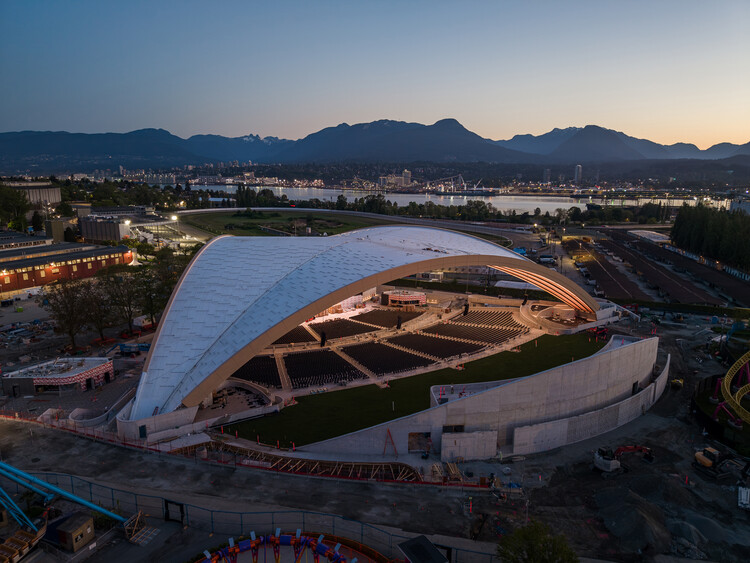

© Ema Peter

Curated by **Susanna Moreira**

[Cultural Architecture](https://www.archdaily.com/search/projects/categories/cultural-architecture), [Public Architecture](https://www.archdaily.com/search/projects/categories/public-architecture)

•

Vancouver, [Canada](https://www.archdaily.com/search/projects/country/canada)

Architects: [Revery Architecture](https://www.archdaily.com/office/revery-architecture?ad_name=project-specs&ad_medium=single)

- Area: [132943](https://www.archdaily.com/search/projects/min_area/106354/max_area/159531?ad_name=project-specs&ad_medium=single) m&sup2;
-  Year: [ 2026 ](https://www.archdaily.com/search/projects/year/2026?ad_name=project-specs&ad_medium=single)

Photographs:[Ema Peter](https://www.archdaily.com/photographer/ema-peter?ad_name=project-specs&ad_medium=single)

Manufacturers: Cascadia, Keith Panel Systems, Nordic Structures, Walters Group

 Lead Architect:  Venelin Kokalov

Category: [Cultural Architecture](https://www.archdaily.com/search/projects/categories/cultural-architecture), [Public Architecture](https://www.archdaily.com/search/projects/categories/public-architecture)

Design Team: Culum Osbourne, Bronson Fung, Lynn Pilon, Kyle Chan, Bibi Fehr, Cody Loeffen, Mark Melnichuk, Kailey O’Farrell, Obinna Ekezie, Nassim Sani, Myles Hardy-Kavanagh, Jennifer Zhang, Marina Rosa, Paulo Queiroz, Alisa Dantseva, Dexter Lu, Leo Wang, Sarah Li, Brenden Louie, Leah Siegel

Engineering & Consulting > Structural: Fast + Epp

General Contractor: EllisDon Corp.

Engineering & Consulting > Mechanical: Introba

Engineering & Consulting > Electrical: AES Engineering

Engineering & Consulting > Civil: Kerr Wood Leidal Associates Ltd.

Landscape Architecture: PFS Studio

Engineering & Consulting > Other: Nordic Structures

Interior Design: Revery Architecture

Engineering & Consulting > Environmental Sustainability: Stantec

Engineering & Consulting > Acoustic: Stages Consulting

Engineering & Consulting > Quantity Surveying: James Bush & Associates

Project Manager: Earle Briggs

City: Vancouver

Country: [Canada](https://www.archdaily.com/search/projects/country/canada)

[Did you collaborate on this project?](https://archdaily.typeform.com/to/ajaa5AIQ#project_url=https://www.archdaily.com/en/1188346)

More SpecsLess Specs

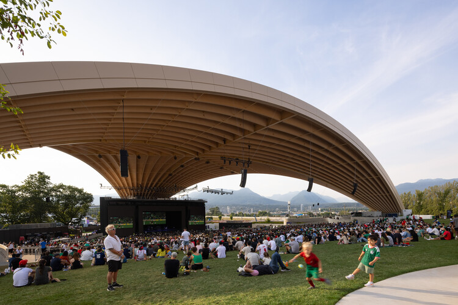

© Ema Peter

*Text description provided by the architects. *Framing views of Vancouver's North Shore Mountains, the Freedom Mobile Arch is an open-air amphitheatre designed to remain connected to its surrounding landscape. A sweeping mass-timber canopy shelters audiences of up to 10,000 while preserving the experience of being outdoors. Permanent infrastructure and adaptable seating allow the venue to accommodate performances and gatherings at a wide range of scales.

## 图片集

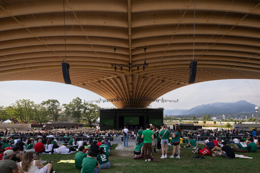

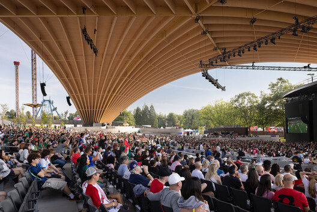

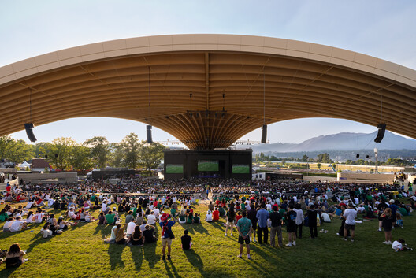

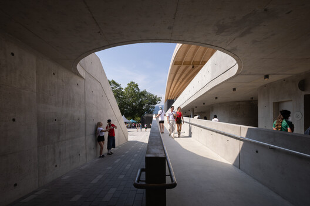

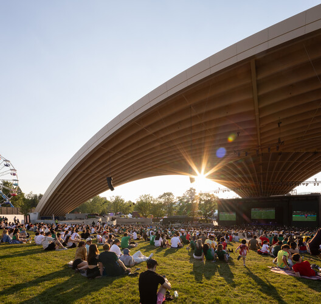

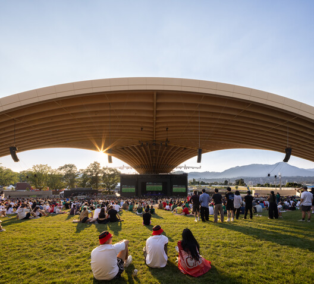

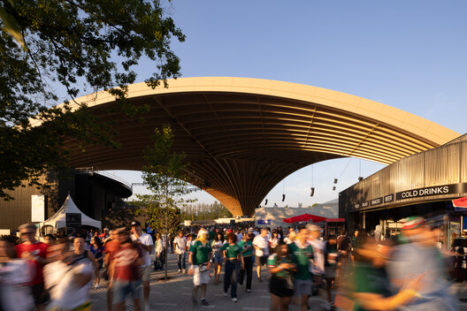

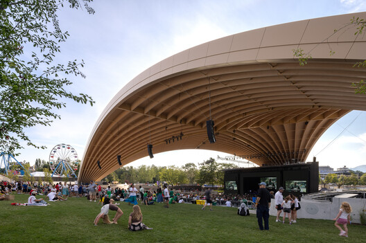

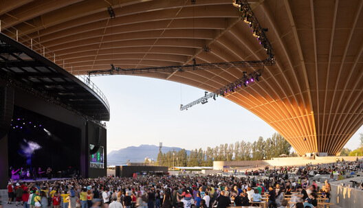

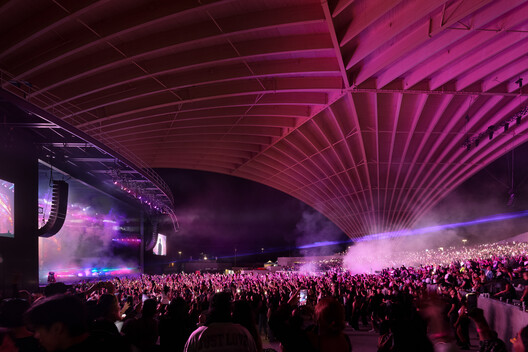

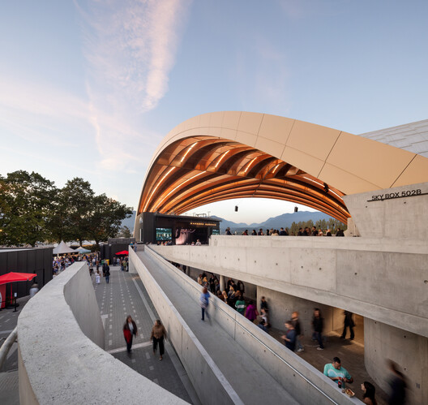

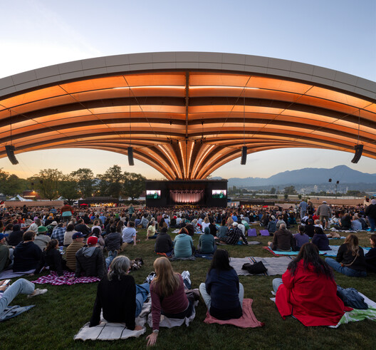

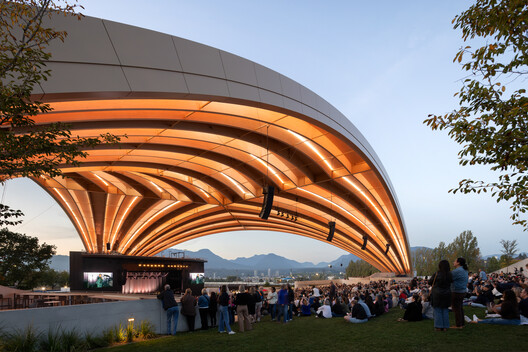

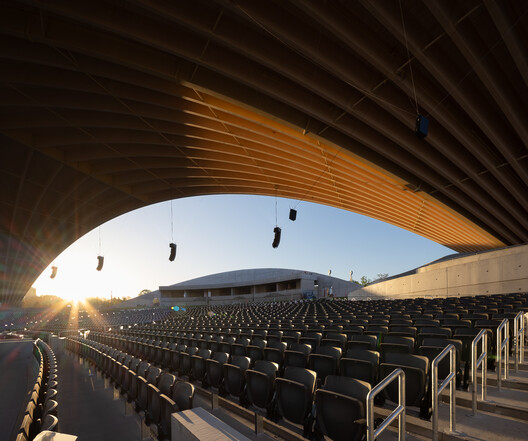

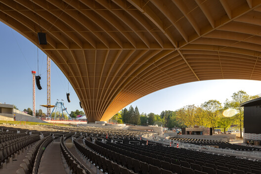

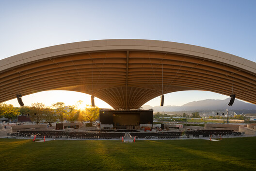

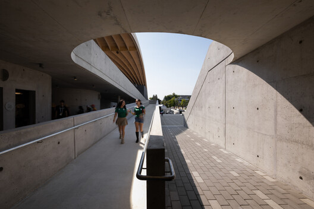

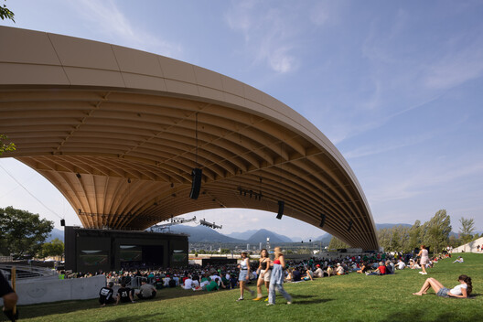

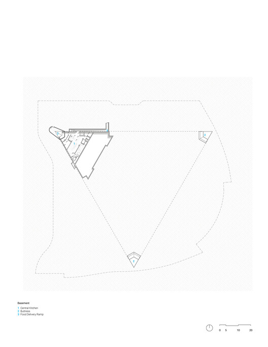

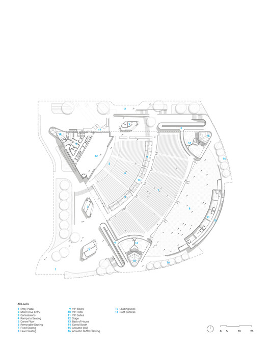

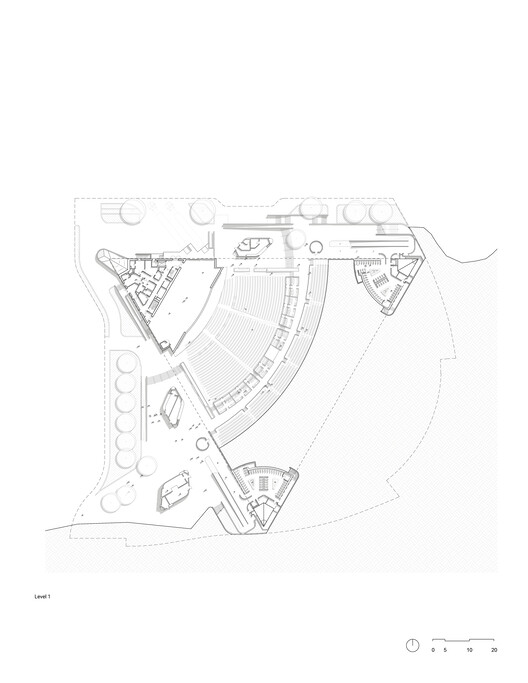

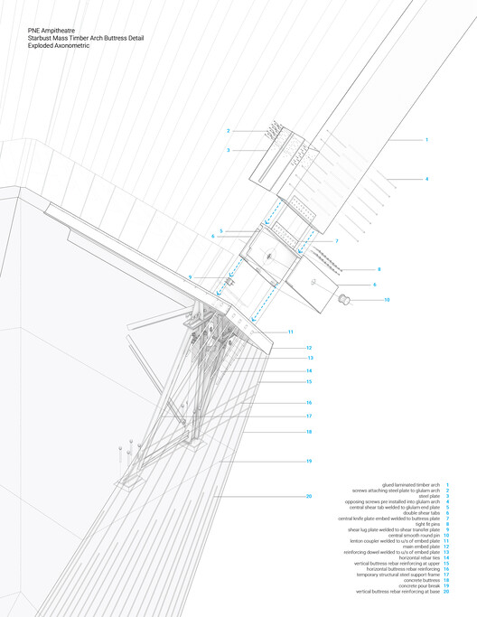

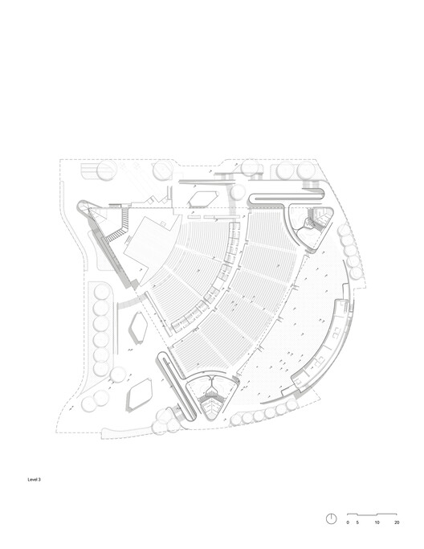

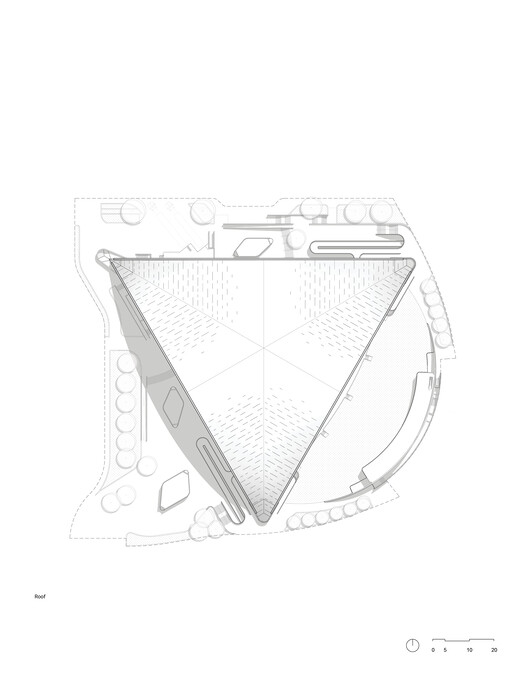

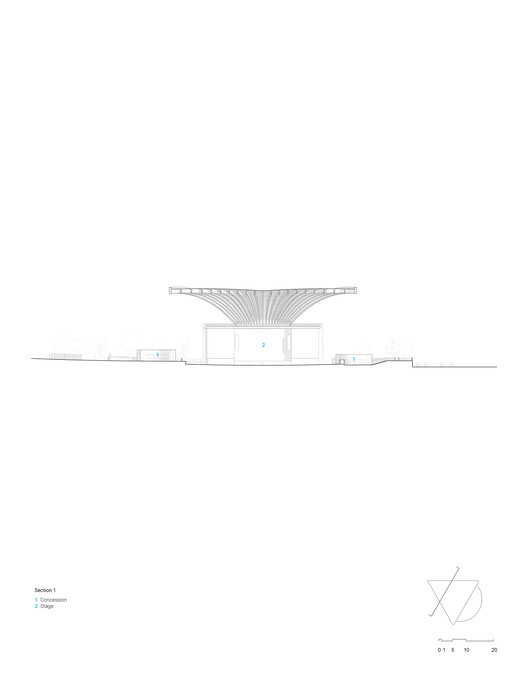

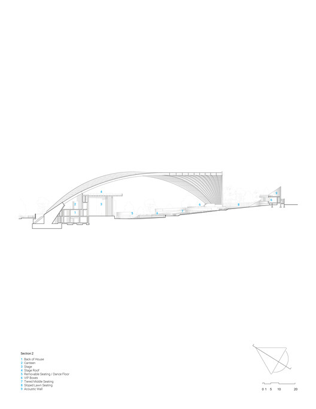

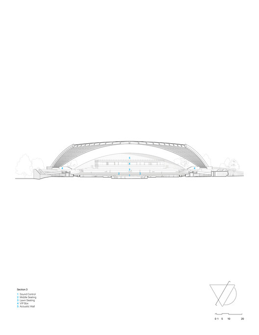

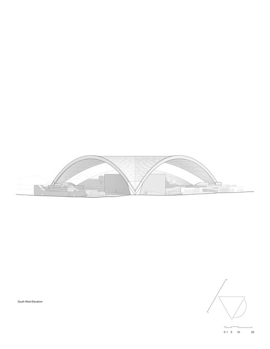

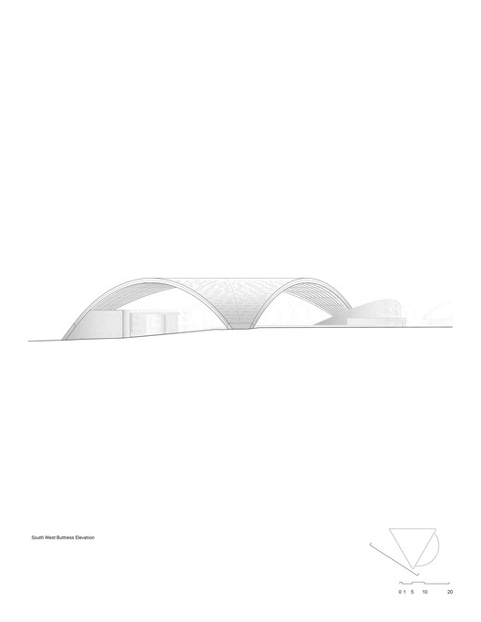

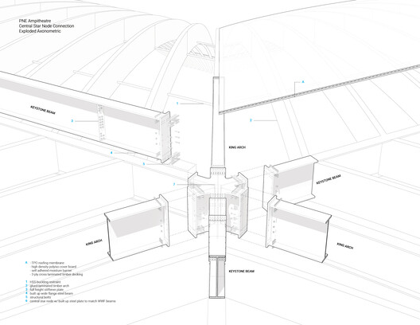

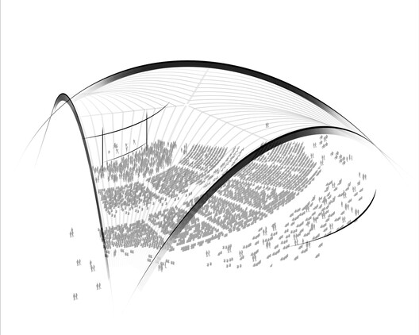

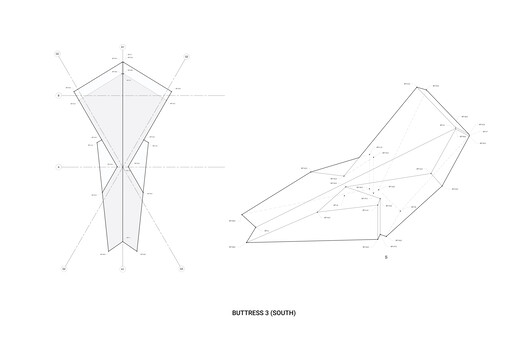

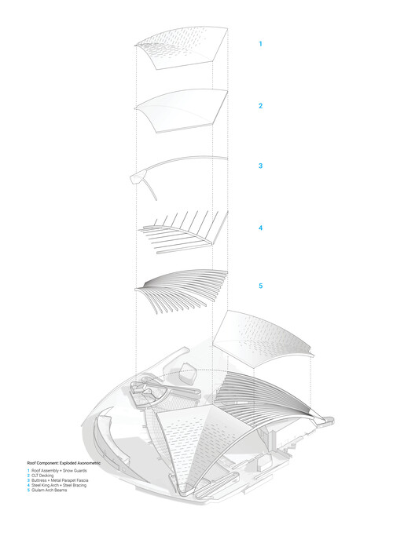
