# Bai’etan, Guangzhou / UTE Agence Ter & Ana Coello de Llobet

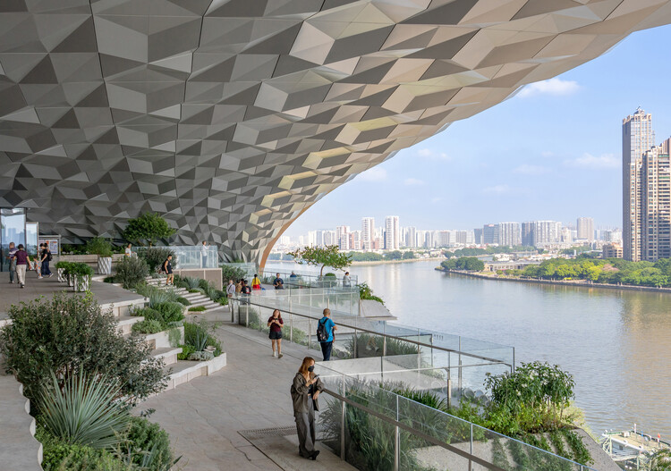

© ©️IAM岸木摄影

Curated by **Nina Vuga**

[Public Space](https://www.archdaily.com/search/projects/categories/public-space), [Installations & Structures](https://www.archdaily.com/search/projects/categories/installations-and-structures), [Landscape Architecture](https://www.archdaily.com/search/projects/categories/landscape-architecture)

•

Guangzhou, [China](https://www.archdaily.com/search/projects/country/china)

Architects: [UTE Agence Ter & Ana Coello de Llobet](https://www.archdaily.com/office/ute-agence-ter-ana-coello-de-llobet?ad_name=project-specs&ad_medium=single)

- Area: [100000](https://www.archdaily.com/search/projects/min_area/80000/max_area/120000?ad_name=project-specs&ad_medium=single) m&sup2;
-  Year: [ 2026 ](https://www.archdaily.com/search/projects/year/2026?ad_name=project-specs&ad_medium=single)

Photographs:[©️IAM岸木摄影](https://www.archdaily.com/photographer/c-iaman-mu-she-ying?ad_name=project-specs&ad_medium=single)

 Lead Architects:  Kai DIAO

Category: [Public Space](https://www.archdaily.com/search/projects/categories/public-space), [Installations & Structures](https://www.archdaily.com/search/projects/categories/installations-and-structures), [Landscape Architecture](https://www.archdaily.com/search/projects/categories/landscape-architecture)

Design Team: Adèle Meidine, Jiaxin Li, Abderrahmane Nachda, Yifan Huang, Xueyan Liu, Yirong Ma, Siyuan Wang, Wencan Fu, Nguyễn Gia Khoa, Julie Ducros, Ali Hamze, Lucas Huvet, Ziyun Zhou, Zhuoran Chen, Huimin Yang, Na Zhang, Hao Yu

General Contractor: China Resources Land

Urban Planning: Urbanus!

Engineering & Consulting > Civil: Pubang Landscape Architecture Co.,Ltd

Engineering & Consulting > Other: EBOND

Engineering & Consulting > Lighting: TS Lighting

Engineering & Consulting > Structural: Arup

City: Guangzhou

Country: [China](https://www.archdaily.com/search/projects/country/china)

More SpecsLess Specs

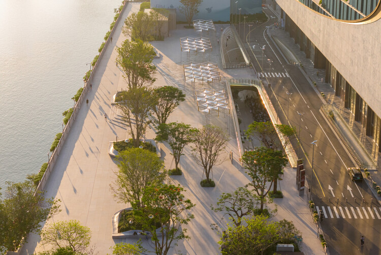

© ©️IAM岸木摄影

*Text description provided by the architects. *Through a continuous, multilevel public landscape, Bai'etan reconnects historic neighborhoods, urban life, and the Pearl River, creating value through new relationships between existing conditions and everyday use.

## 图片集

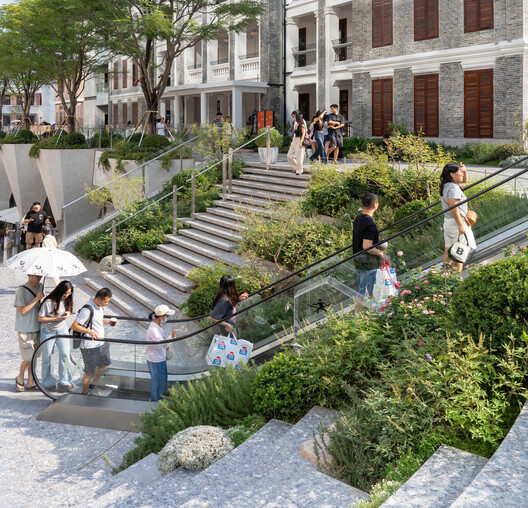

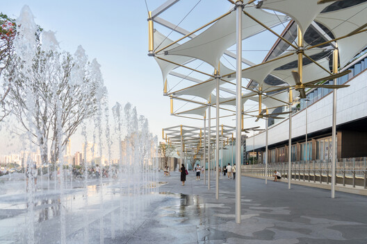

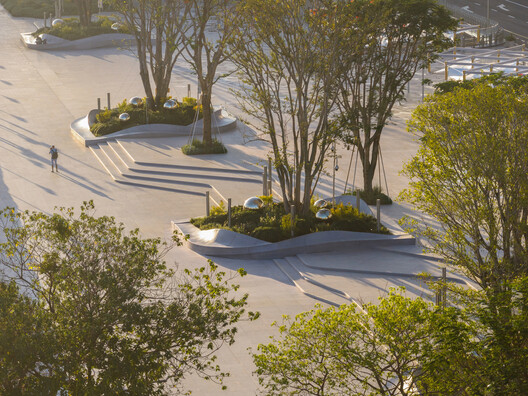

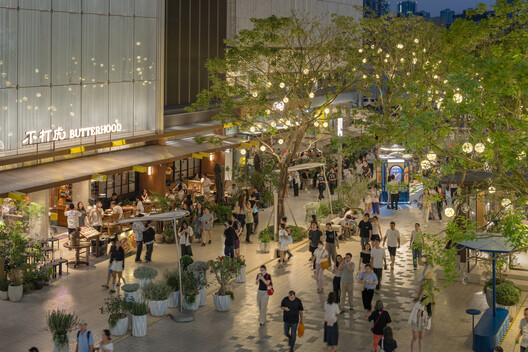

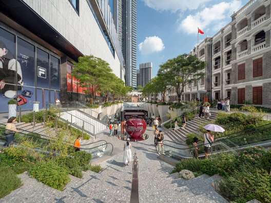

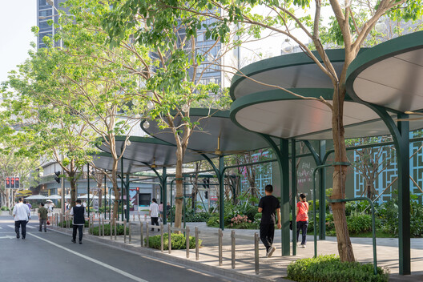

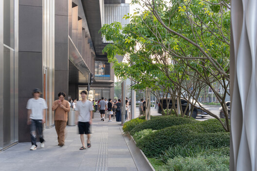

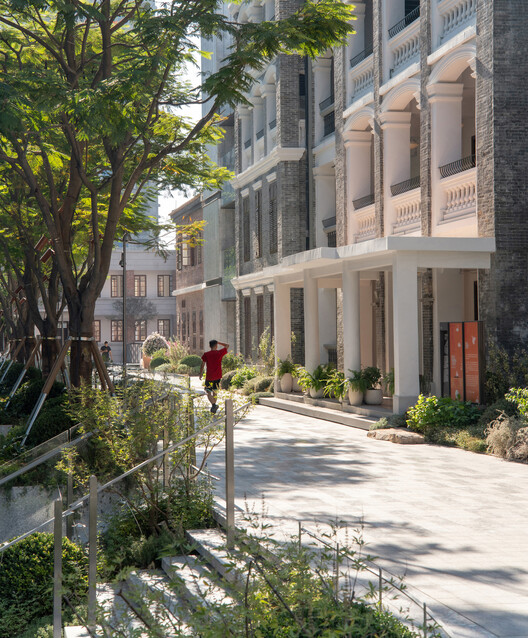

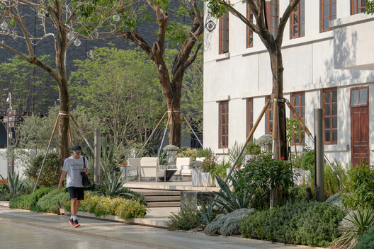

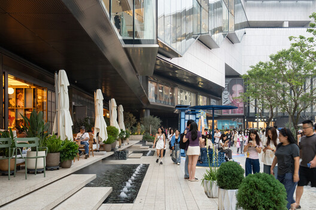

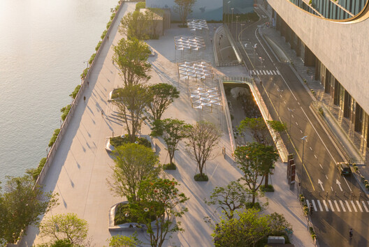

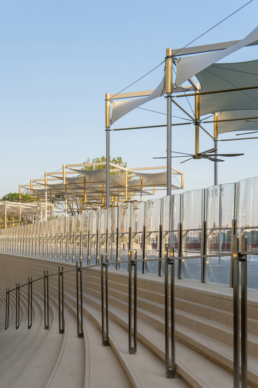

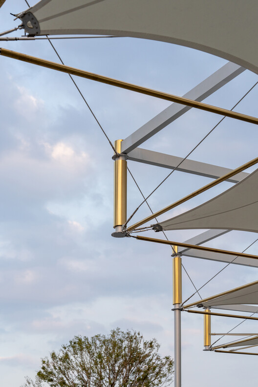

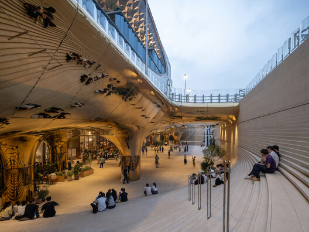

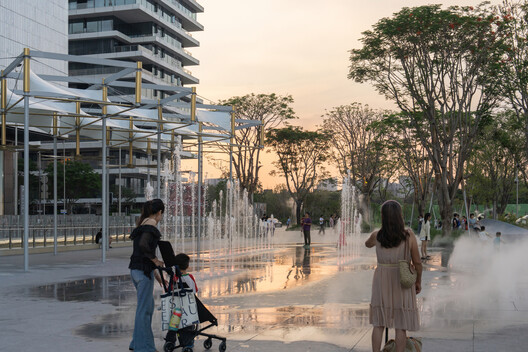

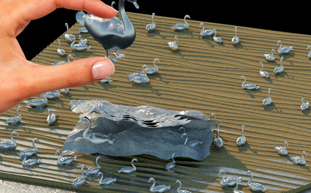

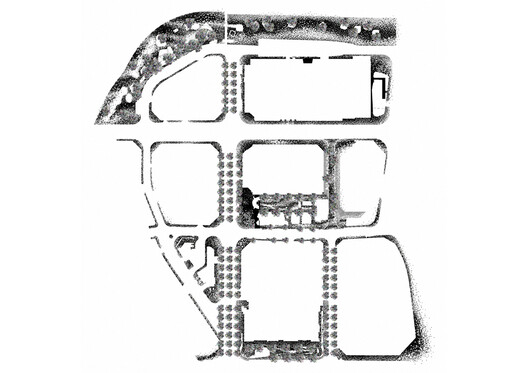

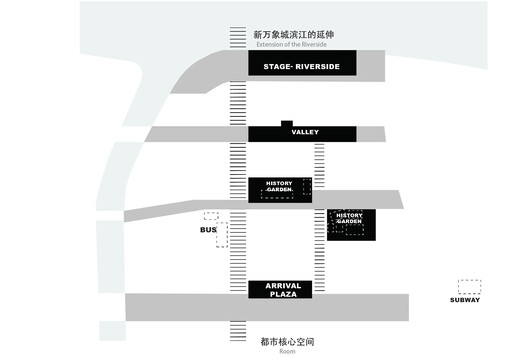

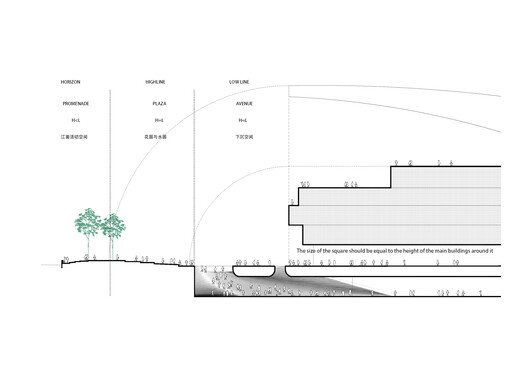

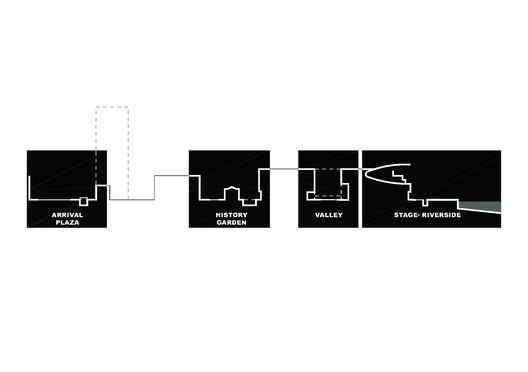

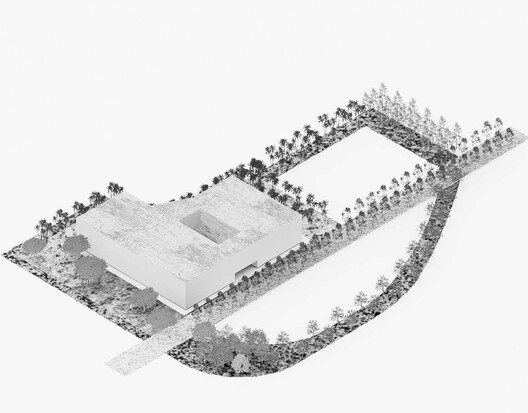

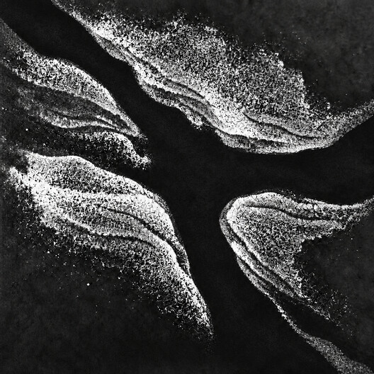

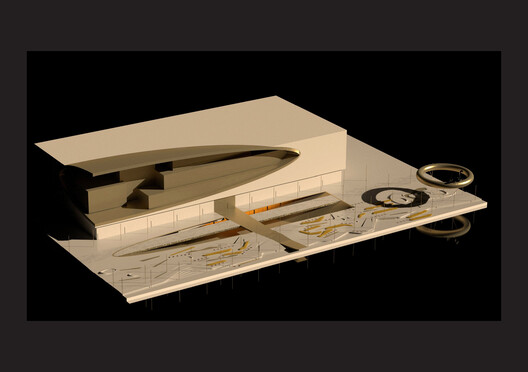

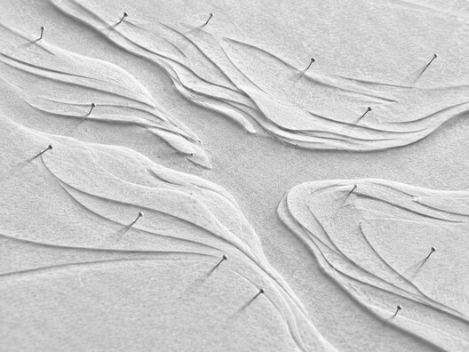
