# Sharjah City Guide: 18 Contemporary and Historical Attractions to Discover in UAE's Cultural Hub

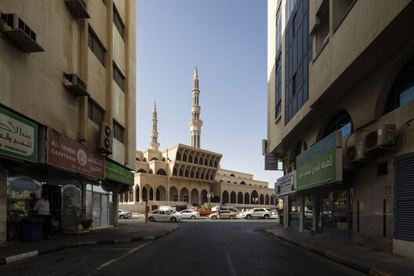

© leva Saudargaite | King Faisal Mosque, Office of Texhnical and Architecture Engineering

[Sharjah](https://www.archdaily.com/tag/sharjah), the captivating territory in the [United Arab Emirates](https://www.archdaily.com/country/united-arab-emirates), is a cultural hub that blends tradition with contemporary modernity. Situated on the Arabian coastline, the city is known for its commitment to preserving its rich history, promoting the arts and culture, and providing a platform for creative and intellectual pursuits. In fact, the [2023 Sharjah Architecture Triennial](https://www.archdaily.com/tag/2023-sharjah-architecture-triennial) (SAT) will take place from November 11, 2023, to March 10, 2024, under the theme "[The Beauty of Impermanence: An Architecture of Adaptability](https://www.archdaily.com/985057/the-beauty-of-impermanence-announced-as-2023-sharjah-architecture-triennial-theme?ad_campaign=normal-tag)." [The Triennial ](https://www.archdaily.com/1003249/exploring-scarcity-in-global-south-sharjah-architecture-triennial-2023-announces-full-list-of-participants?ad_campaign=normal-tag)is curated by [Tosin Oshinowo](https://www.archdaily.com/tag/tosin-oshinowo), exploring innovative design solutions emerging from conditions of scarcity in the Global South.

With a deep-rooted connection to its cultural heritage, the emirate is home to an array of museums that showcase a journey through multiple timelines, from Islamic civilization to traditional lifestyles. Now a hotspot for emerging designers, the city has taken a leading role as a patron of fine arts. In the contemporary city, attractions are designed by many architects, from [Foster + Partners](https://www.archdaily.com/office/foster-plus-partners), [Zaha Hadid Architects](https://www.archdaily.com/office/zaha-hadid-architects), [51-1 Arquitectos](https://www.archdaily.com/office/51-1-arquitectos), to [Hopkins Architects.](https://www.archdaily.com/office/hopkins-architects?ad_name=project-specs&ad_medium=single) In addition to this emerging cultural scene, old [Sharjah](/tag/sharjah) is a valuable embodiment of historical tradition, having been transformed into useable attractions and art facilities. The old Sharjah also flaunts landmarks such as the modernist King Faisal Mosque, the Museum of Islamic Civilization, and the Sharjah Art Museum.

## 图片集

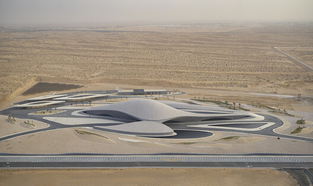

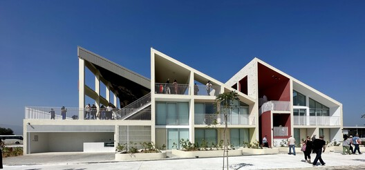

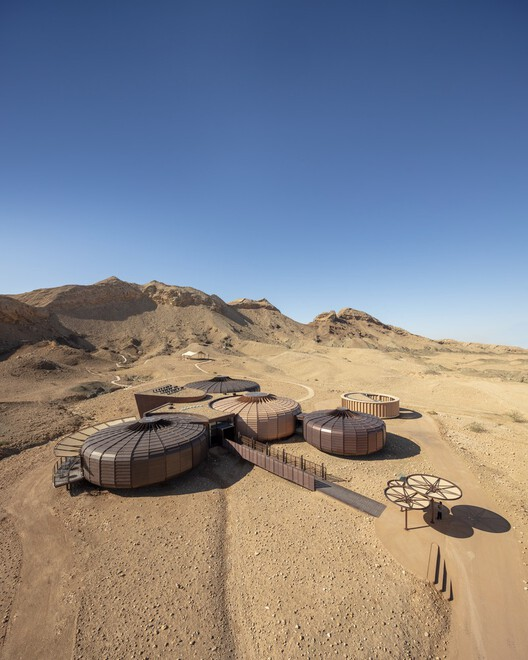

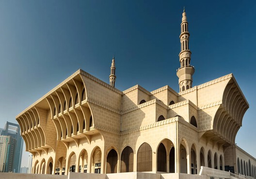

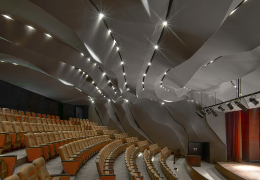

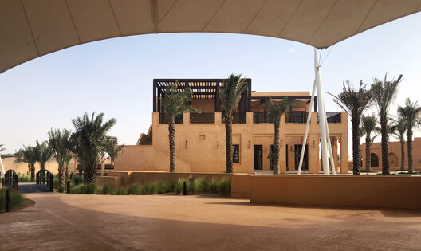

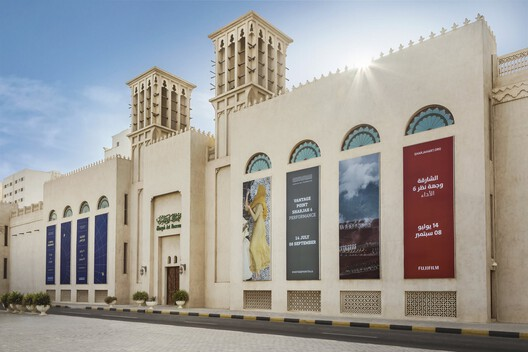

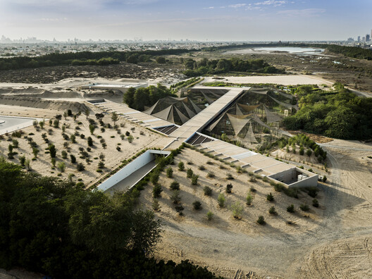

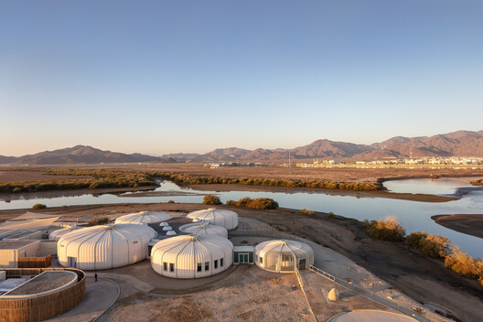

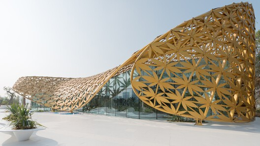

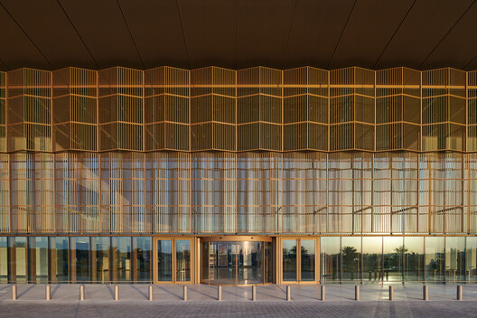

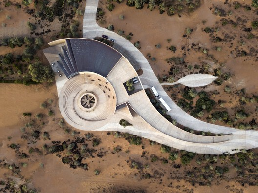

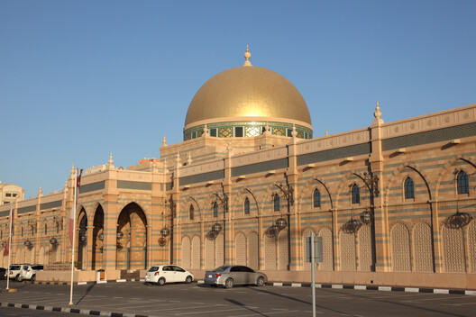

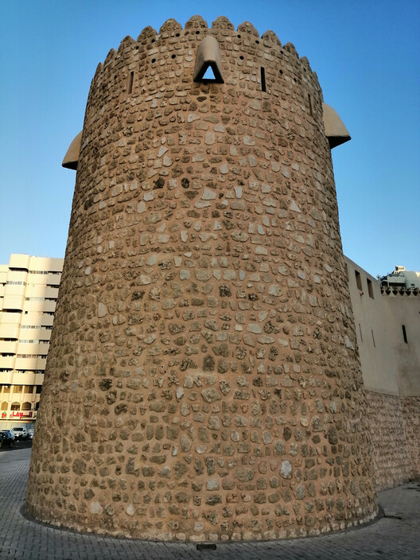

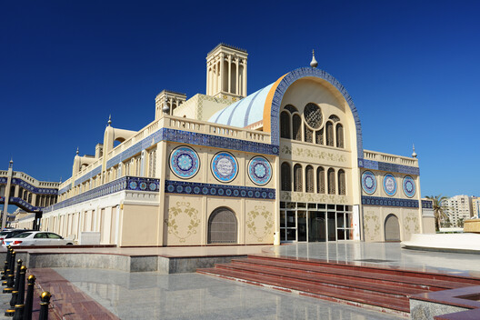

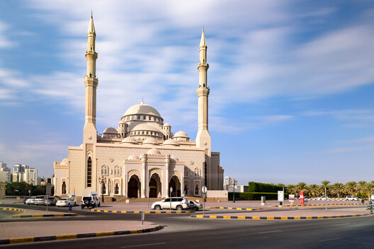

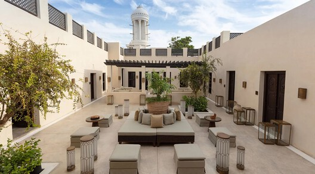

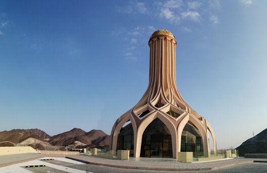
