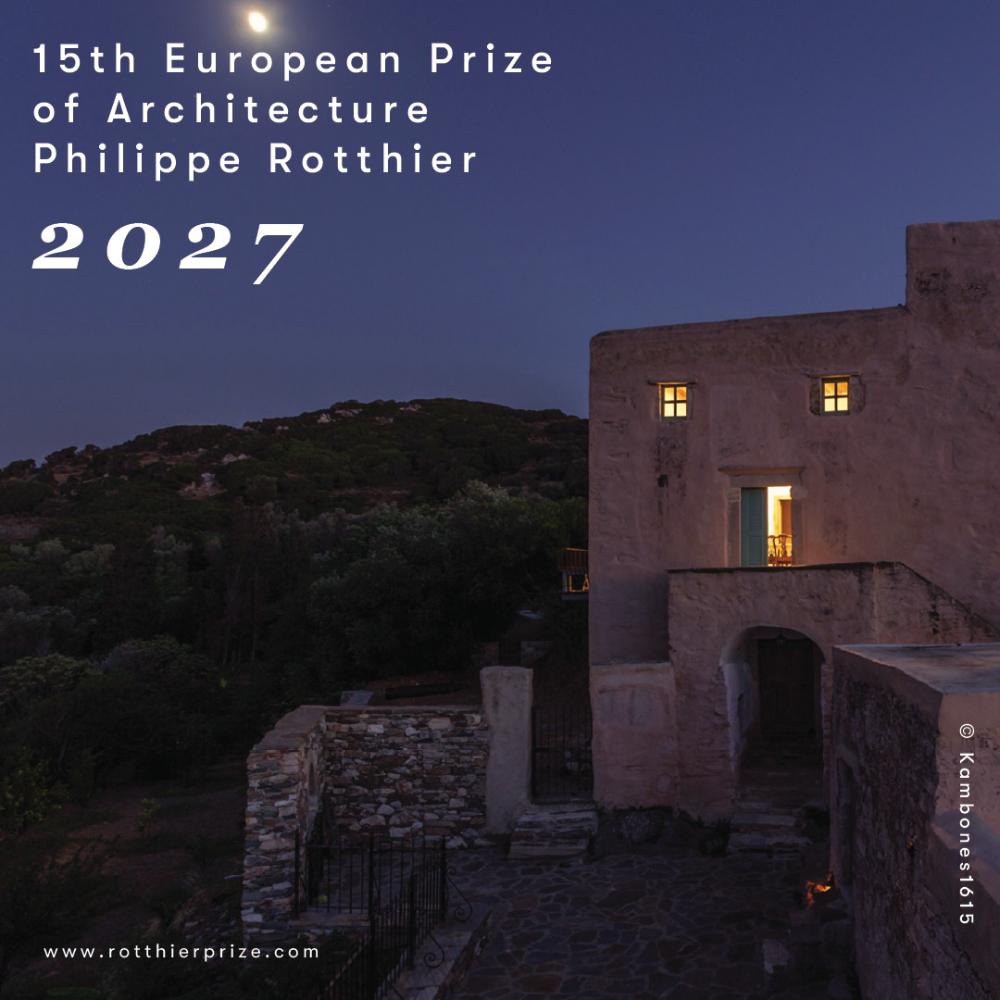

# 15th European Prize of Architecture Philippe Rotthier

In 2027 Foundation Philippe Rotthier continues rewarding (vernacular) architecture of collective and cultural value, rooted in its region, using natural materials in a durable way.

The 15th European Prize of Architecture Philippe Rotthier rewards recent architectural achievements, located within urban or rural contexts. The 15th edition of the prize acknowledges the architecture rooted in its context, attentive to history and local know-how, innovative towards the use of resources, aware towards the ecological and social challenges of its context. The prize is endowed with €50,000 and the selected projects will be exhibited in Brussels in 2027.

This Triennial Prize created in 1980, is dedicated to the preservation and promotion of the European urban culture, with particular attention to heritage, regional context and the use of natural, sustainable materials and construction techniques.

## 图片集

