# Edicola 518 / Giuseppe Arezzi

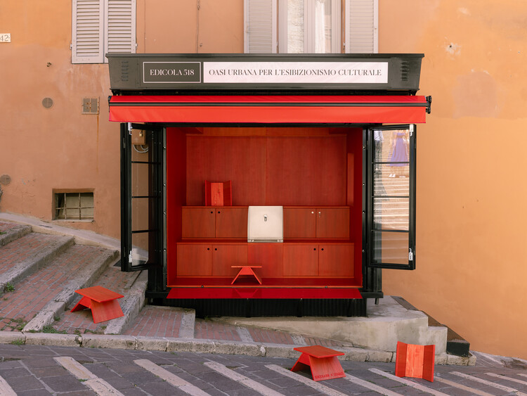

© Giovanni Emilio Galanello

Curated by **Nina Vuga**

[Urbanism](https://www.archdaily.com/search/projects/categories/urbanism), [Small Scale](https://www.archdaily.com/search/projects/categories/small-scale)

•

Perugia, [Italy](https://www.archdaily.com/search/projects/country/italy)

Architects: [Giuseppe Arezzi](https://www.archdaily.com/office/giuseppe-arezzi?ad_name=project-specs&ad_medium=single)

- Area: [10](https://www.archdaily.com/search/projects/min_area/8/max_area/12?ad_name=project-specs&ad_medium=single) m&sup2;
-  Year: [ 2026 ](https://www.archdaily.com/search/projects/year/2026?ad_name=project-specs&ad_medium=single)

Photographs:[Giovanni Emilio Galanello](https://www.archdaily.com/photographer/giovanni-emilio-galanello?ad_name=project-specs&ad_medium=single)

 Lead Architects:  Giuseppe Arezzi

Category: [Urbanism](https://www.archdaily.com/search/projects/categories/urbanism), [Small Scale](https://www.archdaily.com/search/projects/categories/small-scale)

Lead Team: Giuseppe Arezzi

Design Team: Matteo Pettorali

Engineering & Consulting > Other: Listone Giordano

Technical Partner: Seed Festival, Umbra Acque

City: Perugia

Country: [Italy](https://www.archdaily.com/search/projects/country/italy)

More SpecsLess Specs

© Giovanni Emilio Galanello

*Text description provided by the architects. *The project for Edicola 518 redefines the kiosk for independent magazines and books along the historic staircase of Sant'Ercolano in [Perugia](/tag/perugia), transforming it into an "Urban oasis for cultural exhibitionism" and a device for social activation.

## 图片集

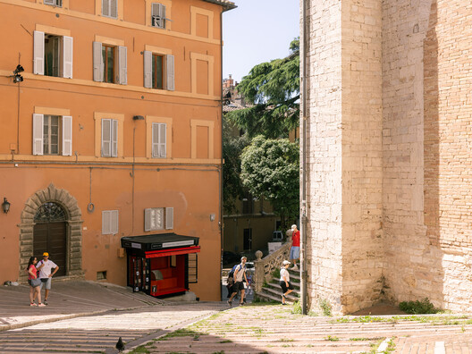

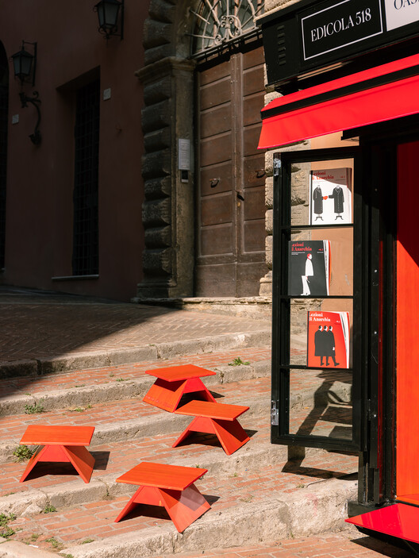

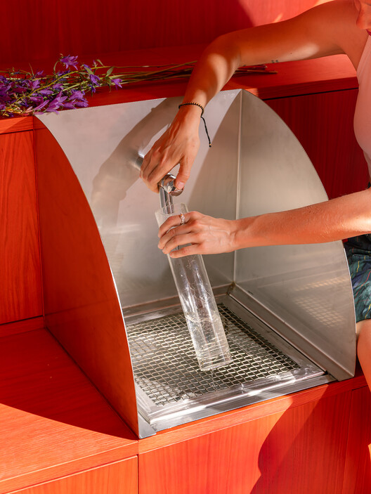

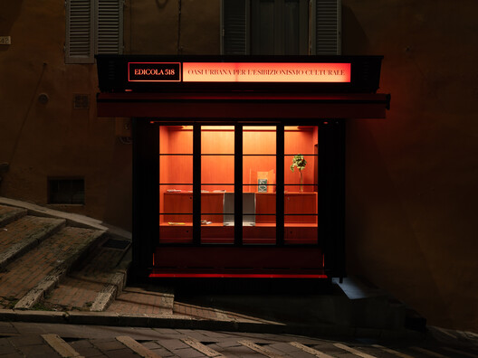

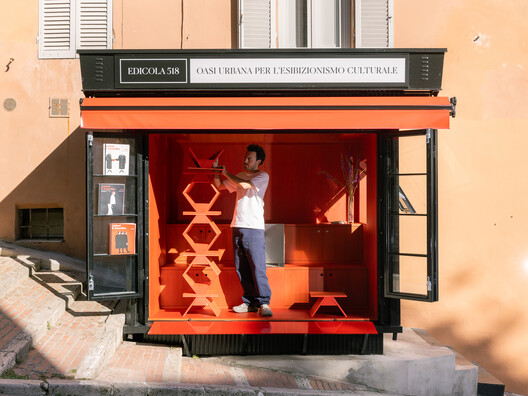

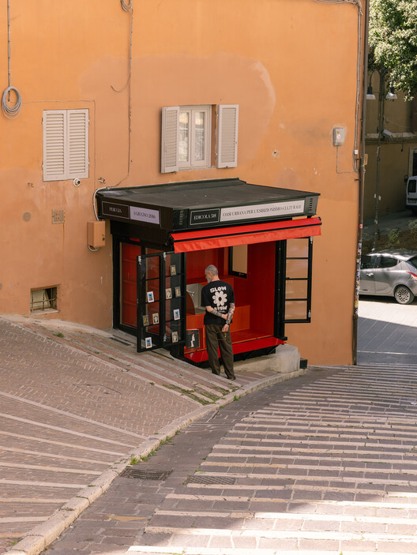

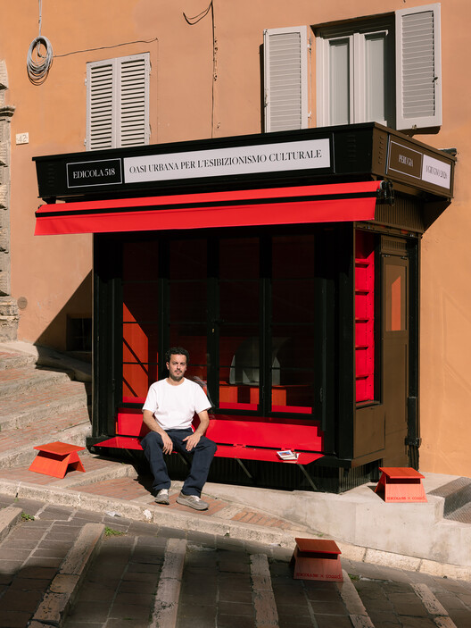

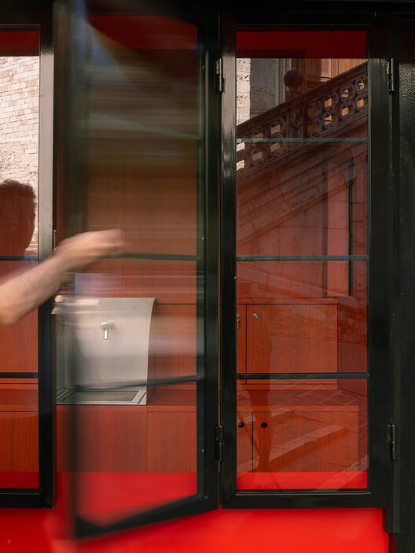

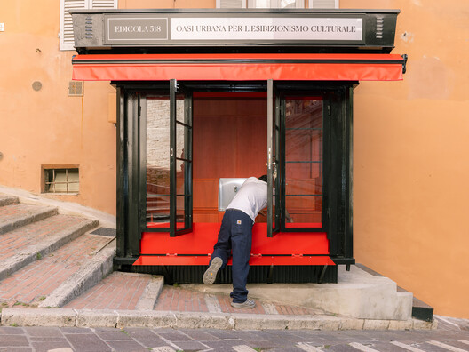

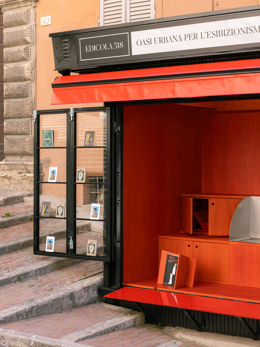

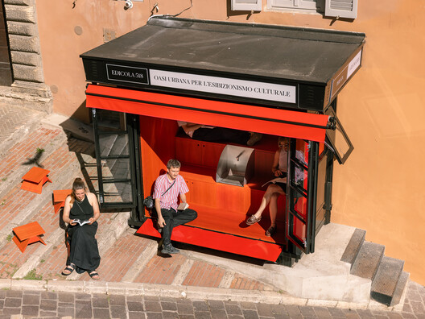

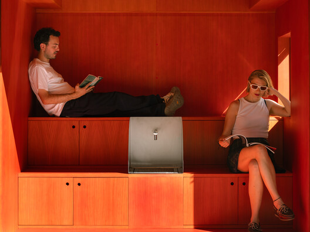

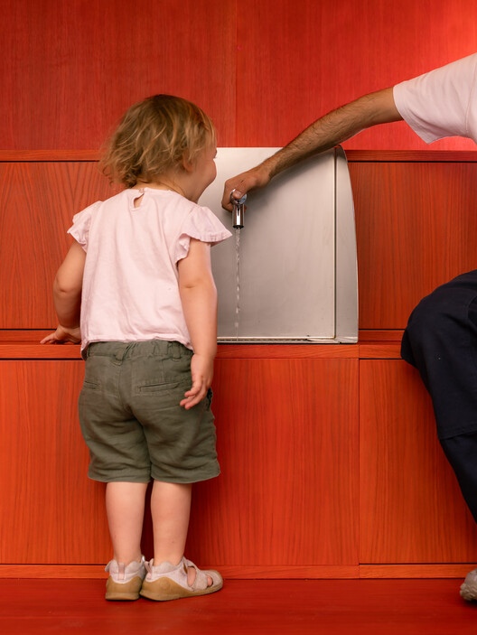

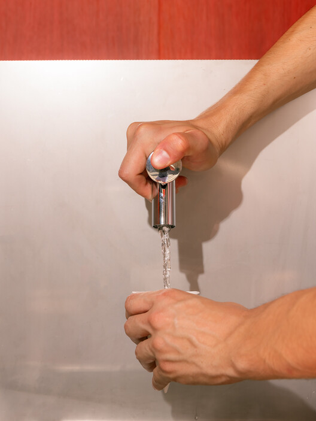

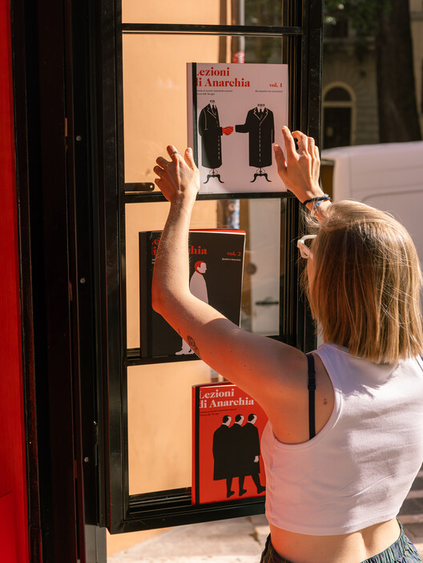

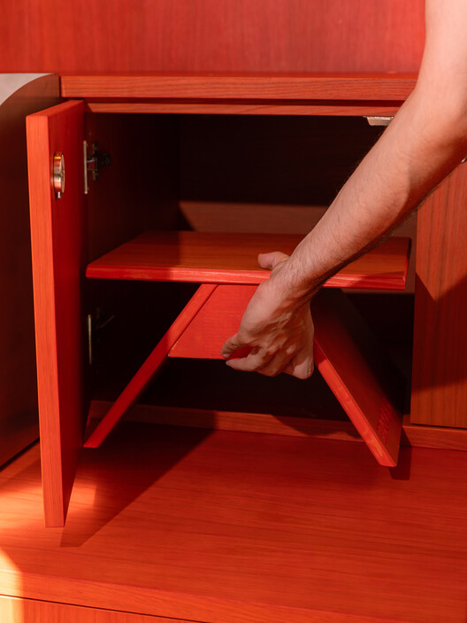

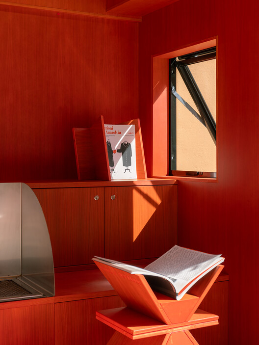

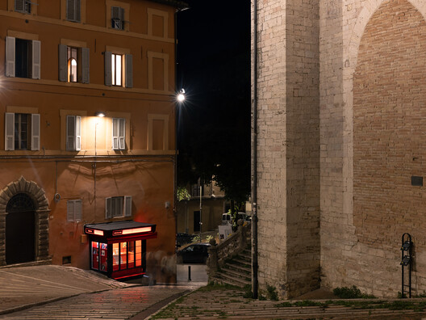

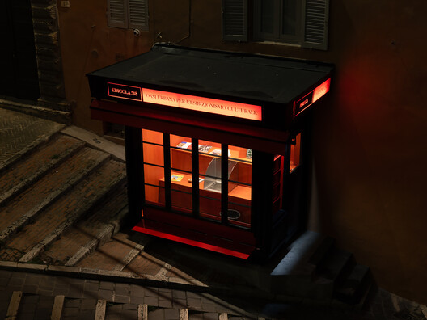

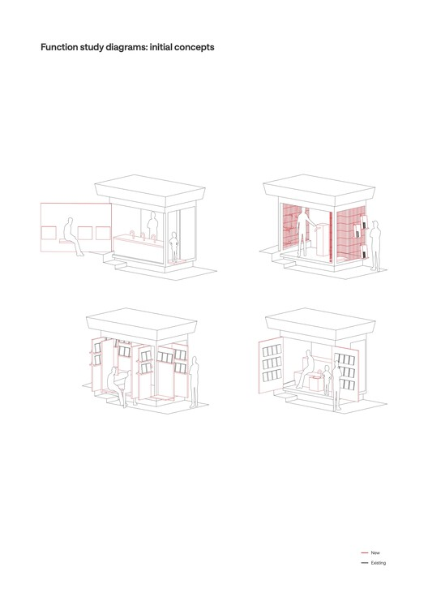
