# Architecture as a Social Practice: Lessons from Ammodo Architecture Days

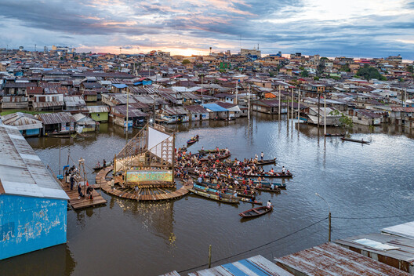

Escenario Flotante Principal de Muyunafest 2025 / Espacio Común . Image © Eleazar Cuadros

What connects[ a cooperative housing development in Barcelona,](https://www.archdaily.com/971631/la-balma-collective-housing-lacol-plus-laboqueria) a [cultural institution hosted in an unfinished concrete structure in Accra](https://www.archdaily.com/1035920/ammodo-architecture-awards-2025-announces-26-recipients-for-socially-and-ecologically-responsible-design?ad_source=search&ad_medium=search_result_articles), and [a floating festival platform in the Peruvian Amazon](https://www.archdaily.com/1032018/muyunafest-2025-main-floating-stage-espacio-comun?ad_source=search&ad_medium=projects_tab)? Despite their unique geographic and social contexts, these projects encourage [an understanding of architecture that extends beyond the construction of buildings](https://www.archdaily.com/1114179/ten-tips-for-those-who-want-to-start-working-in-social-architecture?ad_source=search&ad_medium=search_result_articles). Through collective housing, adaptive reuse, participatory design processes, and community-led initiatives, they demonstrate how [architectural practice creates opportunities for communities to shape their built environments.](https://www.archdaily.com/1184123/latin-america-in-focus-this-month-in-architecture-environmental-design-social-infrastructure-and-practice?ad_source=search&ad_medium=search_result_articles)

[The Ammodo Architecture Days event](https://www.archdaily.com/1035920/ammodo-architecture-awards-2025-announces-26-recipients-for-socially-and-ecologically-responsible-design?ad_source=search&ad_medium=search_result_articles), organized by [Ammodo Architecture](https://www.archdaily.com/tag/ammodo-architecture-award), a programme of the [Ammodo Foundation](https://www.ammodo.org/?utm_medium=website&utm_source=archdaily.com), focuses on these questions of care and community in the built environment. The inaugural two-day symposium [brought together practitioners working in remarkably different geographic, social, and environmental contexts](https://www.archdaily.com/1035920/ammodo-architecture-awards-2025-announces-26-recipients-for-socially-and-ecologically-responsible-design?ad_source=search&ad_medium=search_result_articles) who are invested in implementing positive change for their communities. Hosted in [Amsterdam](https://www.archdaily.com/tag/amsterdam), the programme combined an award ceremony, symposium, exhibition, and publication launch, creating [multiple platforms for exchange around socially and ecologically responsible architectural practices](https://www.archdaily.com/1186296/ammodo-architecture-announces-first-edition-of-architecture-days-in-amsterdam?ad_source=search&ad_medium=search_result_articles). The event celebrated the recipients of the 2024 and 2025 [Ammodo Architecture Awards](https://www.archdaily.com/1184123/latin-america-in-focus-this-month-in-architecture-environmental-design-social-infrastructure-and-practice?ad_source=search&ad_medium=search_result_articles), recognizing 49 projects that explore alternative approaches to architectural design, collaboration, and community engagement.

## 图片集

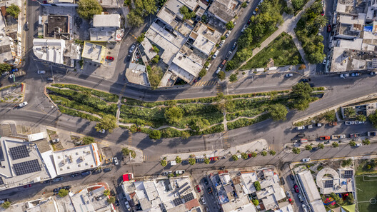

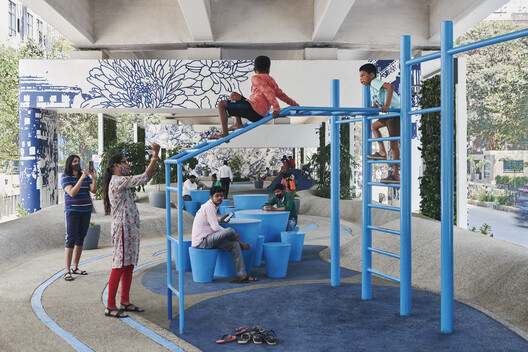

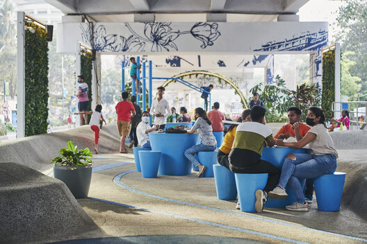

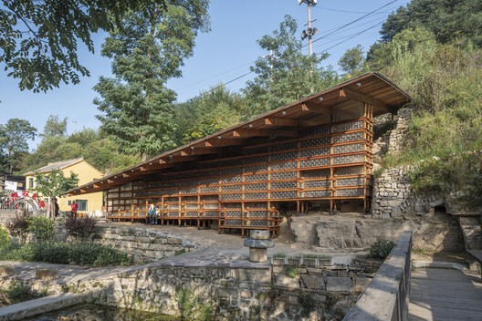

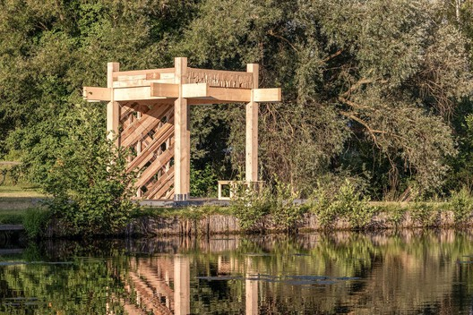

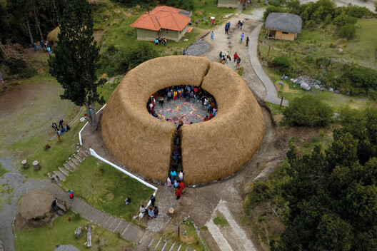

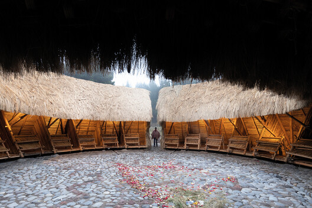

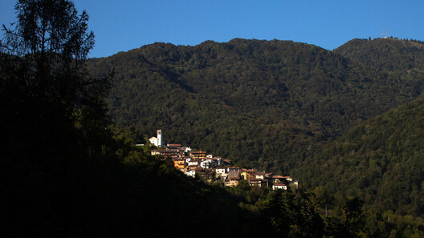

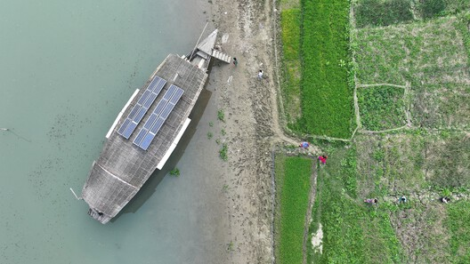

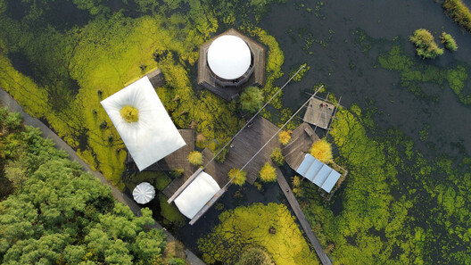

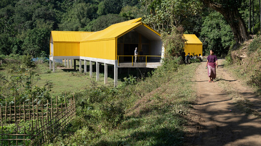

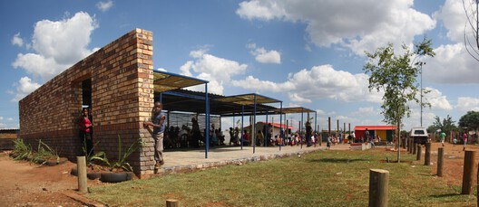

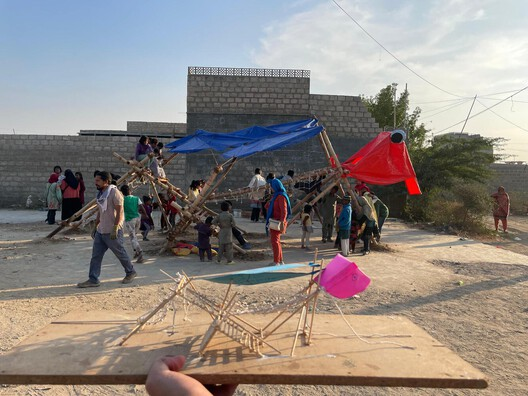

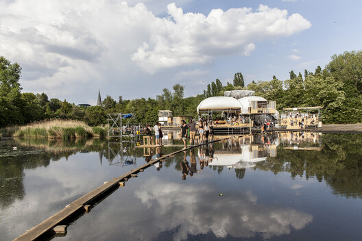

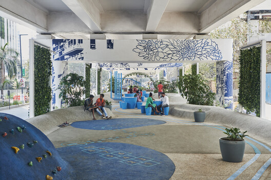

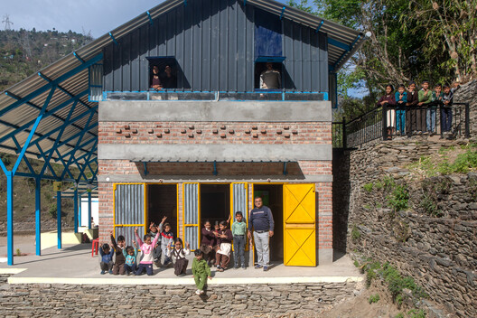

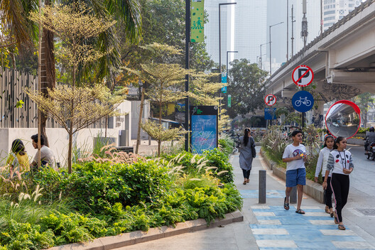

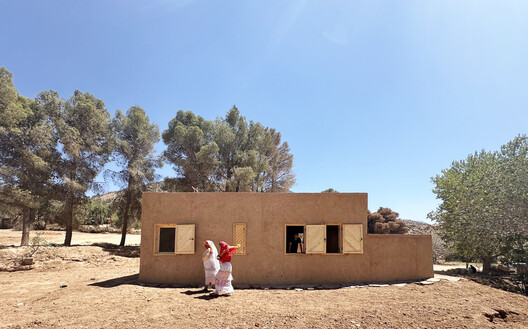

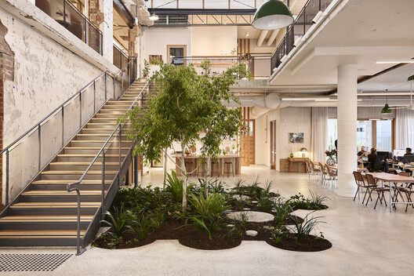

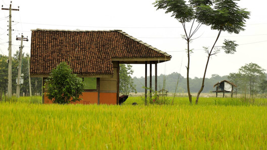

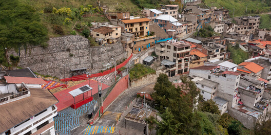

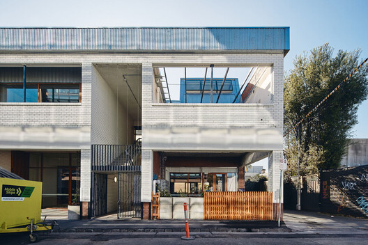

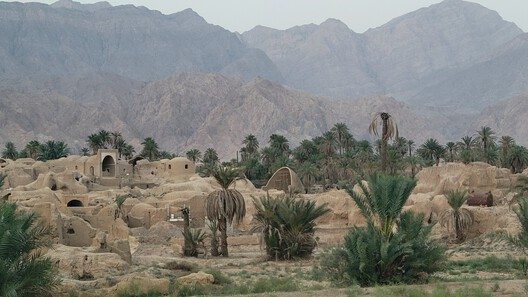

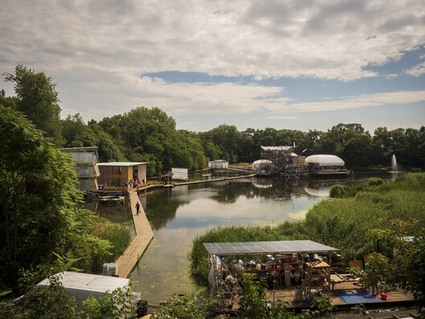

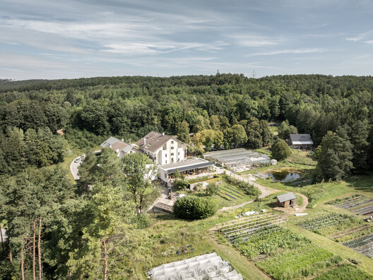

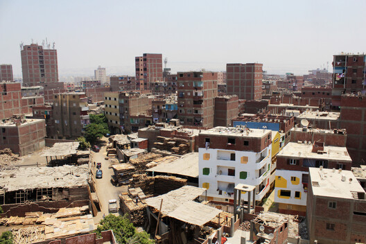

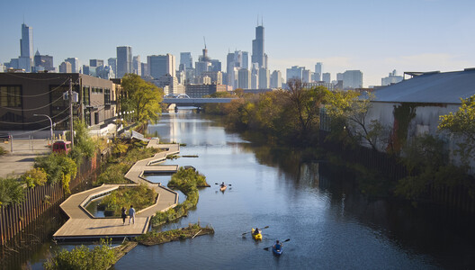

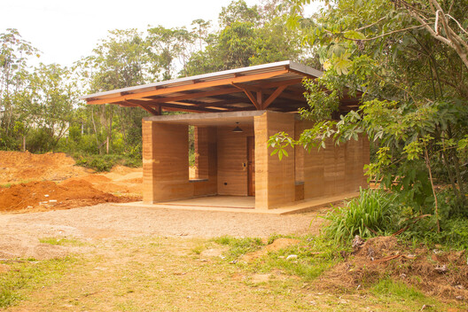

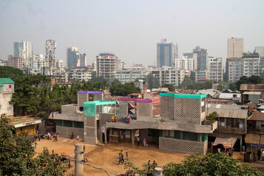

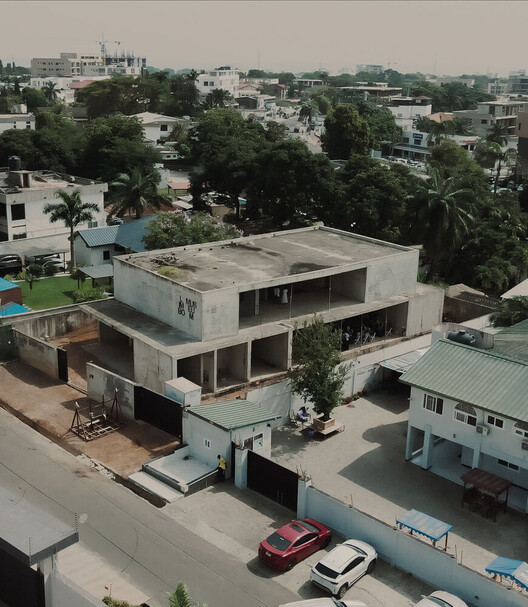

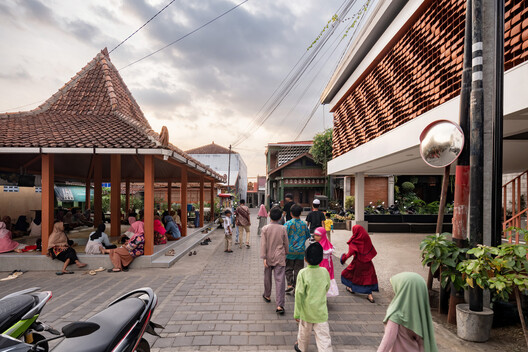

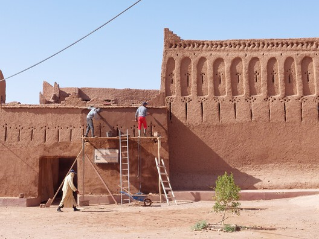

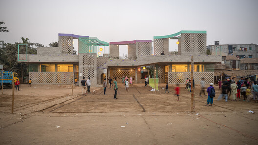

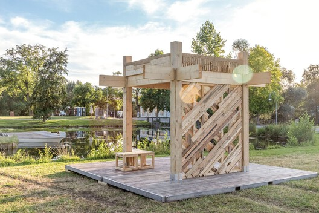

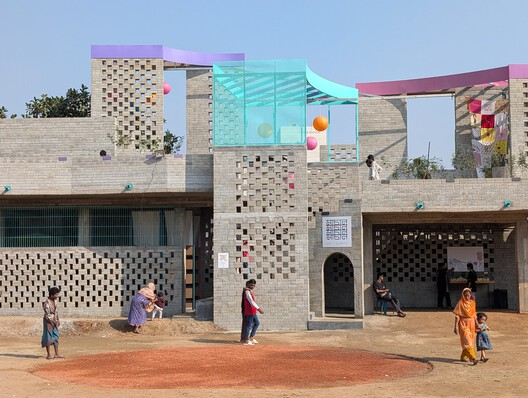

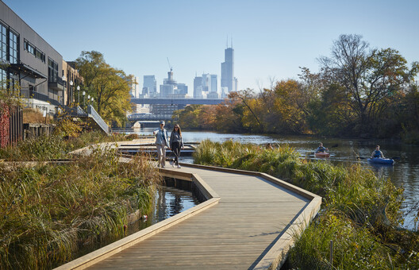

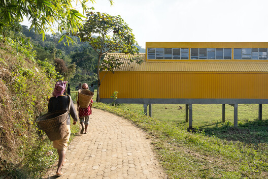

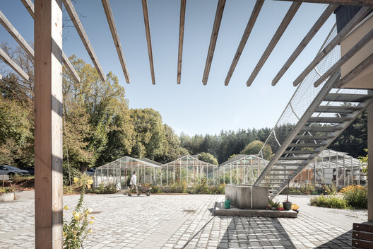

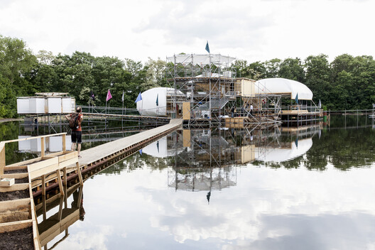

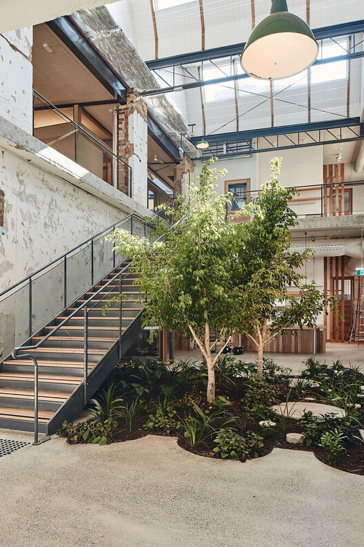

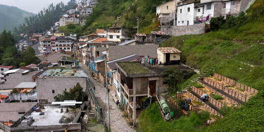

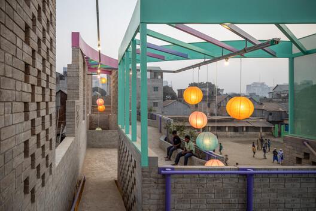

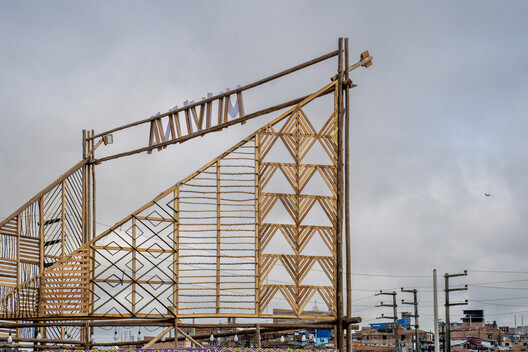

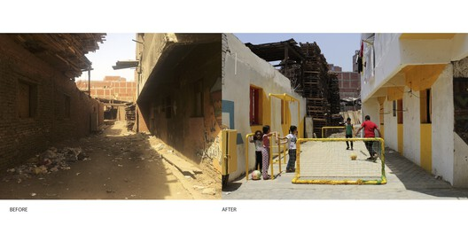

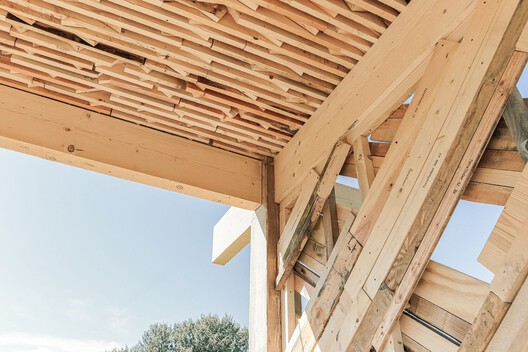

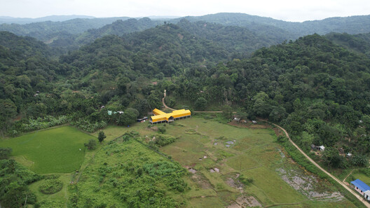

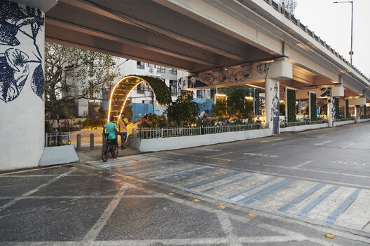

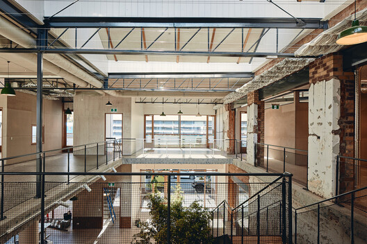

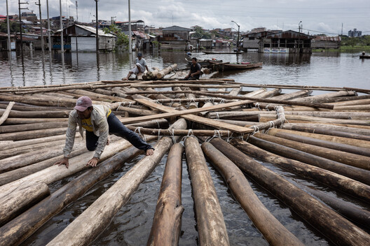

