# The Work of Keeping a Public Building Public: The Drill Hall in Johannesburg

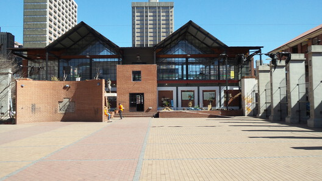

Courtesy of Michael Hart Architects

What happens to a building after the architecture is finished? For buildings intended to serve the public, their continued life depends on more than the physical conditions of their construction. It involves the activities that take place within them, the relationships they allow to develop, the people [who occupy and shape them](https://www.archdaily.com/1037479/who-owns-public-space-three-active-models-of-shared-management-shaping-urban-commons-in-europe-and-new-york), and the institutional structures responsible for their upkeep. Yet these conditions are not always secured through the act of building itself. They are continually negotiated, often through forms of work that remain outside the conventional understanding of architectural practice.

The Drill Hall in central [Johannesburg](/tag/johannesburg) offers a way of examining this unfinished work. Its history is marked by changes in use, occupation and institutional responsibility, but also by repeated attempts to imagine what the building could offer the city.

## 图片集

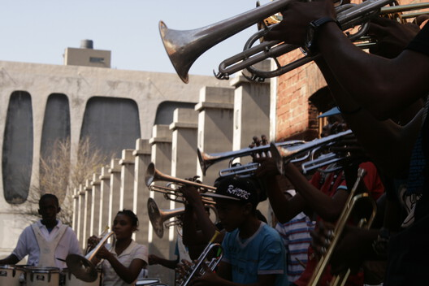

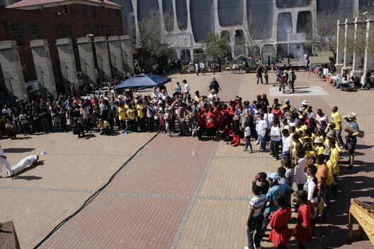

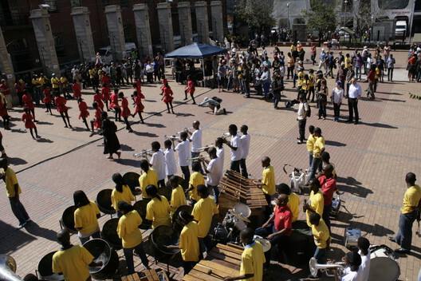

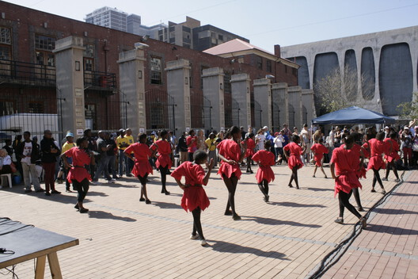

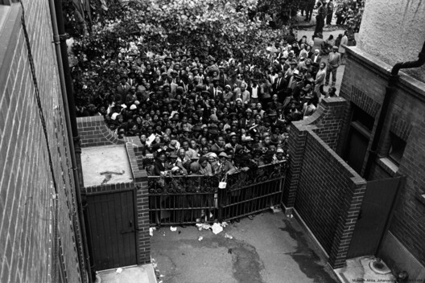

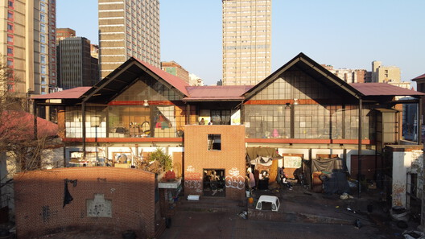

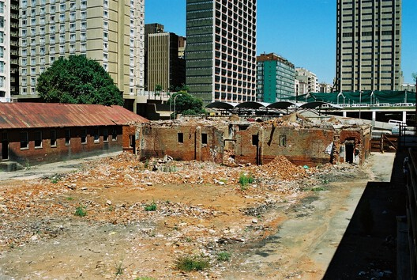

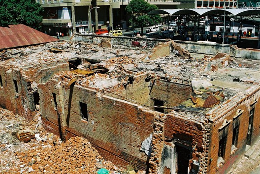

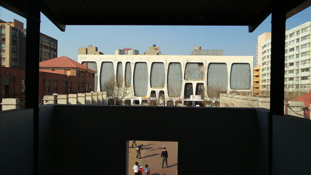

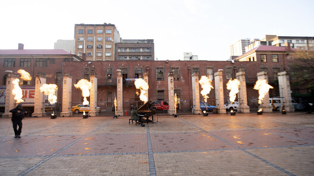

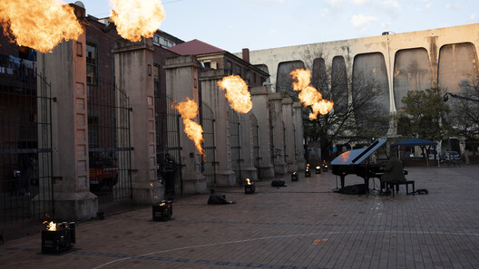
