# Pod for Happiness / Craft Narrative

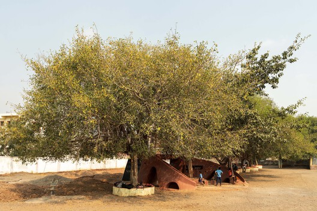

© Studio f/8

Curated by **Miwa Negoro**

[Installations & Structures](https://www.archdaily.com/search/projects/categories/installations-and-structures)

•

Baramati, [India](https://www.archdaily.com/search/projects/country/india)

Architects: [Craft Narrative](https://www.archdaily.com/office/craft-narrative?ad_name=project-specs&ad_medium=single)

- Area: [15](https://www.archdaily.com/search/projects/min_area/12/max_area/18?ad_name=project-specs&ad_medium=single) m&sup2;
-  Year: [ 2024 ](https://www.archdaily.com/search/projects/year/2024?ad_name=project-specs&ad_medium=single)

Photographs:[Studio f/8](https://www.archdaily.com/photographer/studio-f-8?ad_name=project-specs&ad_medium=single)

Category: [Installations & Structures](https://www.archdaily.com/search/projects/categories/installations-and-structures)

Lead Archiitects: Vijay Kharade, Yatindra Patil

Design Team: Bharat Yadav, Manasi

Structural Consultant: Sonal N

City: Baramati

Country: [India](https://www.archdaily.com/search/projects/country/india)

[Did you collaborate on this project?](https://archdaily.typeform.com/to/ajaa5AIQ#project_url=https://www.archdaily.com/en/1188502)

More SpecsLess Specs

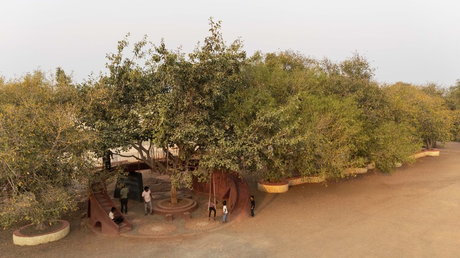

© Studio f/8

*Text description provided by the architects. *In the small village of Hignigada near [Baramati](/tag/baramati), Maharashtra, a young village head approached us to build an outdoor play area for school children. The school campus had a large playground divided by an avenue of seven trees, with classrooms arranged along the perimeter. Villagers fondly shared how they enjoyed evening walks and sitting under the trees. Inspired by this connection to nature & community space, we designed the play area around the banyan tree, making it the centerpiece of the insert.

## 图片集

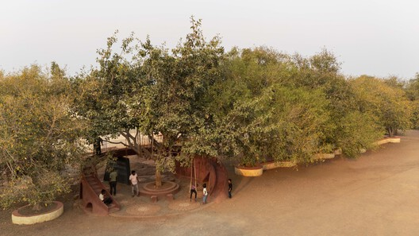

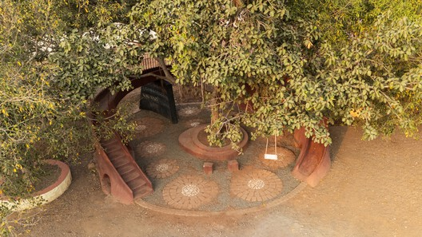

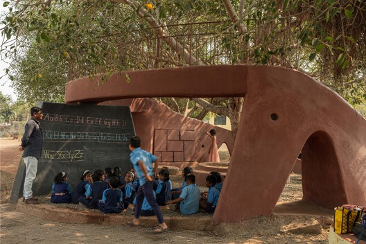

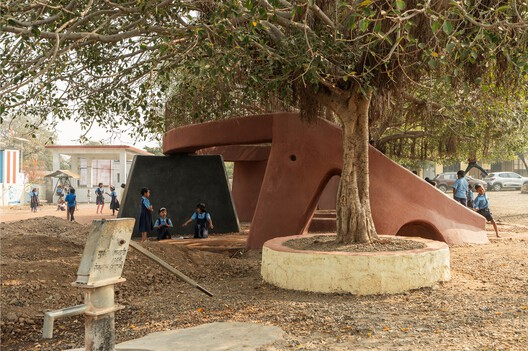

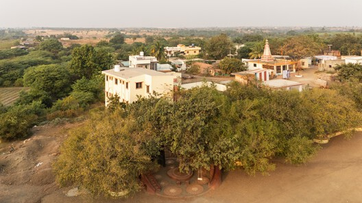

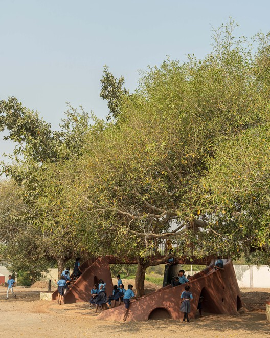

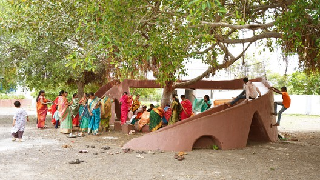

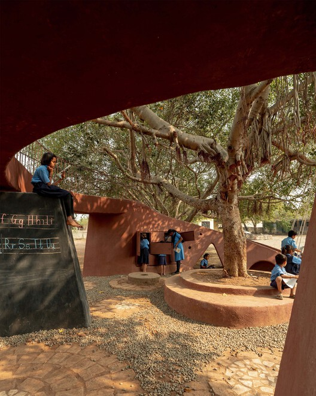

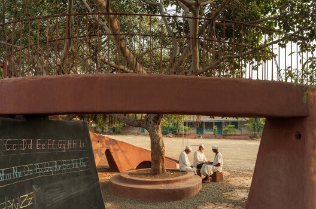

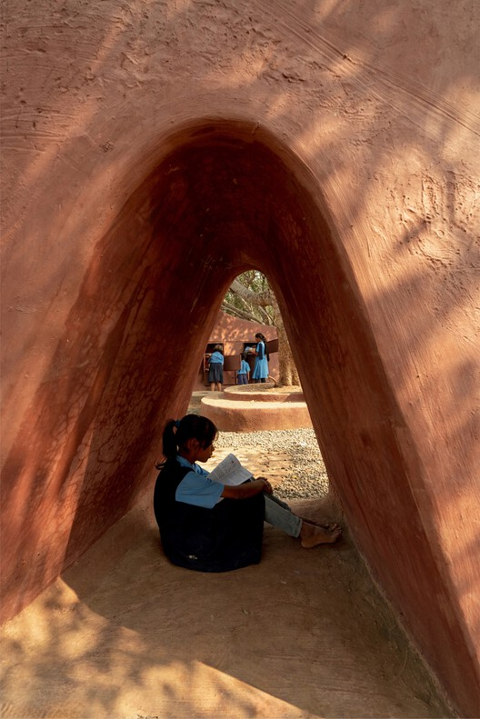

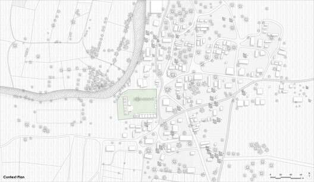

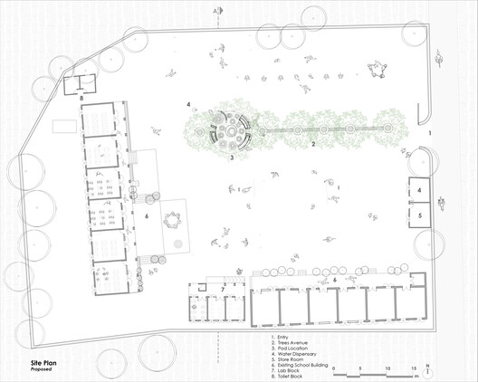

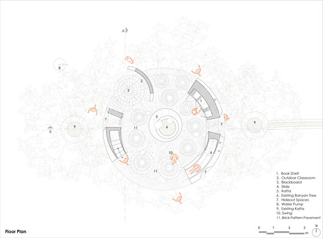

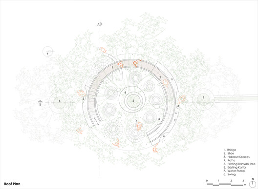

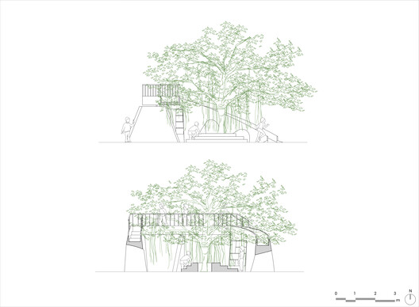

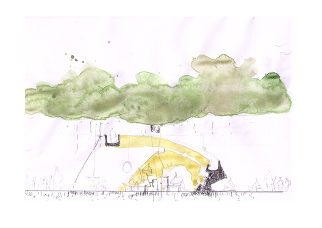
