# Neuweilerstrasse Development / Volpatohatz

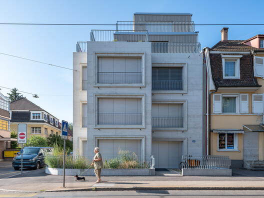

© Tina Barth

Curated by **Nina Vuga**

[Residential Architecture](https://www.archdaily.com/search/projects/categories/residential-architecture), [Apartments](https://www.archdaily.com/search/projects/categories/apartments), [Sustainability](https://www.archdaily.com/search/projects/categories/sustainability)

•

Basel, [Switzerland](https://www.archdaily.com/search/projects/country/switzerland)

Architects: [Volpatohatz](https://www.archdaily.com/office/volpatohatz?ad_name=project-specs&ad_medium=single)

- Area: [294](https://www.archdaily.com/search/projects/min_area/235/max_area/352?ad_name=project-specs&ad_medium=single) m&sup2;
-  Year: [ 2026 ](https://www.archdaily.com/search/projects/year/2026?ad_name=project-specs&ad_medium=single)

Photographs:[Tina Barth](https://www.archdaily.com/photographer/tina-barth?ad_name=project-specs&ad_medium=single), [VOLPATOHATZ AG](https://www.archdaily.com/photographer/volpatohatz-ag?ad_name=project-specs&ad_medium=single)

 Lead Architects:  Nicole Hatz, Marco Volpato

Category: [Residential Architecture](https://www.archdaily.com/search/projects/categories/residential-architecture), [Apartments](https://www.archdaily.com/search/projects/categories/apartments), [Sustainability](https://www.archdaily.com/search/projects/categories/sustainability)

Design Team: Tongxin Li, Daria Hagea

Engineering & Consulting > Structural: Ernst & Eitel GmbH

Urban Planning: VOLPATOHATZ AG

City: Basel

Country: [Switzerland](https://www.archdaily.com/search/projects/country/switzerland)

[Did you collaborate on this project?](https://archdaily.typeform.com/to/ajaa5AIQ#project_url=https://www.archdaily.com/en/1188089)

More SpecsLess Specs

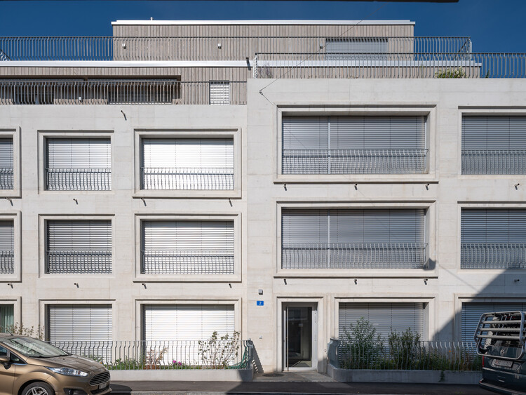

© Tina Barth

*Text description provided by the architects. *VOLPATOHATZ won a competition for the design of an apartment building in [Basel](/tag/basel), Switzerland. The competition proposal, juried by architect and professor Harry Gugger, includes seven apartments over five levels, plus a basement for bikes, plants, and storage.

## 图片集

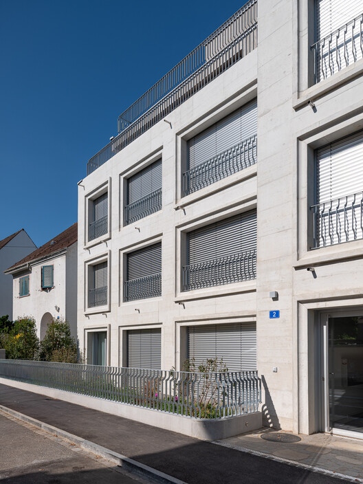

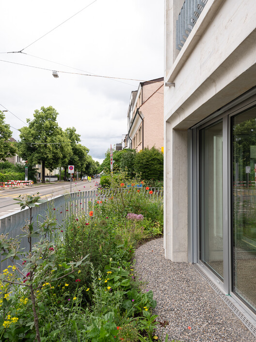

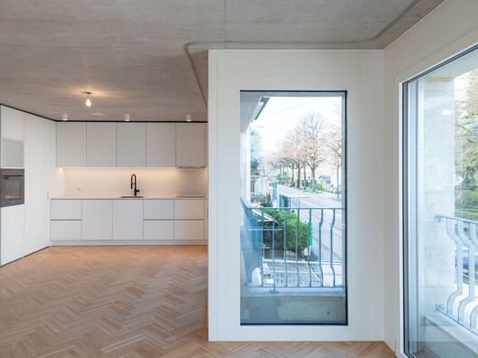

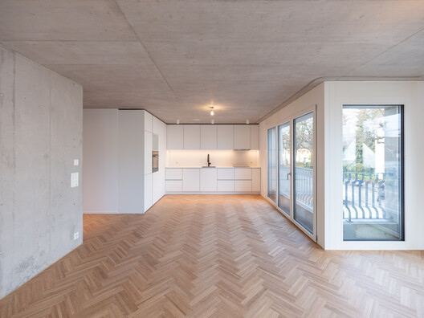

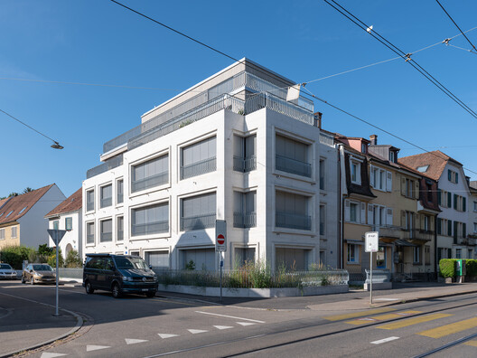

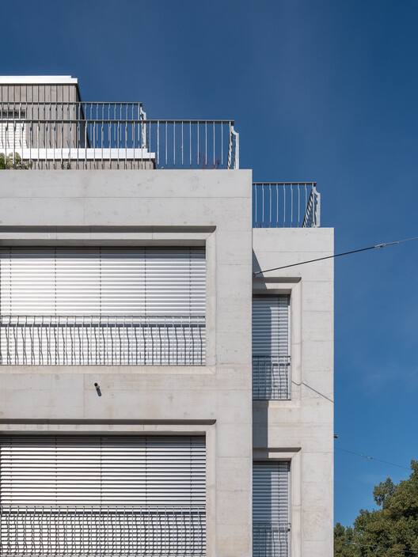

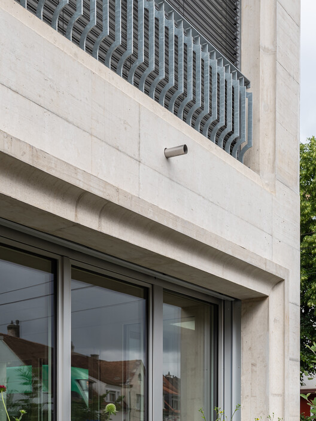

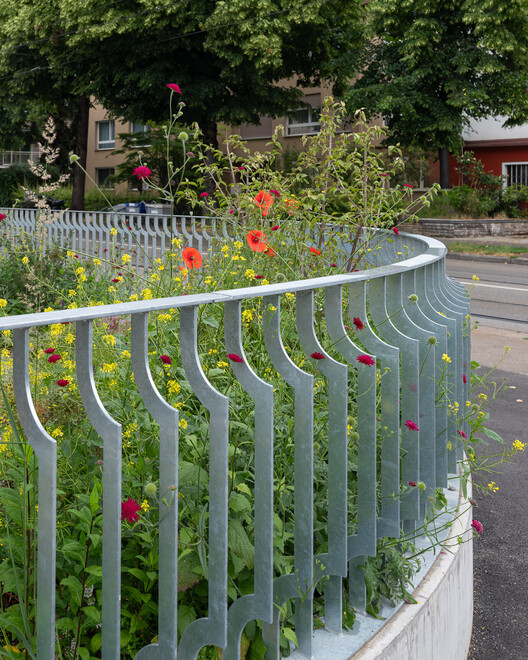

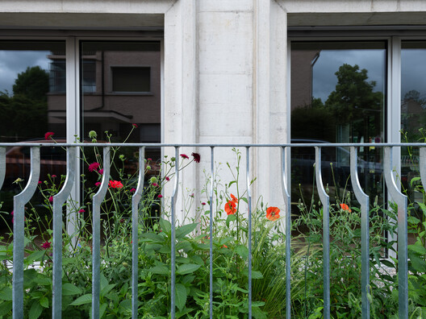

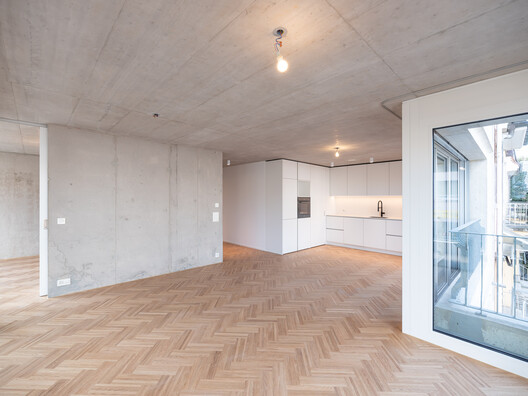

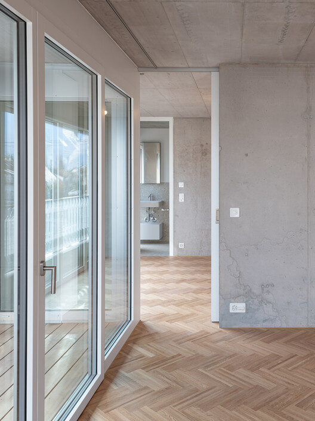

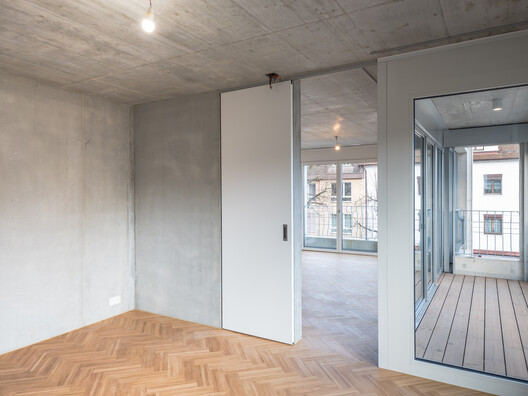

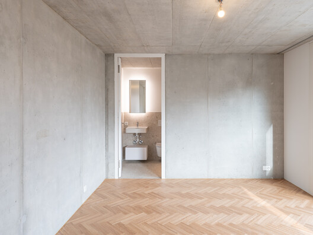

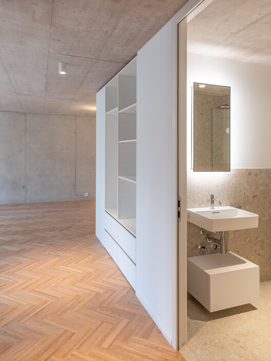

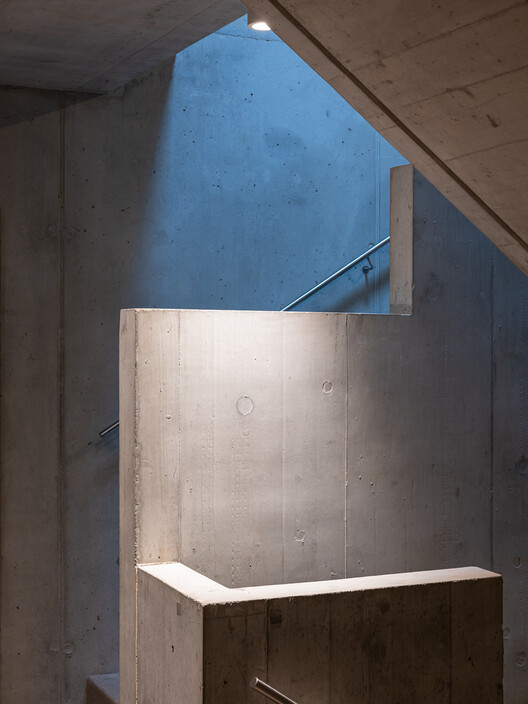

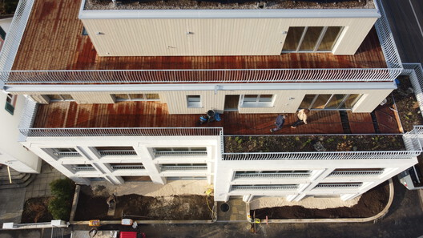

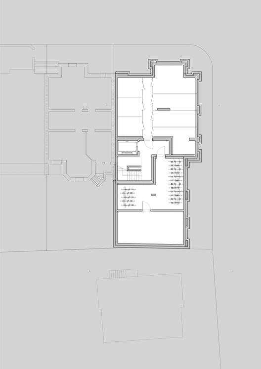

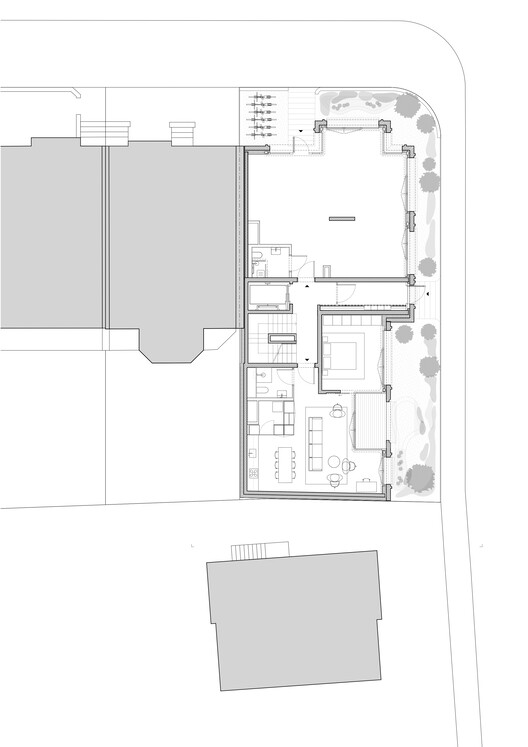

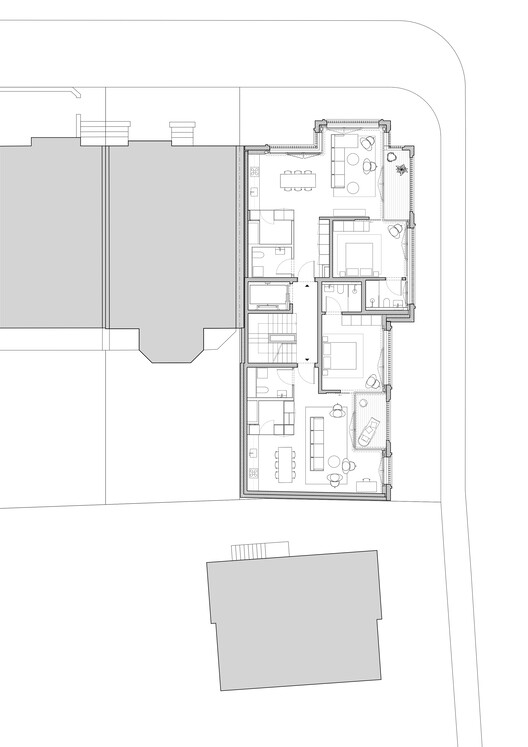

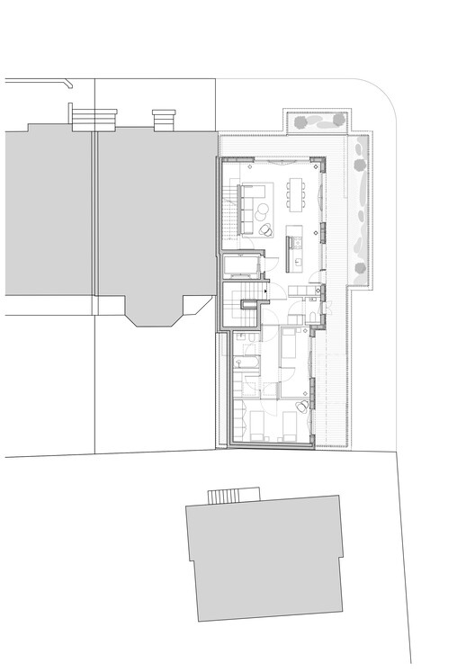

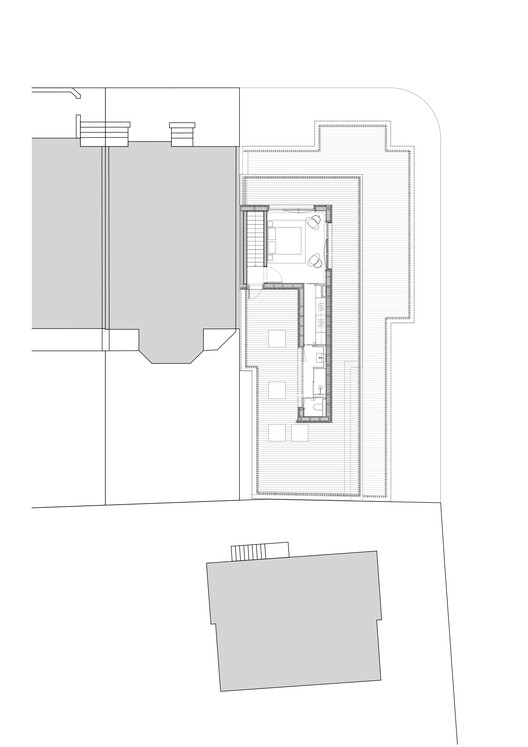

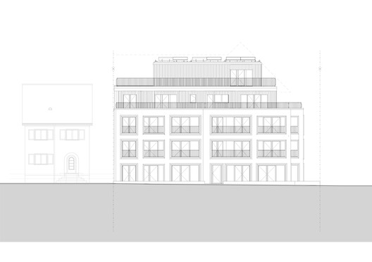

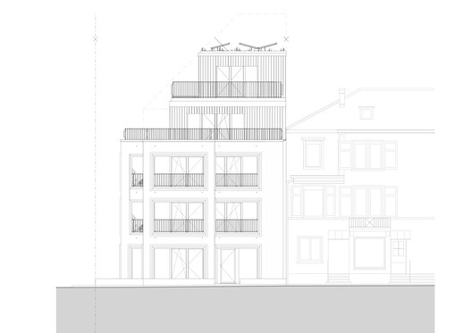
