# World Cities Day 2026 Explores "Regenerating the City: Adequate Housing for All"

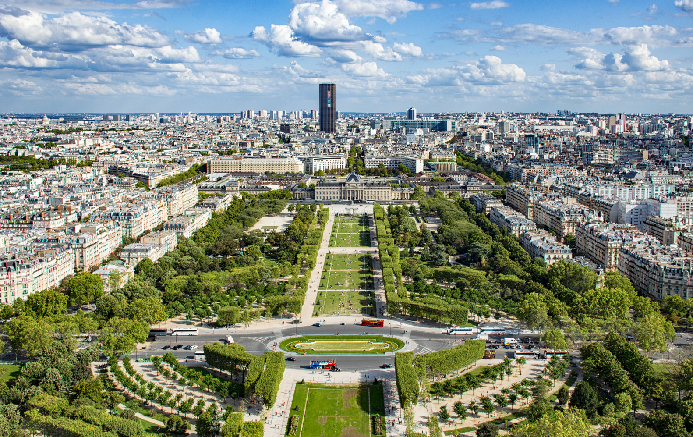

View towards Tour Montparnasse from Eiffel Tower. Image © ASaber91 via Wikimedia CommonsWritten by Reyyan Dogan

Published on October 30, 2026

On October 31, World Cities Day 2026 will be observed under the theme "Regenerating the City: Adequate Housing for All." Hosted in Fuzhou, China, this year's global observance focuses on how urban regeneration can advance access to adequate housing by improving existing neighborhoods, infrastructure, and public spaces. According to the United Nations, up to 3.4 billion people worldwide lack access to adequate housing, secure tenure, basic services, or affordable living conditions. This challenge points to the need for approaches that consider housing alongside the wider conditions of urban life, including environmental resilience, connectivity, and access to essential services.

Cities are shaped by the relationship between people, their homes, and the environments they share. Housing developments influence the density and character of neighborhoods, transportation networks determine access to jobs and services, and public spaces provide places for recreation and social interaction. These urban systems are also increasingly exposed to environmental pressures, from extreme heat and flooding to storms and other natural hazards. As cities continue to grow and change, providing adequate housing is closely connected to how urban settlements adapt to these challenges while supporting the communities that live in them.

For World Cities Day, we look at these interconnected aspects of urban life through four themes: housing, public space, mobility, and neighborhood livability, bringing together stories that examine the challenges and possibilities shaping cities today.

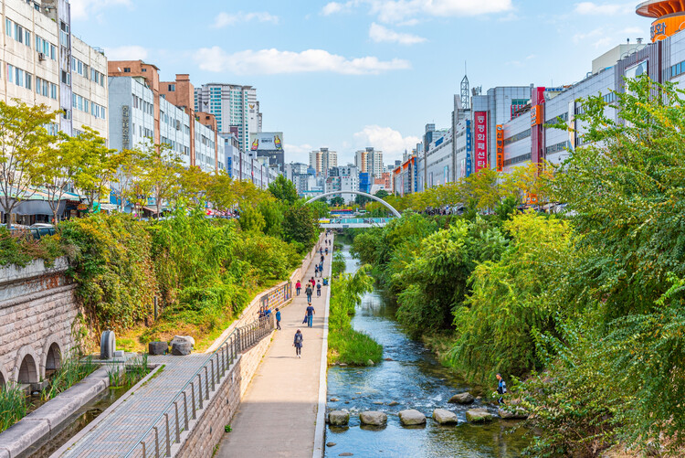

Cheonggyecheon stream in Seoul, Korea. Image © trabantos via Shutterstock

## Housing, Displacement, and Climate Resilience

Adequate housing is about more than having a roof over one's head. Its location, construction, affordability, access to services, and ability to withstand environmental risks all influence the security it provides. As floods, storms, and extreme heat increasingly affect urban settlements, housing strategies must consider how buildings and communities can adapt to changing conditions. For people displaced by environmental pressures, conflict, or economic instability, finding a new home also involves rebuilding access to livelihoods, services, and social networks. These challenges call for approaches that connect housing design with land use, infrastructure, and community participation.

### Responding to Displacement: Architectural Strategies Across Latin America

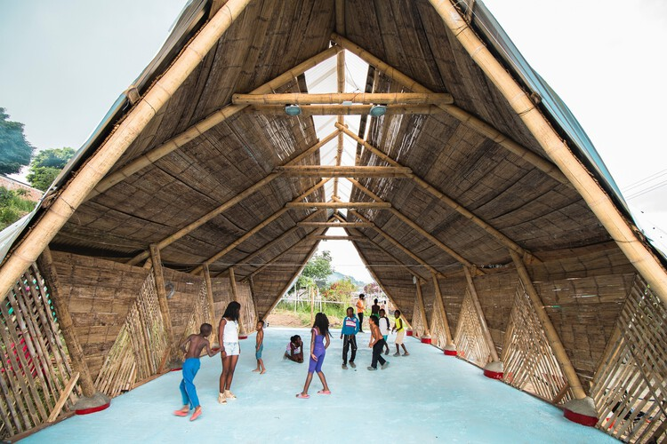

La Casa Ensamble Chacarrá by Ruta 4. Image Courtesy of Ruta 4

### "If You Build Ugly Social Housing, You Will Create Social Problems": An Interview with the OBEL Award 2026 Recipients

### UN-Habitat Recognizes Five Approaches to Adequate Housing With 2026 Scroll of Honour

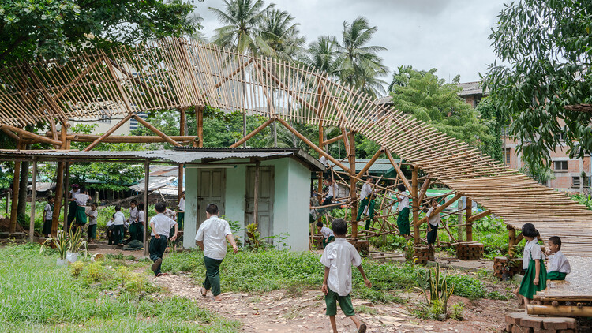

Housing NOW / Bago, Myanmar. Image © UN-Habitat

### Designing for Density: How Modernist Principles Continue to Shape Social Housing Solutions Today

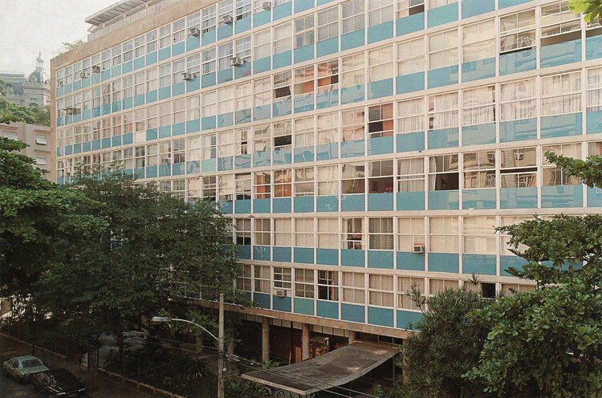

Parque Eduardo Guinle / Lucio Costa. Image © Nelson Kon

### On Housing, Public Space, and Climate Resilience: In Conversation with the Winners of the 2026 UIA 2030 Award

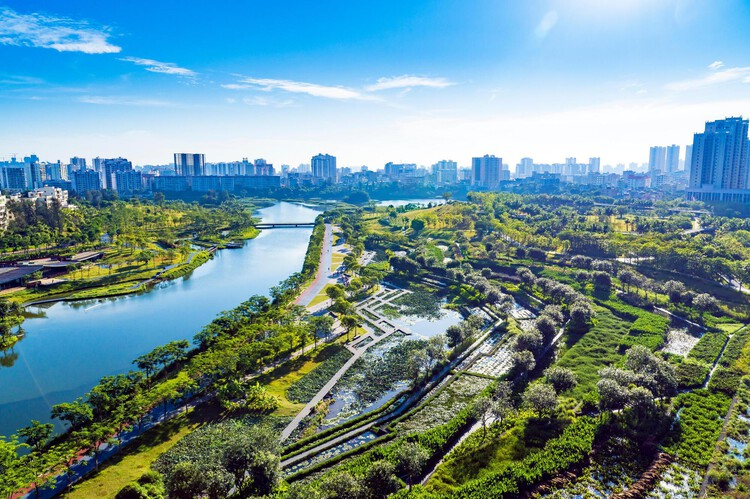

Meishe River Restoration: Turning Grey Into Green, China, by Turenscape. Image Courtesy of International Union of Architects (UIA)

## Urban Landscapes as Infrastructure: Public Space, Water, and Climate Adaptation

Parks, waterfronts, gardens, and open spaces are often understood as amenities that improve the appearance and recreational value of cities. Their role, however, extends into the functioning of urban environments. Landscapes can help absorb rainwater, reduce surface temperatures, support biodiversity, and provide relief during periods of extreme heat. In areas exposed to flooding, the integration of water management into public space and landscape planning can also help reduce pressure on conventional drainage infrastructure. These functions become particularly important as cities expand and natural systems are increasingly affected by urban development.

### Lessons from Roberto Burle Marx: Designing Resilient and Evolving Urban Landscapes

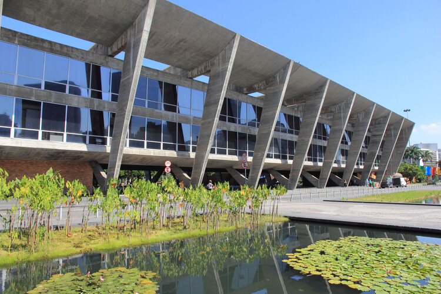

Rio de Janeiro Contemporary Modern Art Museum / Affonso Eduardo Reidy. Image © Halley Pacheco de Oliveira via Wikipedia under CC BY-SA 3.0 27 / 28

### Urban Landscape as an "Art of Survival": An interview with Kongjian Yu, the Advocate of the Sponge Cities Concept

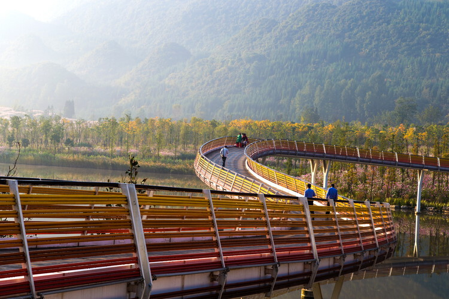

Minghu Wetland Park / Turenscape. Image Courtesy of Turenscape

### Who Owns Public Space? Three Active Models of Shared Management Shaping Urban Commons in Europe and New York

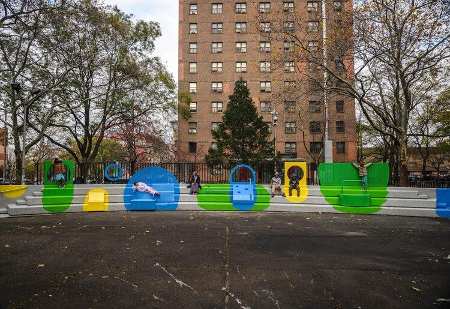

Common Corner at Morris Houses, a New York Public Housing Development, in Bronx, NY. Image © Brook Banister

### Elevated Infrastructure and Public Space: Reclaiming the Ground Below

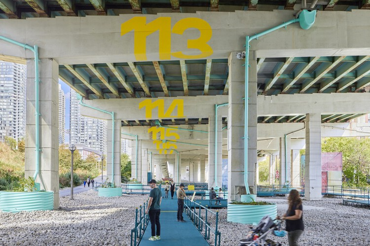

Bentway Staging Grounds / Agency-Agency + SHEEEP. Image © Samuel Engelking

### From Residual Land to Civic Places: 6 Mexican Public Parks

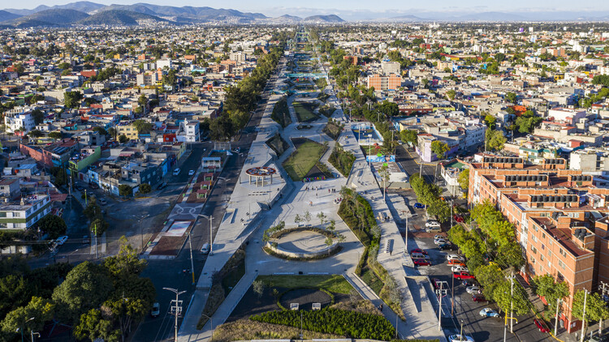

Gran Canal Linear Park / 128 arquitectura y diseño urbano. Image © Onnis Luque

## Moving Through the City: Mobility, Transportation, and Connectivity

How people move through a city directly influences their access to housing, employment, education, healthcare, and public space. Transportation networks connect neighborhoods, but the way streets and infrastructure are planned can also create barriers, particularly for people who rely on walking, cycling, or public transportation. In many cities, car-oriented development has contributed to fragmented urban environments, unsafe streets, and unequal access to essential services. Rethinking mobility involves more than introducing new transportation technologies or expanding road networks. It also requires considering how different modes of travel work together, how infrastructure serves people with different needs, and how connections between urban and rural areas can be improved.

### Mobility Justice: Urban Equity in an Era of Innovation

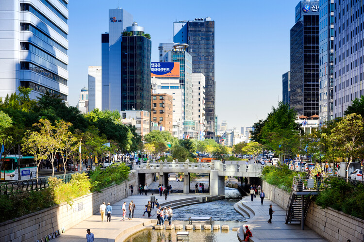

Cheonggyecheon stream in Seoul, Korea. Image © 501room via Shutterstock

### Beyond the Street: Climate, Commerce, and the Evolution of Hong Kong's Elevated Networks

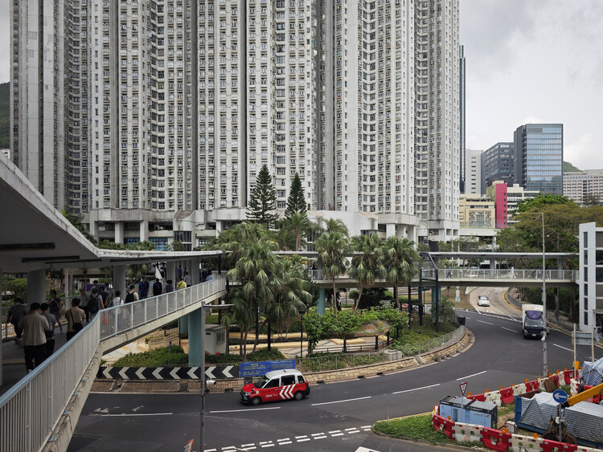

Footbridge network in Chai Wan, Hong Kong. Image © Jonathan Yeung

### Rural Transportation Hubs: Infrastructure Design, Access, and Regional Mobility

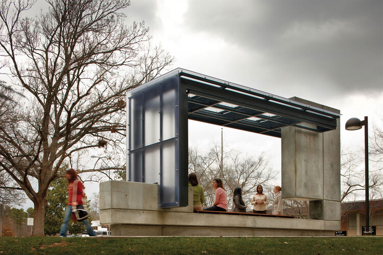

Bus Shelter / Pearce Brinkley Cease + Lee. Image Courtesy of JWest Productions

### From London to Houston: Four Ongoing Pedestrianisation Initiatives Shaping More Walkable Cities

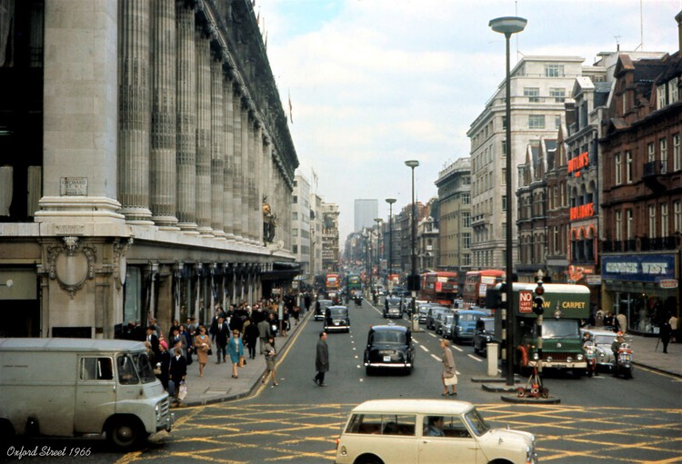

London, Oxford Street 1966. Image © wilford peloquin via Wikimedia Commons, under the Creative Commons Attribution 2.0 Generic license

## What Makes a Neighborhood Livable? Health, Green Space, and Community

While citywide strategies establish the conditions for urban development, the experience of living in a city often comes down to the neighborhood scale. Access to parks, healthcare, schools, local services, and safe streets influences how people experience their surroundings and participate in everyday urban life. These qualities are not distributed evenly, and broad indicators or international rankings can sometimes obscure differences between neighborhoods and the needs of their residents. Understanding livability therefore requires looking beyond economic performance or the quantity of green space to consider how people use their environments, interact with one another, and take part in decisions that affect their communities.

### The Metrics We Use Decide the Cities We Build: Urban Indicators and Lived Experience

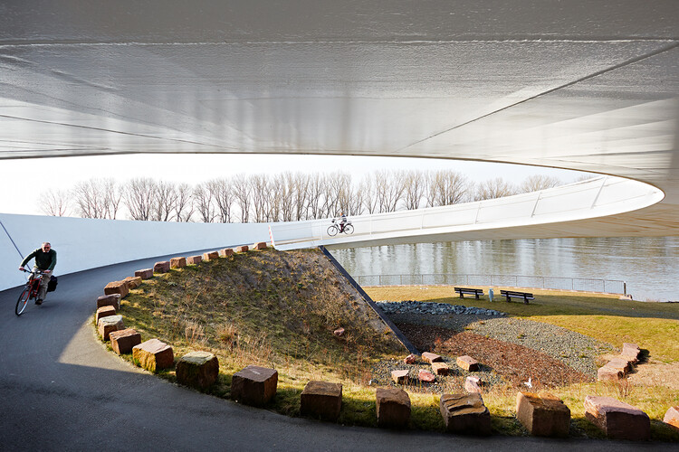

Ölhafen Bridge in Raunheim, Germany. Image © Schneider+Schumacher

### City-Making Through Participation: Lessons from Utopian Hours 2026

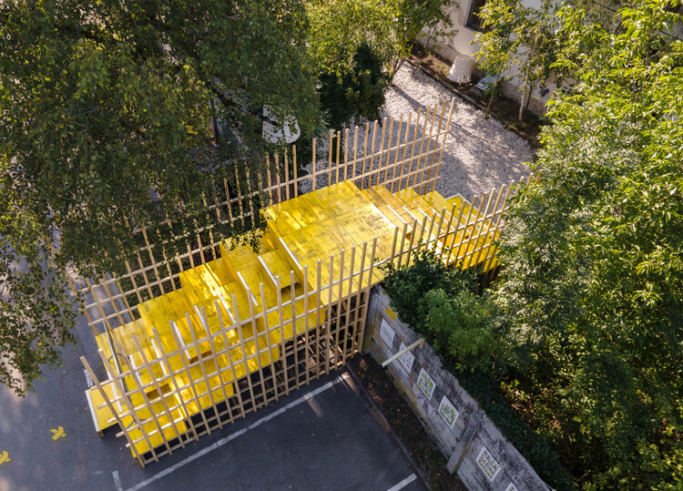

Urban Academy project involving Prostorož. Image © Mitja Kuret

### Paris as a Living Laboratory: Proximity, Inclusion, and the School as Climate and Social Infrastructure

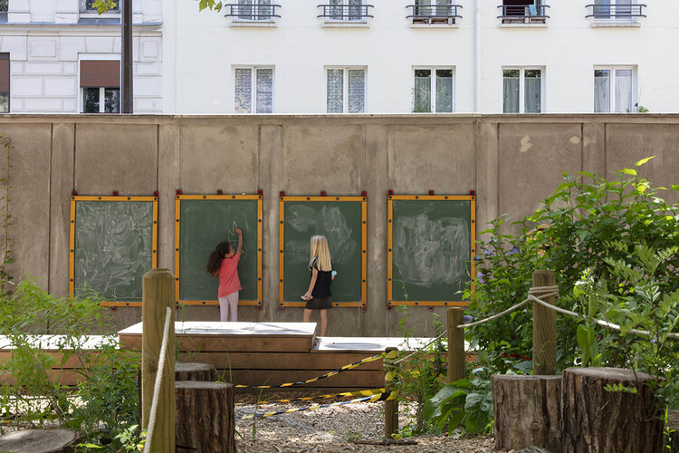

cour oasis de l’École élémentaire Keller, les tableaux d’expression, CAUE 75. Image Courtesy of ReGreeneration

### Building Public Life: How Bogotá and Mexico City Addressed Urban Inequality

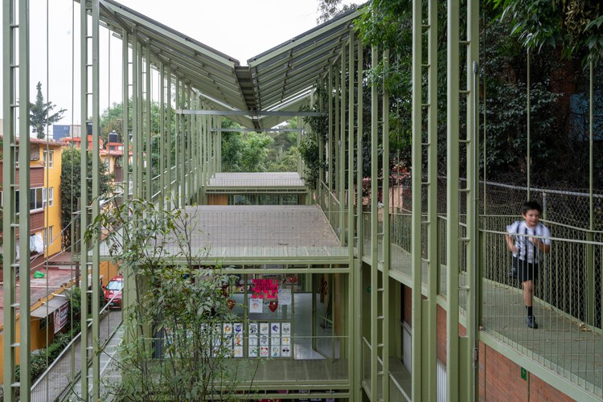

PILARES Cuicuilco Community Center / TO + +UdeB Arquitectos + AGENdA Agencia de Arquitectura. Image © Jaime Navarro

### The City as a System of Health: Breaking Feedback Loops in Planning

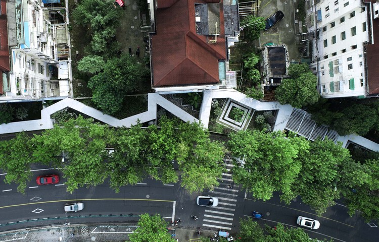

Changli Urban Garden / TM Studio. Image Courtesy of TM StudioExplore ArchDaily's input into recent United Nations International Days: International Day of Democracy, International Youth Day, International Day of the World's Indigenous Peoples, World Population Day, World Environment Day, Africa Day, and International Mother Earth Day.

## 图片集

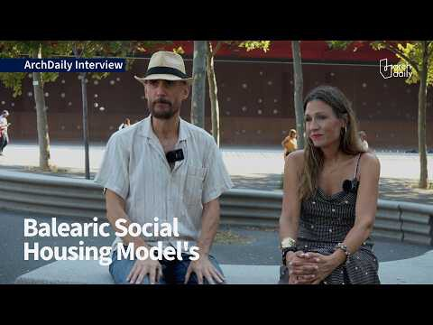
