# Maryland House / Remi C.T.

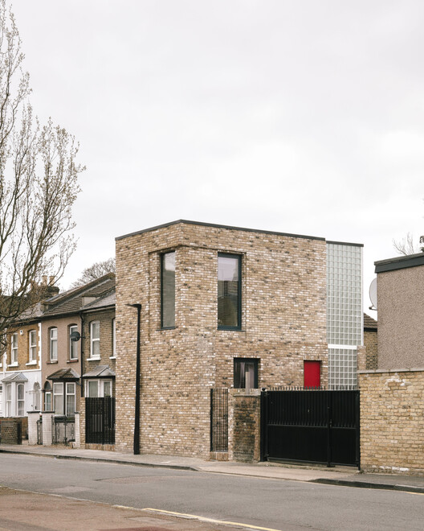

© James Retief

Curated by **Nina Vuga**

[Residential Architecture](https://www.archdaily.com/search/projects/categories/residential-architecture), [Houses](https://www.archdaily.com/search/projects/categories/houses), [House Interiors](https://www.archdaily.com/search/projects/categories/house-interiors)

•

[United Kingdom](https://www.archdaily.com/search/projects/country/united-kingdom)

Architects: [Remi C.T.](https://www.archdaily.com/office/remi-ct?ad_name=project-specs&ad_medium=single)

- Area: [100](https://www.archdaily.com/search/projects/min_area/80/max_area/120?ad_name=project-specs&ad_medium=single) m&sup2;
-  Year: [ 2021 ](https://www.archdaily.com/search/projects/year/2021?ad_name=project-specs&ad_medium=single)

Photographs:[James Retief](https://www.archdaily.com/photographer/conform-architects?ad_name=project-specs&ad_medium=single)

 Lead Architects:  Remi Connolly Taylor

Category: [Residential Architecture](https://www.archdaily.com/search/projects/categories/residential-architecture), [Houses](https://www.archdaily.com/search/projects/categories/houses), [House Interiors](https://www.archdaily.com/search/projects/categories/house-interiors)

Engineering & Consulting > Environmental Sustainability: Thornton Reynolds Ltd

Engineering & Consulting > Lighting: Point 2 surveyors

Engineering & Consulting > Structural: Albert Williamson Taylor

General Contractor: Morrison Construction

Country: [United Kingdom](https://www.archdaily.com/search/projects/country/united-kingdom)

More SpecsLess Specs

© James Retief

*Text description provided by the architects. *A bold example of infill housing architecture, Maryland House redefines urban living through spatial innovation and design precision. It is a dwelling that challenges traditional spatial hierarchy in the home to focus on the reality of modern city living.

## 图片集

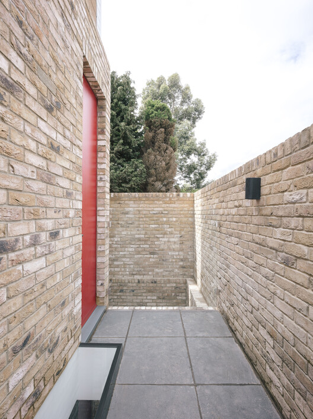

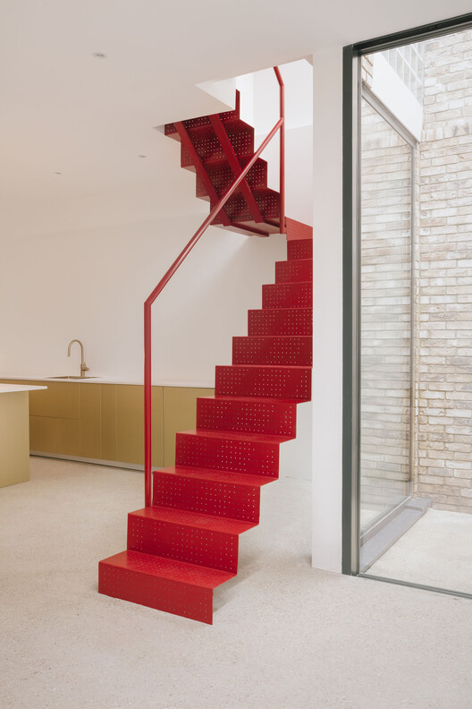

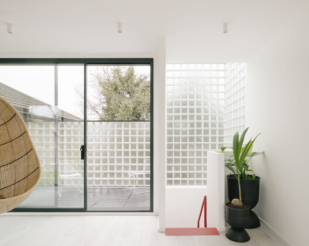

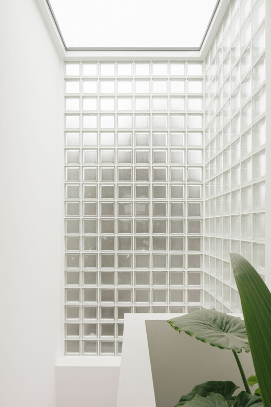

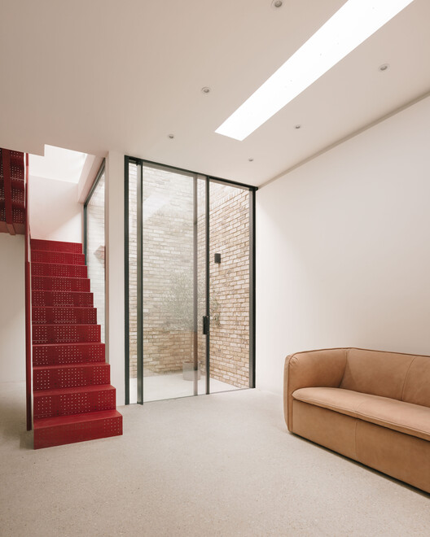

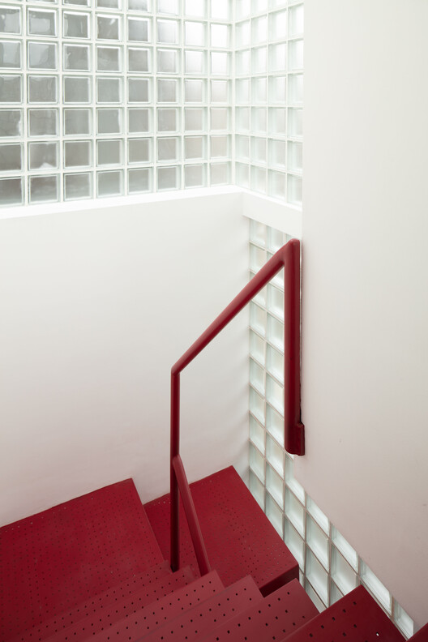

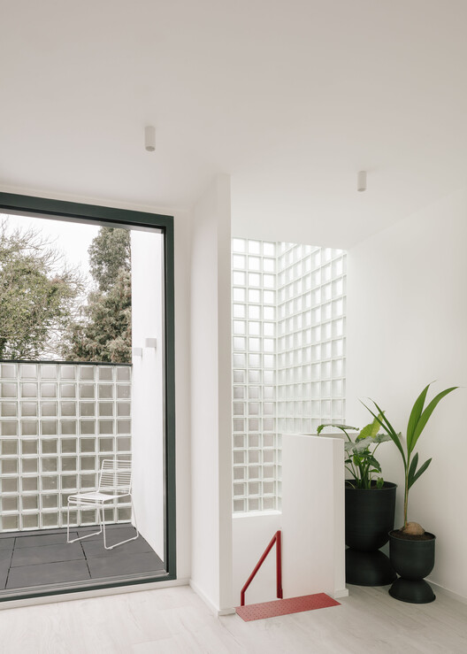

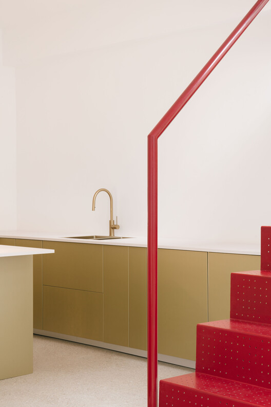

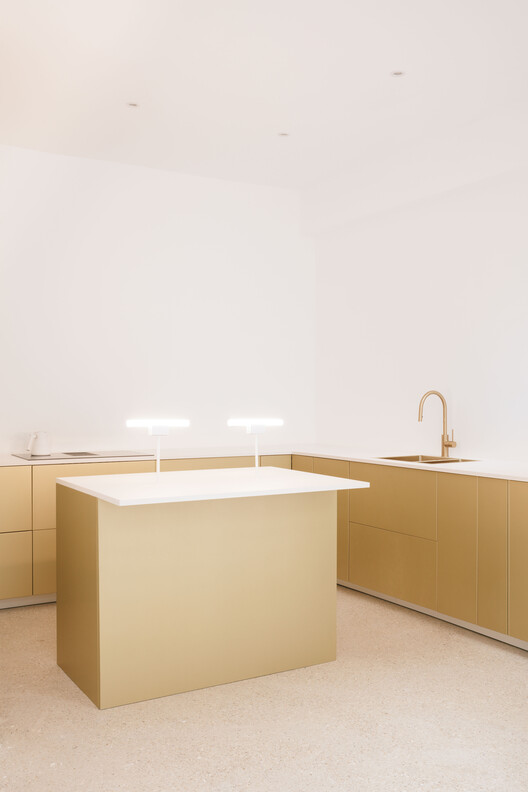

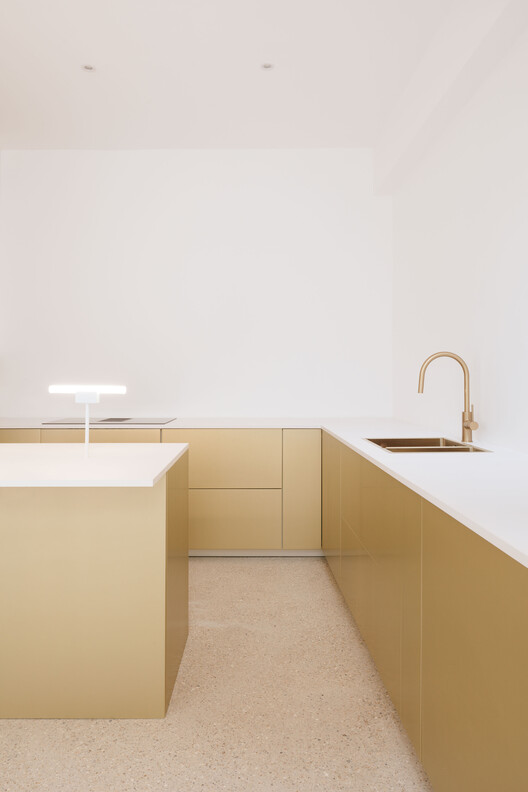

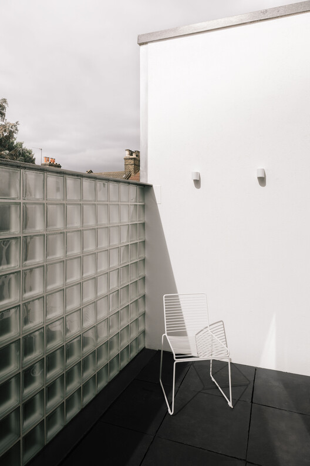

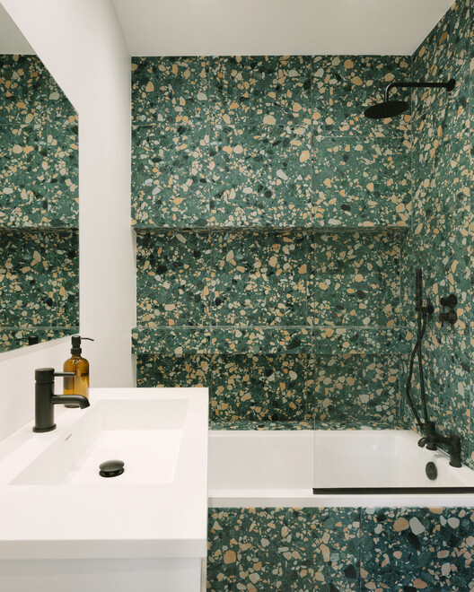

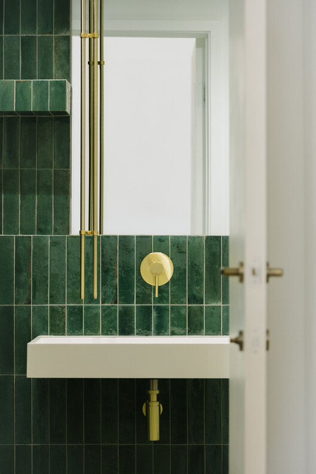

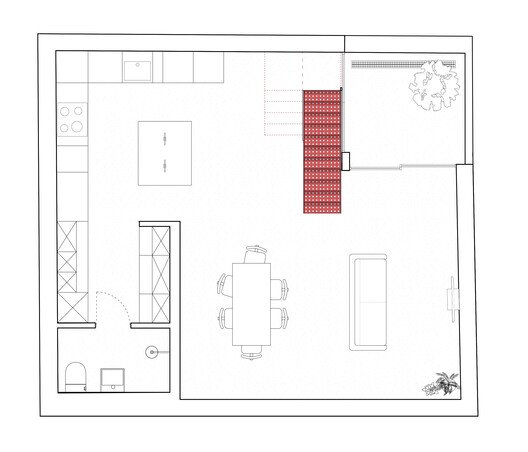

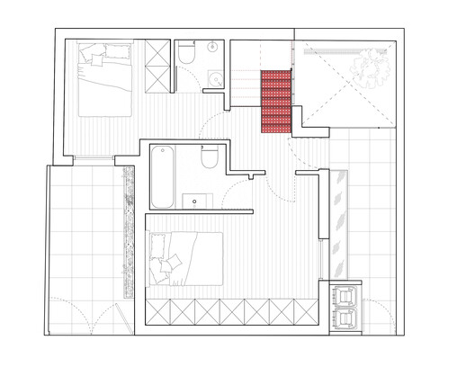

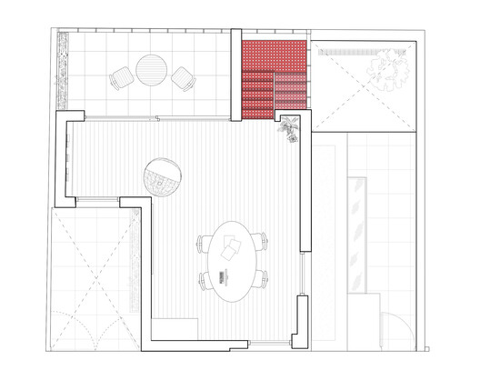

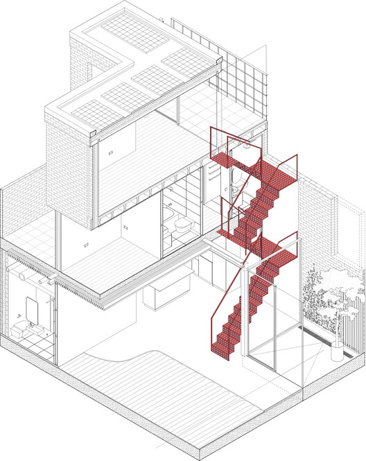
