# Snake Building / C+S Architects

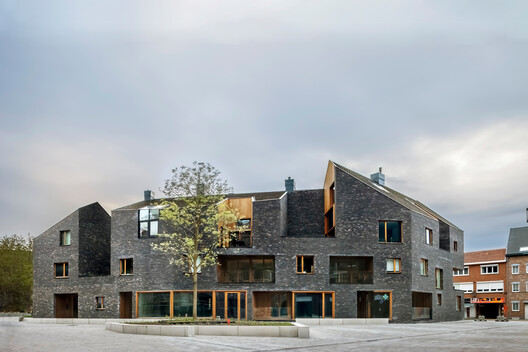

© Alessandra Bello

Curated by **Nina Vuga**

[Mixed Use Architecture](https://www.archdaily.com/search/projects/categories/mixed-use-architecture), [Housing](https://www.archdaily.com/search/projects/categories/housing), [Commercial Architecture](https://www.archdaily.com/search/projects/categories/commercial-architecture)

•

Aarschot, [Belgium](https://www.archdaily.com/search/projects/country/belgium)

Architects: [C+S Architects](https://www.archdaily.com/office/c-plus-s-architects?ad_name=project-specs&ad_medium=single)

- Area: [70000](https://www.archdaily.com/search/projects/min_area/56000/max_area/84000?ad_name=project-specs&ad_medium=single) m&sup2;
-  Year: [ 2026 ](https://www.archdaily.com/search/projects/year/2026?ad_name=project-specs&ad_medium=single)

Photographs:[Alessandra Bello](https://www.archdaily.com/photographer/alessandra-bello?ad_name=project-specs&ad_medium=single)

 Lead Architects:  Carlo Cappai, Maria Alessandra Segantini

[Site Supervision](https://www.archdaily.com/search/professionals/expertise/construction_other?ad_source=project-specs&ad_medium=main-spec&ad_campaign=prof_spec): [a2o Architeckten](https://www.archdaily.com/professional/a2o-architeckten?ad_source=project-specs&ad_medium=main-spec&ad_campaign=prof_spec)

Category: [Mixed Use Architecture](https://www.archdaily.com/search/projects/categories/mixed-use-architecture), [Housing](https://www.archdaily.com/search/projects/categories/housing), [Commercial Architecture](https://www.archdaily.com/search/projects/categories/commercial-architecture)

Client: Dyls

Detailed Design: [a2o Architeckten](https://www.archdaily.com/professional/a2o-architeckten?ad_source=extra-specs&ad_medium=extra-specs&ad_name=project-specs)

City: Aarschot

Country: [Belgium](https://www.archdaily.com/search/projects/country/belgium)

More SpecsLess Specs

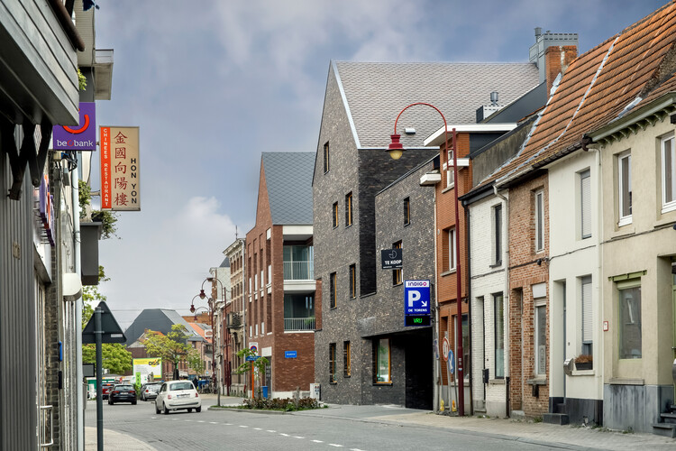

© Alessandra Bello

*Text description provided by the architects. *The Snake Building in [Aarschot](/tag/aarschot), Belgium, is part of a collaboration with a2o Architekten, a Hasselt-based office, commissioned by the client to design the urban regeneration of the De Torens masterplan: a former industrial site in the center of Aarschot, developed with housing, commercial, and public spaces. A series of collegial workshops in Hasselt initiated the design process and assigned the plots to each office (a2o Architekten, C+S Architects, De Vylder Vynck and DRDH).

## 图片集

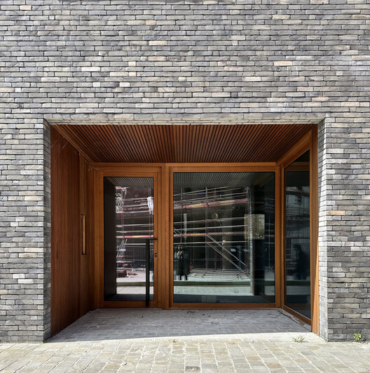

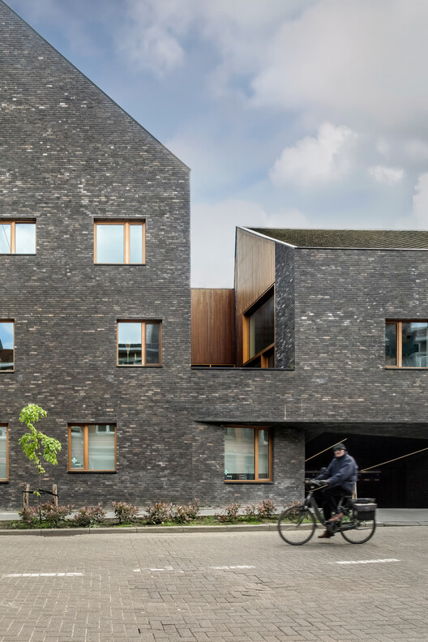

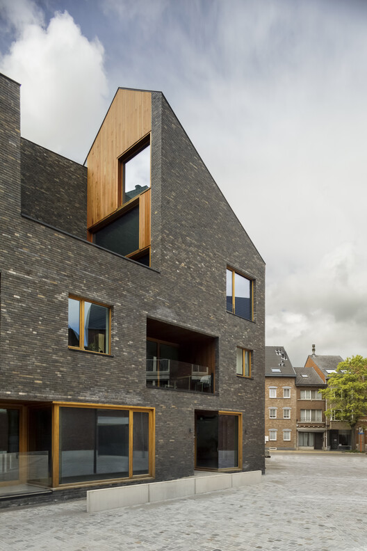

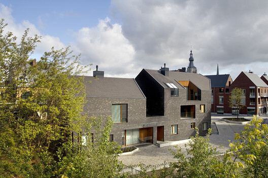

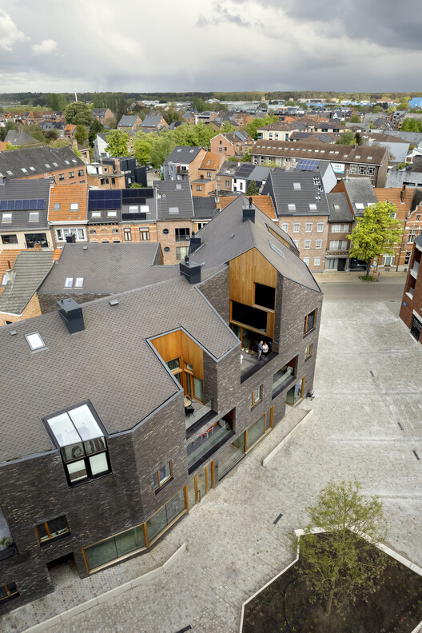

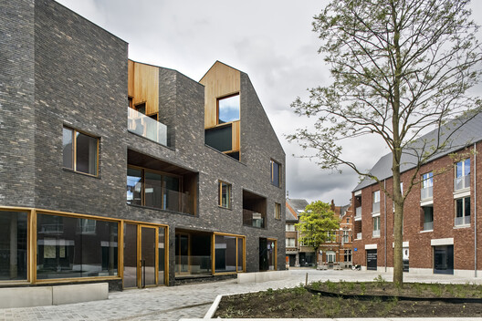

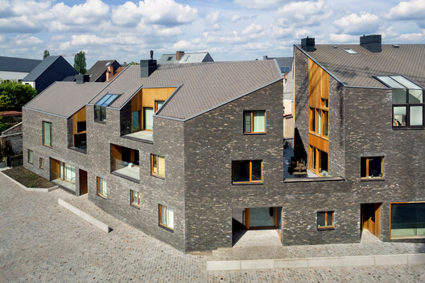

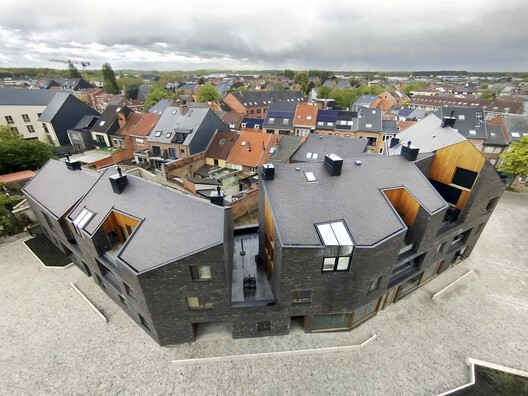

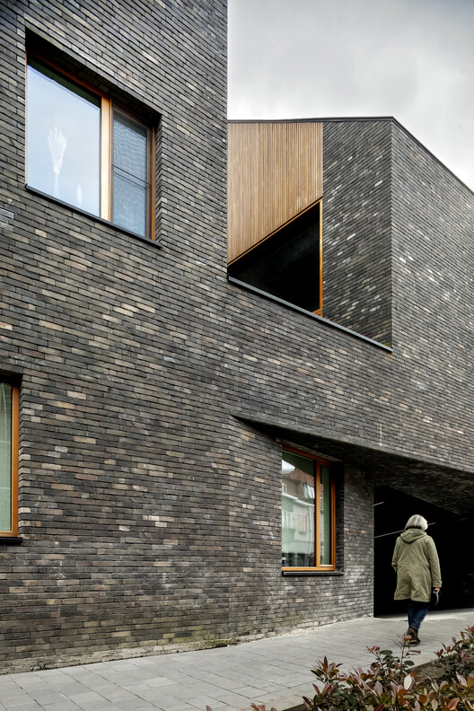

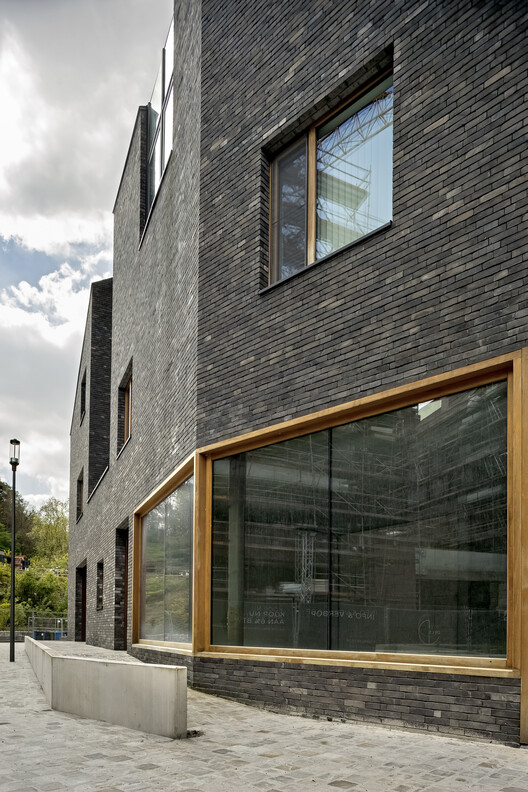

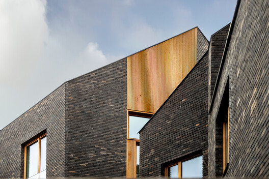

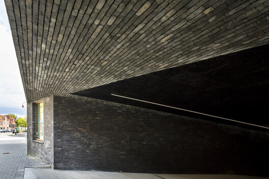

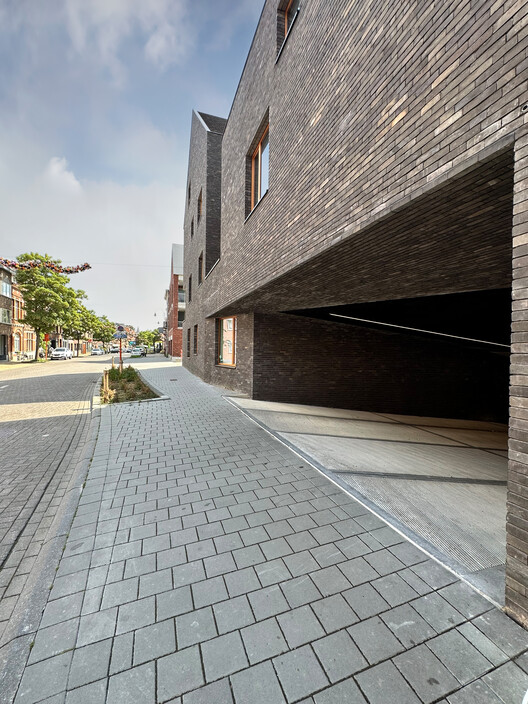

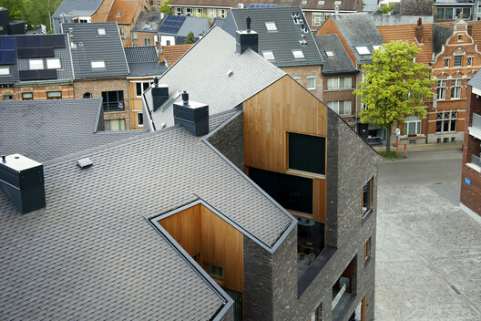

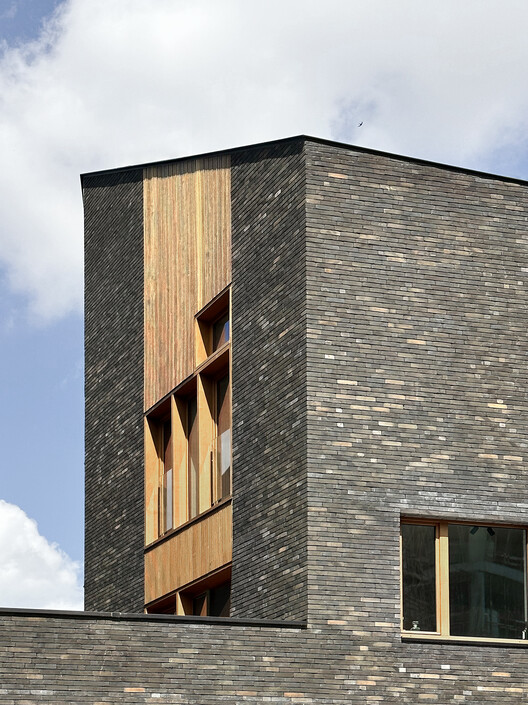

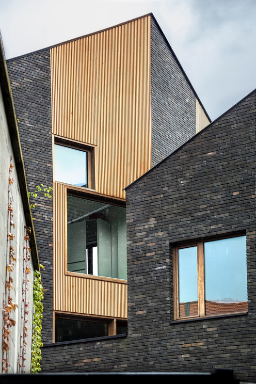

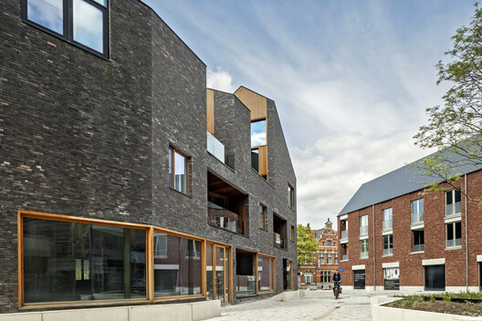

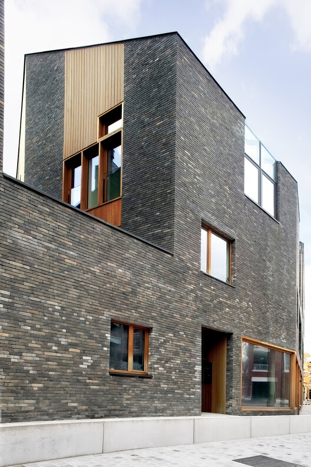

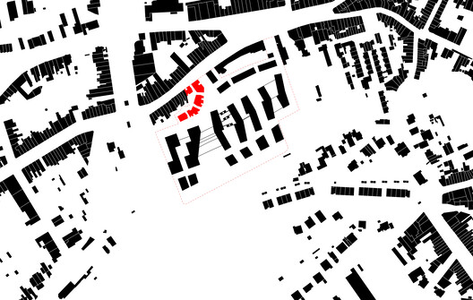

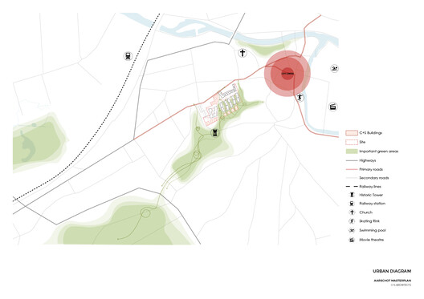

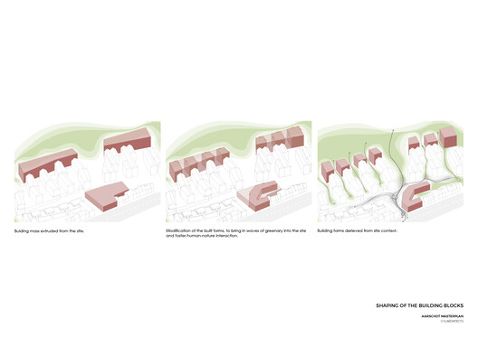

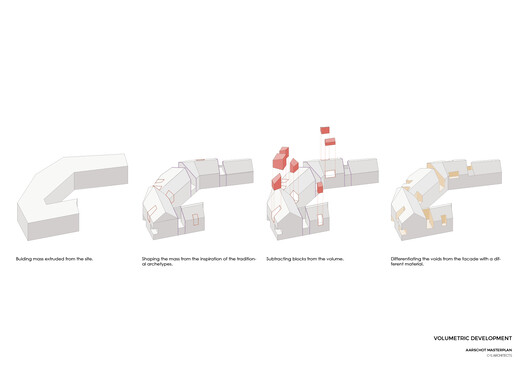

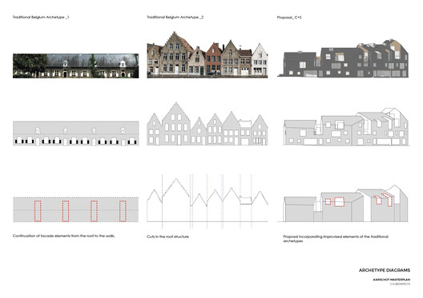

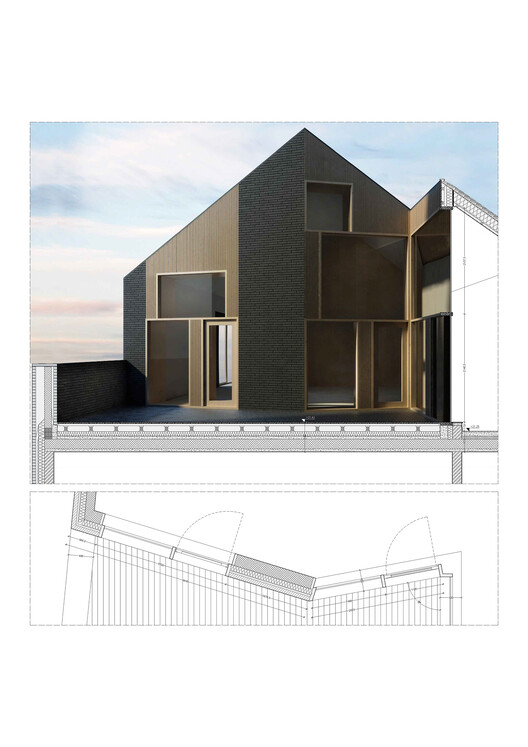
