# 专访孟凡浩：孔雀林山庄，从极致到在地

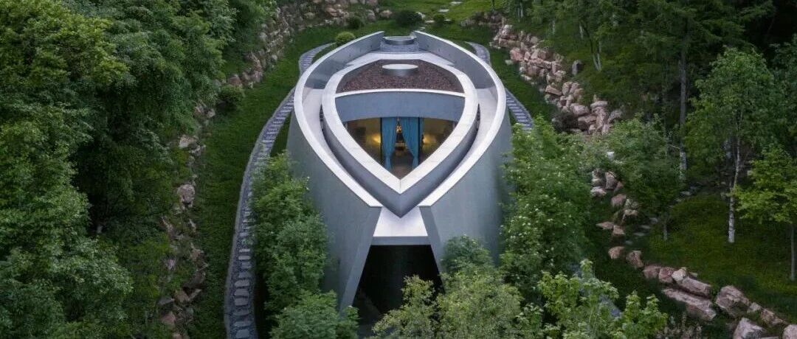

** 对于今晨发布的孟凡浩line+新作「孔雀林山庄」，在9月底有方曾前往现场。  **
在秋日长春的密林中拾级而上，设计希望呈现的空间质感逐渐清晰。对于这一功能复合、细节极致、高度追求建造纯粹性的项目，在客观的新作呈现之外，我们更好奇于主创建筑师孟凡浩在实践前后的判断与反思。
“我们经常讨论建筑形式的在地性，但建造本身同样需要在地性。”在回访的复盘时刻，有方专访以五个提问再探孔雀林。
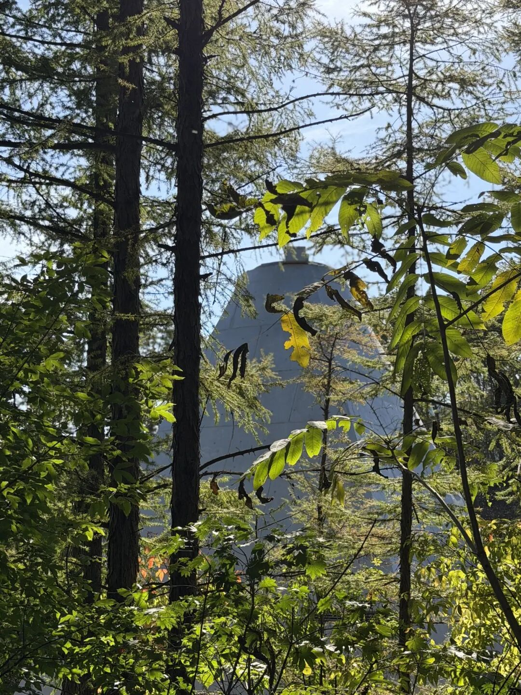
** △  秋日密林中的孔雀林山庄-佛堂 摄影：原源/有方  **

** 有方 你第一次来到场地是什么季节，当时的感受如何？将建筑
“尽量控制在原有地形轮廓之中，减少对场地的重塑”的决定，更多是出自设计自觉、业主要求、抑或现实约束？  **
孟凡浩  我  第  一次到现场是在
2018年，正好是冬天。印象最深的是场地本身的自然条件很好——整个山谷北高南低，两侧山坡向中间收拢。冬季植被退去之后，山谷的整体骨架看得特别清楚。它和江南的山水很不一样，这里的山势更加舒展、开阔。
所以我们很自然地做了一个判断：尽量不改变原有地形，也不把建筑做成一个过于突出的地标，而是顺着山谷一层一层展开。最后建筑的体量、院落和路径，其实都是从这样的地形关系里慢慢生长出来的。
业主的想法和我们也非常一致，他们一直强调对原有土地和自然关系的尊重，尽量减少开挖和破坏。几年之后重新回到现场，树木已经逐渐长起来，建筑也慢慢融入山谷，这其实就是我们最初希望看到的状态。
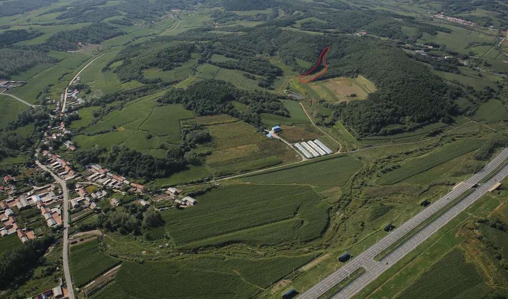
△ 场地区位 ©  line+
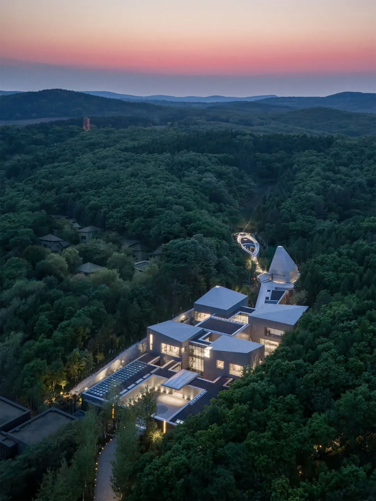

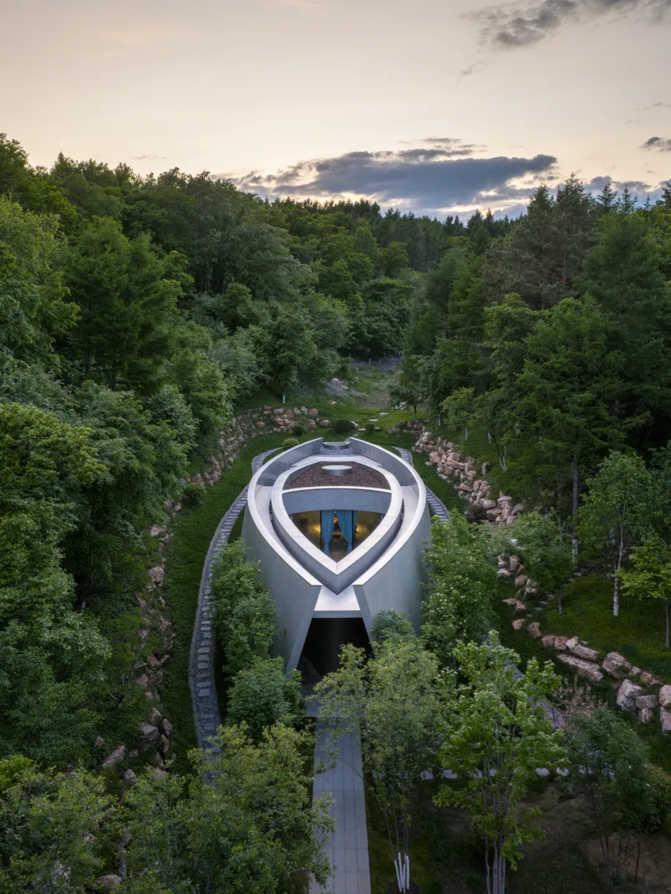
△  山谷中的建筑 摄影：  陈曦工作室
** 有方 每一个值得复盘的项目，都有自己需要回应的核心议题。孔雀林山庄的设计在回应的核心思考是什么？在  **
line+近年的作品序列中，你如何理解这个项目的价值？
孟凡浩  核心有两个方面：一个关乎建筑与自然的关系，一个关乎建筑如何容纳不同的生活方式。
最初面对这片山谷，我希望建筑像几块散落在自然中的巨石，带有某种原始、粗粝的力量。它们既是独立的雕塑性体量，又像是从山谷中生长出来的存在。
我们希望建筑以一种近乎原始的力量，唤醒场地本身的神秘感。这些厚重、稳定的体量，也为整个山谷建立起一种具有恒久感的空间秩序。
另一个是业主所要求的世俗生活与精神修行的共存。两种生活方式有着不同的空间诉求，我们并不希望将它们简单分隔，而是通过院落、路径和空间序列，建立一种既相对独立、又彼此关联的秩序，让人能够在行走中自然完成不同状态之间的转换。
这其实也延续了我这些年对复合场景的探索。
随着社会需求与生活方式不断变化，建筑的类型边界也在被重新定义。孔雀林既不是传统意义上的文化建筑，也不是常规的度假酒店，而是将度假生活、宗教礼仪与精神体验融合在一起，形成一种新的空间类型。
它把场地、空间、材料、构造，包括建筑师对整个建造过程的介入，都推到了一个比较极致的程度。
对我来说，它更像是一个阶段性的节点：既是一次非常彻底的实践，也是后来很多反思的起点。
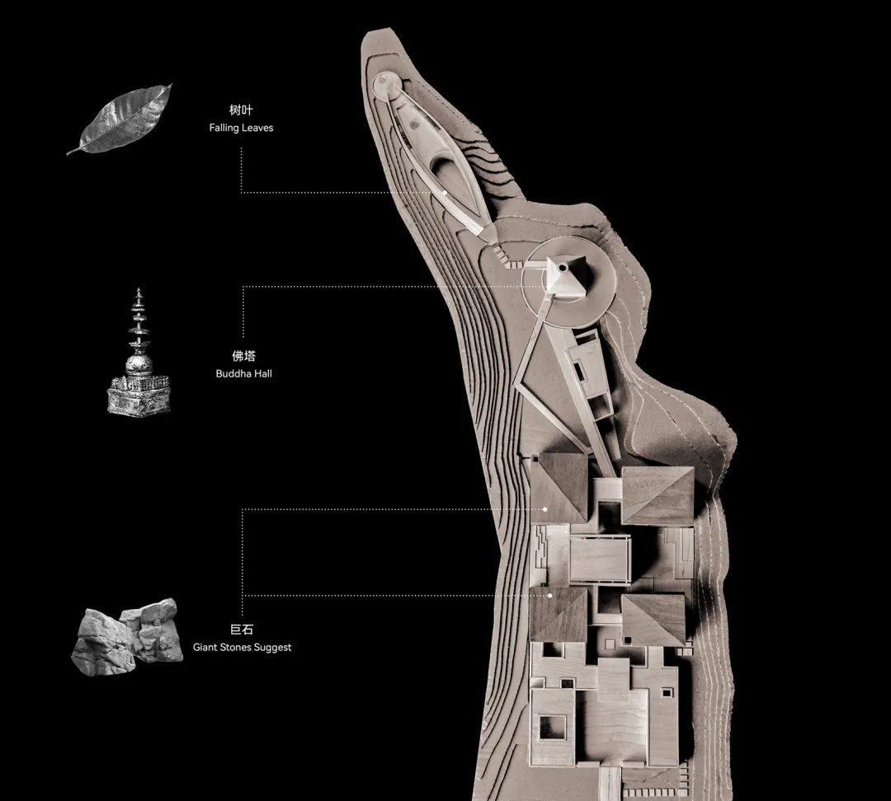
△ 体块分析 ©  line+
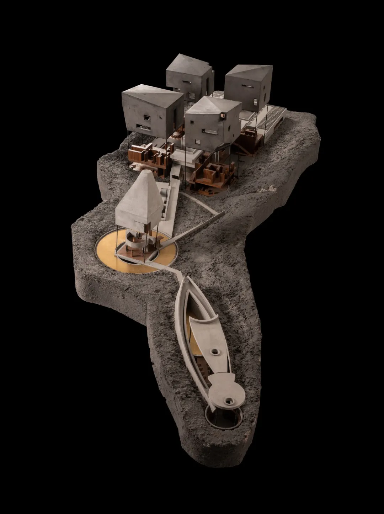
△  模型 摄影：  孙磊
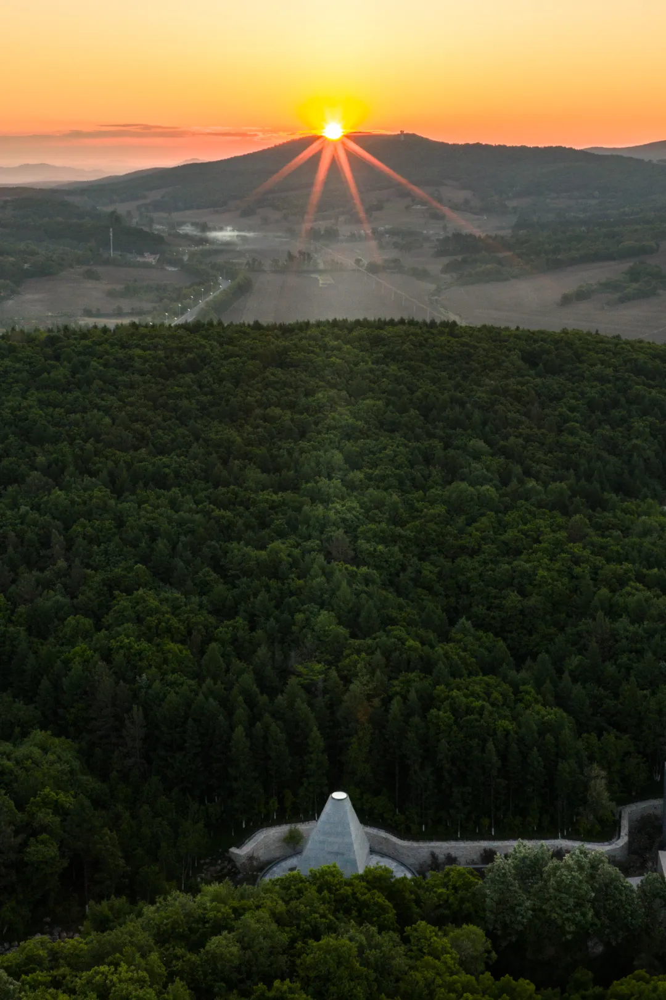
△  光影下的佛堂 摄影：  陈曦工作室
** 有方 项目对材料类型的选择非常审慎。希望以这种克制的精简实现怎样的空间氛围？在风格问题上，是否与业主做过重要讨论？  **
孟凡浩  这个项目的材料语言其实非常简单，主要就是石头、清水混凝土和玻璃。石头回应土地，混凝土构筑空间，玻璃则将自然引入室内。
我们希望尽量回到材料本身的属性与建构逻辑，用最直接的方式完成建筑表达，而不是通过额外的装饰去制造某种风格。
我对当下  一些  建筑中过度装饰化的倾向，始终持保留态度。
很多时候，材料被简化成一种视觉符号，不断叠加、拼贴，建筑看似越来越丰富，却逐渐失去了材料自身的特质与建构逻辑。
这个项目非常幸运的一点，是业主给予了我们近乎毫无保留的信任。从最初的设计理念、建筑形态到材料选择，他们始终尊重建筑师的专业判断，没有以既定的风格或市场偏好来限定设计
。  这种信任在国内的项目实践中是非常难得的，我也一直心怀感谢。
从第一版概念方案到最终建成，建筑的整体形态与精神气质几乎没有发生  任何一点
变化。设计的完整性，不仅来自建筑师的坚持，也来自业主对原创性与专业价值的尊重。  正是这种相互信任，让我们能够把更多精力投入到真正重要的空间和建造问题之中。
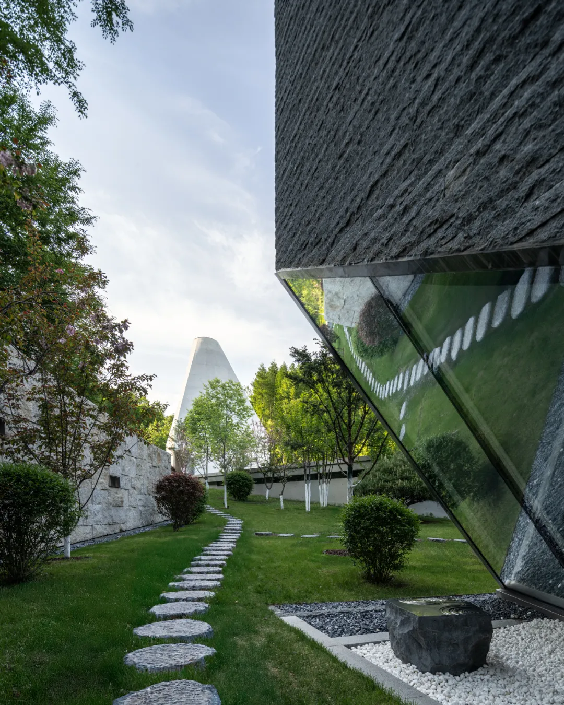

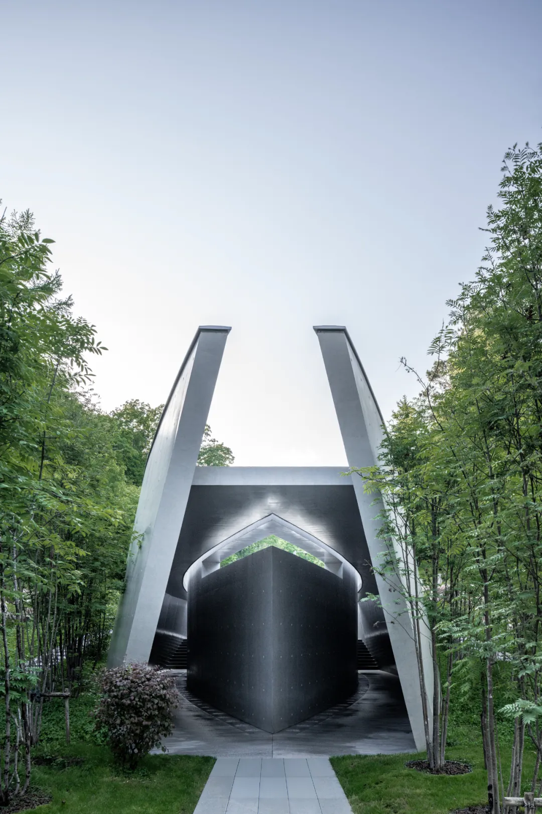
△  材料的结合与表现力 摄影：  陈曦工作室
** 有方
在严寒地区实现大面积的高品质清水混凝土，建造容错率是极低的。业主与设计团队为此做了哪些考察与准备工作？施工精度如何保证，你还记得浇筑时的过程与心情吗？
孟凡浩  大面积清水混凝土的施工确实比我们想象的难很多。一开始业主组织我们共同去日本考察，看了一系列安藤忠雄的混凝土建筑，当时觉得那套经验应该可以借鉴。
但后来发现，长春的严寒气候和保温要求，比我们最初想象的更加复杂。  最核心的问题是，我们既希望内外都保留清水混凝土最原始的质感，又必须解决严寒地区的保温。
比如我们有些双层夹心墙体，厚度做到了
65厘米，两侧各25厘米的混凝土，中间是15厘米的保温层。我们当时做了大概6次实体墙样板试验，反复调整墙体构造和浇筑方法，最后才找到相对可靠的做法。模板也非常讲究，用的是芬兰进口WISA板，通过高精度机械切割
结合工厂预制的支撑体系，  尽量把尺寸和拼缝控制准确。我们还专门邀请了参与安藤忠雄设计的和美术馆清水混凝土施工的团队参与建设。
清水混凝土一旦浇筑完成，后期几乎没有调整的余地。所以从模板、浇筑到最后拆模，每一步压力都很大。
尤其是拆模的时候，前面做了那么多准备，最后到底会呈现出什么样子，其实还是很紧张。
除了混凝土，整个外围护系统的标准也很高。  像山谷客厅，部分玻璃单元高度接近  8米，采用了多片夹胶与中空组合的玻璃构造  ；门窗系统  选用  的是
德国  Solarlux  ，在满足保温  的  同时尽可能把边框做窄，让大尺度的玻璃界面仍然保持通透。
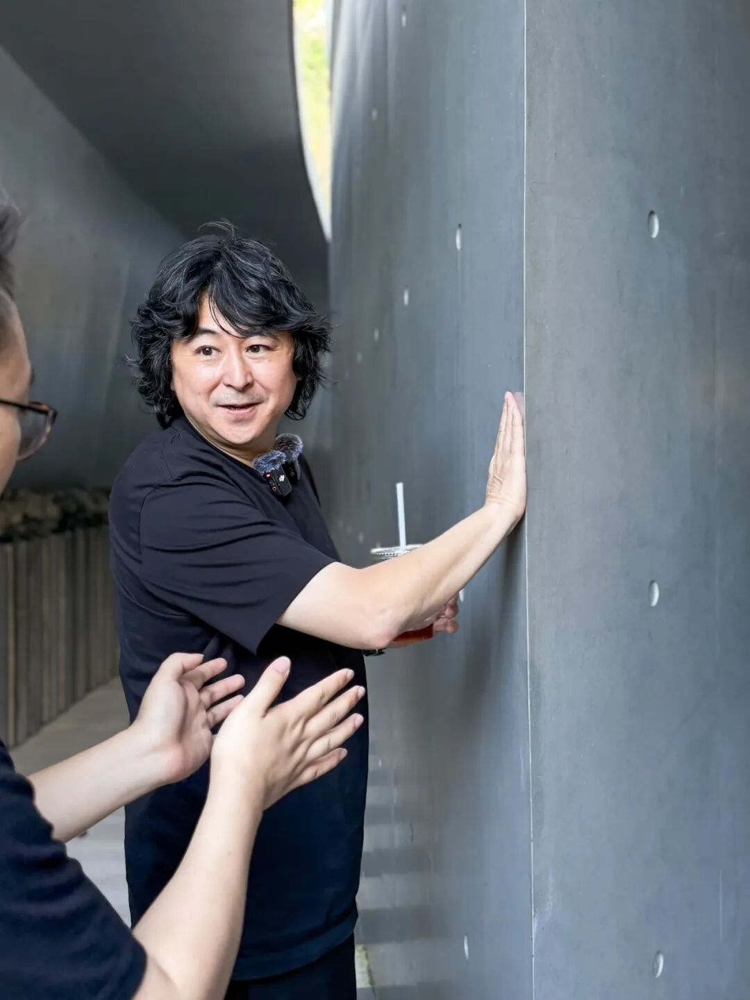

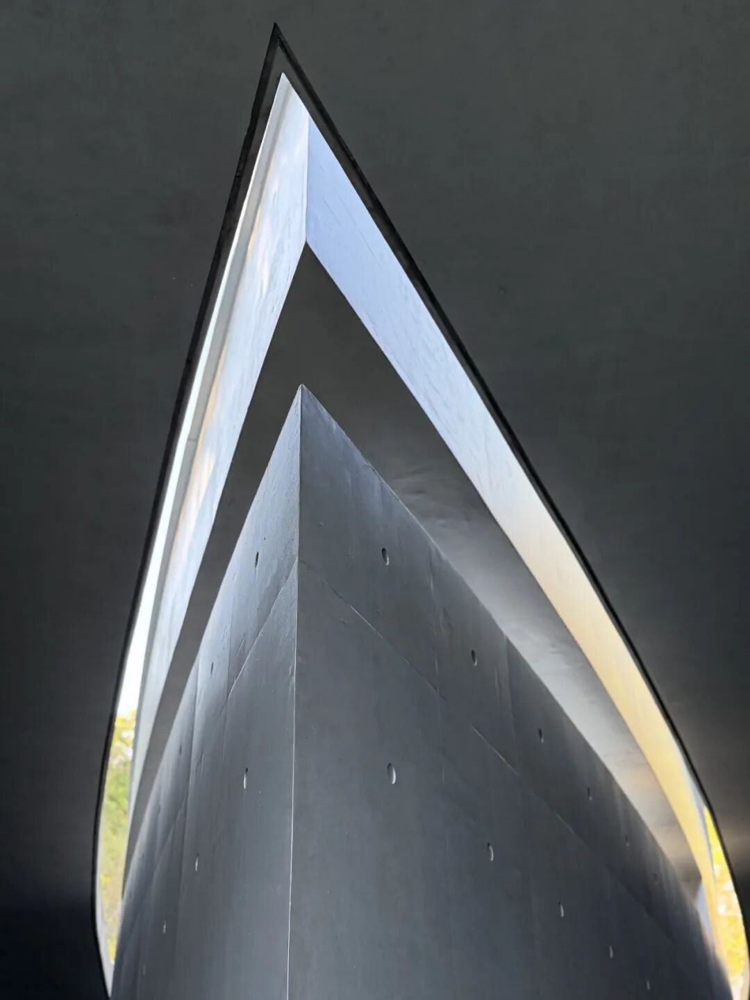

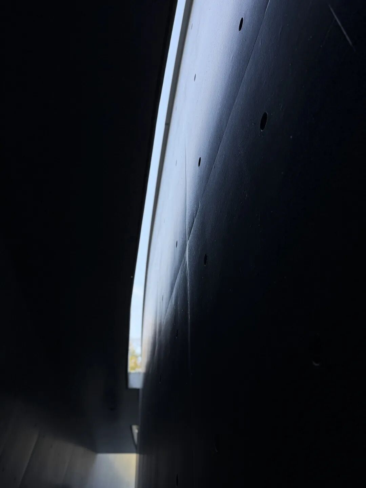
** △  清水混凝土完成面  摄影：原源/有方  **
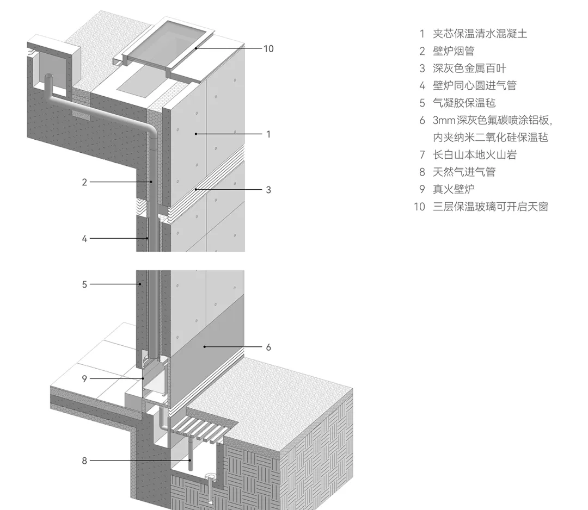
△ 混凝土  墙身节点 ©  line+
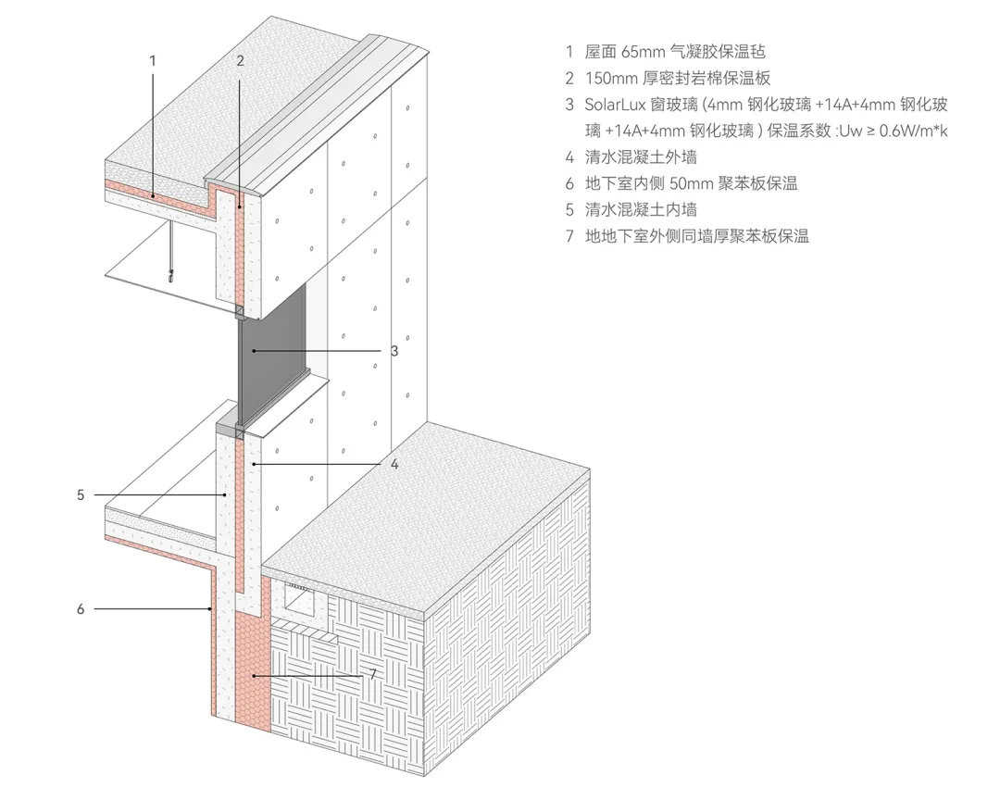
△ 清水混凝土夹心部分保温运用 ©  line+
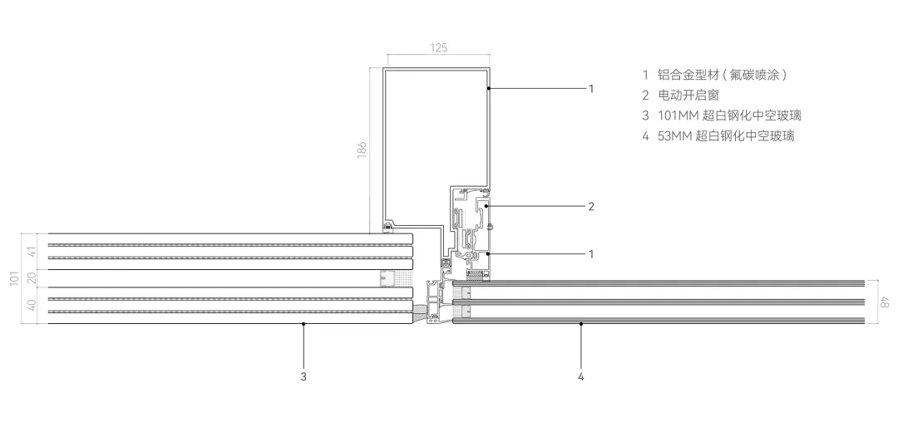
△ 8米通高的单片3层夹胶中空玻璃 ©  line+
** 有方 在项目建成后，你对中国当代施工生产体系有没有一些更新的思考？孔雀林山庄可复制、不可复制的经验，分别是什么？  **
孟凡浩  孔雀林做完以后，我确实有一个比较深的反思，就是  建筑的建造方式，究竟应该如何回应我们所处的现实条件。
受到建筑学教育和现代建筑大师作品的影响，  在那个阶段，
我比较认同材料的真实性与建构的纯粹性，希望尽可能忠实地呈现材料本身，甚至带着某种执着，去实现真正的清水混凝土建造。
为此，我们借鉴了日本、瑞士等国家成熟的建造经验。但真正实施下来发现，  任何一种建造方式的背后，  都依赖与之相适应的产业基础、供应链和施工体系。
如果脱离这些条件，直接移植另一套技术标准，往往需要付出极高的时间、成本和协调代价。
** 我们经常讨论建筑形式的在地性，但其实建造本身同样需要在地性。  ** 它不仅要适应气候与场地，也要适应当地的生产能力、施工体系和成本条件。
这让我想到几乎同一时期做的丽水古堰画乡艺术中心。那个项目受到造价条件的限制，我们采用了相对常规的钢结构和砌块围护体系，通过混凝土质感涂料形成最终的建筑表面。
一个是真正的清水混凝土，一个是混凝土质感的饰面，从材料和建构的角度来看，当然有很大差别。但我并不认为后者有什么问题。因为在那个项目的现实条件下，如果坚持采用孔雀林这样高成本、高精度的建造方式，设计可能根本无法实现。
所以回过头来看，孔雀林有些经验是可以延续的，比如前期对材料和构造的深入研究，通过实体样板反复验证，以及建筑师对设计、施工和多专业协同的持续把控；
另一方面，它也让我开始重新思考，如何在设计追求、建造精度、成本与实际生产条件之间找到更合理的平衡。这可能是这个项目留给我更重要的经验。
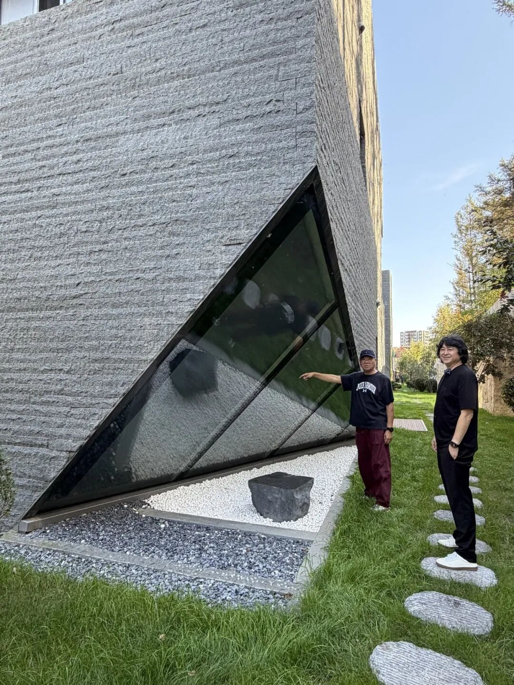
△  回访现场，让业主团队印象深刻的一处挑战 摄影：原源/有方
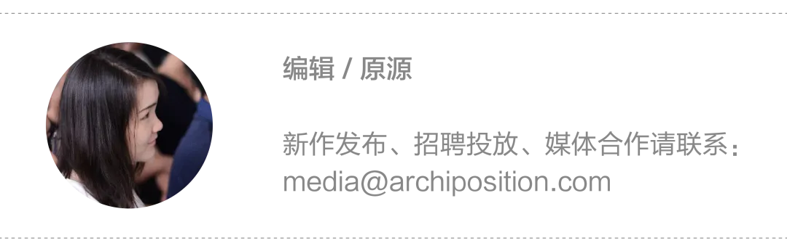
** ** 采访  / 原源  校对  ** / 原源
本文版权归有方所有，部分配图由line+授权有方发布、版权归原作者所有。欢迎转发，禁止以有方编辑版本转  载。

以“在看”分享  **** **

