# 阿尔托一栋“死去的经典”：三次开馆，两个国家，跨越铁幕的78年丨深度

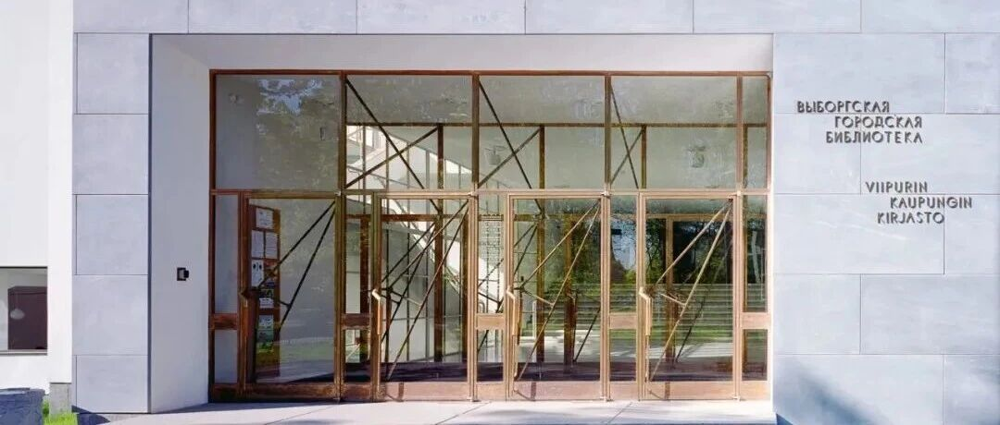

**** 孙一腾  ** **
建筑师、写作者，现从事建筑设计。关注建筑、城市与时代叙事，尝试从具体的空间、人物与历史现场出发，重新观看那些在时间中不断改变意义的建筑。相较于将建筑作为物的存在，
更关心它们曾经如何被建造与使用，又如何在新的时代被重读与理解。  “闲市集丨檐下谈”系列作者。
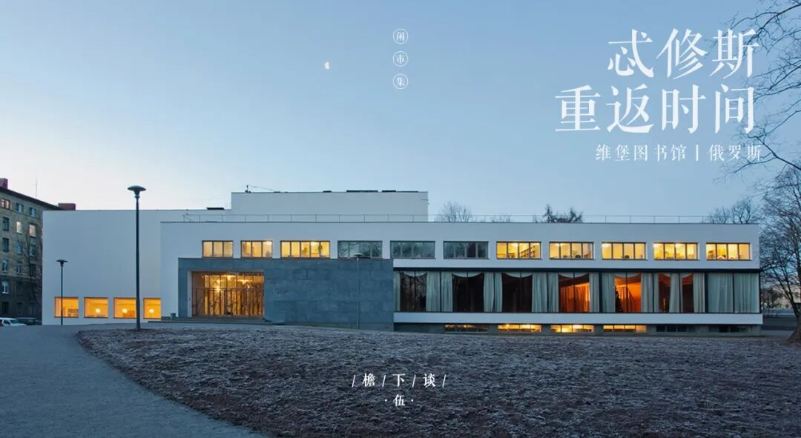
本文由作者公众号“闲市集”（ID：xianshi_garden）授权有方发布，欢迎关注。

自市场广场向前，一座雪白的图书馆在冬日的枝桠之间显现。其入口墙面上镌着两组不同语言的文字，指向同一个名字：维堡市立图书馆。
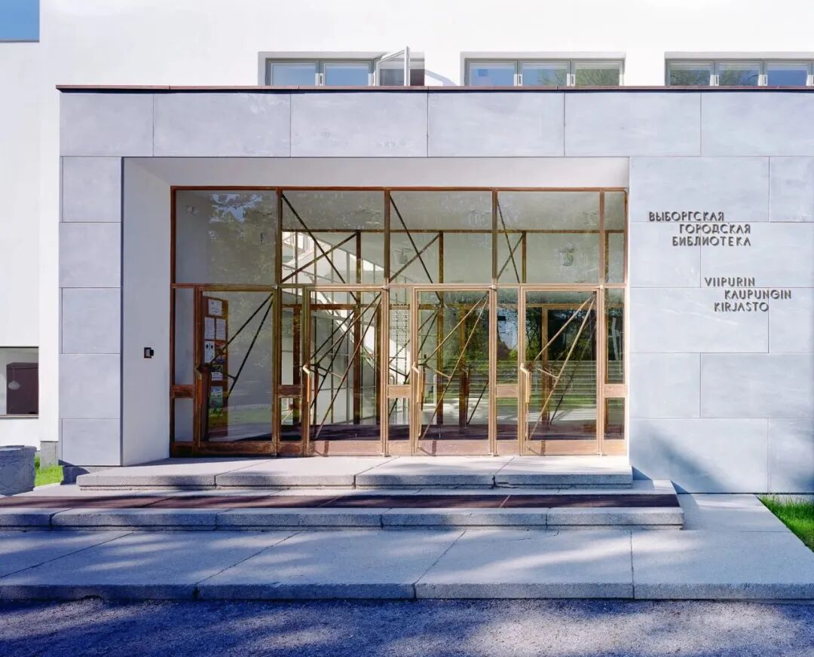
△  维  堡图书馆入  口铭牌 ©Petri Neuvonen
临近正午，演讲厅里的座椅已经重新排列。人们没有朝向通常意义上的讲台，而是面对门厅，以及东侧那面围合出玻璃楼梯的透明窗墙。
来自芬兰和俄罗斯两国的政要与建筑师们陆续就座，其中有芬兰前总统塔里娅·哈洛宁、俄罗斯总统办公厅主任谢尔盖·伊万诺夫、列宁格勒州州长亚历山大·德罗兹坚科、主持修复工作的建筑师塔帕尼·穆斯托宁，以及参与这场漫长修复的诸多建筑师们。
二十余年的漫长工程将在今天正式宣告结束。他们聚集于此，也正是为了参加随之而来的开幕典礼。
又一场开幕典礼。
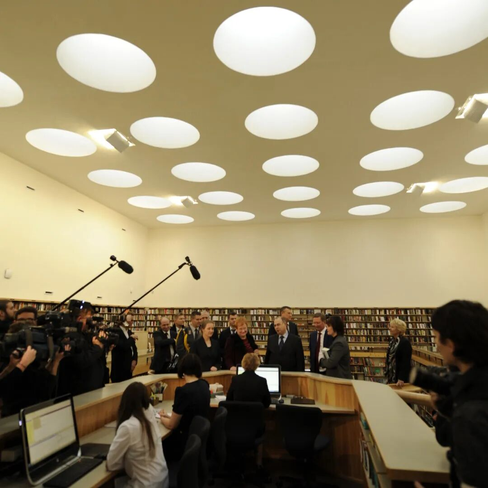
△  2013年维堡图书馆重新开放典礼现场
图源：Alvar Aalto Library, Vyborg官方网站
宾客之中，有两个人并不因为职位而显眼：艺术史学家约翰娜·阿拉宁和工程师哈米尔卡·阿尔托，但二人的身影始终被诸多目光追随。而这，源自他们曾共享过的姓氏：阿尔托。
此时，距离他们的父亲——这座图书馆真正的建筑师——阿尔瓦·阿尔托的去世，已经三十七年；而距离它上一次的开幕典礼，则已有七十八年。

1927年，芬兰维伊普里市为新的中央图书馆举行了一次设计竞赛。最终，一个署名为“W.W.W.”的方案胜出，设计者便是尚且年轻的阿尔瓦·阿尔托。
彼时仍然身处北欧古典主义的尾声影响下的阿尔托，其设计出的规整构图、明确轴线，以及位于核心位置的阅读空间，还都能让人轻易联想到阿斯普朗德正在建造的斯德哥尔摩市立图书馆。
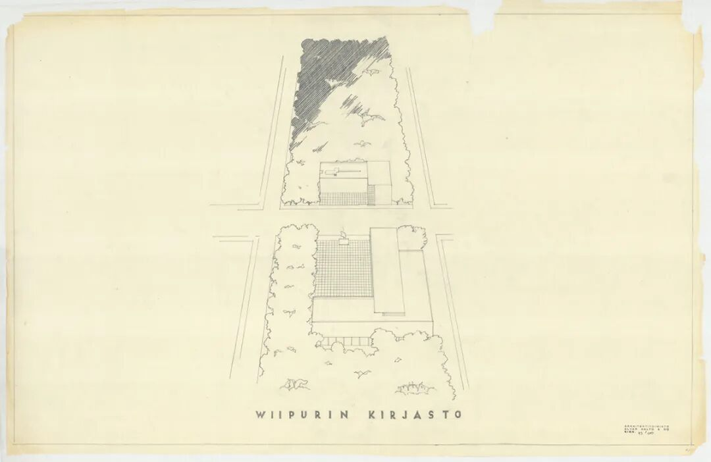
△  阿尔托以“W.W.W.”为匿名代号提交的竞赛方案
图源：Archiweb
但竞赛结束不久后，当他将自己的事务所搬至图尔库，一场属于他与这栋建筑的改变不期而至。
一方面建设始终迟迟未启；而在接下来的数年间，阿尔托也在之后的欧洲旅行中接连经过法国、荷兰与丹麦，接触到了勒·柯布西耶、奥德、杜多克等人正在宣扬的另一种新建筑。这些邂逅促使他在1928年至1929年完成的《图尔库日报》办公楼中，开始频繁使用水平长窗、自由立面与钢筋混凝土结构取代了此前所拥护的古典秩序。也正是在1929年，阿尔托去法兰克福参加第二届现代建筑国际会议，第一次真正进入那张正在改变欧洲建筑的关系网络，他也因此得以结识了吉迪恩、格罗皮乌斯、柯布等诸多现代主义先驱。
但与当时多数人的某种“狂热”不同，
当阿尔托后续赢得帕伊米奥结核病疗养院竞赛时，功能主义在他的手中似乎已然发生了某种不易察觉的偏移：新的结构、材料与形式仍然重要，但“功能”所指向的对象，已经从建筑本身延展成为对个体的体察与关心：病房的朝向、病房的天花颜色、水龙头发出的噪声以及椅背的支撑角度，这些看似细枝末节的设计，得以让阿尔托在现代建筑的宏大原则之下，宕开了一个崭新且和谐的宇宙。
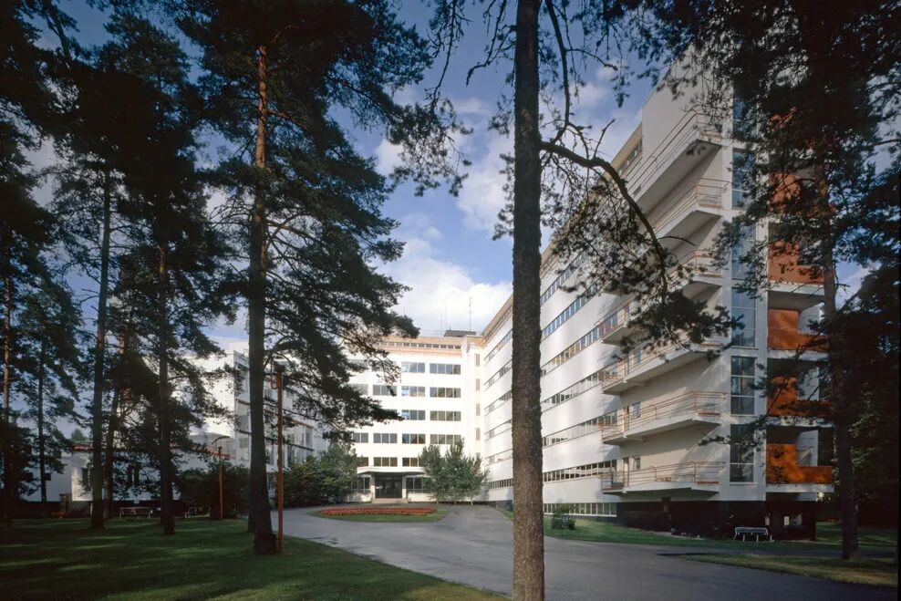

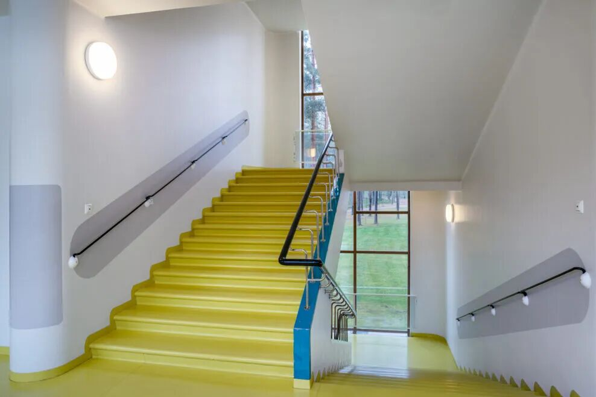

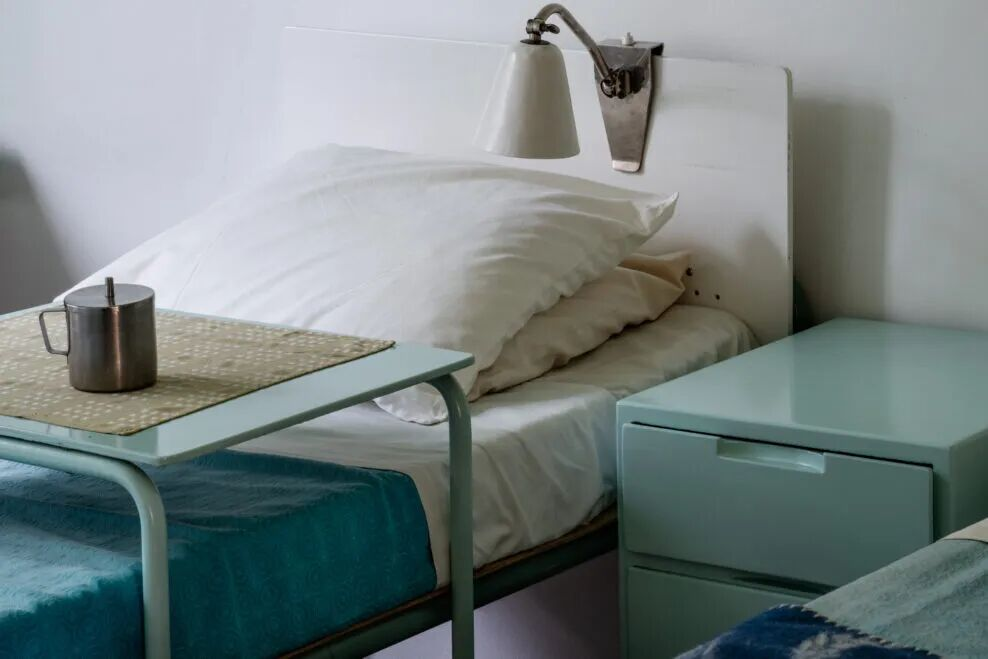
△  阿尔托的帕伊米奥结核病疗养院
图源：Maija Holma, Alvar Aalto Foundation
因此，当维堡图书馆终版的图纸在帕伊米奥疗养院落成的那年绘制完成，那原本仍带有古典主义意味的方案已然褪去了对称的构图与装饰，蜕变为一栋平屋顶、白色墙面、长窗与玻璃楼梯组成的新建筑。而相较于其克制的“现代”立面，其内部空间更能体现阿尔托技法成熟后的有机、理性与浪漫。
主图书馆被重新组织成了一个连续且开放的空间，借阅与阅读区域之间形成高差，书架沿着空间展开。位于空间高点的管理与借阅台则被稍稍抬起，使工作人员得以从相对集中的位置，看到沿不同标高展开的借阅与阅读空间。
开放与管理并没有依靠墙壁或管理手段来解决，而是被巧妙藏进了几级高差之中。
同时，在阅读空间的天花之上，一个个2米深的锥形天窗嵌入白色屋顶。阿尔托利用如此的深度，将高纬度地区低角度的直射天光在白色锥壁间多次反射、彼此叠加，最终均匀地洒向人们阅读的书台。这样的设计，既让读者平等地沐浴于难得的日光下，也保证所有人免受耀目眩光的烦扰。
声学上，阿尔托同样有深远的考量。在被用作演讲厅的空间中，阿尔托选择让极具芬兰地域特色的卡累利阿红松配合设计，形成一道缓慢起伏的波浪曲面吊顶。正如他的声学研究草图所揭示的那般，看似随意呵成的曲线都是有心为之：阿尔托试图以此将声音从演讲者所在的位置均衡而平等地抵达房间的不同位置。
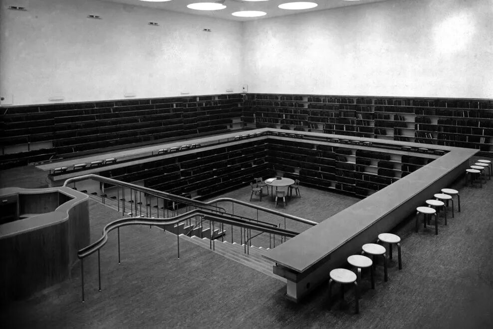
△  下沉的阅读空间
图源：Gustaf Welin,  _ _ Alvar Aalto Foundation
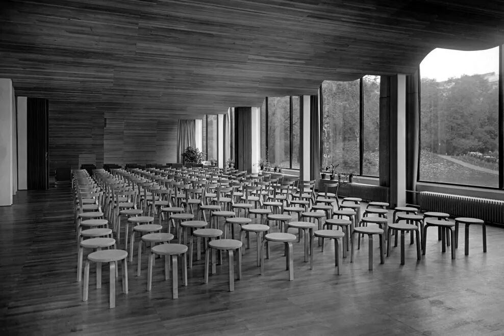

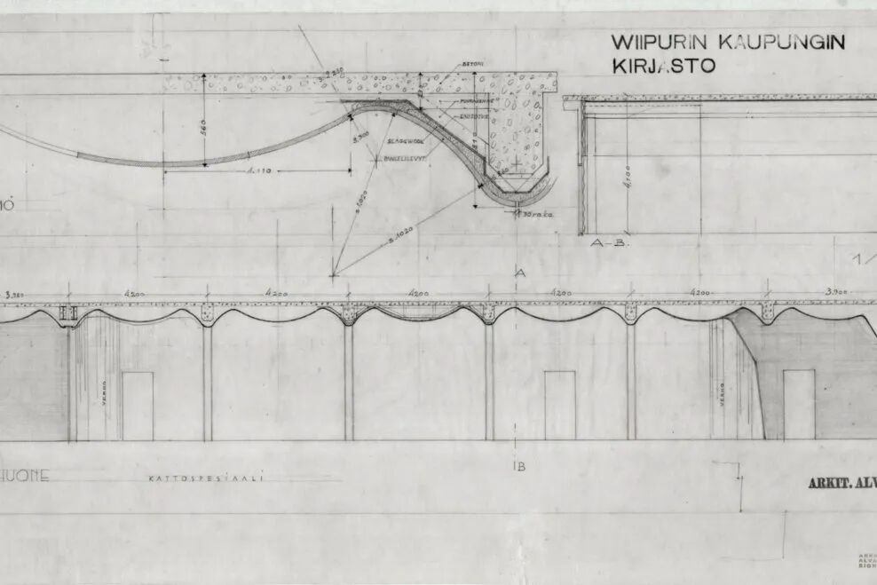

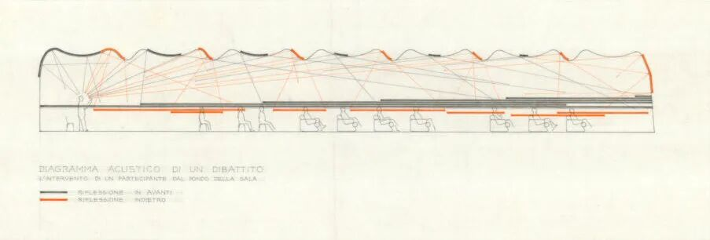
△  演讲厅与波浪形天花
图源：Gustaf Welin,  _ _ Alvar Aalto Foundation  _
图书馆的儿童图书馆和报刊阅览室也分别面对建筑不同的立面，与主馆不共用同一入口。藏书、阅读这些内向空间与更具社交属性的俱乐部和演讲空间彼此区分，却又被规划的一条内部流线清晰连接。不同年龄、目的的人们都有属于自己的路径，却又可以相遇在同一座公共建筑之中。同样地，馆中用于不同活动的空间彼此明确，却并未被束缚，部分空间仍可以借助帘幕等手段进行重新划分，为不同的活动留有余地。从当代回看，这甚至隐约预演了几十年后建筑界关于灵活性与开放性的思辨。
这或许也是阿尔托“有机建筑”理论逐渐显露的表征。
所谓“有机建筑”并不应简单地被理解为曲线、木材或模仿自然形态，尽管这些元素也构成了阿尔托设计手段中的重要环节。
更为本质的，也许是他并不相信复杂的建筑能够被某种单一的秩序所概括。
阅览室因为光线的引入形成自己的天窗，演讲厅因为声音的均衡获得另一种吊顶，儿童拥有自己的入口，管理又被藏进几级高差之中……每一个局部都可以回应自己的条件，却又因更广阔的视角彼此牵连，最终汇聚成一个完整而生动的整体。
同时，阿尔托并未因此离开功能主义。恰恰相反，他是在从微观视角扩大了“功能”本身的内涵——从分区、流线与结构，一直延伸到光线、声音、人的身体乃至心理感受。
当周围正喧嚣着新时代建筑那种源自机器的统一、理性秩序时，阿尔托却选择使用源自生命的有机，回应着个体的感受与尊严。
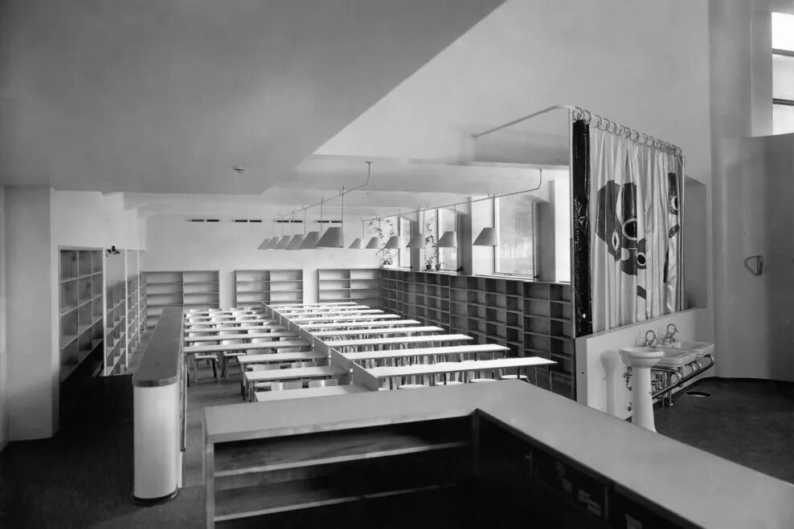

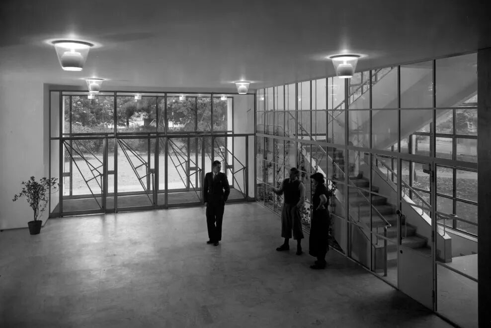
△  维堡图书馆室内空间，1935
图源：Gustaf Welin,  _ _ Alvar Aalto Foundation  _
而更难得的，是理解这些设计思考并不仰赖于系统性的建筑专业训练。因为他的作品，正使用着人人皆可感知的语言。
当建筑落成，人们  自不同入口
进入这座精心设计后的图书馆。孩子轻松奔向只属于自己的阅览室，而并不会影响在报刊室的长辈。下午短暂的日光从头顶的圆形天窗落下，在桌面和书页之间弥散开来；另一侧的演讲厅里，芬兰语的沙龙讨论倾泻满屋……人们无需知道那些光经过了怎样的计算，也未必有人会注意整栋建筑流线的驯服，但总能感受到来自建筑本身的温度。
而对于刚刚拥有这座新图书馆的维伊普里而言，这仿若是它漫长得了无尽头的日常里，每一个再平静不过的下午。
一如在几十年后在佛罗伦萨斯特罗齐宫的阿尔托作品回顾展上，意大利著名评论家拉基安蒂（Carlo
Ragghianti）所评价的那般：阿尔托如同基督教里，“阿西西的圣弗朗西斯”。
一位能够向鸟兽布道的圣徒。
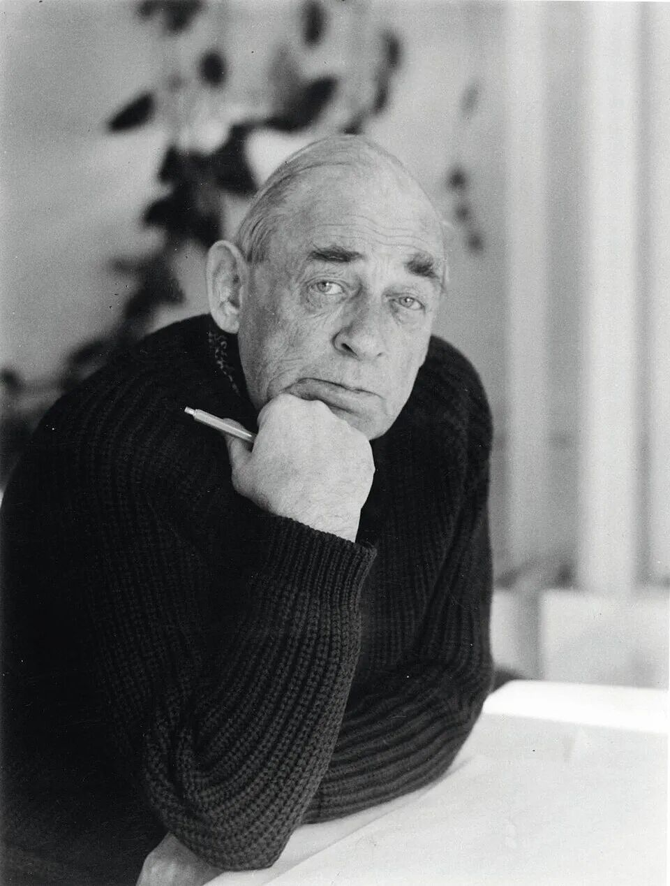
△  阿尔瓦·阿尔托
图源：Wikimedia Commons

但命运从不偏爱平凡。
维伊普里，这座在地图上并不出名的市镇，却在近千年的历史中，始终身处纷争前线。它的一侧是宽广的波罗的海，身后则是同样无垠的大陆平原。
这里既是通向圣彼得堡的门户，也同样是直抵赫尔辛基的前哨。水道、城堡与要塞于此叠加，见证着它的历史。
所以，当1939年11月，苏芬战争在双方的积怨中爆发，炮火再一次越过卡累利阿地峡，这栋曾经只需要考虑光线、声音与书页的建筑，第一次直面着迫近的威胁。此次战争持续的时间并不长，最终是以次年3月签署的《莫斯科和平协定》结束。尽管当时维伊普里的大部分城区仍由芬军控制，根据协定，芬兰仍须将包括这座城市在内的卡累利阿地峡大片地区割让给苏联。城中的居民陆续撤离，地图上的“维伊普里”（Viipuri），也开始被标记为俄语中的“维堡”（Vyborg）。
1940年5月，当尼古拉·尼科尔斯基（Nikolai
Nikolski）作为苏联的管理者被授权重新打开图书馆大门时，书架上原本的芬兰语书籍开始被替换为列宁格勒和彼得罗扎沃茨克的俄文书籍，研究室里也摆满了马克思列宁主义、共产党历史以及卡累利阿—芬兰民族史的相关著作。
但这不过是它颠沛命运的启程。维堡图书馆连同这座城市一起，始终在海潮一般的国境线中反复确认归属。就在不久后的1941年，随着芬兰军队重新接管维伊普里，作为图书馆的新一任芬兰馆长，瓦尔特·阿佩尔奎斯特（Walter
Appelqvist）却发现他的“敌国”前任馆长尼科尔斯基曾通过数道行政命令，将之前下架的大多数芬兰语书籍都集中完好地保存于附近的城市圆塔。
尼科尔斯基当然没有阻碍图书馆纳入苏联知识秩序的动机，但这位研究芬兰—乌戈尔民族的苏联学者在威权之下，仍留存应有的专业伦理：
图书馆首先应是保存文明记忆的机构，其次才应是当下权力解读知识的工具。
权力与暴力自有其威压，但文明与善意也总有其顽强。
重回芬兰的图书馆此时早已不是1935年的完美模样，但每日下午四点，图书馆仍会开放，一如战争并不能阻止天光落下，也不能阻止日常生活的发生。即使是动荡如战争的极端社会环境，来自芬兰的士兵与平民和前几年的苏联“敌人”一样，都在此做着同样简单的事：读书、看报、消磨时光。
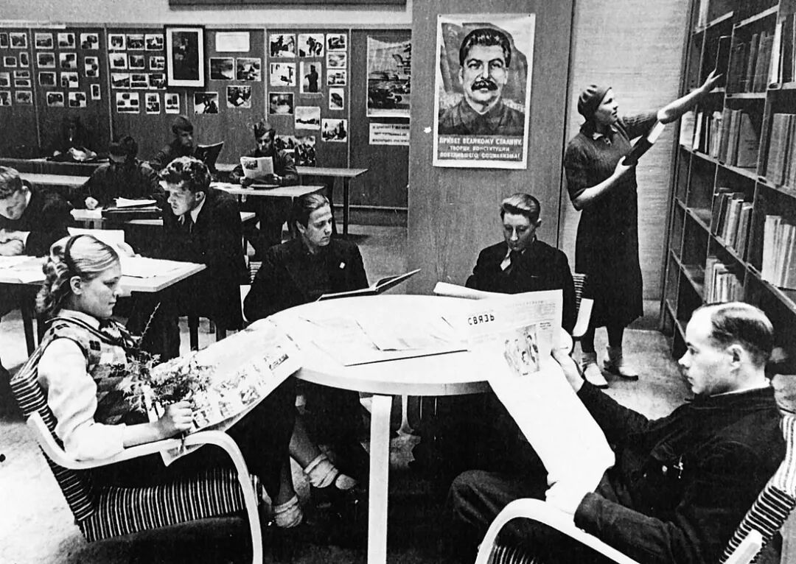
△  拍摄于图书馆归属苏联期间
图源：Alvar Aalto Library, Vyborg官方网站
直至1944年6月20日，又一个下午四点，苏军的坦克再次出现在滚滚烟尘之中。
两名年轻的军士在慌乱中穿过公园，于灌木后找到一扇地下室的窗户，便带着两名伤员翻了进去。而这正是维堡图书馆。而之后，这里又容纳了大约二十名年轻的撤退士兵，很多人在绝望之中，把身上仅剩的一点贵重物品藏进书架，甚至书页间。
很快，随着远处传来的巨响，连接老城的城堡桥被炸毁，退路已然消失。而他们最后的决定，是将找到的一截白布挂在图书馆的窗前。
远处的城堡塔楼上，芬兰国旗缓缓落下，与落日一起，结束了维伊普里作为芬兰城市的最后一天。
曾任1927年设计竞赛评委的馆员约翰·瓦塞纽斯（Johan Vasenius），也在那日的撤退中失踪，从此下落不明。
这位自这座图书馆诞生之日便长期参与各项事务的馆员似乎与维堡图书馆一起，消失于迷雾。
没人知道发生了什么，图书馆也一样。
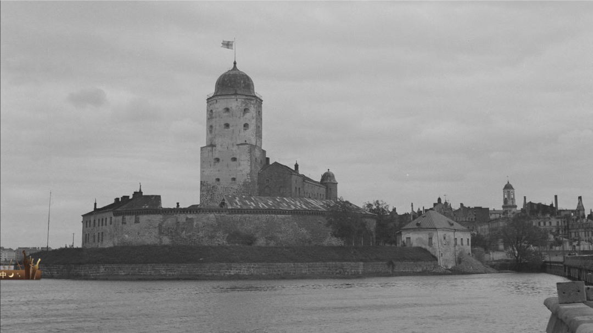
△  1944年6月20日，芬兰国旗在维堡落下 图源：yle

战后相当长一段时间里，西方主流建筑界广泛地接受了“维堡图书馆已毁于战争”的说法，例如在纽约MoMA内部一封讨论重印阿尔托专著的信里，直接写明“维堡图书馆已经被摧毁”。随后，类似说法被多部权威建筑史著作重复使用，齐格弗里德·吉迪恩、雷纳·班纳姆都曾把它当成既定事实；甚至在1963年的阿尔托作品集里，也出现了“图书馆在苏芬战争中被摧毁，如今只剩废墟”的类似表述。
在西方建筑语境中，它一度变成了一栋“死去的经典”——芬兰保存下了大量有关这座图书馆的照片、档案与建筑图纸，它们仍在建筑出版物中反复流传，其建筑史地位甚至不断攀升，但现实中的那栋建筑却几乎无人过问。
正如1970年《纽约时报》在相关报道中写道：两代无数的建筑师都是通过照片，认识这座“在战争中被毁掉”的图书馆。
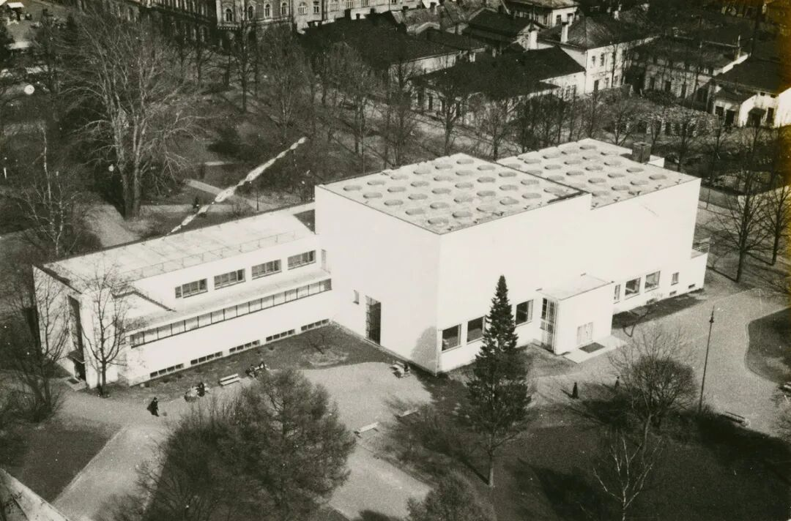
△  维伊普里市立图书馆，约1936年
摄影：Pietinen 图源：Museovirasto
而事实上的维堡图书馆呢？
它仍然站在原处，只不过在接下来的几年里迅速沦为一具空壳，其中的木材、铜、铅以及任何能够被拆走的部件陆续消失，而持续暴露在雨雪与寒潮中，让其窗、门、木地板乃至内外墙面，都在后来的损坏评估里通通被记作损坏或遗失。
而全面修缮的计划却迟迟未被落实。没有图纸的窘境，加之当时激进的意识形态环境，使原样修复这样一座可能被视作“资产阶级现代主义”建筑的可能性称不上高；而对于另一种“现代苏维埃建筑”方案中可能出现的古典柱式、檐口、三角山花以及补充的对称体量，苏联建筑师安德烈·戈扎克等人则是表达了坚决反对。在双方的相互拉扯中，委员会最终还是选择保留原有立面修缮，其理由倒也真诚：
与其付出巨大代价重新寻找一种足够好的建筑表达，不如承认眼前已有的方案已是如此。
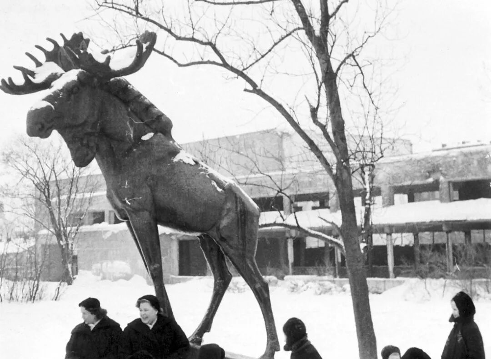
△  公园中衰败的图书馆
图源：Alvar Aalto Library, Vyborg官方网站
但接下来这场持续了近七年的单方面的修复，更像是对功能而非空间的挽救。战争年代遗失的家具以随处可见的普通桌椅替代，原有的空调、通风与管线系统也都未能恢复，一些窗户、细部与材料也只能以当时能够获得的方式被重新制作，鉴于苏联彼时愈发孱弱的轻工业环境，这些修复工作不过差强人意。原本通透的楼梯间也因为缺少相应的制作方法而被厚重的混凝土所代替；同样地，那片曾经悬浮于演讲厅上空的木质波浪天花也已消失。
如此一来，阿尔托原本精细的空间关系被大幅削弱，诸多只有在材料、构件与细部中才能被感受到的感性与浪漫，也随之变得暧昧模糊。修复“完成”的它似乎重新获得了作为图书馆的生命，却与1935年的原作愈发像是不同的存在。
在贯穿整座欧洲的铁幕之下，苏联留下了建筑，芬兰留下了记忆。而维堡图书馆，则被遗忘在了二者之间。
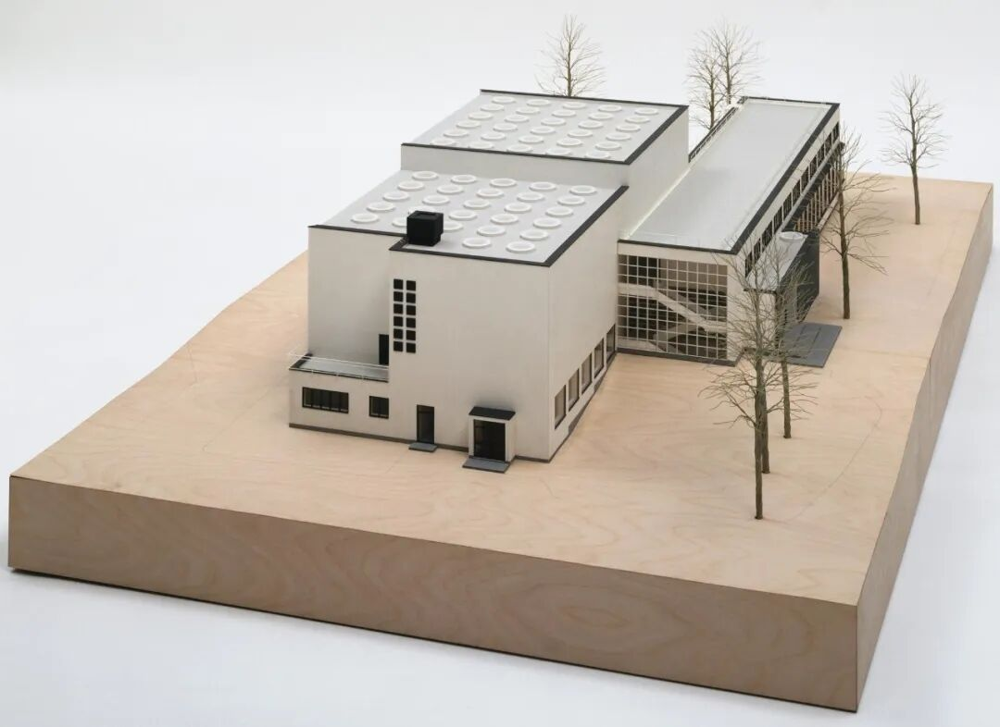
△  MoMA收藏的  1:50  维堡图书馆模型
直至1985年，一位名叫谢尔盖·克拉夫琴科（Sergei
Kravchenko）的吉尔吉斯斯坦建筑师，抱着参观苏联境内唯一一座阿尔托作品的心态走进了这座图书馆。起初，他也曾满足于相似的躯壳，但很快便痛心于细节的缺失与设计精神的贫乏。他一方面仔细检修建筑的面层与墙体，用考古式的耐心来对抗修复的粗糙；另一方面，他也开始主动跨越那时已然开始松动的铁幕，通过在维堡附近工作的芬兰企业建立联系，成功从艾丽莎·阿尔托和芬兰建筑博物馆获得了一部分图纸。
而另一侧的芬兰，也开始出现了一种名为“library-
run”（逃跑去图书馆）的“潮流”，即在赫尔辛基—莫斯科列车在维堡停靠进行边检时，偷偷下车，沿公园跑到图书馆拍几张照片，再赶回列车。这些冒险式的短暂造访，也开始让更多的建筑师知晓了图书馆的现状。值此天时地利，1990年曾在阿尔托事务所工作多年的时任芬兰环境部官员尤西·劳齐（Jussi
Rautsi）和米科·曼西卡（Mikko
Mansikka）如唐·吉诃德一般，锲而不舍地奔走宣传，最终说服了阿尔托的遗孀艾丽莎·阿尔托参与到修复倡议之中。随后，他们马不停蹄地赶赴维堡勘察，与列宁格勒建筑研究机构、维堡市建筑师以及克拉夫琴科会面、研究后续修复的诸多可能。
至此，桥梁开始打破篱墙。
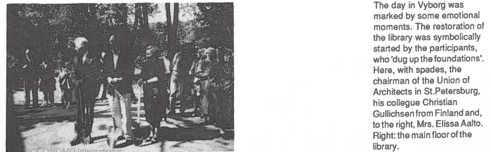
△  1993年5月，维堡图书馆修复工程象征性开工
图源：DOCOMOMO International
返程后的1991年3月，芬兰环境部为之专门举行了一场公开会议——“维堡图书馆可以被修复。”一年后的同月，随着芬兰环境部与维堡市方面签署了一份包含20项内容的合作意向协议，双方的目标与责任因此被明确；而后，芬兰维堡图书馆修复委员会被正式宣布成立，成员囊括了艾丽莎·阿尔托、芬兰建筑师协会、芬兰环境部、阿尔托俱乐部（Alvar
Aalto Club）建筑师等多方合作者。
又一年过去，在维堡的阳光、乐队与香槟中，艾丽莎·阿尔托、克里斯蒂安·古利克森与维堡副市长一起拿起铁锹，挖下了象征性的第一铲土。
在现场的克拉夫琴科激动地说，他已经为这历史性时刻等了太久。
它也是一样。

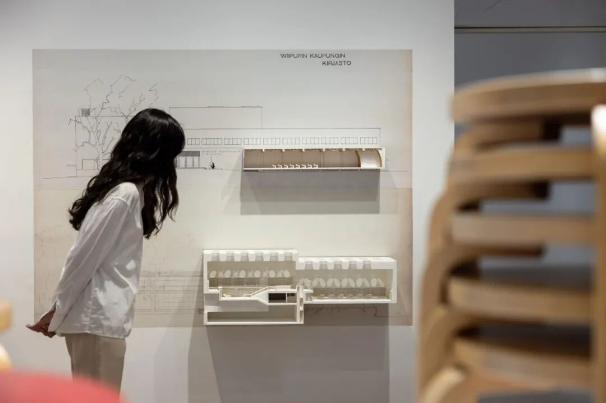
△  阿尔托展览中的剖面模型
但这并非故事的完美终章。这项看似声势浩大的修复野心，其面对的挑战远比当时众人所想象的复杂。
此时，正值苏联解体的历史节点，俄罗斯进入混沌而剧烈的社会转型。因此导致的，是资金问题始终悬而未决。1992年前后，项目估算的修复费用已高达5000到6000万芬兰马克，但其中本应俄罗斯兑付的一半，在当时连零头可能都要“打很大的问号”。这一问题，要等2010年前后双方领导人在两国“阿莱格罗”列车首航期间的会晤时才能得以真正解决（时任俄罗斯总理普京最终向芬兰总统哈洛宁许诺拨款2.555亿卢布、约合670万欧元）。而在这之前的漫长修复期间，团队一直依赖拆解阶段、举办慈善音乐会、接受私人基金会或国际机构资助等方式勉强维持。
而跨境修复这一行为本身，也同样是不可预见的阻力缘由。芬兰定制的灯具、工具和材料，例如重建波浪天花时，需要的约9公里长的卡累利阿红松木条，都需人力携带穿越边境。据穆斯托宁后来回忆，这些在当时苏联并不常见的物品，几乎次次都会遭遇海关的问询与盘查，以至于他的车中，时常备着一本维堡图书馆的影集来应对。
而两国之间不同的技术规范、审批体系和建筑传统也同样带来诸多问题。芬兰团队更在意原始材料、细部以及其中的微妙构造；而俄罗斯的施工团队有时则更习惯接受平铺直叙的工程逻辑。作为双方参与决策的建筑师，俄方的克拉夫琴科认为，应借此完善阿尔托时代未曾实现的部分，例如没有真正建成的室外水池；而代表芬兰方的穆斯托宁却更坚持忠于已建成的原作，就像演讲厅的波浪天花的材质与搭接方式，以及入口大厅那面玻璃墙原本的尺寸和偏差。
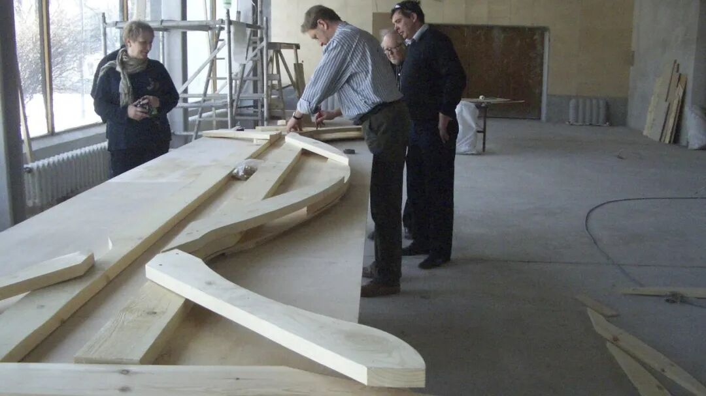

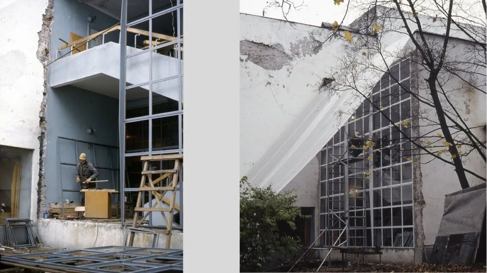

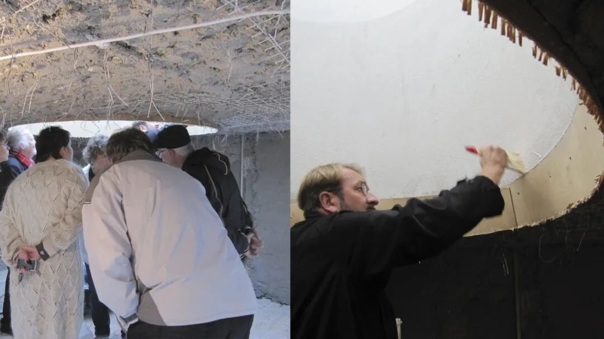
△  修复过程记录摄影 图源：Alvar Aalto Foundation
但在差异之上，共识更多。在修复后的图书馆里，60年代苏联时期留下的衣帽间与钢框玻璃门被一致同意留在大厅；而主阅读空间的天花上，那些看似相同的锥形天窗，也早已更换为安全玻璃，辅以保温与防结露措施。火灾探测器、监控、新风与喷淋也均为满足当代标准被引入，被特别关照地安置在那些不打扰原有空间视觉的角落。
这一切不由得让人联想起传说中，那艘忒修斯自克里特返回雅典后被长久保存的船只。当人们一块块地重新替换它的零件，直至最初构成这艘船的木料已经没有存留的那天。而替换下来的零件，则被有心人重新组装成新的船体，那么这两艘船谁又有资格被认定是原本的那艘“忒修斯之船”呢？
名为“忒修斯之船”的悖论自此诞生，而现代哲学通常愿意归纳其为“跨时间同一性”（identity over
time）的思辨，即一种存在本身的材料、形式、历史、功能、记忆都可能参与构成身份，但似乎没有任何一项可以替代存在本身。
维堡图书馆，也许正是这一古老问题的再次上演。
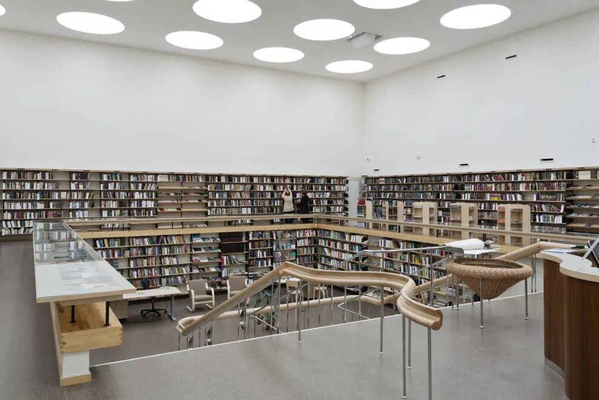

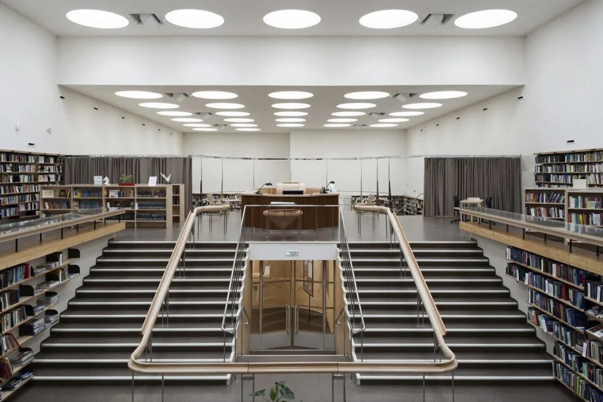
△  修复后室内摄影
图源：Maija Holma, Alvar Aalto Foundation
诚然，若只以原始材料作为评判尺度，修复后的维堡图书馆早已不再是1935年的那座：天窗并非同一块玻璃，天花并非来自同一块木板，家具与扶手被重新打造，某些空间的设计也因苏联时期的使用而被更改。
但一栋建筑的同一性从不仰仗于此。维堡图书馆并未真正被战争摧毁，尽管在这之后的漫长岁月中，它残破、失语、一度消失在大半个世界的视野之外，但它从未像密斯的巴塞罗那展览馆那般，在拆除后搬入一座更大的“展柜”供人参观；亦没有如流水别墅一般，从一栋真实被居住的住宅，最终只得转变为供公众参观的建筑“遗产”。即使在修复前的最后时刻，它依旧以维堡图书馆之名，行阅读服务之举。
历史从未自其上剥离，它始终存续于时间之河。
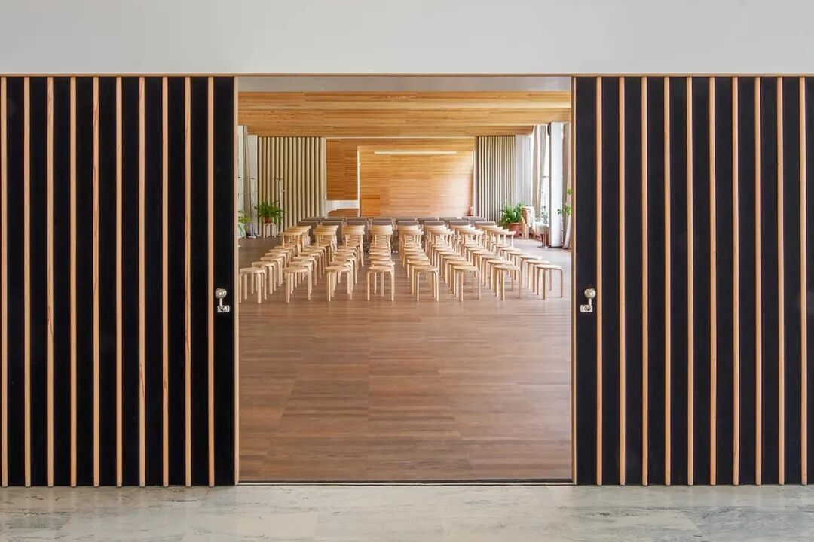

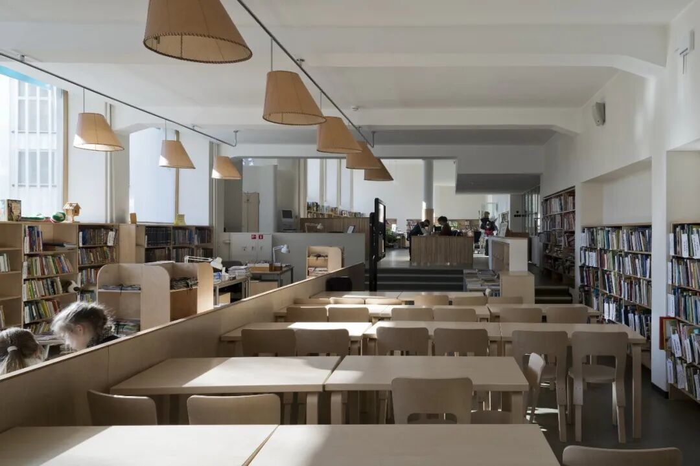
△  上：演讲厅入口；下：儿童阅览区
摄影：Maija Holma，2014
在日本摄影师星野道夫的摄影集《森林、冰河与鲸》中，曾记载过这样一个故事。某根在杉木林里逐渐腐烂的图腾柱，被民俗博物馆收藏后加以恒温恒湿的精心保护，却被原住民的后人强烈要求归之原位，尽管代价就是它们终将腐朽、消失在林地的沼泽中。
也许有些事物的尊严，恰恰在于它本应接受命运；若保存成为唯一的正义，那么世界将沦为徒有其表的空壳。
恰恰就如同维堡图书馆的修复者们所做的那般。他们执着于旧图纸里的尺寸，也愿意保留时间造就的某种痕迹。他们以与热情相当的专业，在改变与不变间反复权衡，
为的，并非让建筑免于时间，而是让它重新回归时间。
因此，尽管近一个世纪的光阴流转，图书、文字，甚至争夺过它所在国土的国家都已更迭变换，管理手段、照明、采暖与信息技术更是沧海桑田。可在又一次的开幕典礼上，当百年后的人们重新走近，很多事情却依旧发生得自然。
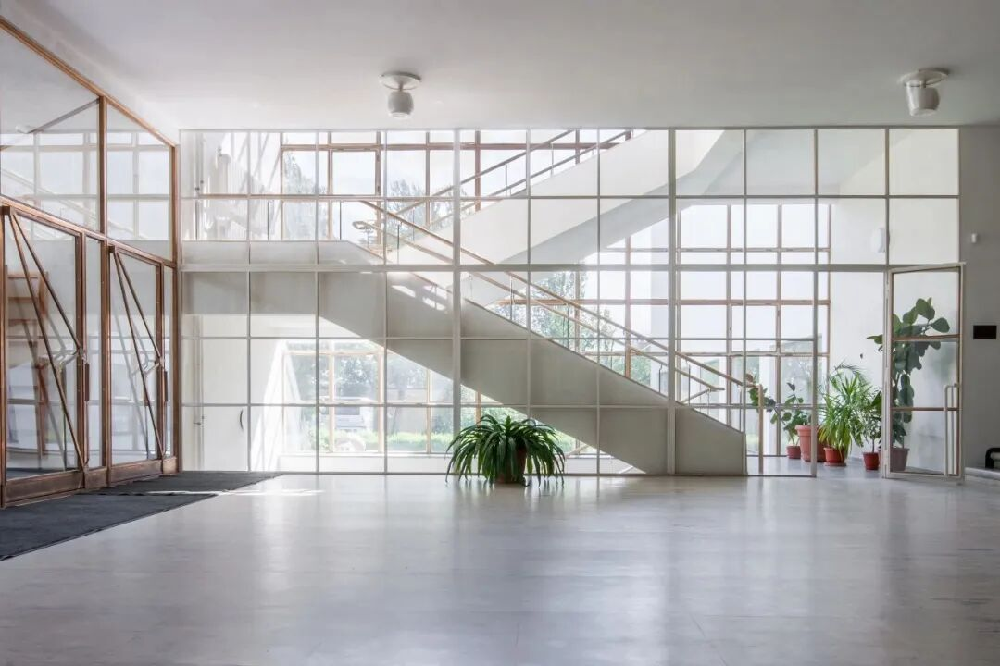

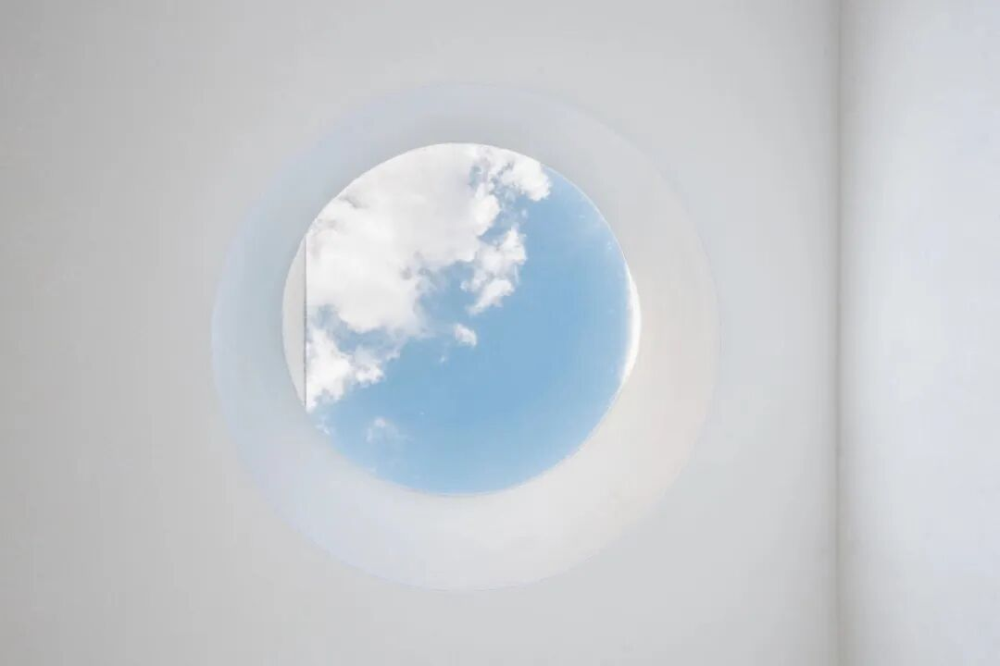
△  上：维堡图书馆主入口大厅与玻璃楼梯；下：圆锥形天窗
摄影：Denis Esakov
历史学者罗新在名为《历史学家的美德》的演讲中，曾借用哈特利那句“The past is a foreign
country（往昔乃是异乡）”来厘清历史猜测的边界。但对此他同样补充道，即使时代、制度与文化相隔千年，但人在相似处境下的爱与恐惧，依恋、悲伤与求生欲，仍然为我们理解过去提供了最低限度的一种尺度。
就像身处1935年的阿尔托无从预料身后互联网与电子阅读的兴起，更不会知晓之后几十年发生在这栋建筑中的无常命途。他所做的，只是出于对人的观察，坚信建筑所面对，从来不只是冰冷而抽象的“功能”而已。
所谓阅读，从不止于书架与座椅；所谓演讲，也并非只关乎背景与方位。光的来路、声的归途、人如何阅读、公共建筑又如何平衡需求——生活在那个现代建筑正以效率、标准与机器重新解释世界的年代，阿尔托所依赖的，无非是一些比时代变化缓慢得多的标尺。
正如历史学家面对遥远过去时，仍愿意相信某些时刻共同的人性；建筑师面对尚未到来的明天，也始终有迹可循。
而这，也许是维堡图书馆这艘忒修斯之船之所以存续的真正缘由。
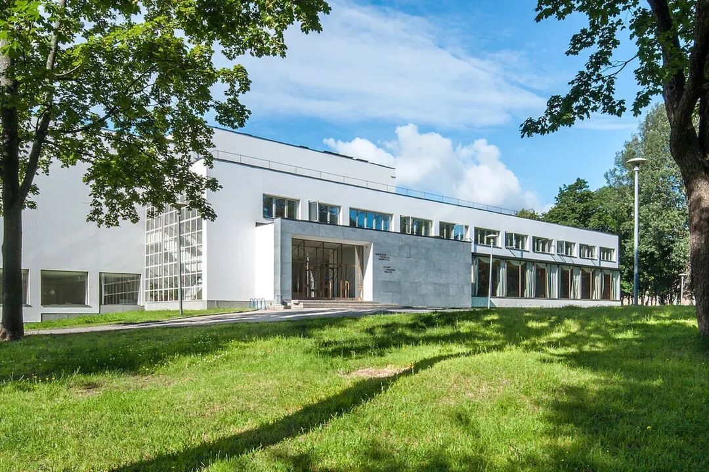

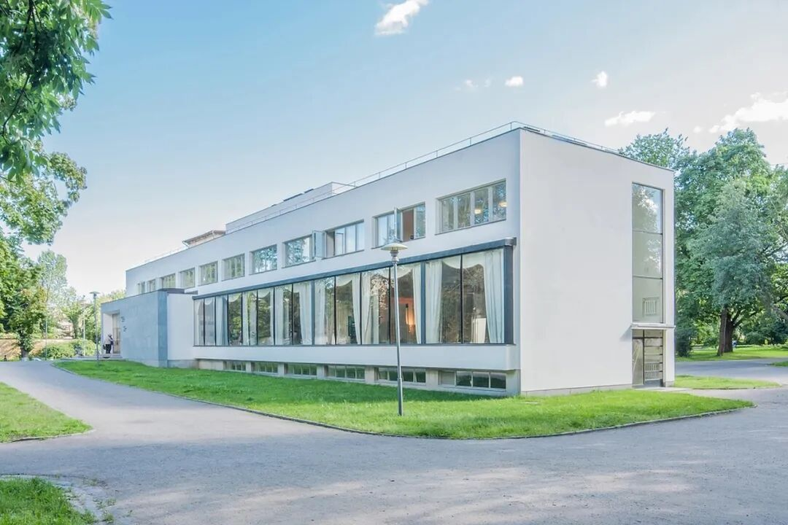
△  维堡图书馆室外 摄影：Denis Esakov
—
2013年11月25日，在盛大的开幕典礼后过去两天，图书馆正式宣布重新向普通市民开放。
政要与记者已经离开，那些有关战争、国界、修复与现代主义的宏大叙事，也尽数收拢于此。日光自天窗缓缓沉落，人们在这里借阅、停留、消磨时间。
一切未曾回到过去，只是重返时间。

** 参考：  **
· Laura Berger, The Building that Disappeared: The Viipuri Library by Alvar
Aalto, Aalto University, 2018.
· Eric Adlercreutz et al. (eds.), Alvar Aalto Library in Vyborg: Saving a
Modern Masterpiece, Rakennustieto, Helsinki, 2009.
· Eric Adlercreutz, Maija Kairamo, Tapani Mustonen et al. (eds.), Alvar
Aalto Library in Vyborg: Saving a Modern Masterpiece, Part 2, Rakennustieto,
Helsinki, 2015.
· Maija Kairamo & Tapani Mustonen, “The Restoration of Central City Alvar
Aalto Library in Vyborg,” Docomomo Journal, No.49, 2013, pp.73–77.
· Alvar Aalto Foundation, “Alvar Aalto Library”及维堡图书馆相关档案资料。
·  _ Appelqvist, Walter. “Viipurin kaupunginkirjasto bolshevikkivallan
aikana.” Kansanvalistus- ja Kirjastolehti, no. 5 (1943), pp. 110–117.
· Michael Spens, Viipuri Library 1927–1935: Alvar Aalto, Academy Editions,
1994.
· Yle关于2013年维堡图书馆重新开放的系列报道。
** 延伸阅读：  **
· Plutarch, Life of Theseus, Chapter 23.
· Thomas Hobbes, De Corpore, XI.7.
· 罗新：《历史学家的美德》。
· 星野道夫：《森林、冰河与鲸》，曹逸冰译，广西师范大学出版社，2020。

** ** 视觉  / 蔡雨欣  校对  ** / 原源
本文  由  作者公众号“闲市集”（ID：xianshi_garden）  ** 授权有方发布。欢迎转发，禁止以有方编辑版本转载。  **

以“在看”分享  **** **

