# 友情推广丨城以青春：第二届“青城之约”城市更新设计大赛正式启动

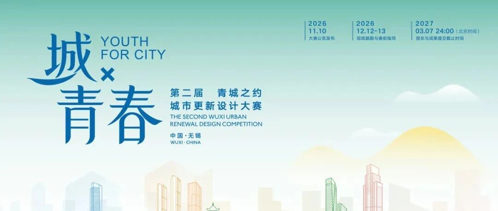

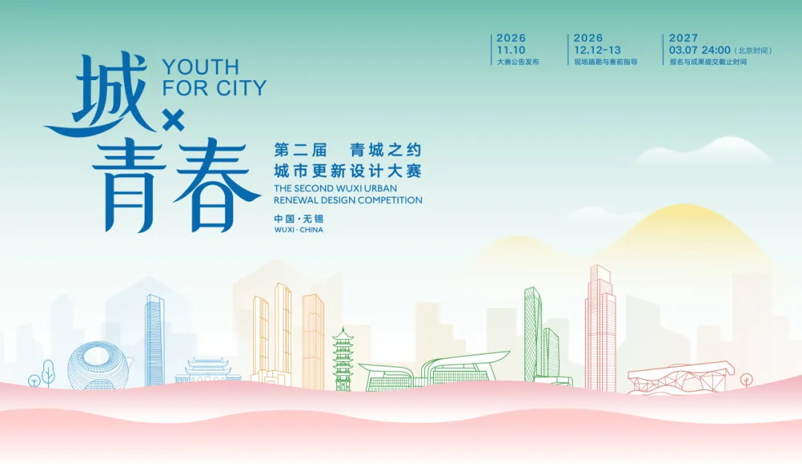

** 指导单位：  **
共青团江苏省委、江苏省住房和城乡建设厅
** 主办单位：  **
共青团无锡市委、无锡市住房和城乡建设局
** 承办单位：  **
无锡市锡山区人民政府、无锡市惠山区人民政府、无锡市滨湖区人民政府、无锡市文化旅游发展集团有限公司、无锡城建梁溪发展有限公司
** 合作媒体：  **
《建筑技艺》杂志

本届赛事立足无锡片区统筹更新的现实需求，承接江苏省青年社区建设政策要求，以真实存量场地为设计载体，面向海内外青年设计师公开征集可落地的更新方案。当前，无锡已入选2026年度中央财政支持实施城市更新行动城市，是江苏省唯一获中央层面支持的城市；随着《无锡市城市更新片区及项目库管理办法》印发实施，“片区统筹”已成为城市更新的核心推进模式。2026年9月，全国首个省级青年社区专项政策《关于支持青年社区建设的若干措施》（苏政办发〔2026〕46号）印发，明确支持青年以规划设计等方式参与青年社区建设，为本届赛事提供了清晰的政策指引。2024年首届赛事已为无锡储备一批兼具创意与落地潜力的方案；
** 本届赛事规模升级，覆盖5大片区、8个真实设计现场，一等奖作品将获得方案设计实施委托权。  ** 诚邀青年设计师来到现场，以青春创意激活城市存量空间。

本届大赛主题为  ** “城以青春Youth for City”  **
，核心包含三层递进关系：一是城市未来的希望在于青年，建设青年发展型城市是无锡一以贯之的目标；二是城市依托青年力量推进更新，邀请青年设计师根据真实场地，以专业设计激活工业遗存、老街巷、老旧社区等存量空间，为城市更新注入青年视角与解决方案；三是城市为青年提供实践场域，以具备落地条件的设计现场为载体，让青年设计跳出纯概念范畴，直接对接片区实施路径，同步培育适配青年需求的公共场景与社区生态。主题紧扣江苏省“打造最懂年轻人的青年社区”的政策导向，呼应无锡片区统筹更新的发展节奏，既是对青年设计力量的召集，也是对“青年发展型城市”的一次空间实践。

本届大赛采用“片区统筹”的空间布局，定位为  ** “真题真做、可落地、可运营”  **
的实战型设计竞赛，共设5大更新片区、8个真实设计现场，覆盖工业遗存活化、老城街巷更新、文旅场景升级、社区民生改造、创意园区打造等多元类型。所有设计现场均为具备落地基础的真实项目，参赛方案直接服务于各片区后续实施。必须强调的是，
本次竞赛关注的不仅是建筑学本体，更是建筑学的社会价值——以建筑学为媒介，连接城市与社区、连接城市与青年、连接城市与未来。方案需兼顾青年使用需求与全龄友好，平衡业态商业逻辑，构建可持续的城市良性运营闭环。
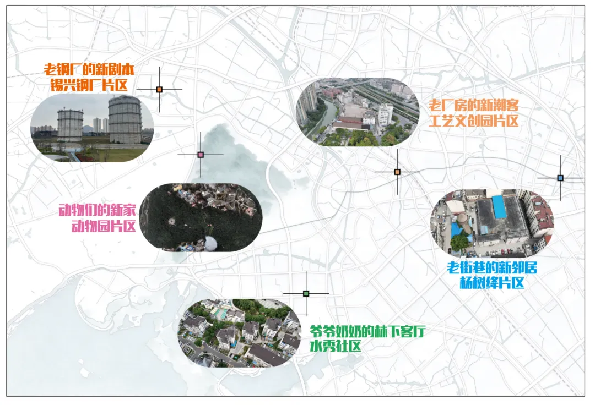
△ 设计场地区位图
** 片区① 老钢厂的新剧本——锡兴钢厂片区  **
包含储气罐改造、步行景观桥2个设计现场，以工业巨构的垂直转型与洋溪河两岸慢行系统的接续为主线，打造工业记忆、科普展演、青年休闲与滨水慢行融合的活力片区。
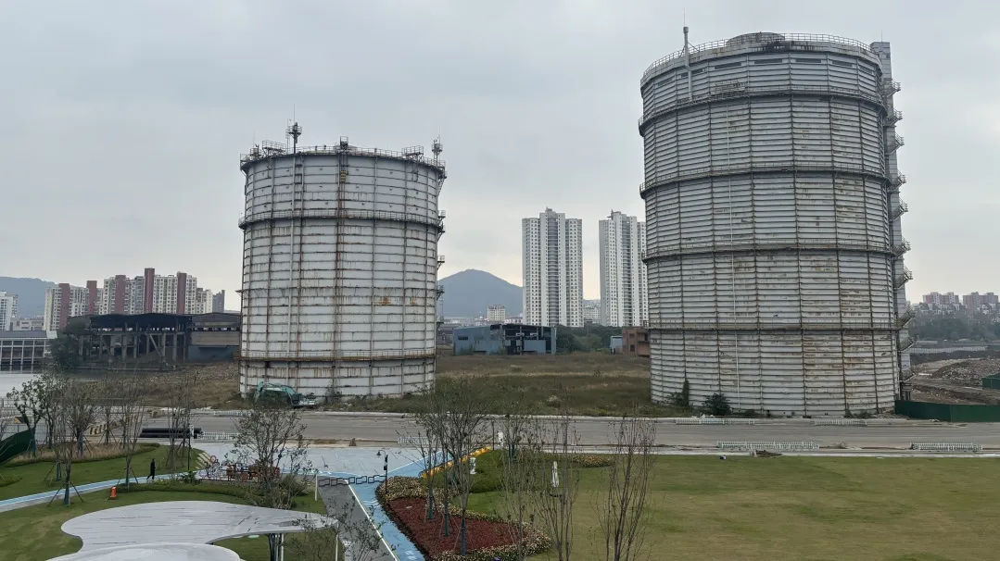
△ 锡兴钢厂片区
** 片区② 老街巷的新邻居——杨树绛片区  **
包含电子三分厂厂房改造、水塔改造2个设计现场，坚持“留改拆”并举，在延续老城烟火肌理的基础上，植入文创工坊、青年创业等复合功能。
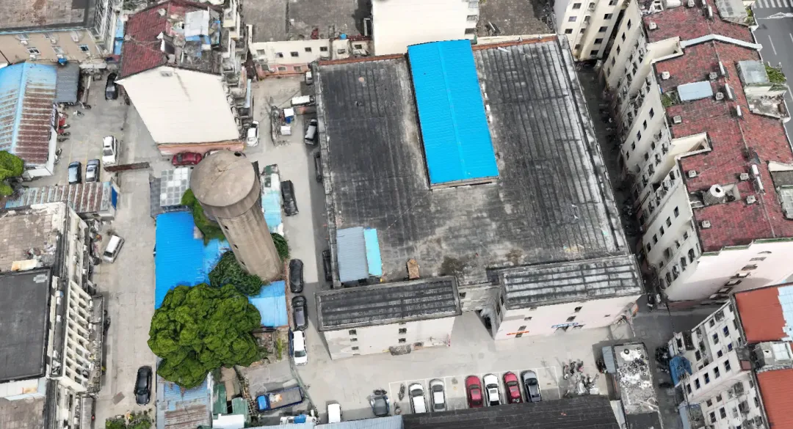
△ 杨树绛片区
** 片区③ 动物们的新家——动物园片区  **
包含灵长类馆改造、林下空间改造2个设计现场，秉持“动物为主人、游客为客人”的理念，优化动物栖息环境，打造互动式研学、轻餐饮与文创消费融合的新场景。

△ 动物园片区
** 片区④ 爷爷奶奶的林下客厅——水秀社区片区  **
核心为水秀苑南侧场地改造1个设计现场，回应老年居民休憩交往的真实需求，延续“百姓规划师”公众参与机制，以低成本小微改造提升社区公共空间温度。

△ 水秀社区片区
片区⑤ 老厂房的新潮客——工艺文创园片区
核心为工艺铁厂改造1个设计现场，保留运河工业遗存肌理与红砖质感，植入主理人商业、潮流文创与滨水休闲业态，打造运河沿岸的青年创意集聚地。
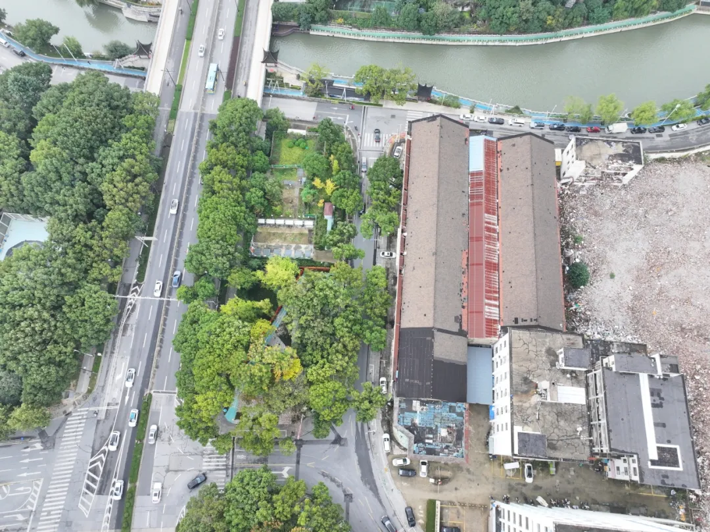
△ 工艺文创园片区
※完整设计现场资料及设计要求详见《设计任务书》，随大赛资料包发布。

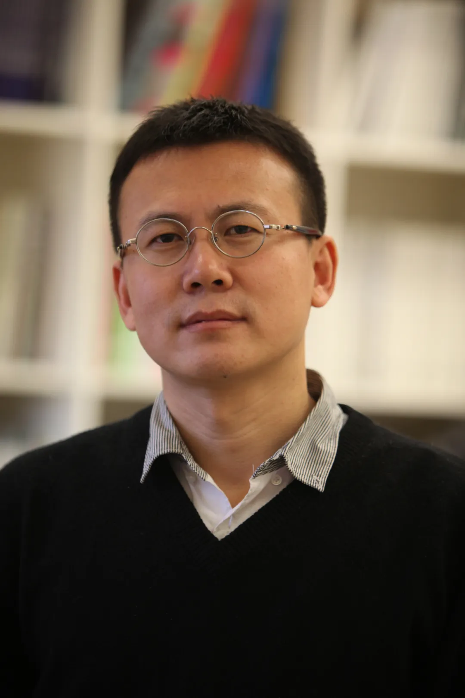
** 李兴钢  **
中国工程院院士，中国建科首席科学家，中国建筑设计研究院有限公司总建筑师
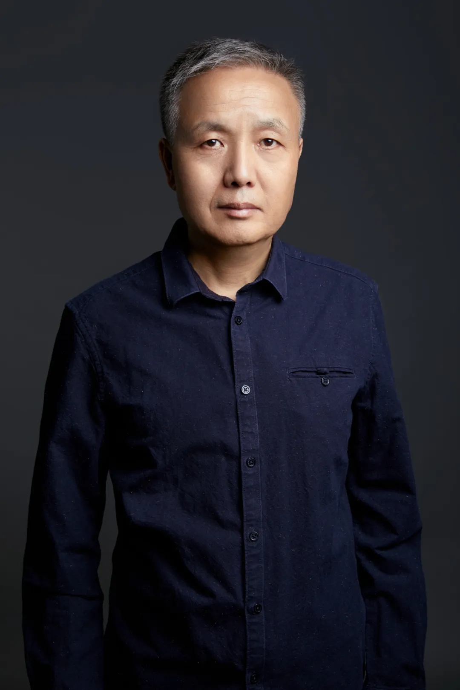
** 张 杰  **
全国工程勘察设计大师，清华大学建筑学院教授，北京建筑大学建筑与城市规划学院特聘院长

** 杨 瑛  **
全国工程勘察设计大师，中国建筑第五工程局有限公司总建筑师、设计研究总院院长
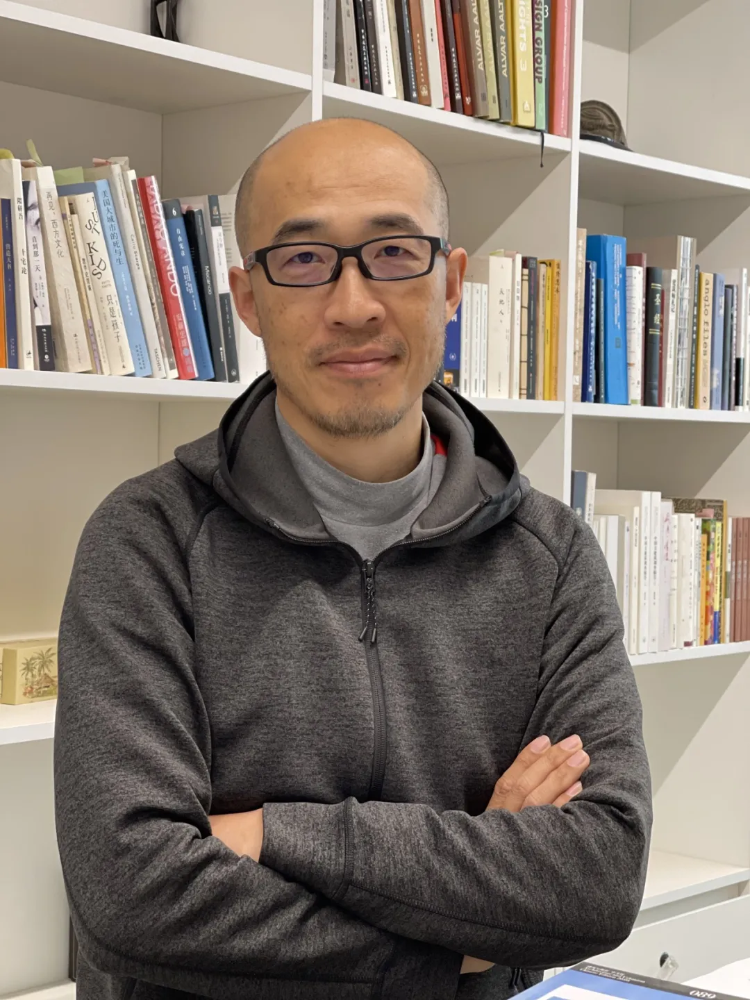
** 柴培根  **
中国建筑设计研究院有限公司执行总建筑师

** 刘 艺  **
中国建筑西南设计研究院有限公司总建筑师

** 褚冬竹  **
重庆大学建筑城规学院院长、教授

** 张 斌  **
致正建筑工作室（Atelier Z+）创始人、主持建筑师
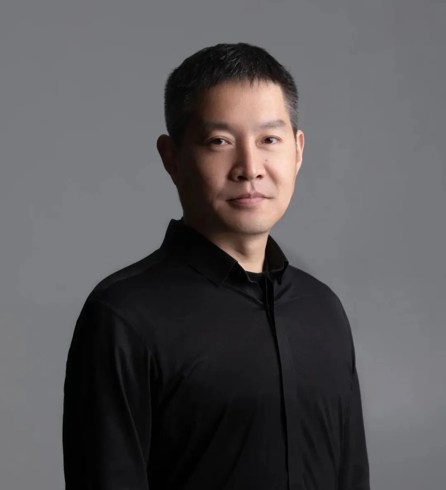
** 荣朝晖  **
江苏中锐华东建筑设计研究院有限公司董事长

** 申江海  **
申江海建筑事务所创始人、Mix岛商业联合创始人

8个设计现场分别独立设奖，每个现场设  ** ：  **
** 一等奖1组：方案设计实施委托权+获奖证书  **
** 二等奖1组：奖金15,000元（含税）+获奖证书  **
** 三等奖1组：奖金10,000元（含税）+获奖证书  **

** 事项  ** |  ** 时间  **
** 大赛公告发布  ** |  ** 2026年11月10日  **
** 现场踏勘与赛前指导  ** |  ** 2026年12月12—13日  **
** 报名与成果提交截止时间  ** |  ** 2027年3月7日24:00  ** ** （北京时间）  **
** 评审时间  ** |  ** 2027年3月中旬—4月初  **
** 结果公示时间  ** |  ** 2027年4月中旬  **
※ 具体时间根据大赛赛程弹性安排。

大赛面向海内外公开征集。建筑设计、城乡规划、景观设计、室内设计从业者，设计院、设计事务所、高校师生团队、独立设计师、品牌主理人均可参赛，可个人参赛或组队参赛。每个团队不超过4人，并须指定1名组长负责统一联络；每组指导教师不超过1人。
** 所有参赛设计师年龄要求在45周岁以下（1982年1月1日及以后出生），指导教师无年龄限制。同一方案不得投递至多个设计现场。  **
** 1）线上报名登记：  **
扫描下方二维码  ，填报参赛者姓名、所属单位、联系电话、电子邮箱、意向参赛片区和设计现场，提  交后完成报名。

△ 线上报名登记二维码
** 2）赛事文件获取：访问  ** 链接
https://pan.baidu.com/s/11r7J5yNhrVIaCX7fktJtrg?pwd=0000，
（提取码：0000），自行下载全套参赛资料（含设计任务书、场地资料包等，后续文件更新及补充均在此下载）。
** 3）现场踏勘报名：访问  ** 链接
https://f.kdocs.cn/g/jT2qOoRj，踏勘报名通道将于2026年11月30日9:00开启，2026年12月6日前24:00关闭，因涉及会场及车辆安排，请及时完成报名。
** 4）作品提交通道：访问  ** 链接
https://f.kdocs.cn/g/MWAVHNJc提交作品。
  * 通道于2026年12月14日9:00开启，2027年3月7日24:00关闭；超过提交时间的文件一律视为无效。
  * 每组作品提交A0图纸2幅（841×1189mm），竖版排版，jpg格式，分辨率不低于300dpi、长边不小于1500像素，单个文件不超过30MB；设计说明、分析图等一律排入图纸，不另交文件。
  * 文件以“片区名称·设计现场名称+作品名称”命名；电子图纸中不得出现任何有关作者姓名和所在单位的文字或图案。
  * 视频为可选提交项，参赛者可自愿提交视频展示设计成果；如提交，时长不超过 3分钟，单个文件不超过300MB。
  * 提交时须同时上传参赛者有效身份证件扫描件（团队为全部成员）、在校学生学生证扫描件，以及全部成员签字的报名表，仅用于参赛资格核验。
  * 原创声明：参赛作品须为原创，已实施项目、已在其他大赛获奖或发表过的作品不得参赛，不得侵害他人权益和知识产权。
  * AI使用声明：使用AI工具生成图纸或视频的，须在成果中明确注明。
※ 详细要求详见《设计任务书》。

  * 参赛者须完全同意并严格遵守本次设计大赛的所有内容及大赛规则，大赛组委会对本大赛规则拥有最终解释权。
  * 本次大赛一等奖不设赛事奖金，一等奖获奖团队享有本点位的方案设计实施委托权。该权利仅限获奖团队享有，不得转让，团队内部解释权归组长所有，具体设计实施事宜另行签订委托合同。
  * 参赛团队须保证参赛作品为原创，如涉及知识产权侵权，相关责任由参赛团队自行承担。

** 《建筑技艺》杂志  **
王老师 13051361832
李老师 15510981211
技术咨询邮箱：  chengyiqingchun@163.com
** 官方信息发布渠道  **
“AT建筑技艺”官方微信公众号
“团聚无锡”共青团无锡市委官方微信公众号
** 官方答疑通道  **
扫描下方二维码
通过IMA知识库答疑
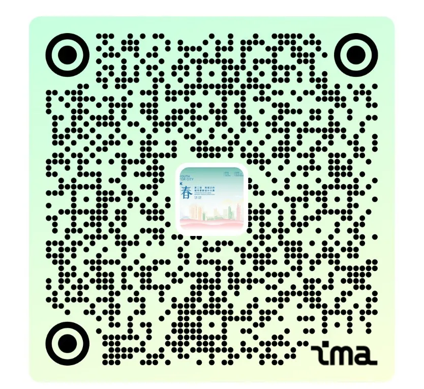
△ 官方  答疑通道二维码
※ 本公告与《设计任务书》及组委会后续正式发布的补充技术文件，共同构成本次竞赛文件体系，所有相关事项均以本套文件为依据。

** ** 平面  / 蔡雨欣  校对  ** / 原源
本文  由  AT建筑技艺  授权有方发布，  欢迎转发，禁止以有方编辑版本转  载。
[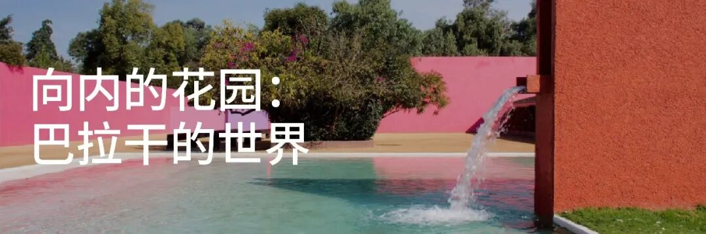](https://mp.weixin.qq.com/s?__biz=MjM5OTAxNjY4MQ==&mid=2650470718&idx=1&sn=80b92fd9ec8739eceb357fb798f1de3c&scene=21#wechat_redirect)[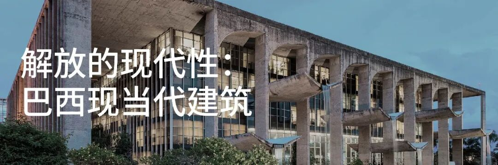](https://mp.weixin.qq.com/s?__biz=MjM5OTAxNjY4MQ==&mid=2650468407&idx=1&sn=ef8d5f225d90ea0728f1dd4945705b32&scene=21#wechat_redirect)

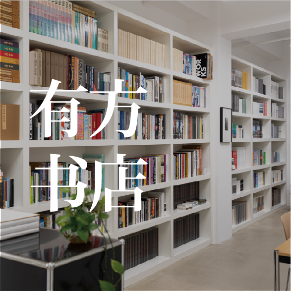

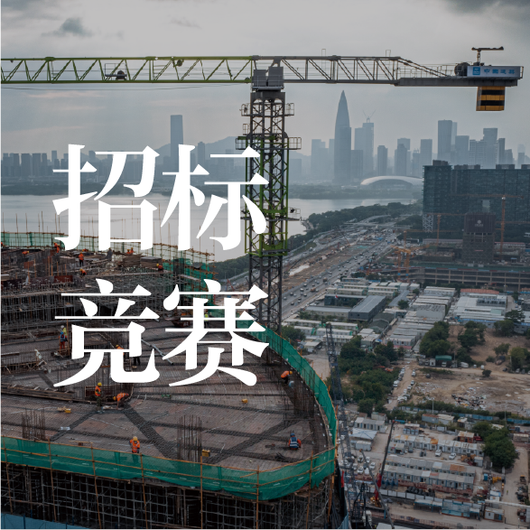

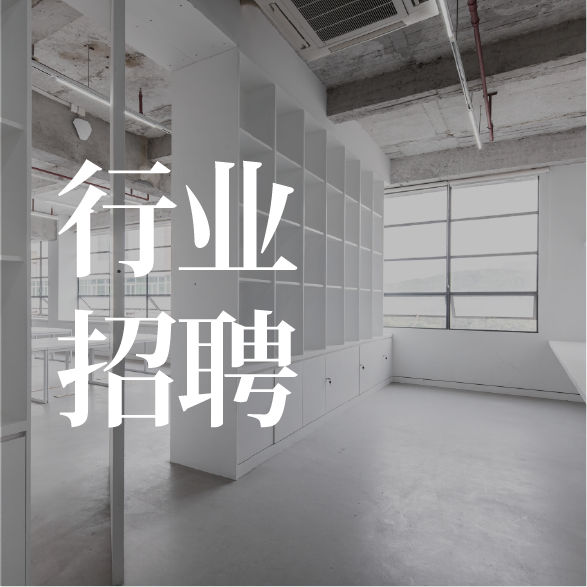

以“在看”分享  **** **

