# Herzog & de Meuron最新方案：埃姆斯研究中心博物馆，雕塑感混凝土仓库改造

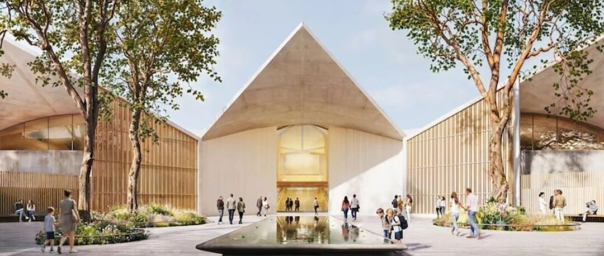

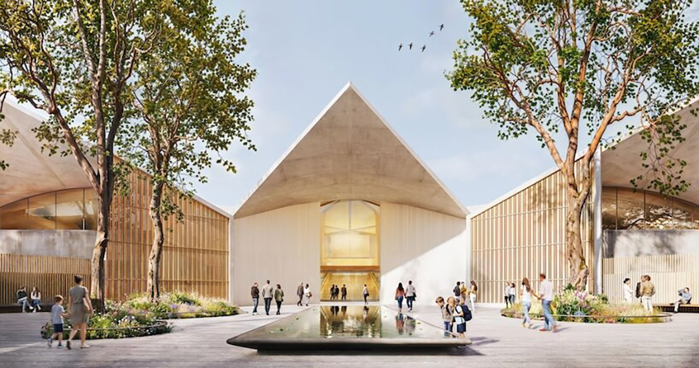
△ 设计效果图 ©Herzog & De Meuron
Herzog & de Meuron  近日公布了为埃姆斯研究中心  （  Eames Institute of Infinite Curiosity  ）
打造的博物馆方案。  项目位于美国  加利福尼亚州诺瓦托，  前身是德国鞋业品牌勃肯  （  Birkenstock  ）  的园区  ，埃姆斯研究中心
于  2025  年收购了现有的场地  ，整个项目占地  88  英亩（约  35  万平方米），  改造后将  包含  展览空间、工作坊、剧场和花园
，成为  一处综合性的文化目的地  ，其愿景不止于展示  埃姆斯  夫妇的作品。
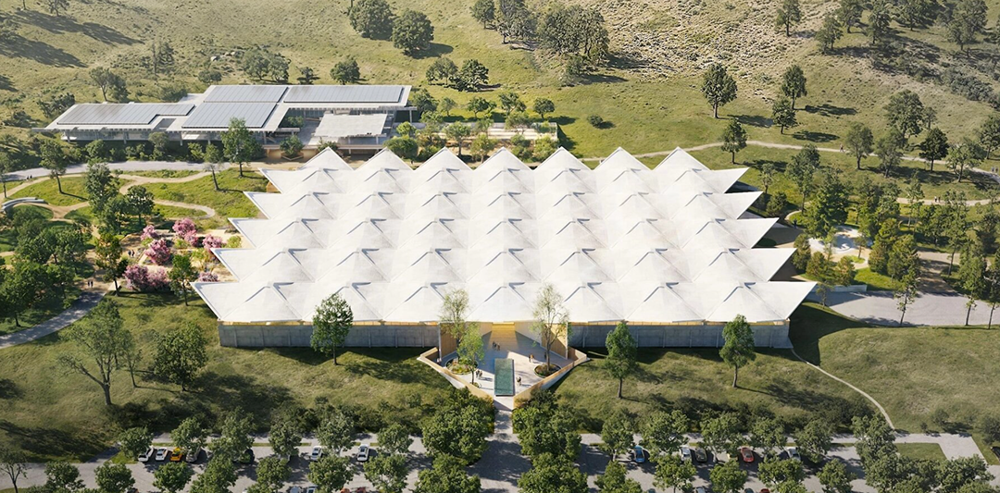
△ 设计效果图 ©Herzog & De Meuron
园区中最具标志性的，是一座具有  雕塑般  几何形  屋顶  的  混凝土  仓库。该建筑于  20  世纪  60  年代初  ，  由  加州建筑师
John Savage Bolle  、  Jan Lubicz-Nyc  与结构工程师  Raj Desai  共同设计。
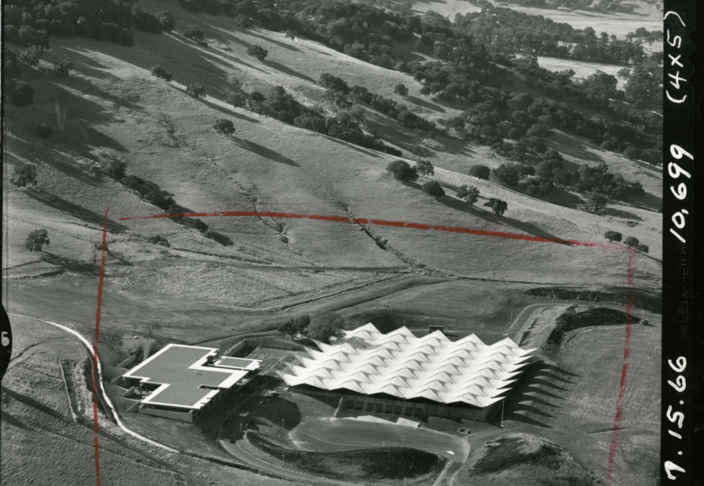
△ 建筑历史照片 图源：  Eames Institute
建筑屋面由一系列  特殊的  几何  曲面构成：双曲抛物面  （  hypar  ）  ，又  称  马鞍形曲面  。
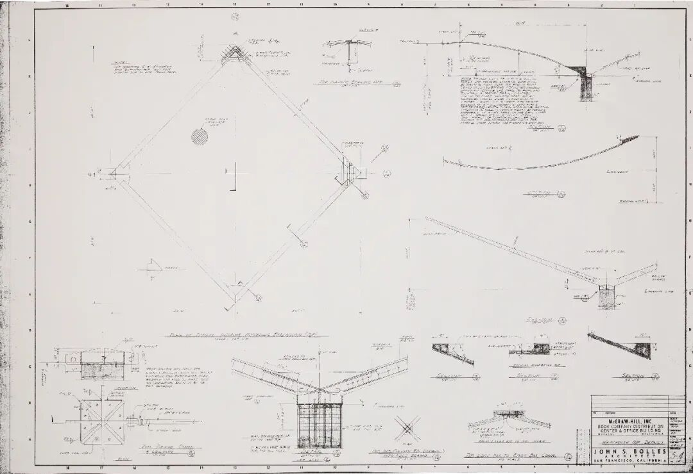
△ 设计图纸 John S. Bolles, 1964  图源：  Eames Institute
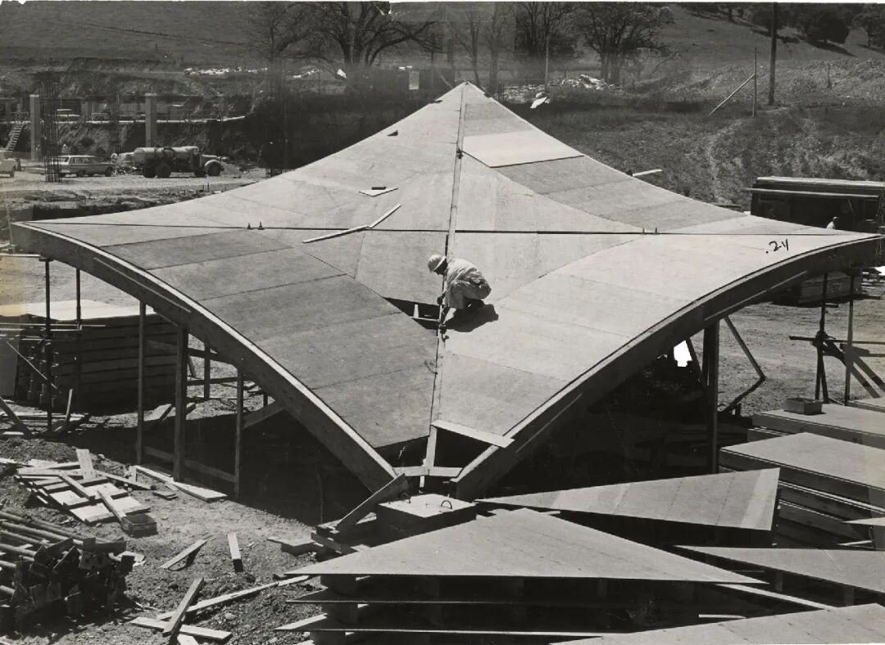

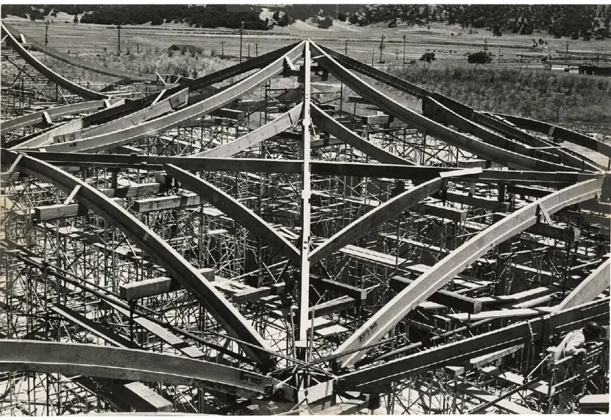
△ 建筑历史照片 图源：  Eames Institute
基于这种结构的几何特性，建筑  以极少的材料  实现了内部的  巨大跨度，  并  形成高辨识度的连续的  尖角  屋檐  ，赋予这座工业建筑意想不到的戏剧
张力  。这项薄壳混凝土实验  ，  在当时极具开创性，也对二战后北美建筑技术起到了很大的推动作用。
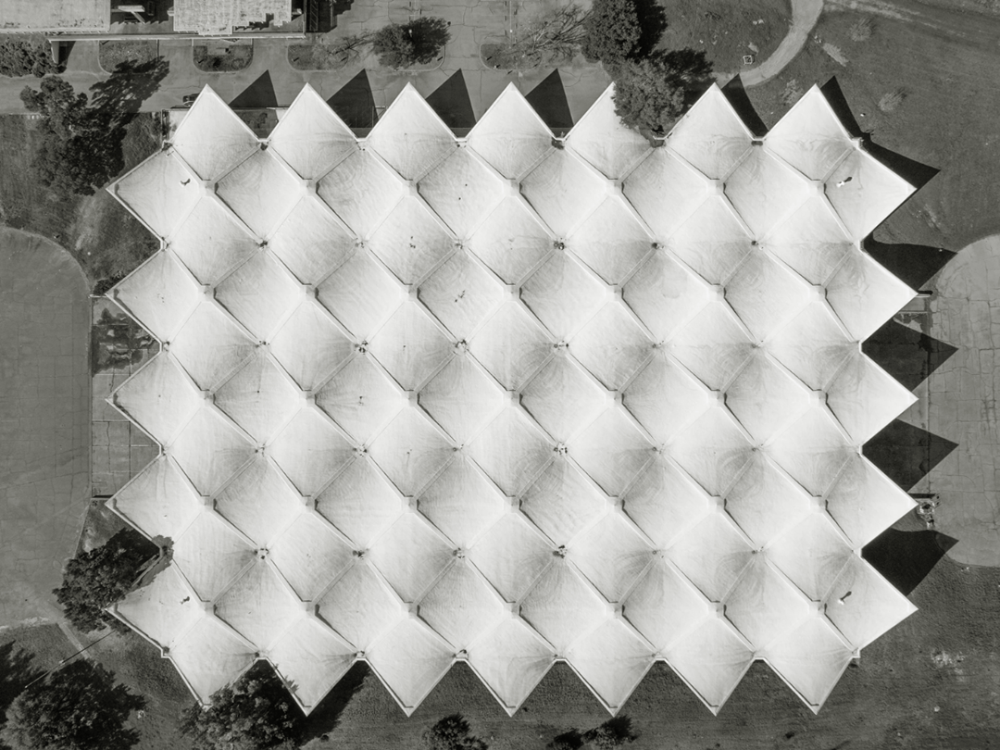
△ 建筑历史照片 ©  Scott Hess
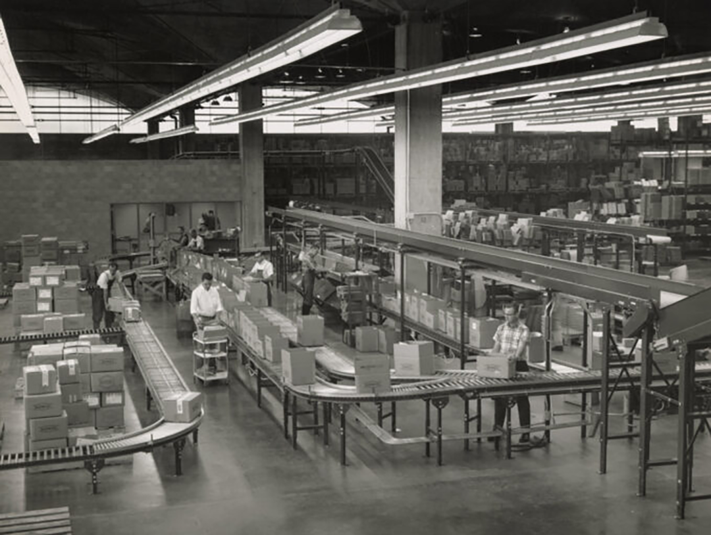
△ 建筑历史照片 图源：Eames Institute
“  一座屋顶如此富有表现力的仓库，
本身就是展品。  ”
Herzog & de Meuron  将与  旧金山建筑事务所  EHDD  、景观设计事务所  Field Operations  合作，改造方案将
保留  仓库标志性的  混凝土  主体结构，重塑屋顶之下的功能场景。这意味着博物馆本身就是一件设计巧思的展品：参观者还未走进展厅，便先邂逅一场建造实验。
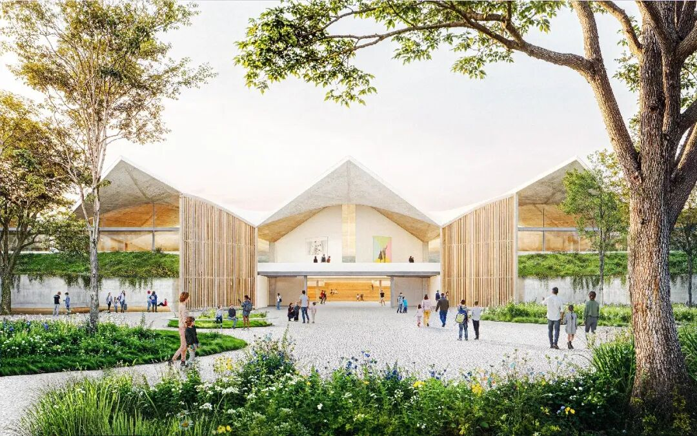
△ 设计效果图 ©Herzog & De Meuron
设计  围绕宽敞的中央大厅组织室内空间  ，
让上方屋顶独特的几何形态完整展露。设计在原有土坡上开辟入口庭院，作为入园通道；一座覆钢桥梁则提供贯穿建筑的高架动线。桥梁表面具备反光特性，捕捉周遭环境的斑驳影像，以变幻灵动的立面，与厚重沉稳的混凝土顶盖形成对照。桥下交通流线串联起展厅、聚会与创作空间。机电管线与照明设备整合收纳于顶棚之中，尽可能弱化尖顶下方杂乱的视觉元素。
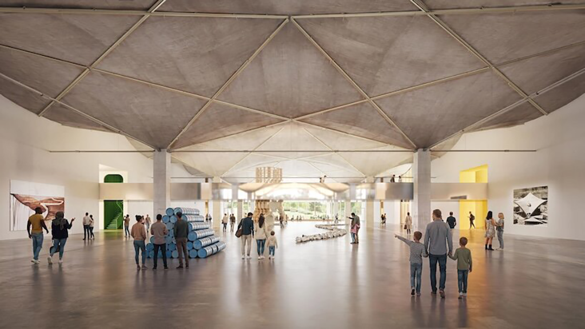

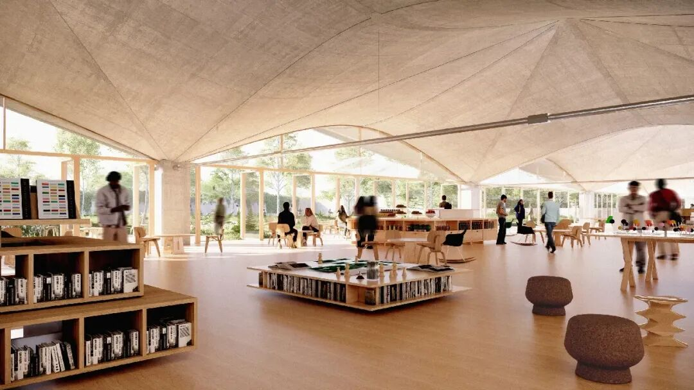
△ 展厅内部效果图 ©Herzog & De Meuron
博物馆的功能布局，让参观者既能看见成品，也能了解物件的制作过程。木工、陶瓷工坊穿插在灵活可变的展厅之间，创意创作本身也成为参观体验的一环。这一思路  与
馆藏征集方向  一致  ，  未来展品  范围  将  涵盖工业设计、绘画、雕塑及其他艺术门类。  博物馆方认为，  伊姆斯夫妇留下的遗产只是起点，
将持续  致力于跨世代的实验探索，留出空间  展示  那些作品在登上展座之前，务实、甚至带着粗糙感的创作过程。
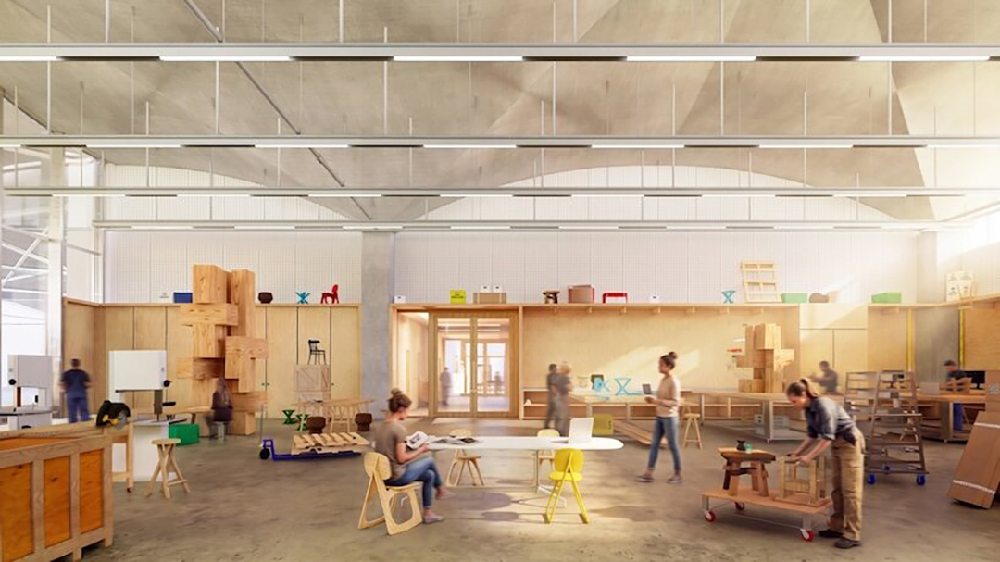
△ 展厅内部效果图 ©Herzog & De Meuron
建筑南北两侧采用内凹玻璃幕墙，在室内与花园之间  设有  进深充足的灰空间  ，  昔日装卸货区也被改造为户外休憩场所  ，  这些有顶  盖的空间
拓展了展览与日常活动的可能性。
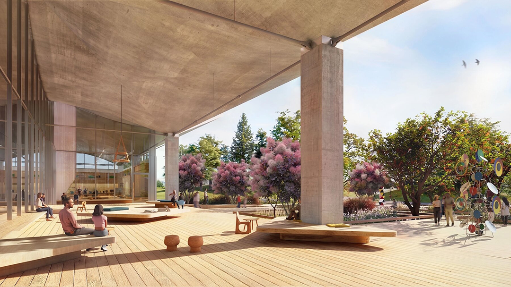

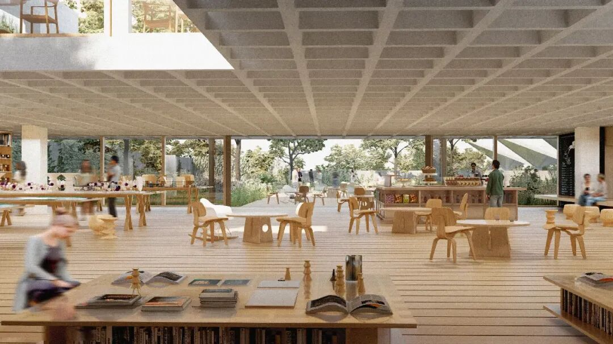
△ 户外空间效果图 ©Herzog & De Meuron
景观设计  通过步道串联起十座花园，  其中设有  户外雕塑、游乐场地、公共活动区，同时保留静谧的静坐与漫步空间  。
植被配置参考当地多样生境，选用橡树、熊果、加州虞美人等本土植物  。  从林地到滨海草原，让场地气质扎根于本土，而非沦为单调统一的布景。
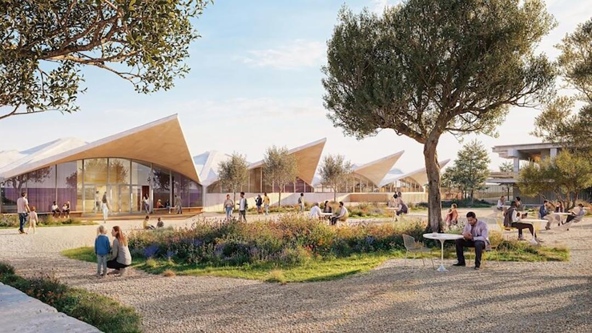

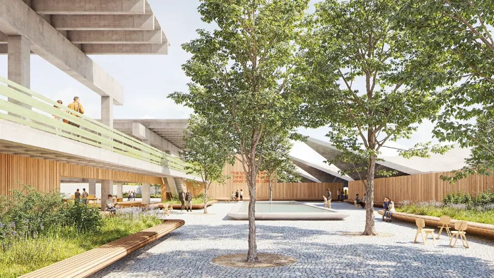
△ 外部景观效果图 ©Herzog & De Meuron
这套方案让参观体验可以在多样场景中、以不同节奏展开：你可以参与工坊、观看演出，也可以在户外消磨一整个下午。
目前  方案  已提交  当地  政府审批；主体工程计划  2028  年动工，目标在  2030  年开馆。
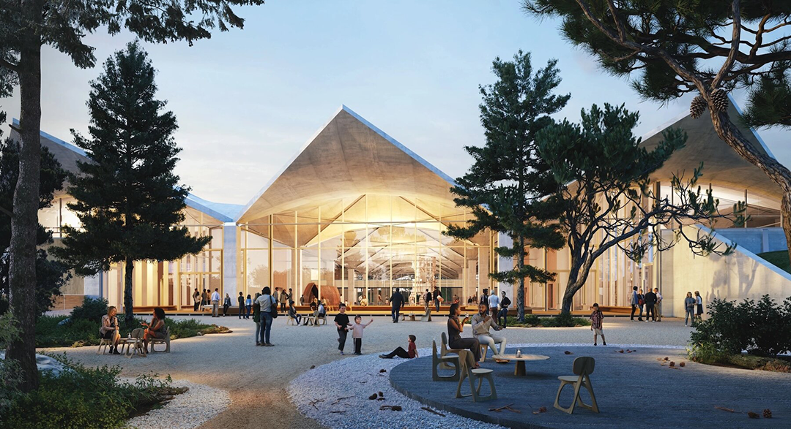
△ 夜景效果图 ©Herzog & De Meuron
主要参考资料与图片来源：
[1]  https://www.designboom.com/architecture/herzog-de-meuron-eames-institute-
museum-birkenstock-warehouse-novato/
[2]  https://www.eamesinstitute.org/stories/art-design-hypar-roof/

** 视觉  ** /  蔡雨欣  ** 校对  ** / 宋诗雨
本文编排版权归有方空间所有。图片除注明外均来自网络，版权归原作者或来源机构所有。欢迎转发，禁止以有方版本转载。若有涉及任何版权问题，请及时和我们联系，我们将尽快妥善处理。邮箱info@archiposition.com
[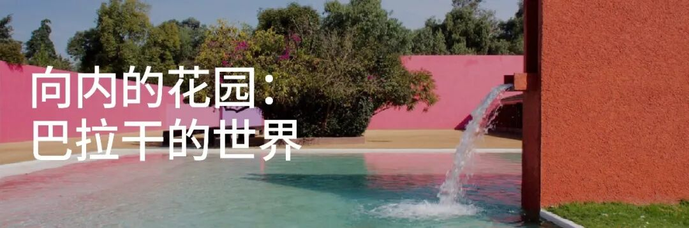](https://mp.weixin.qq.com/s?__biz=MjM5OTAxNjY4MQ==&mid=2650470718&idx=1&sn=80b92fd9ec8739eceb357fb798f1de3c&scene=21#wechat_redirect)[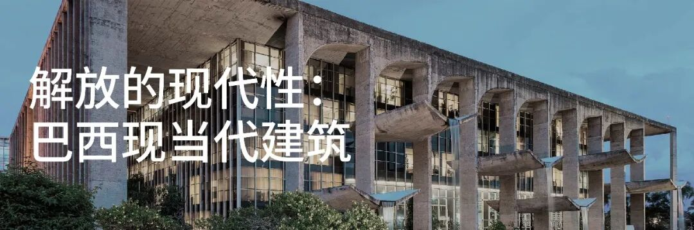](https://mp.weixin.qq.com/s?__biz=MjM5OTAxNjY4MQ==&mid=2650468407&idx=1&sn=ef8d5f225d90ea0728f1dd4945705b32&scene=21#wechat_redirect)

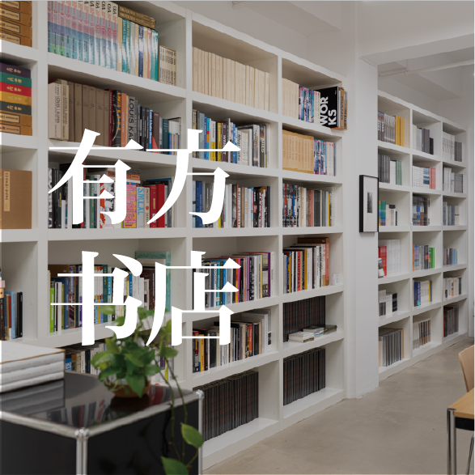

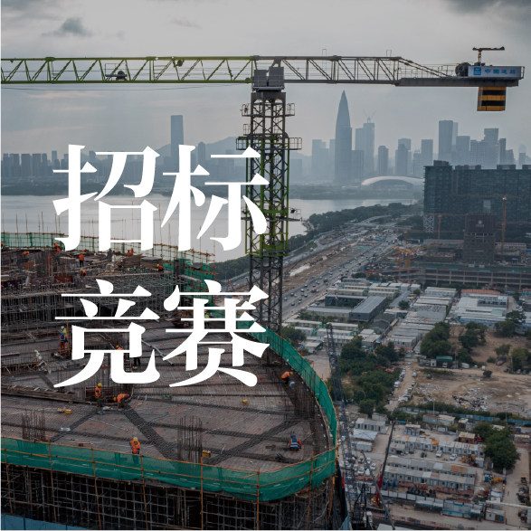

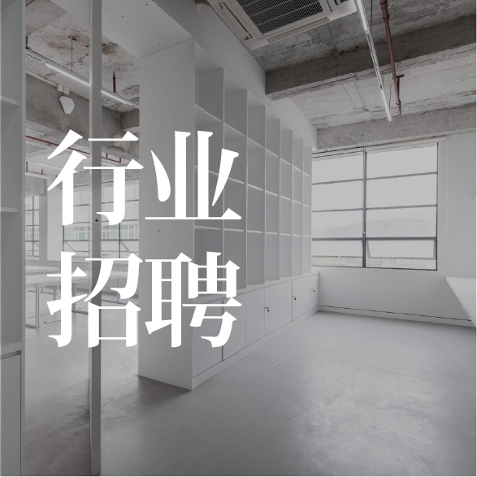

以“在看”分享  **** **

