# 为什么要研究拉美现代建筑？

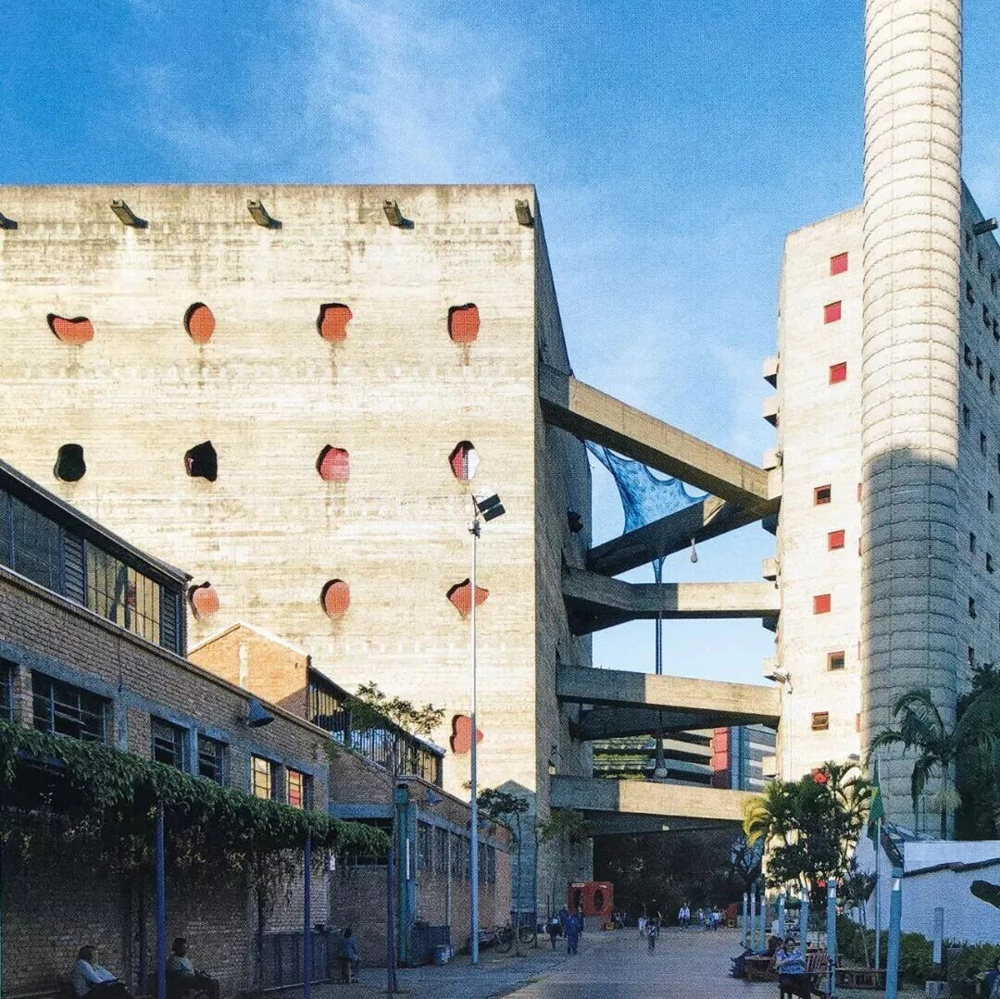

[
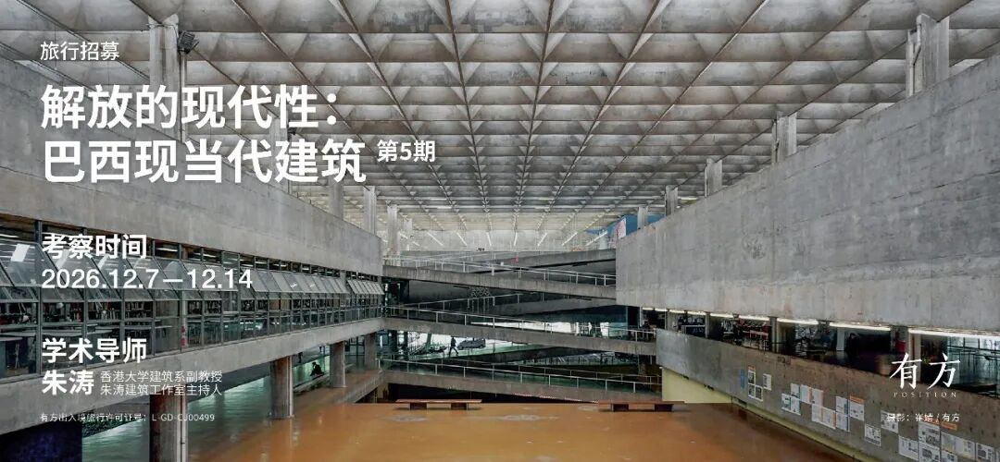](https://mp.weixin.qq.com/s?__biz=MjM5OTAxNjY4MQ==&mid=2650468407&idx=1&sn=ef8d5f225d90ea0728f1dd4945705b32&scene=21#wechat_redirect)
“  解放  ** 的现代性：  ** ** 巴西现当代建筑·第5期”正在招募！  **
点击上图，查看招募详情
联系客服报名：youfang603
本文由拉美建筑研究学者裴钊在《建筑师》杂志和台湾《建筑师》杂志上发表的两篇文章的基础上删略编写。为有方拉美建筑旅行线路的考察前言。
** 杂糅的现代性：  ** ** 阿根廷和巴西现代建筑  **
文 | 裴钊
在《大汗之国》最后一章中，历史专业研究者史景迁以三位大师级作家的小说为例，讨论了二十世纪的外国对于中国的想象。其中两位作家与拉美有关  ——
博尔赫斯与卡尔维诺（第三位是卡夫卡），对他们而言，距离遥远的东方是放置文学想象最佳的地方；对普通拉美人而言，作为一个形容词被使用的“中国”，则可以指代任何难以理解或令人困惑的东西。而我们，对拉美也是想象多于了解，更倾向于将其作为一种标签化的定义。
建筑亦然，距离遥远或许能为双方想象力留下广阔空间，但如果止步于此、缺乏深入的认知和理解则将会非常遗憾。  **
地球另一端的这片陌生土地，之于我们有着怎样的启示和参照？  **
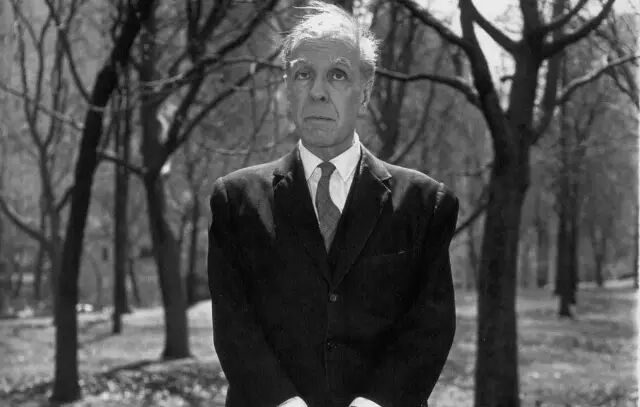
△  博尔赫斯，阿根廷作家
** 为什么要了解拉美现代建筑  **
研究拉美现代建筑的现实意义并不是要分离出一个新的领域，相反，是将对拉美的研究融入到现有中国建筑研究和实践之中，其意义是将中国建筑放入一个更广阔的世界网络中进行重新思考，从而避免孤立的思考和简化的操作。
近代中国以自己为中心建立了一个他者－西方的概念。在民族危机下，这个抽象的“西方”（多指资本主义发达国家）确实有助于确立一个简化和抽象的学习（或者反对）对象；也正因为此，百年来的中国一直努力地在内外之间、主客之间变换着视角去学习那个我们希望成为的“他者”。然而，这种二元论认知方式必然导致中国文化在自我膨胀和自我否定的两个极端之间摇摆不定。尽管拉美也属于我们认为的那个广义“西方”，但经过几个世纪的演化它已呈现出更多的差异性和多元性。因此，
参照拉美并设定一个独立于欧美之外的参照系，将有助于我们摆脱在单一参照系下非此即彼的两元思考模式。
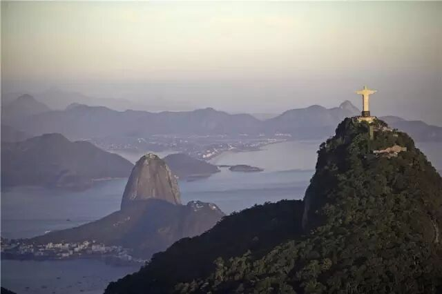
△  耶稣山
在上个世纪里，拉美诸国的现代化、高速城市化、社会改革的进程均早于中国发生，其所面临许多现实问题也多与目前中国类似，使得我们得以观察这一近似于自身的镜像从而反观中国。
从理论的角度来看，研究拉美现代建筑历史和理论的构建过程，可以重新审视现代主义是如何在中国进行转变的，以及中国现代建筑理论和历史是从什么样的角度被编篡和书写等问题；而从实践的角度来看，拉美现代建筑大量的实践经验为中国当下以及未来的发展路径提供了启示与参考。
###
无论从地缘政治角度还是文化角度，“拉美”都不是一个清晰的概念，这个词语本身的争议性也导致了学术讨论的复杂性。上个世纪70年代前后出版了一套介绍世界各大洲新建筑的丛书，其中《拉美建筑新方向》（
New directions in Latin American architecture
，1969）一书由阿根廷建筑史学家、建筑师弗朗西斯科·布利里奇（Francisco Bullrich）撰写。英国建筑史学家雷纳·班汉姆（Reyner
Banham）在1972年评论此书时指出，以大洲为研究对象的建筑调查最终将面临不可避免的失败结果，尤其是针对拉美这样多样化的地区。确实，尽管布利里奇进行了努力尝试，但很遗憾最终呈现的结果仍然是碎片化的。从另一方面讲这又是幸运的，正是这种碎片式的拼贴并置，而不是基于预设归纳而成的历史，为后来的多元观点和讨论的进入提供了可能。既然从洲际总体性出发的描述不能令人满意，采用按照国别或区域进行分类很自然地成为一种选择
——  然而它在带来诸多便利之时，却人为地割断了拉美各国家和地区间的互动影响。在《拉美现代建筑：模糊的地带》（  Latin American
modernarchitectures: ambiguous territories  ，2013）一书中，帕特里西奥·德尔雷亚尔（Patricio del
Real）和海伦·居格（Helen
Gyger）提出了修正的建议，认为应该在探索跨国家和地区之间的联系中讨论拉美现代建筑，抛弃那种将不同地区或国家均质化对待的分类模式。
这一点对当代中国同样适用，任何不加限定以及刻意追求“统一”的中国性的做法只能是弄巧成拙。
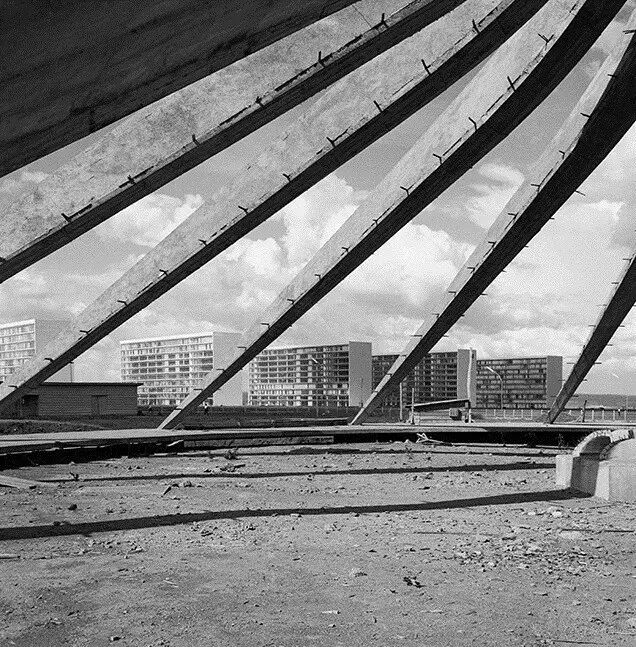
△  巴西利亚
另外一点是，我们需要注意来自拉美内部和欧美外部两种学术观点之间的差异，避免主观地排斥或者偏重于任何一方的观点。美西战争（1898年）之后，美国的拉美研究从学术意义上正式成为一门学科，随后，欧州各国也先后设立拉美研究机构，在建筑学方面也不例外。这些外部的声音与拉美内部汗牛充栋的研究成果交织在一起，相互批判和影响。这种学术上的交锋，正是中国在构建自身的建筑理论和历史过程中所缺乏的；同时，因为语言问题，目前中国大多是通过英文文献和资料（外部观点）来了解拉美建筑，缺乏对来自拉美内部西语文献的了解，阻碍了大多数人兼顾两种学术观点的深入。
因此，对于拉美，我们期望随着了解越多越全面，地球另一端的那个模糊镜像能够越来越清晰，能够见我们所未见，思我们所未思。
** 拉美现代建筑发展  **
在过去的百年里，拉美不同国家地区在政治、经济、社会变革等方面尽管动因和形式差异巨大，但在时间上基本同步，使得简化的方式讨论拉美建筑具有一定的可行性  ——
将拉美现代建筑发展历史“粗暴”地分成若干阶段进行叙述，一窥阿根廷和巴西现代建筑的发展概貌。
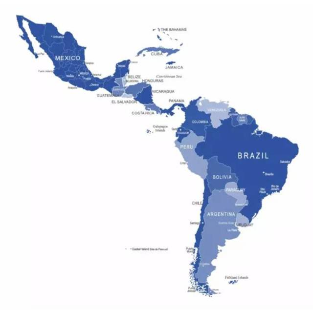
△  “拉美”地图
以编年体和国别体来呈现拉美现代建筑并非一个绝佳的方法，这里仅为提供一个“方便之门”。因为在某种程度上，这样的历史编篡方式不仅无助于了解拉美，甚至会起到误导的作用。其原因如下：第一，拉美的国家疆域划分是人为的，而拉美的艺术文化并非决然的因政治地缘而断裂，基于人文地域而形成的文化圈对于建筑的影响更为强大；第二，按照时间顺序，或者将一个国家和地区的现代建筑历史简化为成若干发展阶段的方法，在隐藏着的进步论观点之下将历史简化为线性逻辑下的发展形态，会损失更加多元和丰富的历史细节。
▼
** 1925—1945年启蒙与开端  **
在这一时期，拉美各国从基本农业国家向工业化国家转型，其过程并非具有同时性和有规律地展开，甚至同一个国家的不同区域也都有差异。事实上，直至今天拉美也仍未形成相对完整的工业化社会和经济体系，究其原因是其工业化进程只是为了满足国家上层精英利益需求；或者说，本地的精英阶层一方面要保留自身以往的特权，一方面又期望得到工业化发展的利益。这样一种不彻底的变革除了带来生产力的提高外，也带来了更加严重的社会经济不平等和政治不稳定问题，这些问题使得拉美各国在其后很长的时间里不得不经历一次次的阵痛。
在这个不稳定的转型时期，拉美各国政府给予了现代主义建筑支持的态度：因为现代主义风格象征着新兴国家的形象，契合政府的宣传。那么，现代主义建筑是如何在拉美大地上开始的呢？大多数现代主义建筑历史论述，为了片面地强调现代主义建筑的合法性和正统性
——  都过于强调勒·柯布西耶对于拉美现代建筑的影响  ——
认为拉美的现代主义建筑源于1929年勒·柯布西耶对南美三国访问的结果。然而，正如拉美的现代主义来源和混杂的文化一样，它并非可以简单地归结于一个人或一次事件。由于拉美和拉丁语系国家密切联系，从殖民时期起文化艺术方面的交流就从未间断过。在西班牙内战和第一次世界大战期间，大量的欧洲移民将现代主义的思想以不同渠道引入拉美，其传播路径和拉美地域之间的相互影响更是错综复杂；同时，西班牙殖民建筑的简洁装饰和功能化特征在某些方面与现代主义建筑的原则非常接近，使得与欧洲相比，现代主义建筑在拉美国家较为平缓地被接受。
也正是因为这样，拉美的现代主义建筑一开始就带有一种模糊性和混杂性。
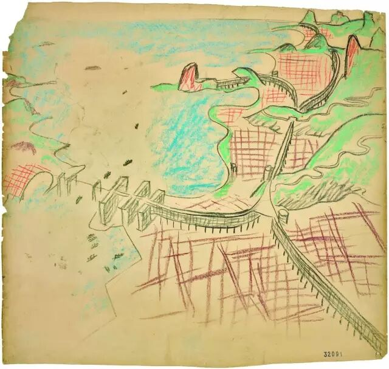
△  勒·柯布西耶的里约热内卢规划草图，1929年
一些建筑历史学家认为，拉美现代主义的开端始于1922年巴西圣保罗的“现代艺术周”（Semana de Arte
Moderna）。虽然这一说法存在争议，但不能否认的是，在1925年里诺·利维（Rino
Levi）的“建筑与城市美学”和格雷戈里·瓦勒查贝基克（Gregori
Warchavechik）的“关于现代建筑”的文章，确实引发了拉美最早关于现代主义建筑公开讨论。
1930年，当时年仅28岁的卢西奥·科斯塔（Lucio Costa）出任位于巴西里约的国家美院（ENBA, Escola Nacional de Belas
Artes）建筑系主任后，立刻对当时的建筑教育进行改革。这场改革被认为是巴西现代主义建筑的起点，尽管在几年后以失败告终，但其为奥斯卡·尼迈耶（Oscar
Niemeyer）、阿方索·爱德华多·里迪（Affonso Eduardo Reidy ）、罗伯托·布雷·马克思（Roberto Burle
Marx）和卡洛斯·里奥（Carlos
Leão）这些日后的建筑大师们提供了独特的专业训练。科斯塔所建立的卡里奥卡学派（Carioca用于指一切与里约热内卢相关的东西），显示出巴西早期现代主义建筑师以一种国际柯布式建筑作为起点向民族主义转变的路径。此外，这个时期还有一个不容忽视的小插曲：1931年，作为哥伦布纪念灯塔国际竞赛评委的赖特来到了里约，科斯塔充分利用这个机会就其新的教学大纲展开讨论，并得到了赖特的公开支持。
从今天拉美建筑的发展来看，赖特及其弟子对其影响被远远地低估了。
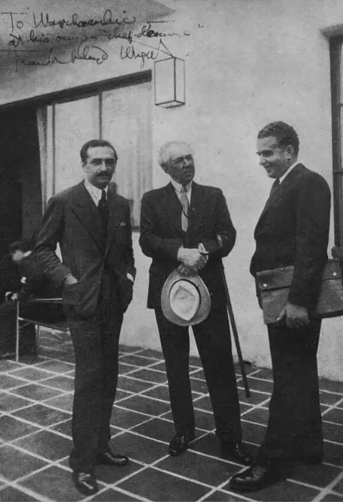
△  赖特与科斯塔在里约，1931年
1936年，巴西新政府将巴西教育与公共健康部（MESP）总部项目委托科斯塔设计，柯布作为顾问参与其中。在这个世界上最早建成的现代主义高层办公建筑之一的项目中，建筑师将完全忠于现代主义建筑基本原则的塔楼、有着强烈古典意味的底层柱廊、以及使用本地（葡萄牙-
巴西）艺术家手工艺瓷砖装饰的底层外墙融合为一体，这种开放的姿态表明了巴西现代主义建筑中灵活兼容的特征。1939年，科斯塔和尼迈耶设计的巴西馆在美国纽约博览会上建成。1941年，尼迈耶设计了贝洛奥里藏特的潘普利亚建筑群（Pampulha
buildings）。1943年，美国纽约现代艺术博物馆MoMA以“巴西建筑”为主题的展览象征着巴西现代主义建筑的黄金时代。
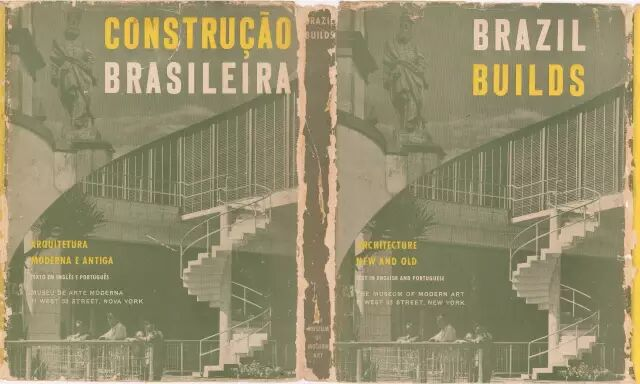
△  1943年MoMA展览的“巴西建筑”
在邻国阿根廷，前卫的现代主义和古典主义则是被奇妙地结合起来；确切地说，阿根廷早期的“现代主义建筑”是在古典法则下使用现代建筑造型语言的实践。
接受巴黎美院体系训练的阿根廷建筑师亚历杭德罗·布斯蒂略（Alejandro Bustillo）按照业主要求所设计的Ocampo住宅（Villa
Ocampo，Buenos Aires，
Argentina，1928）拥有现代主义建筑外表和纯正的古典室内空间；西班牙移民建筑师安东尼奥·比拉尔（Antonio
Vilar）的汽车俱乐部（Automobile Club, Buenos Aires, Argentina,
1943）则同时拥有临街道的古典立面和功能现代主义建筑的背部；阿曼希奥·威廉姆斯（Amancio
Williams）在1942年为父亲所设计的溪上住宅（House over the brook, Mar dePlata,
1942）展示一种清晰而不暧昧的现代主义建筑  ——  作为早期拉美现代建筑最高水平的代表作之一  ——
其优雅的建筑形态、精巧的结构和精确的施工代表了那个时代的最高水平。
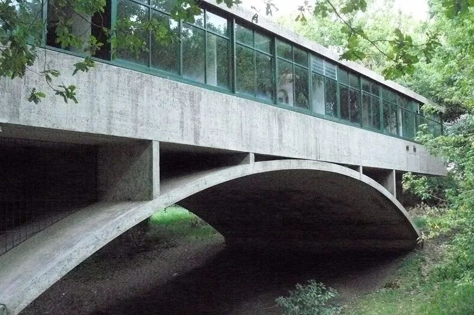
△ 溪上  住宅，1942年
▼
** 1945—1960年，建设乌托邦  **
因为没有直接卷入两次世界大战，战争期间拉美各国通过出口原材料物资，积累了大量社会财富。战后受到民粹主义影响的拉美各国，相继实行了高福利公共政策，这一政策直接加速了拉美各国城市化进程。在极短时间内，大量移民涌入城市（尤其是各国的首都和大城市）以便获取更好的社会公共福利。仅仅十年时间，许多拉美国家首都城市的人口翻倍，一些国家城市化率甚至超过90%。为了满足高速增长的城市居民需求，政府在短期内需要建造大量的社会住宅和公共设施，提倡工业化生产的现代主义建筑自然成为了政府首选。
在任何一本关于现代建筑的教科书中，巴西利亚都是不能缺席的。
1956年，新当选的库比契克总统在国内组织巴西利亚城市规划方案竞赛，最终科斯塔击败了巴西诸多知名建筑师赢得了项目，城市主轴上的建筑则是主要由尼迈耶设计，他将纪念性和古典性成功地融入到了现代主义建筑之中，突破了自己以往的建筑创作模式。从正式启用的那一天起至今，巴西利亚这座巴西的新首都既收获了最慷慨的赞誉，也受到了最严厉的批评；但这并不影响它在人们心中的地位
——  一座建成的极致现代主义乌托邦。
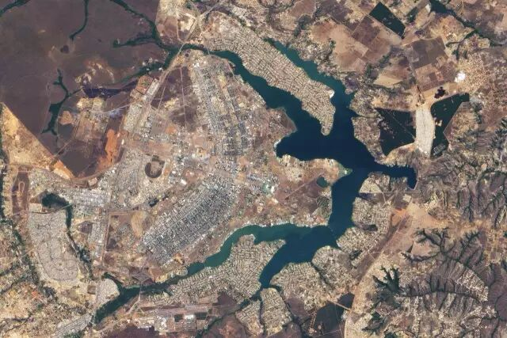

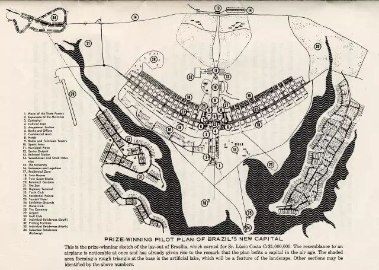
△  巴西利亚总体规划
当国际的眼光聚焦于巴西新首都的建设时，巴西圣保罗学派（即保利斯塔学派，Paulista
School）诞生了。1951年若昂·巴蒂斯塔·比拉诺瓦·阿蒂加斯（João Batista Vilanova
Artigas）在隆德里纳的公交站项目（Bus Station in
Londrina）中将钢筋混凝土的能力发挥到了极限。次年阿方索·爱德华多·里迪（Affonso Eduardo
Reidy）的里约现代艺术博物馆项目（Museum of Modern Art in Rio
，MAM）落成，在这个建筑中他提前使用了许多用于定义圣保罗学派的特征。1957年，女建筑师丽娜·博·巴尔迪（Lina Bo
Bardi）开始启动圣保罗现代艺术博物馆设计（MASP）。1958年，当时30岁的保罗·门德斯·达·洛查（Paulo Mendes da
Rocha）建造了可容纳2000座的圣保罗人体育馆（Paulistano Gymnasium）。
1954年，勒·柯布西耶为库鲁切特医生所设计的住宅（Curutchet
Housing）落成完工。尽管柯布对南美建筑有着巨大影响，这个住宅却是他在南美唯一建成的作品。柯布西耶在这栋小住宅里，几乎使用了他之前所有的设计手法和语言，并将自己对拉美的理解投射于这个建筑之中。1949年设计定稿后，柯布邀请了阿曼希奥·威廉姆斯（Amancio
Williams）作为项目现场建筑师以负责建造。不负众望，阿曼希奥不仅确保了这栋建筑高水平的施工，也为这栋建筑增色不少。
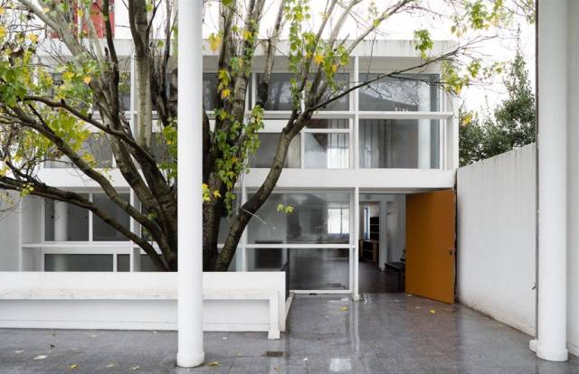

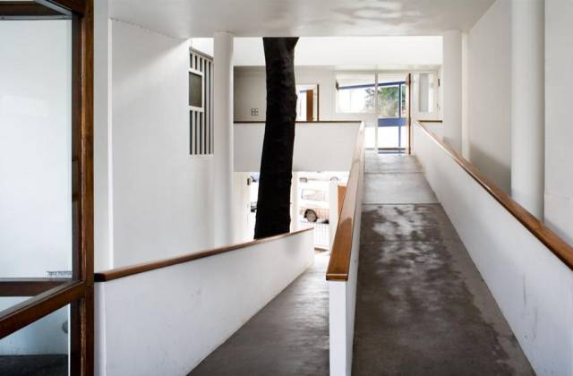
△  柯布设计的库鲁切特住宅，1954年
▼  ** 1960—1980年，隔绝的发展  **
讨论拉美现代建筑时，政治永远是一个无法回避的问题。我们甚至可以说，拉美的现代建筑从始至终都和政治有着千丝万缕的联系。“二战”后，由于冷战和恐惧共产主义对拉美国家的渗透，美国对拉美推行全面干涉主义，从多方面支持各国军政府，以便消除任何可能损害美国国家利益、控制各国共产主义化的倾向。1960年代后，各国独裁军政府陆续通过军事政变上台，一方面对内迫害和封锁言论，绑架杀害知识分子、学生和政治异见者；而另一方面实行极端的民粹主义来笼络底层大众，盲目推行高福利的公共政策。尽管如此，这个时期依然产生了一大批经典的建筑作品；然而直到1980年代拉美重返国际社会，大部分这些作品和建筑师才逐渐为人所知。
由于民粹主义的盛行和政局的动荡，拉美各国的私有经济力量逐渐被削弱，这个时期的优秀作品大多为大型公共建筑：阿根廷建筑师克洛林多·特斯塔（Clorindo
Testa）和SEPRA事务所合作完成的伦敦银行项目（1959—1966），巴西建筑师若昂·巴蒂斯塔·比拉诺瓦·阿蒂加斯设计的圣保罗大学建筑系馆（1967），墨西哥建筑师佩德罗·拉米雷斯·巴斯克斯（Pedro
Ramírez Vázquez）设计的墨西哥人类学博物馆（1964），以及智利建筑师艾米略·多哈特（Emilio
Duhart）设计的联合国拉美和加勒比地区经济委员会建筑（1960—1966）等。它们继承了早期拉美现代主义传统并有所发展：外露的钢筋混凝土材料创造了一种矛盾的和含混的纪念性，精致的结构将建筑体量从地面抬起，把地面空间留给公众空间。
这些建筑在以不同的方式努力地创造一种永恒感而不依赖于传统风格和形式，寻求一种能够超越其自身所处时间和地点的特征。
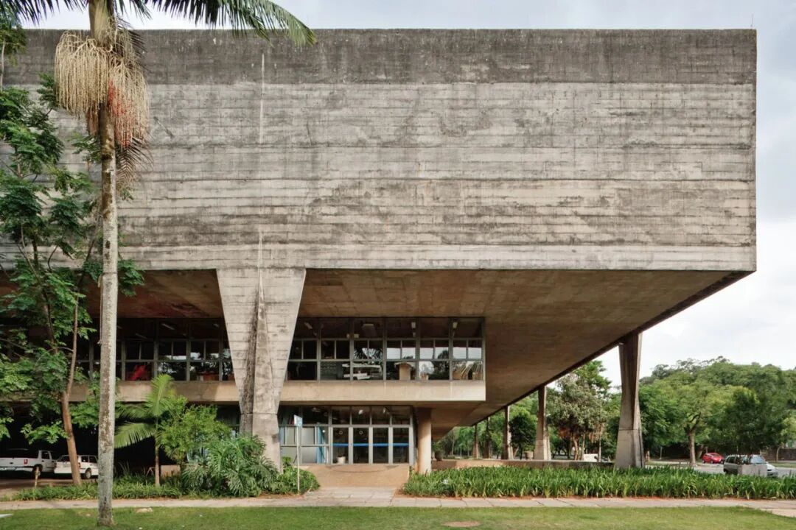
△  圣保罗大学建筑系馆，1967年
▼  ** 1980—1990年，"丢失的十年"  **
在1980年代初，拉美各国陆续结束了军政府统治，逐渐恢复民主制度并采用了新自由主义发展模式。然而拉美殖民时期遗留下的土地分配、贫富差距和产业体系等社会问题，依然没有得到解决。随着毫无约束的国际投机资本涌入，看似繁荣的地区和国家经济背后却布满了陷阱和灾难的种子。1980年代中期至2000年前后，拉美大部分国家的经济和货币在崩溃和重新开始之间往复循环，使得大部分中小资产阶级的财富积累全部耗尽，最终沦为贫民阶层。这一阶段的建筑发展也不乐观，拉美各国经济的自由主义和建筑文化的自我隔绝，使得两者之间呈现出矛盾而奇怪的关系。此外，正值国际上历史主义和后现代主义盛行之时，一些建筑评论家和建筑师的推动，拉美各国也受到了很大的影响。在身份认同、拒绝国际思潮、“场所精神”和民族主义的大背景里，拉美盛行后现代主义和地域主义建筑思想，在某种程度上塑造了一种孤立性，而这种主动隔离也意味着缺乏外界的关注。
这一时期拉美各国产生了大量的后现代主义建筑作品，其中不乏优秀之作；
少数建筑师没有放弃本地区的现代主义传统，例如：丽娜·博·巴尔迪所设计的圣保罗庞培亚体育文化中心  (SESC, São Paulo,
Brazil，1977—1985)  和保罗·门德斯·达·洛查所设计的巴西雕塑博物馆  （MuBE，São Paulo, Brazil,
1988-1991）。
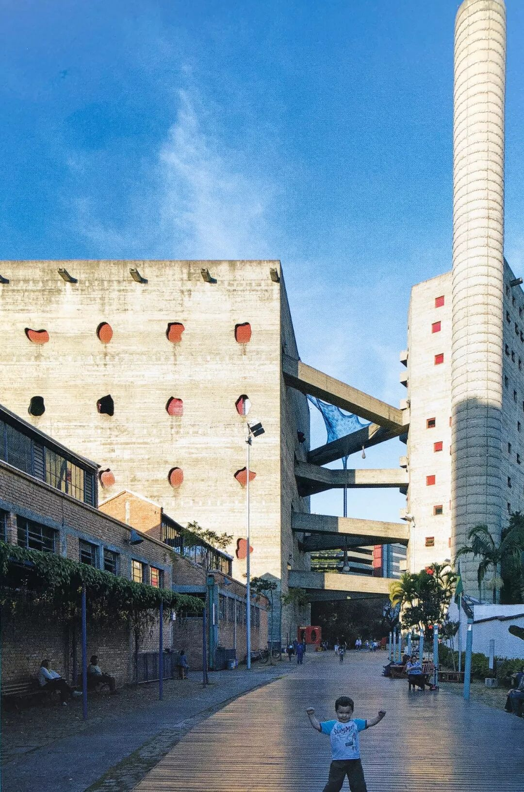
△  庞培亚文化休闲中心，1985年 图源：  _ LINA BO BARDI
▼  ** 1990年后，当代的转型  **
鉴于当代拉美建筑是一种进行时的状态，其所呈现出的不定性、多样性和丰富性都无法简短概括。在90年代开始的一两年里，处于盛期的后现代主义和历史主义却突然悄悄地退出了拉美的建筑舞台，在此之前没有任何激烈的批评和学术争论；几个看似偶然不相关的事件对后来的拉美建筑发展产生了巨大的影响。
1991年，南美各国在巴拉圭的亚松森签订了南共体协议；1994
年，墨西哥、哥伦比亚和委内瑞拉组成“三国集团”。在这样的背景下，跨地区和国家之间得以互相参照，多重视角和话语可以迅速传播并互相影响，完全改变了1980年来盛行的地域主义和后现代主义建筑倾向。拉美区域一体化进程对建筑产生了巨大影响，这是过去几代建筑师所无法想象的。回溯2000年前后拉美建筑的发展，不难发现地区政经整合历程是理解拉美当代建筑状态的一个重要前提。以南美为例，其国家铁路最初是外资公司拥有和运营，政府收归国有之后因经营和维持不善而废弃，至今主要出行方式还是依靠公路交通。1992年，以Rafael
Iglesia为首的一群罗萨里奥建筑师，在地理位置非常优越、正处整个南锥体国家大陆交通中心的阿根廷第三大城市罗萨里奥（Rosario）自发成立了R小组（Group
R）：没有任何大学和政府的背景，完全由志同道合的实践建筑师自行组织，以定期的沙龙形式进行建筑讨论，并自筹资金邀请国际著名建筑师讲座，同时出版自己的刊物。优越的地理中心位置和频繁的高质量建筑学术讨论蕴育了罗萨里奥学派的诞生，并影响了Solano
Benitez和亚历杭德罗·阿拉维纳（Alejandro Aravera）这些在日后声名显赫的建筑师，一直持续至今。

△  建筑师Rafael Iglesia
同时，信息时代为拉美带来了更多的国际影响和机会。1992年时，西班牙举办了塞维利亚世界博览会，以此纪念西班牙王国殖民美洲大陆四百周年。在1991年的竞赛中，巴西建筑师安杰洛·布奇（Angelo
Bucci）和阿尔瓦罗·蓬托尼（Alvaro
Puntoni）赢得了博览会巴西馆的设计；评论家认为这个项目标志着后现代主义在拉美统治地位的结束，以及新（晚期）现代主义的开始。
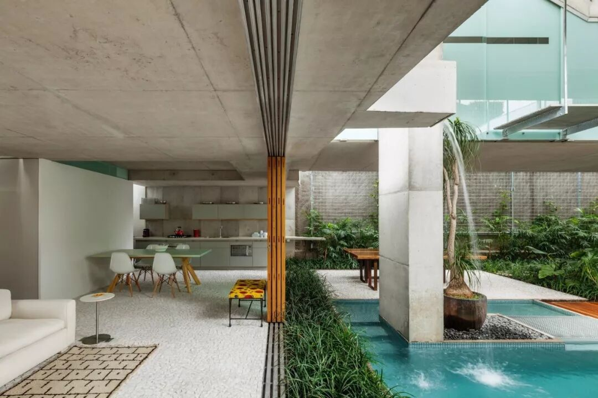
△ 建筑师Angelo Bucci设计的圣保罗周末住宅，2013年
在随后至今的二十多年里，拉美  年青
一代的建筑师不仅延续了拉美建筑传统，而且超越了前辈，将拉美现代建筑推向了另一个顶点。对于其所面临的拉美社会问题和建筑所应承担的责任，年青一代的拉美建筑师与他们的前辈并无太大的区别，其最根本的不同之处在于他们对建筑的理解以及建筑师在社会中所扮演角色的认知
——  ** 拉美年青一代建筑师不再受缚于宏大的建筑宣言，也不执着于永恒的身份认同，他们充满个人化的试验和表达尝试使得今日拉美建筑展现出丰富多元的面貌。
** 这样的转变在地域分布亦有所体现，与拉美传统的现代主义建筑中心相比，智利、哥伦比亚和巴拉圭地区的年轻建筑师迸发出更大的创造力。
** 有方12月拉美建筑考察，将由  香港大学建筑系副教授  ——  朱涛  带队，深入考察近30个拉美建筑经典。欢迎联系客服报名（识别下方二维码即可）。

** 视觉  ** / 蔡雨欣  ** 校对  ** / 李菁琳
本文版权归有方所有，  图片版权归原作者或来源机构所有。
若有涉及任何版权问题，请及时和我们联系，我们将尽快妥善处理。联系邮箱：info@archiposition.com
[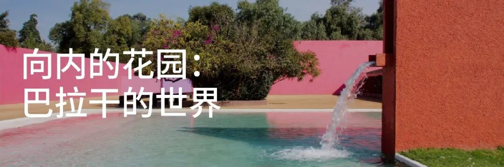](https://mp.weixin.qq.com/s?__biz=MjM5OTAxNjY4MQ==&mid=2650470718&idx=1&sn=80b92fd9ec8739eceb357fb798f1de3c&scene=21#wechat_redirect)[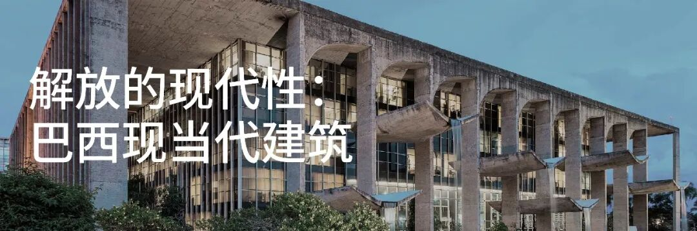](https://mp.weixin.qq.com/s?__biz=MjM5OTAxNjY4MQ==&mid=2650468407&idx=1&sn=ef8d5f225d90ea0728f1dd4945705b32&scene=21#wechat_redirect)

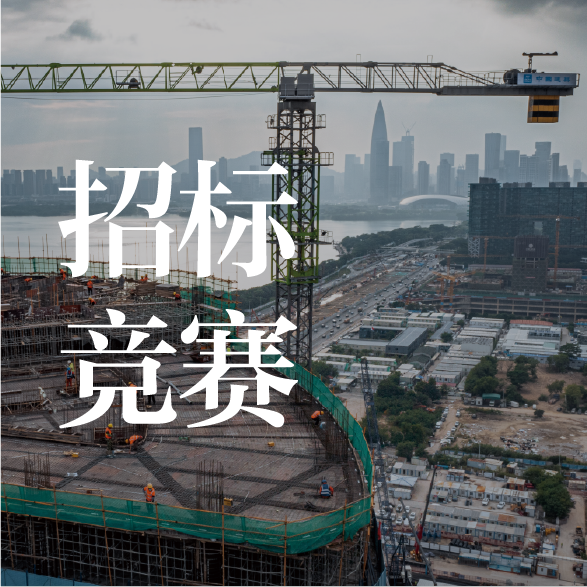

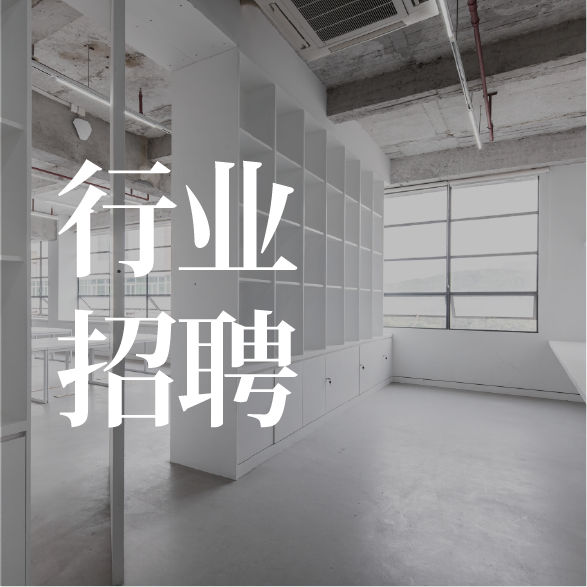

以“在看”分享  **** **

