# 建筑 景观招聘精选：日建设计、源计划等10家优质设计单位，等你加入！

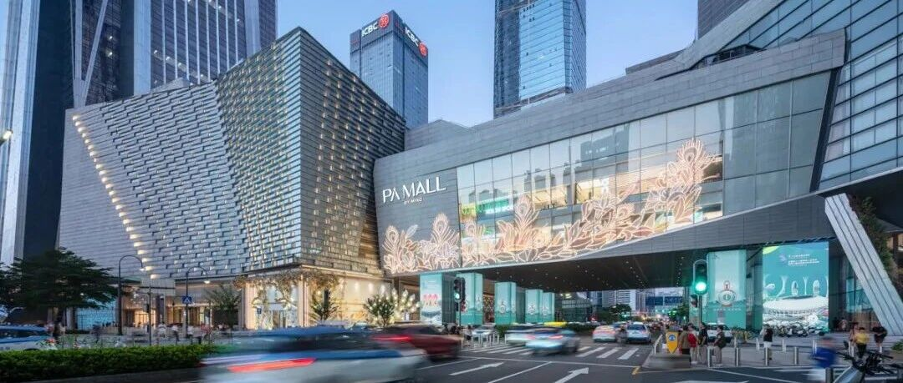

本期招聘合集精选1  0家设  计单位，地点分布在  ** 北京、上海、广州、深圳、杭州、香港6地。  从  优质外企到明星  ** ** 事务所  **
，期待你能匹配到心仪的岗位，也欢迎分享给有需要的朋友！
更多用人单位信息，使用有方小程序  建筑好工作  可随时  查看。  ** 如有招聘发布需求，欢迎联系我们  **
（微信：archiposition2016，  ** 请备注“招聘投放”  ** ）。
#
团队&职位速览，超链接查看详情：  ** **
** [ 北京｜致舍景观：景观方案设计师、景观施工图设计师、设计研究员/品宣助理、实习设计师](https://mp.weixin.qq.com/s?__biz=MjM5OTAxNjY4MQ==&mid=2650448986&idx=2&sn=07a6b8cb80b22de83c9919990ac54b34&scene=21#wechat_redirect)
** [ 上海｜日建设计：项目建筑师、建筑师（应届生可）、实习生](https://mp.weixin.qq.com/s?__biz=MjM5OTAxNjY4MQ==&mid=2650449174&idx=2&sn=7e0cdaa6e487ef92723bf168fea86bd1&scene=21#wechat_redirect)
[ 上海｜00Group：初级建筑师、建筑设计师、项目建筑师、实习生](https://mp.weixin.qq.com/s?__biz=MjM5OTAxNjY4MQ==&mid=2650450681&idx=2&sn=8f6850740675eda0f54ee6f9f34c90a2&scene=21#wechat_redirect)
** [ 上海｜APJ Arch姜平工作室：助理建筑设计师、建筑设计师、行政助理、建筑实习生](https://mp.weixin.qq.com/s?__biz=MjM5OTAxNjY4MQ==&mid=2650457638&idx=2&sn=1feaeb04acfd4e979de0277865c65e38&scene=21#wechat_redirect)
** [ 广州｜源计划 O-office：项目建筑师、建筑师、助理建筑师、实习生](https://mp.weixin.qq.com/s?__biz=MjM5OTAxNjY4MQ==&mid=2650455187&idx=2&sn=d804ea10771e69725e76a8ae6a9dc0d1&scene=21#wechat_redirect)
** [ 深圳｜境象建筑：项目建筑师、建筑师、助理建筑师、建筑实习生](https://mp.weixin.qq.com/s?__biz=MjM5OTAxNjY4MQ==&mid=2650448869&idx=2&sn=bcd9decd1cfec508cf247adb42f3af6e&scene=21#wechat_redirect)
** [ 深圳｜AICO（深圳）：建筑方案主创、方案建筑师、室内方案主创、室内设计师、商业软装设计师](https://mp.weixin.qq.com/s?__biz=MjM5OTAxNjY4MQ==&mid=2650449705&idx=2&sn=3a78af8f2111ad8b48a59a3da86d702f&scene=21#wechat_redirect)
** [ 深圳｜ARC Z：深化建筑师、助理建筑师、室内设计师、实习生](https://mp.weixin.qq.com/s?__biz=MjM5OTAxNjY4MQ==&mid=2650456975&idx=2&sn=09e36c3de84b246d5034369b40ea18f0&scene=21#wechat_redirect)
** [ 杭州｜O.G.A. 有所谓设计：初级或中级建筑师、实习生](https://mp.weixin.qq.com/s?__biz=MjM5OTAxNjY4MQ==&mid=2650449235&idx=2&sn=ab9a13542e874124a8e76b4037d0479d&scene=21#wechat_redirect)
** [ 杭州、香港｜Platform Design翊象设计：资深扩初景观设计师、中级扩初景观设计师](https://mp.weixin.qq.com/s?__biz=MjM5OTAxNjY4MQ==&mid=2650451255&idx=2&sn=69c6299bb5ade1710e3c299654f7a022&scene=21#wechat_redirect)
** ……  **
点击超链接，查看各团队招聘详情
收藏有方小程序  建筑好工作
及时获得更多优质职位消息
** 北京｜致舍景观  **
** 申请邮箱：  hr@la-zscape.com  **
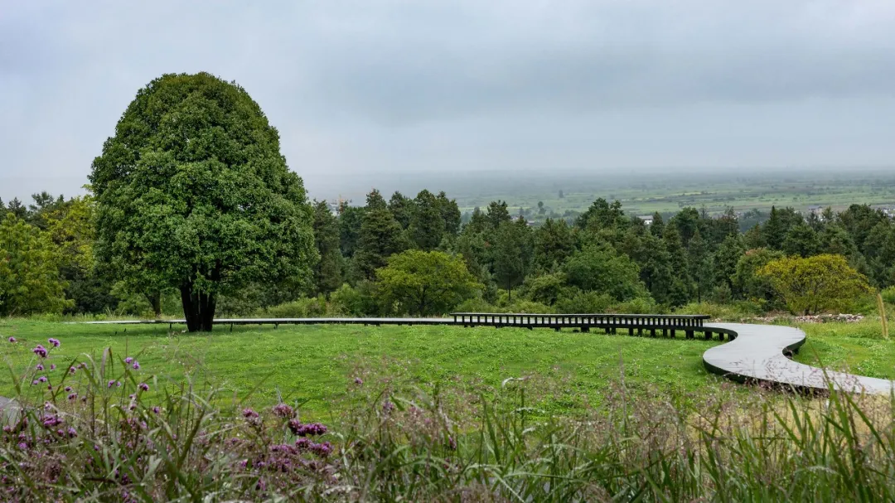
△  丽江HYLLA物与岚高山花园、荒野花园和草甸剧场
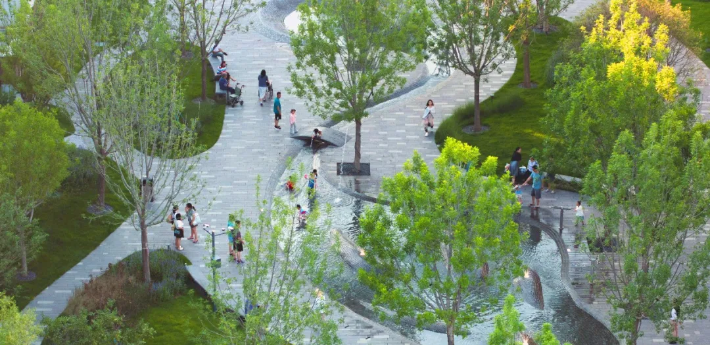
△  阿那亚北岸嬉水公园
** Z'scape致舍景观设计事务所  是由周梁俊与周婷于2018年在北京共同创立。
致舍始终秉持并坚信设计的价值“探求极致、感悟取舍”，致力于景观、艺术与设计领域的
实践探索，贯穿从概念到落地的全过程；追寻现代自然主义与景观艺术化的方向，以富有生命力的景观作品表达对人与自然关系的思考。
致舍的作品不受限于既定的类别与风格，以项目设计落地的质量而非项目数量为核心追求；其已完成的项目涵盖城市公共空间、山海间的酒店文旅、校园、公园、花园等领域。作品近年荣获ASLA美国景观设计师协会专业奖、LI英国皇家风景园林学会奖等业界权威奖项。
招  聘：  景观方案设计师、景观施工图设计师、设计研究员/品宣助理、实习设计师
坐  标：  北京市朝阳区望京街10号  望京  SOHO T3
[ 北京｜致舍景观：景观方案设计师、景观施工图设计师、设计研究员/品宣助理、实习设计师](https://mp.weixin.qq.com/s?__biz=MjM5OTAxNjY4MQ==&mid=2650448986&idx=2&sn=07a6b8cb80b22de83c9919990ac54b34&scene=21#wechat_redirect)
** 上海｜日建设计  **
****** 申请邮箱：  ** nikkenshanghai@nikken.jp  ** **
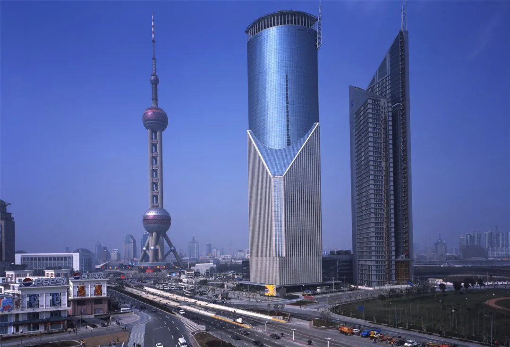
△ 中银大厦（2000）
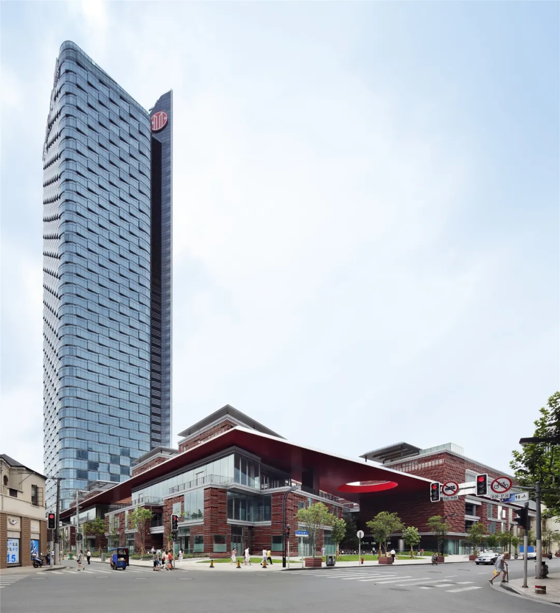
△ 中信广场（2010）
** 日建设计  **
是世界上最大的设计集团之一，拥有涵盖城市规划、建筑设计、土木工程、环境研究等各个领域的专家团队，连续多年综合实力排名世界前列。自1900年公司创立以来，日建设计集团承担设计落成的项目近25,000个，遍布全球50多个国家、250多个城市，打造了国内外具有代表性的城市地标。
** 日建设计（上海）咨询有限公司  **
是日建设计在中国上海设立的独资法人公司，于上世纪80年代，随着中国的改革开放，跟随母公司日建设计集团较早地进入中国市场。自2006年正式设立以来，在中国也打造了众多标杆性项目，广涉TOD综合体、城市更新、办公、研发以及商业、文化设施等诸多领域，并多次荣获各种建筑行业奖项。
****** 招聘：项目建筑师、建筑师（应届生可）、实习生  坐标：  上海市徐汇区龙爱路  7  号芒果广场  B  栋  6  层  ** ** **
[ 上海｜日建设计：项目建筑师、建筑师（应届生可）、实习生](https://mp.weixin.qq.com/s?__biz=MjM5OTAxNjY4MQ==&mid=2650449174&idx=2&sn=7e0cdaa6e487ef92723bf168fea86bd1&scene=21#wechat_redirect)
** 上海｜00  Group  **
** ** 申请邮箱：  ** gr  oup00@163.com  **
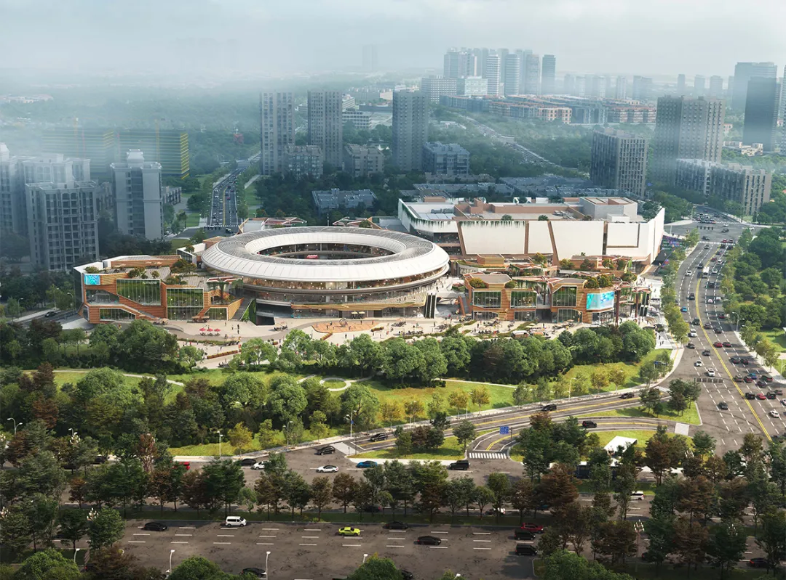
△ 隐溪川  -成都麓湖生态  城W2地块南区建筑设计
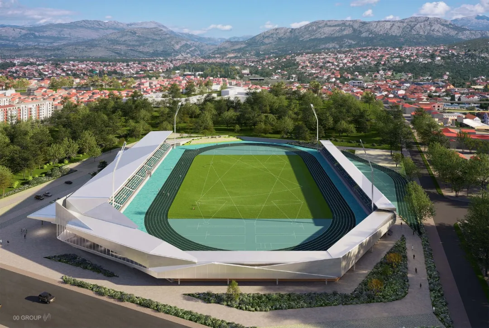
△ 山之间  -黑山体育  馆设计
00G  roup  （上海零霖建筑设计咨询有限公司）  由徐婧、刘刚  于  2019年
创立于上海。事务所关注建筑形式、空间体验与城市能量之间的关系，希望在快速趋同的城市环境中，创造真正具有识别性与精神性的建筑。
目前，事务所已有多个项目进入实施阶段  。  我们希望寻找：对建筑有长期兴趣、具备耐心与判断力、愿意深入图纸与  后期  建造过程的人，共同推进建筑实践。
招聘：初级建筑师/建筑设计师/项目建筑师/实习生  坐标：  上海市静安区共和新路  1868号大宁国际
[ 上海｜00Group：初级建筑师、建筑设计师、项目建筑师、实习生](https://mp.weixin.qq.com/s?__biz=MjM5OTAxNjY4MQ==&mid=2650450681&idx=2&sn=8f6850740675eda0f54ee6f9f34c90a2&scene=21#wechat_redirect)
上海｜APJ Arch姜平工作室
** 申请邮箱：  ** hr@apj-arch.com
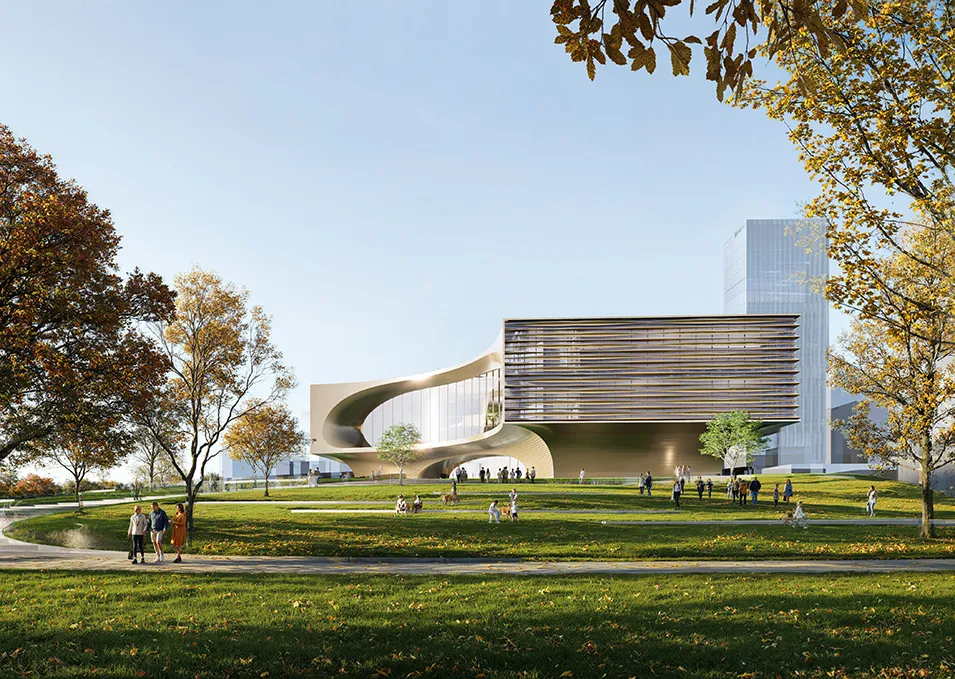
△  北京未来科学城科技文化交流中心  ，施工中
Atelier Ping Jiang | EID Arch | 北京维拓
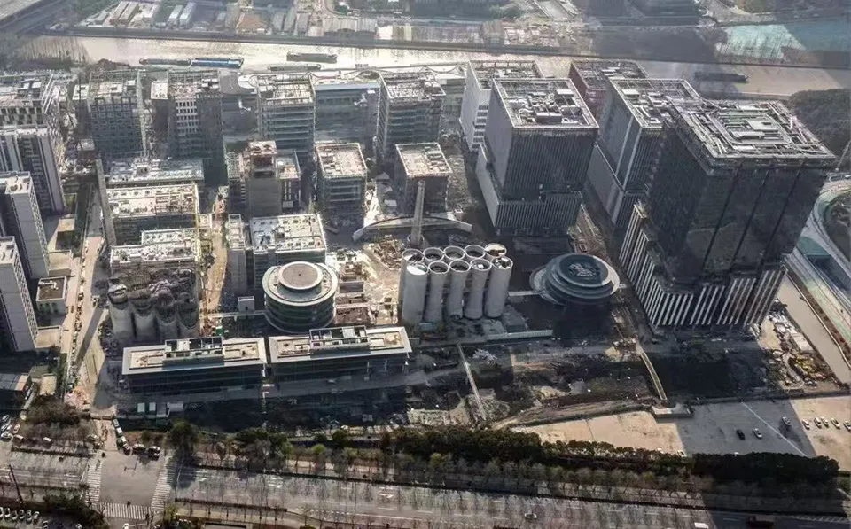
△  张江水泥厂城市更新项目  A地块，施工中
Atelier Ping Jiang | EID Arch |  同济院
APJ Arch姜平工作室  是一家全球领先的建筑事务所，
致力于建筑、城市设计、景观、室内、产品设计、公共艺术等跨学科领域的设计与研究。事务所由美国建筑师协会院士（
FAIA）姜平创办，目前在中国上海及美国芝加哥均设有工作室。事务所聚焦跨越边界的多元建筑类型，关注建筑的公共性，环境适应性，以及与在地文化的关联；设计注重场域的空间体验、氛围营造等可感知的维度，融合建构逻辑与结构理性的诗意表达，力图创造极具辨识度的、有意义的场所，通过对环境与建筑身份的重构，为社区、城市及环境带来持久正向的影响。
得益于事务所核心领导层在全球范围重要项目的实践历练与完善专业的项目管理体系，  APJ
Arch姜平工作室致力于成为中国最具实力和影响力的建筑设计事务所之一，为对设计实践充满热忱的优秀建筑师和建筑学子长期提供成长与职业发展的理想平台。
招聘：助理建筑设计师、建筑设计师、行政助理、建筑实习生
坐标：上海市徐汇区天等路  400号408A室
[ 上海｜APJ Arch姜平工作室：助理建筑设计师、建筑设计师、行政助理、建筑实习生](https://mp.weixin.qq.com/s?__biz=MjM5OTAxNjY4MQ==&mid=2650457638&idx=2&sn=1feaeb04acfd4e979de0277865c65e38&scene=21#wechat_redirect)
广州｜源计划 O-office
**** 申请邮箱：  ** job.gz@o-officearch.com  **
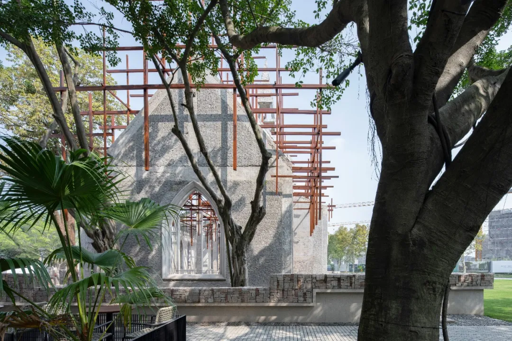
△  广州阿那亚旧教堂
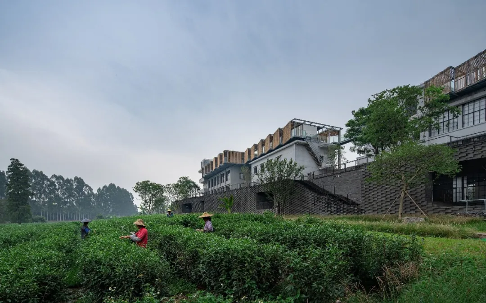
△  高明对川茶厂
** 源计划建筑师事务所  O-office Architects  ** 2007
年由何健翔和蒋滢创建于广州，试图以研究式的设计在高速成长与地域文化之间构建全新的空间话语，保持专业的冷静与克制，追寻已广泛失去的内在空间和城市生活本源。源计划将建筑设计作为泛化都市中的建构与游历，尝试建立一套跨越不同尺度和学科的综合设计策略。对珠三角城市历史和记忆的保护以及对新都市居住形态的研究，是事务所近年的设计和研究重点。源计划独特的地域性实践获得了国内外专业媒体的广泛关注，作品和文章被收录于英国
The Architecture Review  、美国  Architectural Record  、法国  L'Architecture
d'Aujourd'hui  、意大利  CASABELLA  、中国《建筑学报》等顶级学术媒体及多本关于中国当代建筑研究和案例的国际出版物。
招聘：  项目建筑师、  建筑师、  助理建筑师、  实习生
坐标：  广州  天河  天源路  804  号  3  栋  3F
[ 广州｜源计划 O-office：项目建筑师、建筑师、助理建筑师、实习生](https://mp.weixin.qq.com/s?__biz=MjM5OTAxNjY4MQ==&mid=2650455187&idx=2&sn=d804ea10771e69725e76a8ae6a9dc0d1&scene=21#wechat_redirect)
深圳｜境象建筑
** 申请邮箱：  ** hr@jingarchitects.com
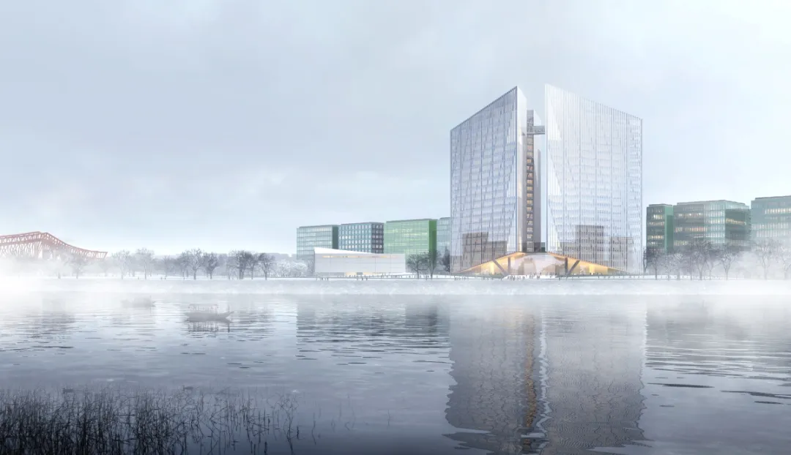
△  衢州市地标建筑概念性方案国际竞赛  #2标段  （竞赛一等奖方案）
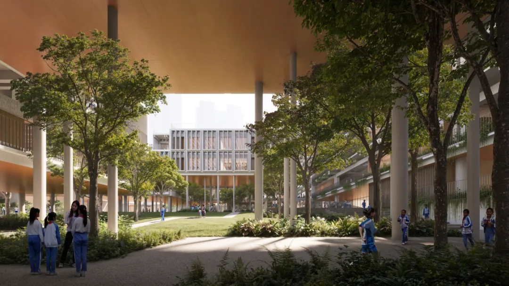
△  深圳市龙岗区坂田街道天安岗头九年一贯制学校新建工程（方案竞赛中标）
境象建筑设计事务所（深圳）有限公司
创立于深圳，它致力于将理性精神带入建筑实践，探索建筑的永恒之道。在一系列建筑实践中，我们正视社会变革和生活方式的改变，试图探索人、建筑与环境重建联系的可能性。我们主张从技术出发，建造清晰、持久和美的作品。我们重视资源相对紧缺的普遍问题，主张少费多用。我们相信在变化的社会现实背后不变的精神诉求，主张从一而多，简洁而饱满。
我们专注于多种尺度的纵深设计，多专业的横向配合，以及多种类型的技术积累。设计范围涵盖城市设计、办公建筑、产业园、综合开发、文化建筑、展览建筑、教育建筑、体育建筑、交通建筑、酒店建筑、商业建筑、室内设计、景观设计以及产品设计等等。创始人胡铮、禹庆曾经创立在业界具有影响力的境工作室（CCDI）并担任主持建筑师多年，获得30+行业设计大奖。
招  聘：  项目建筑师/建筑师/助理建筑师/建筑实习生
坐  标：  深圳市  福田区侨香路  3  085  号岭南大厦  3  楼  3  08
[ 深圳｜境象建筑：项目建筑师、建筑师、助理建筑师、建筑实习生](https://mp.weixin.qq.com/s?__biz=MjM5OTAxNjY4MQ==&mid=2650448869&idx=2&sn=bcd9decd1cfec508cf247adb42f3af6e&scene=21#wechat_redirect)
深圳｜AICO（深圳）
** 申请邮箱：  ** sz-hr@aico-design.com
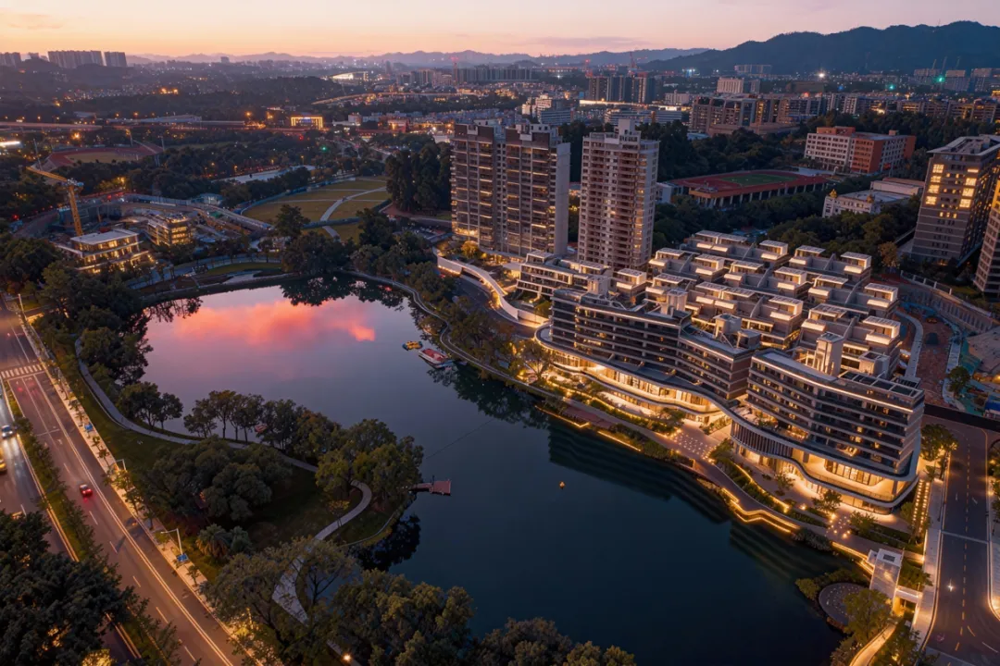
△ 广州越秀樾湖天地
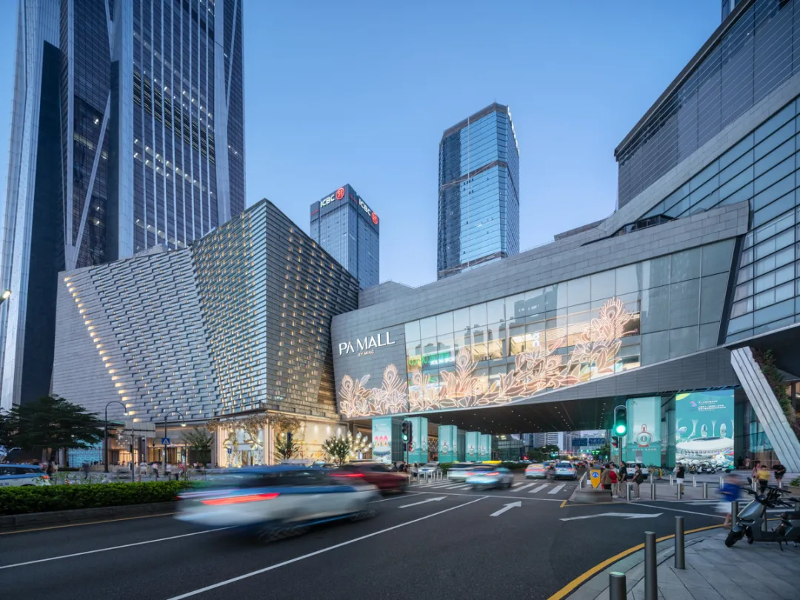
** △  深圳平安金融中心裙楼改造  **
** AICO  ** 国际建筑设计事务所  注册于香港，始创于
2011年。我们致力于在有跨地域、跨文化的全球精品建筑设计深厚经验背景的支持下，为客户提供包括大型城市综合体、超高层地标、商业目的地、办公产业园区、文旅、文化建筑、酒店、高端居住、TOD综合开发和城市更新等领域的综合设计解决方案。
** AICO（深圳）建筑设计有限公司  ** 拥有超过
70名优秀设计师。作为粤港澳大湾区主流商业设计机构之一，我们的设计范围覆盖城市规划、大型城市综合体、商业公共建筑与公共建筑室内设计等领域，为国内优秀开发商及机构提供咨询、设计与执行管控的全方位服务。项目斩获多个国内外设计大奖。追求建筑“表里如一”的品质促使我们在跨专业和跨类型的设计创作过程中全方位地打磨建筑，并进一步给予使用者最佳的体验感受，在快节奏的现代生活中创造更好的空间联系。
招聘：建筑方案主创、方案建筑师、室内方案主创、室内设计师、商业软装设计师  坐标：  深圳市南山区威盛科技大厦  20楼  ********
[ 深圳｜AICO（深圳）：建筑方案主创、方案建筑师、室内方案主创、室内设计师、商业软装设计师](https://mp.weixin.qq.com/s?__biz=MjM5OTAxNjY4MQ==&mid=2650449705&idx=2&sn=3a78af8f2111ad8b48a59a3da86d702f&scene=21#wechat_redirect)
深圳｜ARC Z
** 申请邮箱：  ** info@arc-z.cn
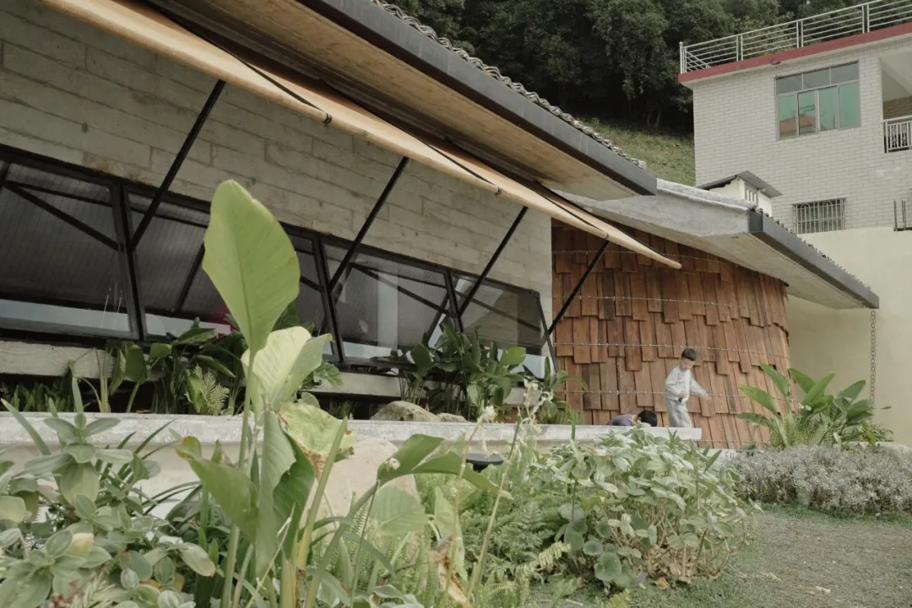
△  树洞酒馆与石室茶屋  合作方：猜一建筑  摄影：张子彦
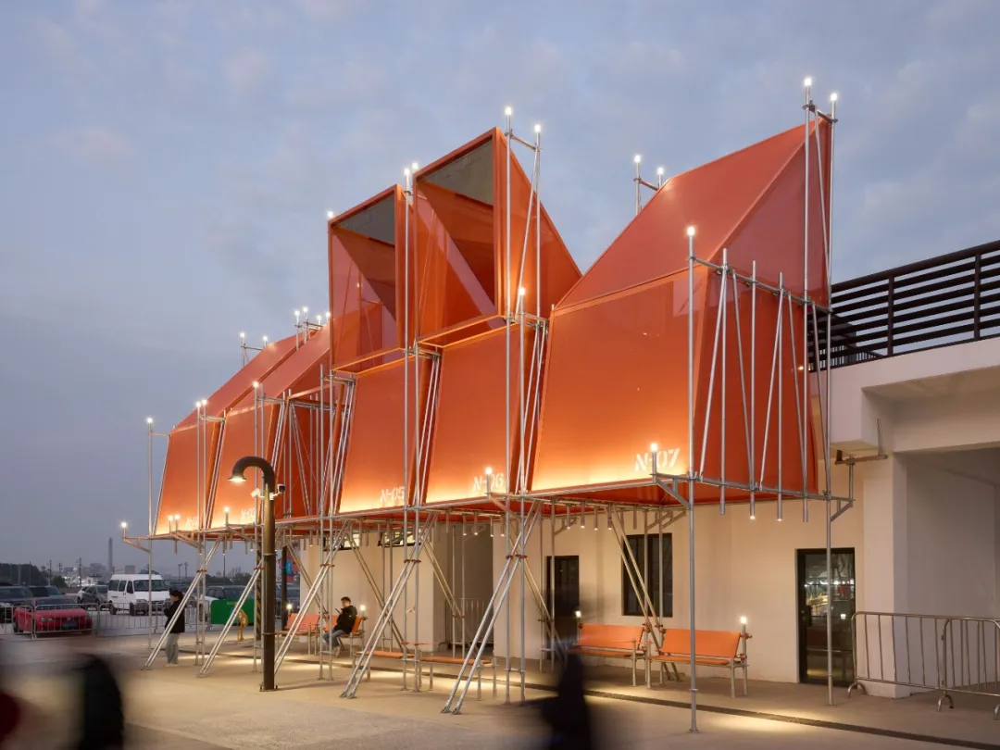
△  “  下水那天  ”  船台装置 合作方：猜一建筑 摄影：朱清言
ARC Z  在  2023  年末成立于深圳，创始人分别毕业于哈佛大学与剑桥大学，曾就职于多家国内外知名建筑事务所，拥有丰富的实践经验。
我们将建筑的综合学科体系作为创作及回应复杂问题的线索，旨在于每个项目中凝练出兼具社会切近性、实用性和批判性的建筑物。我们深信建筑仍具有直达人心的力量，并以此作为实践手段来介入当下中国独特的现实环境。
我们拥有良好的工作环境，并且致力于以合理的项目管理和高效的协作最大程度减少加班。我们期待与每一位成员共同成长，为个体的长期职业发展提供机会。
招聘：  深化建筑师、助理建筑师、室内设计师、实习生
坐标：深圳市南山区华侨城锦绣北街  8-1  号  ARC Z  建筑事务所
[ 深圳｜ARC Z：深化建筑师、助理建筑师、室内设计师、实习生](https://mp.weixin.qq.com/s?__biz=MjM5OTAxNjY4MQ==&mid=2650456975&idx=2&sn=09e36c3de84b246d5034369b40ea18f0&scene=21#wechat_redirect)
杭州｜O.G.A. 有所谓设计
** 申请邮箱：  ** elise  @yswoga.com
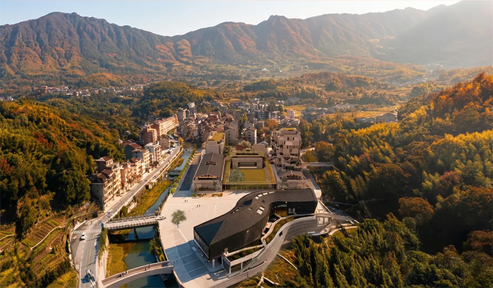
△  青田  农遗研学中心  +青田  稻鱼共生  系统  博物馆  （  已建成  ）  ，浙江青田
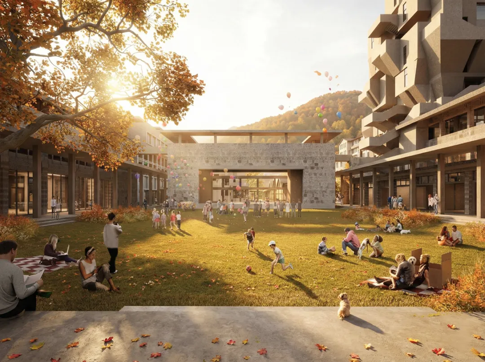
△  青田农遗研学中心，方案深化阶段，浙江青田
** Olivier Greder Architecture  ** （简称
O.G.A.），中文名“有所谓设计”。创始人法国建筑师、城市设计师Olivier
Greder，现为中国美院建筑艺术学院特聘教授、城市设计系主任。来华前曾是法国生态建筑和城市设计事务所G.STUDIO的联合创始人及主持设计师（2001—2015）。2020年11月
个人  获  ** “新时代山水城市·丽水山居图城市设计国际竞赛”  ** 第二名（  152平方公里的城市规划设计）  。
** O.G.A.  ** 工作室创立于  2017年，近西湖，临吴山，  专注于  ** 公共空间和公共建筑  **
的设计以及城市改造和城市修复；注重建筑的科学性、实用性和社会性，倡导生态、环保与低碳；提倡建筑和城市设计  “以人为本”、因地制宜
以及低调朴实的价值观；反对形式主义、功利主义和脱离现实的  “标准化”设计；反对以汽车
为中心的非人性化城市规划；致力于研究普遍性城市化的替代解决办法，支持城市性和城市生活，探索并提出了一种促进步行性和包容性的混合用途友好社区城市的反规划对策；倡导保护农村和农业、自然景观及生物的多样性；主张恢复自然、乡村和现代社会之间的共生条件。
招  聘：  初级或中级建筑师、实习生
坐  标：  杭州市上城区延安路  8号天风商厦
[ 杭州｜O.G.A. 有所谓设计：初级或中级建筑师、实习生](https://mp.weixin.qq.com/s?__biz=MjM5OTAxNjY4MQ==&mid=2650449235&idx=2&sn=ab9a13542e874124a8e76b4037d0479d&scene=21#wechat_redirect)
杭州、香港｜Platform Design翊象设计
** 申请邮箱：  ** contact@platform-dg.com
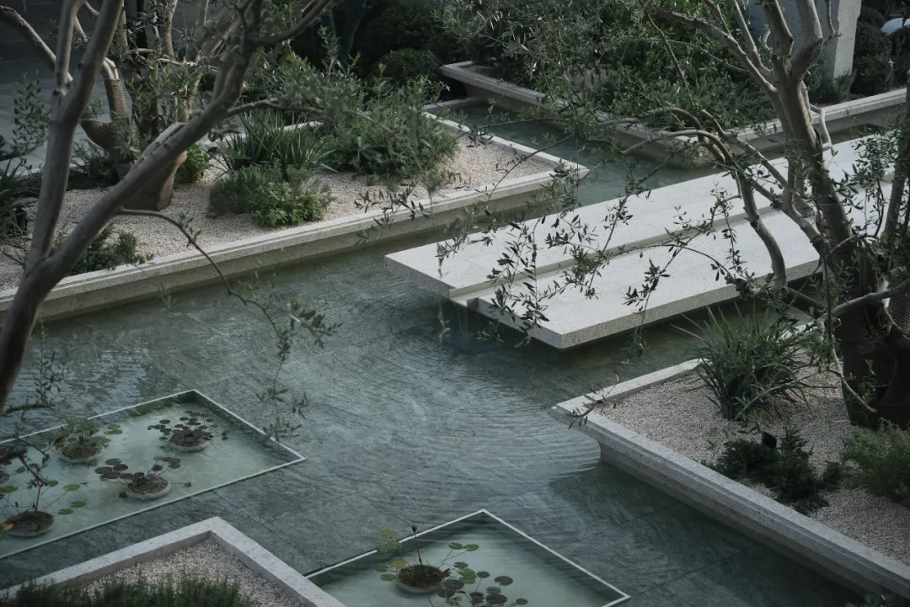
△  ** ** ** 上海万科中兴傲舍  **
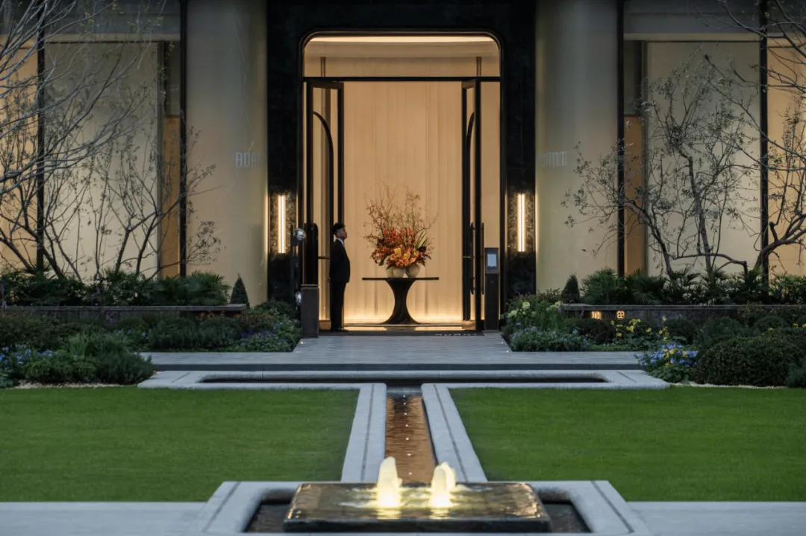
** △  ** ** 中海上海领邸玖序  **
翊象设计  有限公司  在  2014  年成立于香港，  由徐睿绅领军，目前工作室分布于香港、杭州及台北。
翊象深耕高端住宅、大型综合体及酒店等景观空间领域。秉持着精致、独特、鲜明、创造的
设计理念，尽可能在每个项目深挖独特的禀赋，彰显景观构成的特殊性，为每个项目订制最合宜的空间设计。近几年作品获得多个国际大奖，包括  Landezine
International Landscape Award; World Landscape Architect Award; International
Design Award  。
我们重视每一位员  工，  除了有良好的工作环境，  也提供学习成长的空间及国际视野，  欢迎优秀的朋友一起加入。
招聘：资深扩初景观设计师、中级扩初景观设计师  坐标1：杭州市西湖区天目山路  398  号天目里  10  号楼  702  室  坐  标2：
香港上环德辅道中317-319号启德商业大厦1401-02室
****** [ 杭州、香港｜Platform Design翊象设计：资深扩初景观设计师、中级扩初景观设计师](https://mp.weixin.qq.com/s?__biz=MjM5OTAxNjY4MQ==&mid=2650451255&idx=2&sn=69c6299bb5ade1710e3c299654f7a022&scene=21#wechat_redirect)
希望于有方发布招聘信息？  添加微信：archiposition2016  近期更多热招职位请点击：  建筑好工作
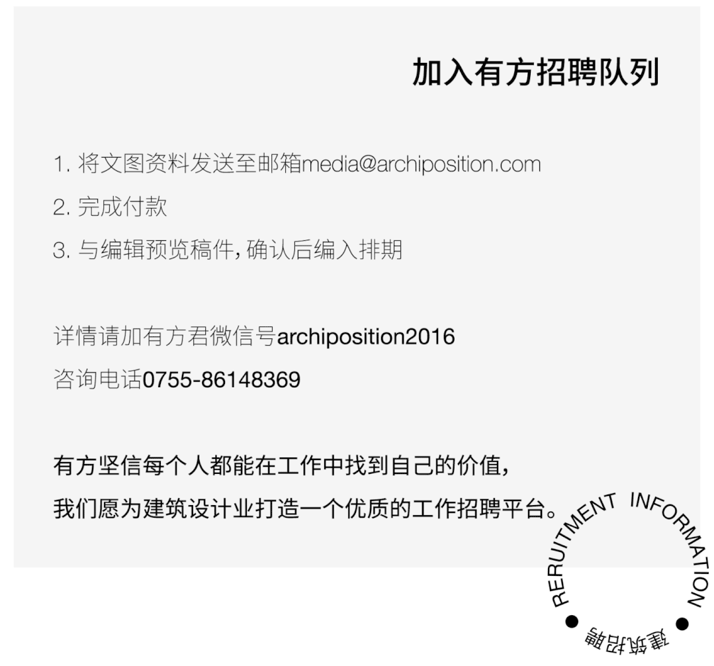

** ** 校对  ** / 原源
本文由各设计单位授权有方发布，欢迎转发，禁止以有方编辑版本转  载。

以“在看”分享  **** **

