# 日建设计新作：卡塔尔·阿尔拉扬银行，高性能八边形

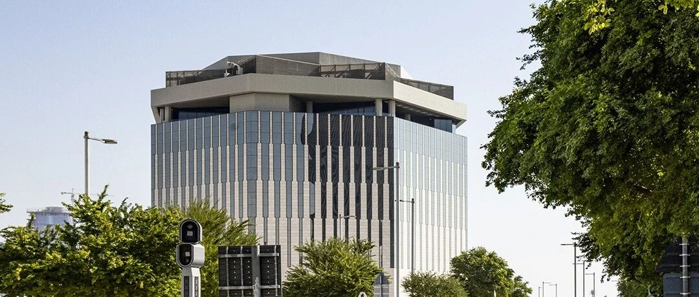

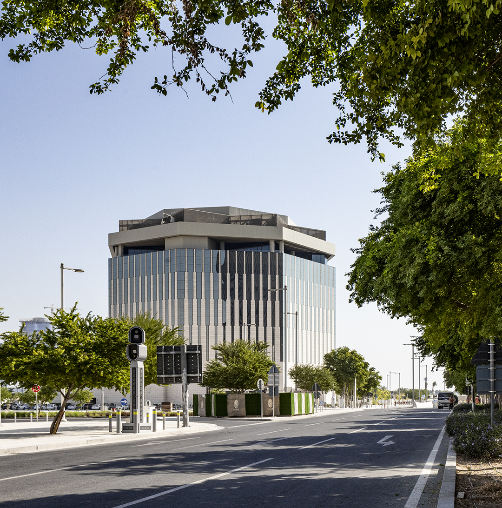

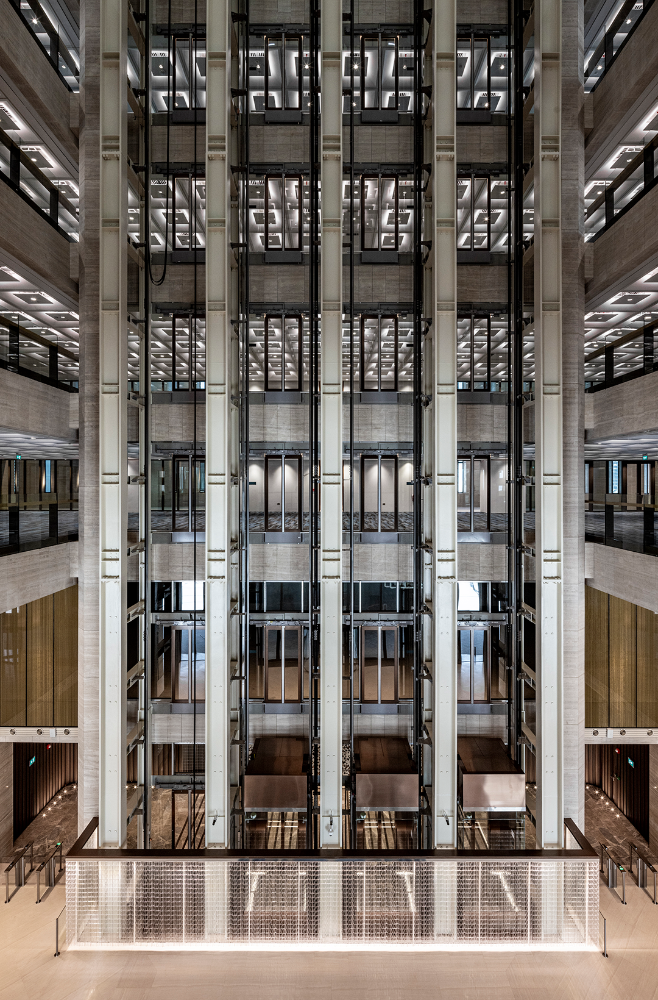

△ 阿尔拉扬银行 ©Koji Horiuchi / Shin Shashin Kobo

首席设计顾问、方案设计 日建设计

项目地点 卡塔尔，卢塞尔

建筑面积 16500平方米

建成时间 2025年9月

本文文字由设计单位提供。

/ 呼应地区文化、适合当地气候的灵活办公空间

阿尔拉扬银行位于卡塔尔卢塞尔滨水区，该地区是正在开发中的新金融商务中心。设计团队在将当地文化与气候特点融入建筑形态的同时，将其设计成了一个能够应对未来变化的办公场所。

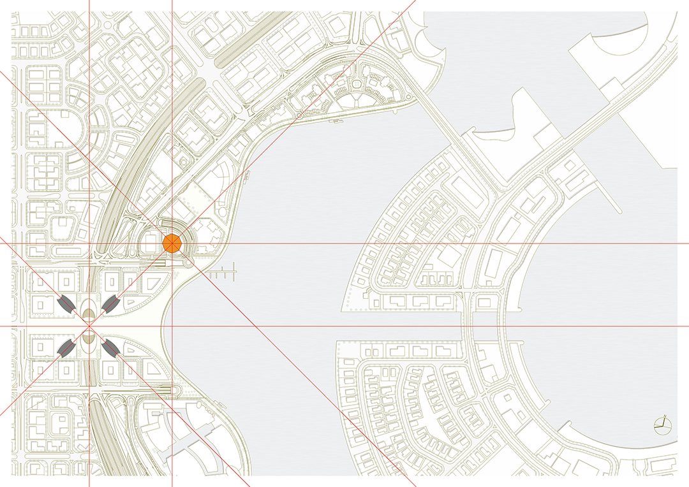

△ 区位示意 ©日建设计

日建设计将根植于当地文化的秩序，作为空间、环境与结构的合理性加以整合，结合应对海湾沿岸特有的强烈日照及高温多湿气候的空间布局，以及具备长期可变性的办公空间规划，打造出一座适合中东环境的现代办公楼。银行大楼与周边的地标性建筑共同构成了卡塔尔不断发展的金融区景观。

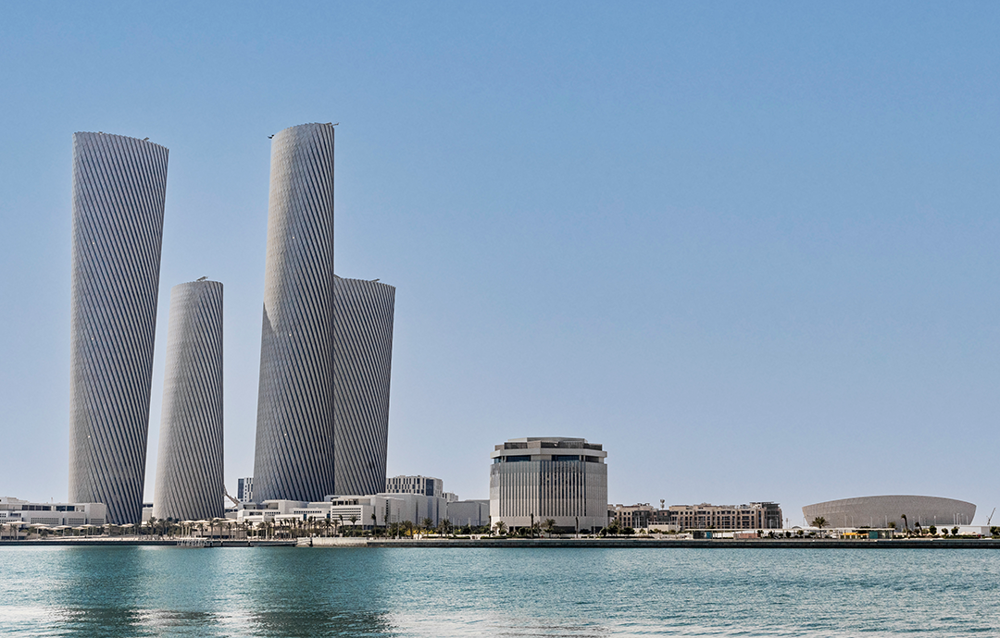

△ 从卢塞尔滨水区眺望阿尔拉扬银行 ©Koji Horiuchi / Shin Shashin Kobo

建筑的形态源于沿城市轴线与沿海岸线布局的网格这两种方向性的叠加。由此，外围呈现出八边形的轮廓，内侧则布置有正方形的办公楼层。在八边形与正方形的连接处设置4个服务核心筒，使整栋建筑呈现出清晰的结构。

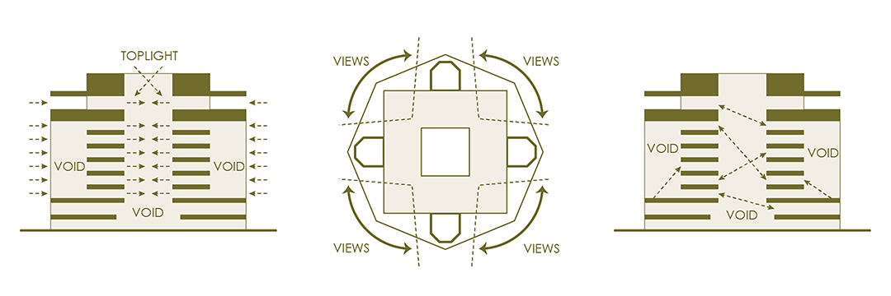

△ 生成分析 ©日建设计

这套几何体系并非单纯的造型手法，而是将空间布局、环境适应性与结构规划有机结合，从而构成整个项目的骨架。

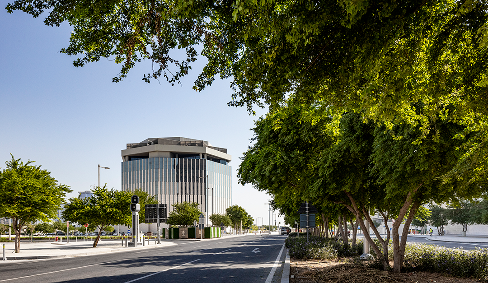

△ 街道视角 ©Koji Horiuchi / Shin Shashin Kobo

/ 兼具厚重感与通透感的建筑立面

立面设计旨在同时实现厚重与通透、遮蔽与开放、地域特色与现代环境性能的统一。低层部分通过采用石材的坚实外装，营造出与金融机构相称的庄重感与存在感。另一方面，随着楼层升高，建筑立面逐渐呈现出轻盈且更具通透感的形态，在引入自然光的同时，向天空敞开。

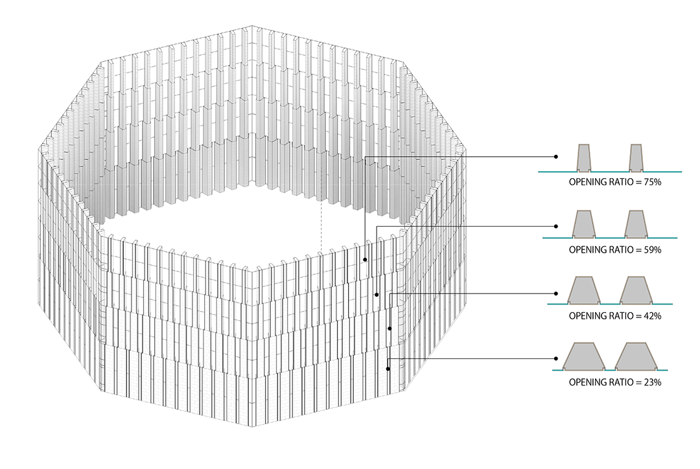

△ 立面分析 ©日建设计

这种垂直方向上的变化也与建筑内部的环境息息相关。低层部分利用石材面遮挡直射阳光，上层部分则借助中庭与双层表皮结构，在实现所需热环境性能的同时，成功呈现出更具开放性的视觉效果。通过最长达30米的半独立型竖向翅片，在阻挡各方向日照的同时，确保了水平方向上广阔的外部视野。

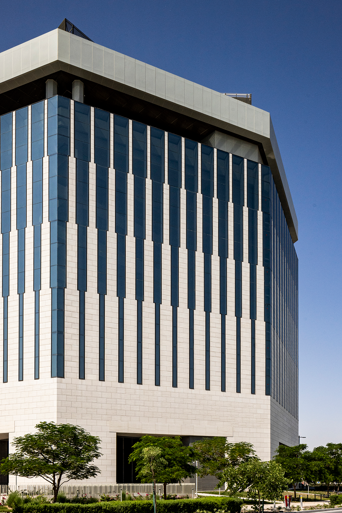

△ 建筑立面 ©Koji Horiuchi / Shin Shashin Kobo

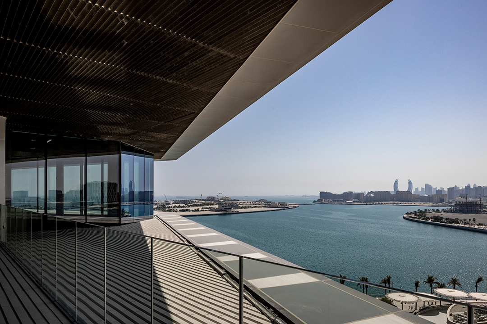

△ 高层视野 ©Koji Horiuchi / Shin Shashin Kobo

/ 调节环境的几何形平面

在八边形外立面与正方形办公楼层之间，连续设置了外侧中庭（外中庭），并在平面中央布置了一个内中庭。通过在建筑内设置两种中庭，既将自然光引入建筑深处，又实现了从外部到内部的渐进式空间层次。

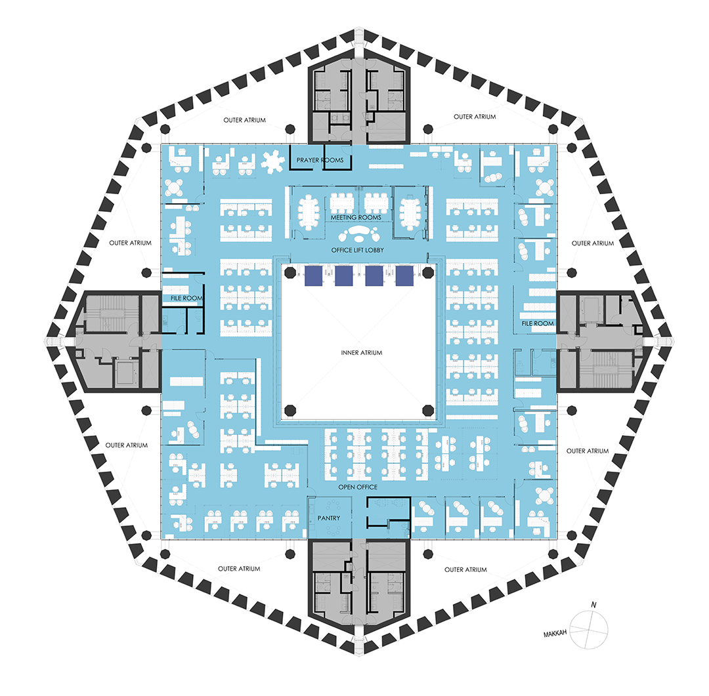

△ 标准层平面 ©日建设计

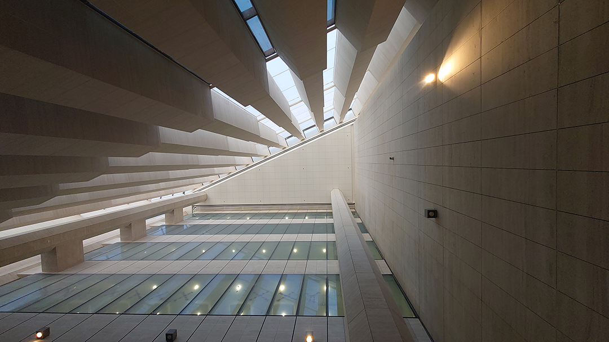

△ 外中庭 ©日建设计

这种双层中庭作为环境缓冲空间，起到了防止办公空间直接暴露于卡塔尔强烈日照、高温高湿外部环境中的作用。外中庭在外立面与办公区域之间抑制日照；内中庭则为整栋建筑引入自然光并建立视觉连接。

本项目的一大特点在于，从规划初期阶段就通过融入几何学、剖面、空间构成的基本原理来获得环境性能，而非通过在竣工后增设设备来实现。

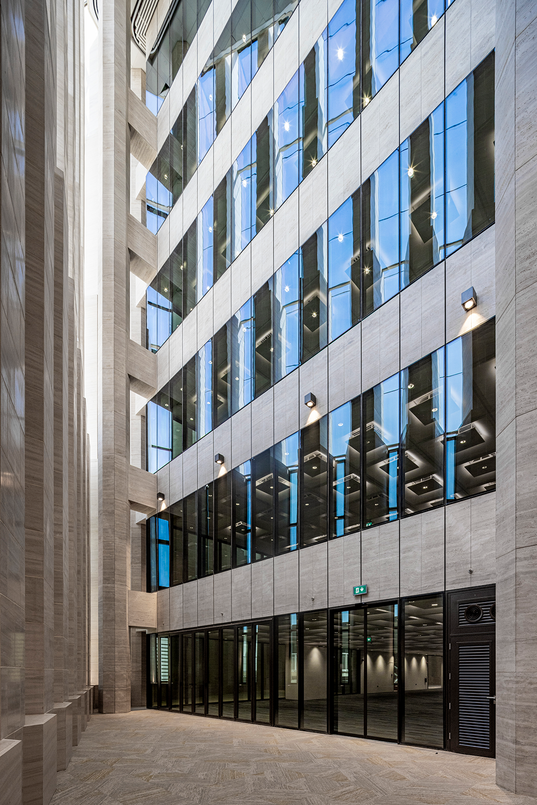

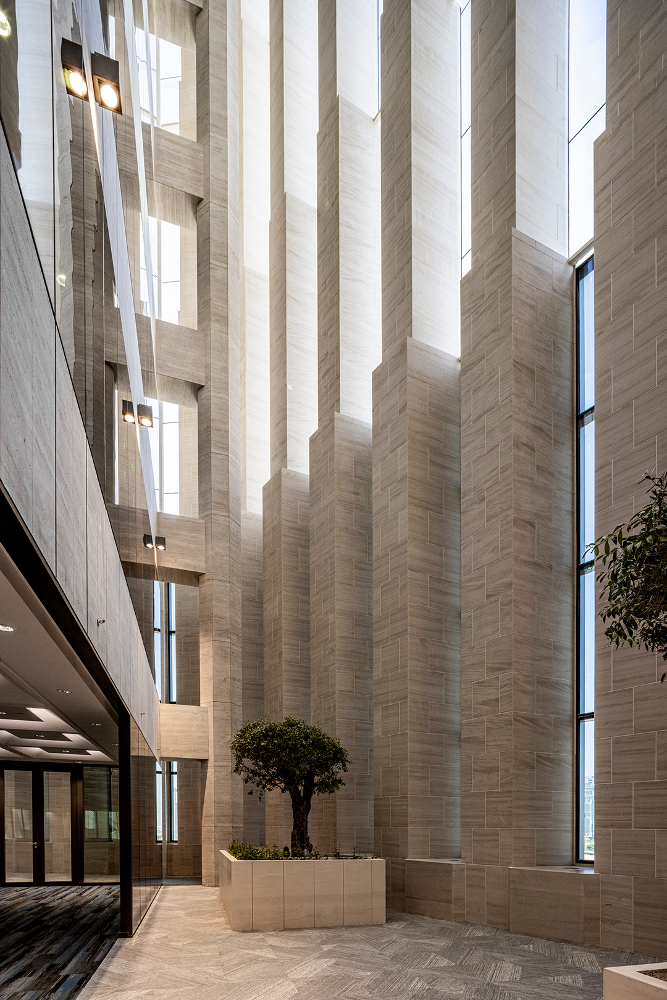

△ 外中庭 ©Koji Horiuchi / Shin Shashin Kobo

/ 两个中庭创建组织间的连接

建筑中心设有一个贯穿办公楼层、向上延伸至顶部天窗的内中庭。内中庭不仅将自然光引入建筑深处，还在视觉上建立了部门间与楼层间的连接。

在大型金融机构中，各部门往往相互分隔，容易产生空间和心理上的距离。内中庭则起到了缓解这种分隔、营造出开放性与整体感的作用。在1层，内中庭作为主大堂，既是迎接访客的场所，同时也作为建筑纵向动线的中心发挥作用。

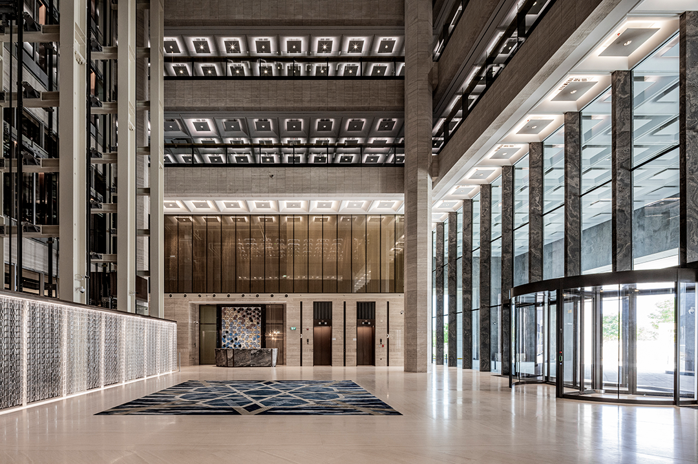

△ 中庭与首层 ©Koji Horiuchi / Shin Shashin Kobo

另一方面，外中庭是设在办公楼层与建筑外立面之间的缓冲空间，在保护办公区免受外部严酷环境影响的同时，还配置了休息室、咖啡厅等公共功能区。这种兼具半户外舒适感的空间不仅促进了非正式的交流，同时也赋予了整栋建筑以进深。

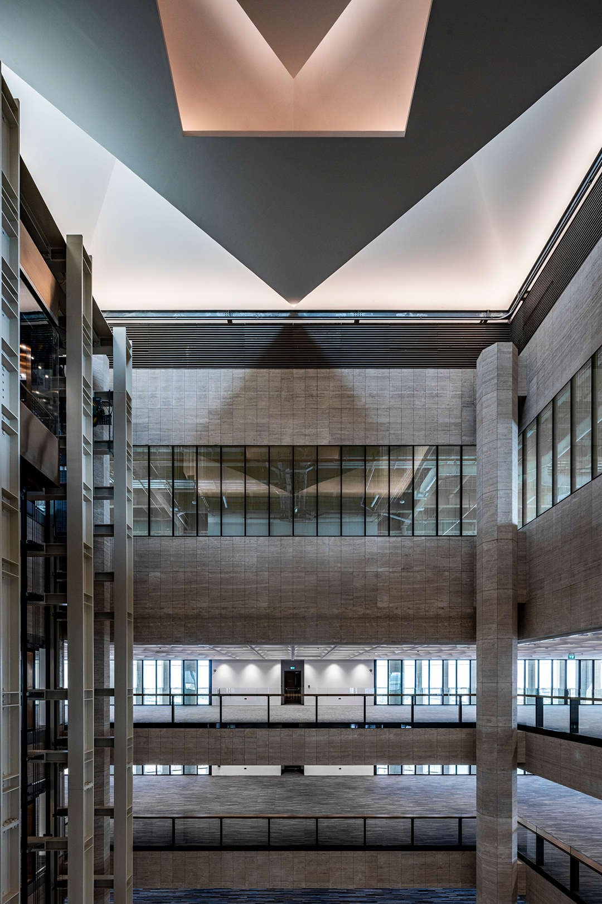

△ 中庭 ©Koji Horiuchi / Shin Shashin Kobo

/ 应对变化的无柱办公空间

客户要求的是能够灵活应对组织发展和未来变化的办公场所。设计团队在听取了银行各部门作为使用者的意见后，提出了一套能够适应多样化工作方式的方案。

将结构构件和设备竖井集中布置在办公区域外侧，确保了办公空间成为不受立柱影响的开放式楼层。由此实现了便于调整工位布局、应对未来组织重组的办公空间。支撑这种灵活性的是钢筋混凝土结构与钢结构相结合的混合结构：基座部分和外周核心筒采用钢筋混凝土以确保稳定性，内部楼板结构、立面和屋顶则采用钢结构。这种形式在当时是该地区较为罕见的结构形式。

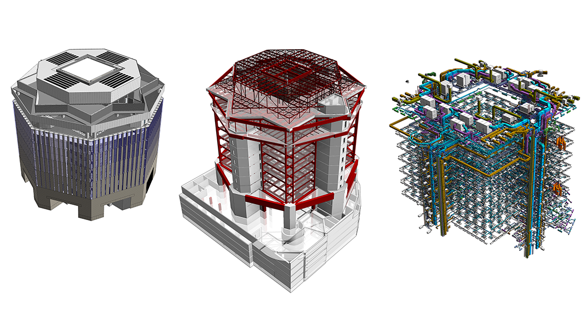

△ 塔楼结构与设备分析 ©日建设计

通过这一构成，在使结构构件保持纤细的同时，实现了具有开放性、轻盈感以及长期适应性的办公环境。

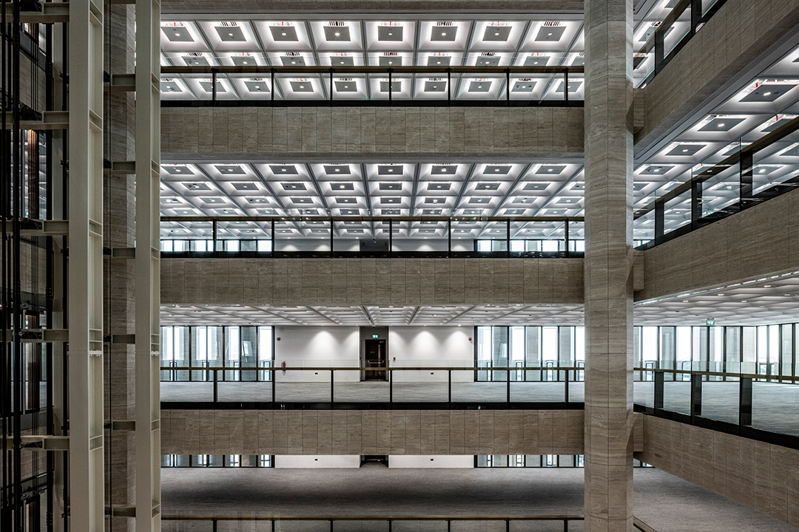

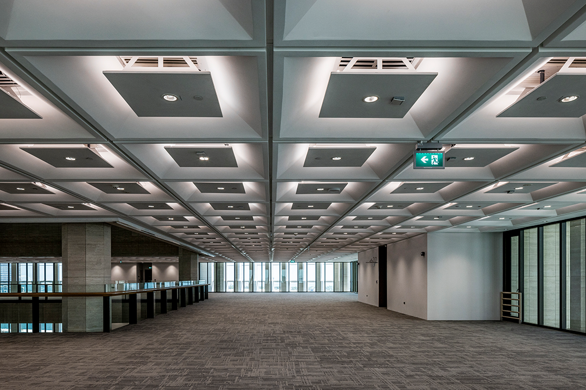

△ 大跨无柱空间 ©Koji Horiuchi / Shin Shashin Kobo

/ 吊顶与环境系统的整合

建筑与环境设备的设计理念也体现在吊顶设计中。以1.8米正方形网格为基础单元的模块化华夫格吊顶，在赋予办公室内部清晰秩序的同时，还将照明、空调及防灾设备一体化地嵌入其中。定制的GRC面板采用了对当地常见几何纹样进行重新诠释的设计。这不仅具有设计性，还便于应对将来的布局调整，是一款极具实用性的吊顶系统。

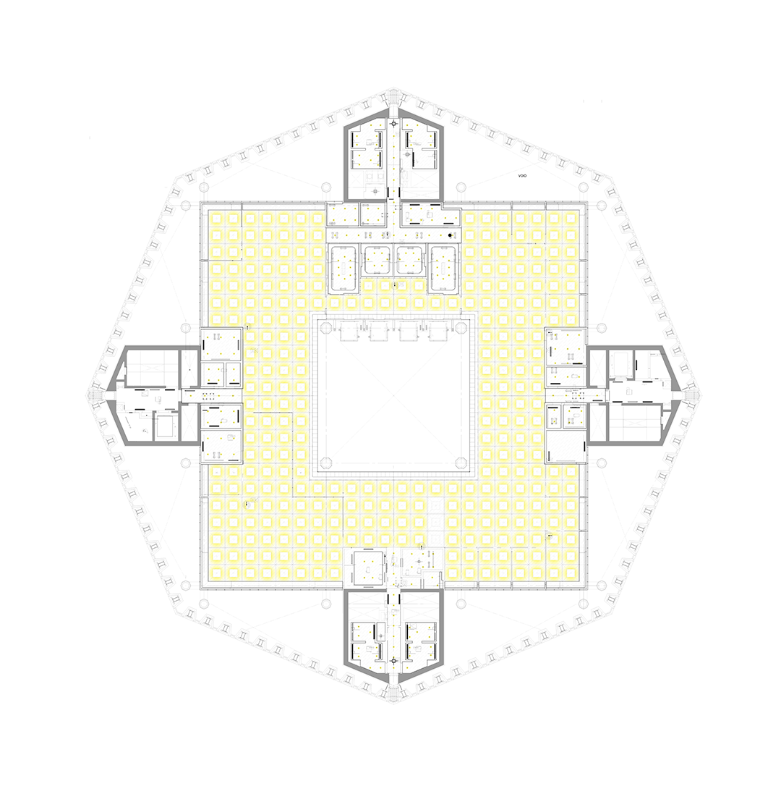

△ 吊顶平面图 ©日建设计

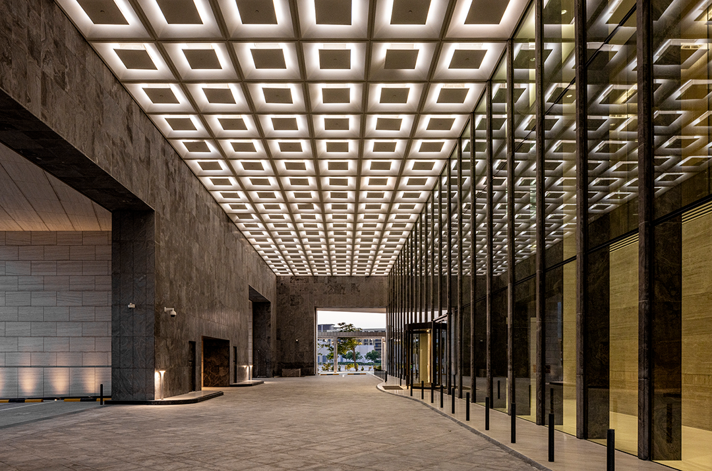

△ 吊顶延续到落客区 ©Koji Horiuchi / Shin Shashin Kobo

吊顶集成了中东地区较为罕见的垂直型主动式冷梁。通过结合整个建筑的缓冲性空间构成，在降低空调输送能耗的同时，也有效确保了区域供冷站所供冷水的供回水温差。在这个项目中，环境性能与建筑表达被定位在一个统一的设计策略中，而不是相互独立的存在。

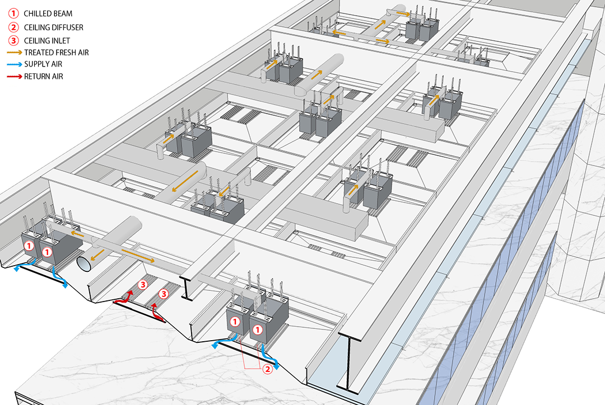

△ 集成于吊顶内的系统 ©日建设计

阿尔拉扬银行大楼既呼应地区文化、适合当地气候，又兼具作为金融机构的坚实存在感、环境性能以及开放式工作环境。该建筑通过对几何形、气候适应性、工作空间规划及建筑设备的整体考量，展现了中东地区办公楼的全新形态。

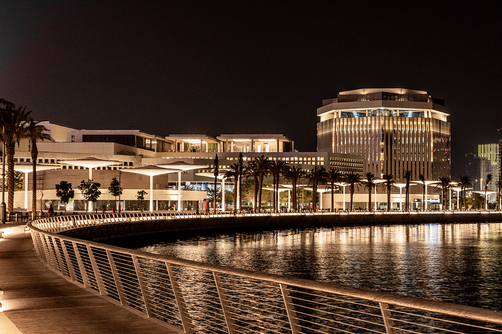

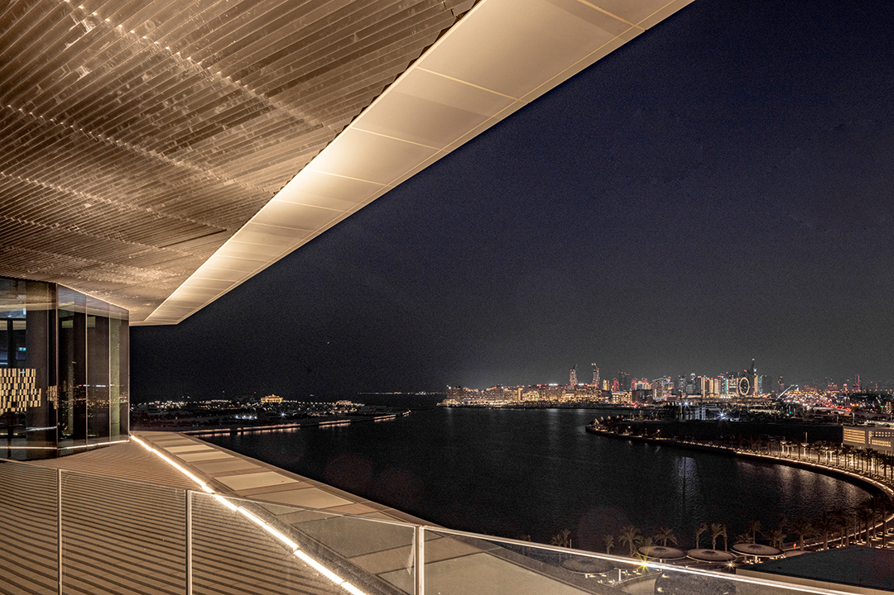

△ 建筑夜景 ©Koji Horiuchi / Shin Shashin Kobo

完整项目信息

项目名称：阿尔拉扬银行

项目功能：办公楼

项目地点：卡塔尔，卢塞尔

占地面积：5971.72平方米

建筑面积：16500平方米

建成时间：2025年9月

层数：地上9层、地下4层

檐口高度/最高高度：47.40米

主结构：钢筋混凝土结构・钢结构

首席设计顾问、方案设计：日建设计

首席设计官、 资深理事：大谷弘明

主要负责人：加加美亚土（建筑设计总部 国际设计部门 设计总监）、铃木哲矢（建筑设计总部 国际设计部门 部长）、谷川敬祐（工程技术总部 结构工程技术部门 设计主管）、高柳慎太郎（执行董事工程技术总部 电气设备工程技术部门 总裁）、三由贤（工程技术总部 机械设备工程技术部门 部长）

当地设计事务所・监理顾问：Arab Engineering Bureau

施工单位：Al Darwish Engineering (W.L.L)

室内设计：STEVE LEUNG DESIGNERS

照明：TinoKwan Lighting Consultants

标识：The Design Company

立面、BMU：Inhabit Middle East

安防：Buro Happold

垂直交通：TUV SUD

声学：PMK

景观：Mitani Landscape Studio

项目摄影：Koji Horiuchi/Shin Shashin Kobo、Nikken Sekkei

视觉 / 蔡雨欣 校对 / 宋诗雨

本文由日建设计授权发布。欢迎转发，禁止以有方编辑版本转载。

以“在看”分享

预览时标签不可点

不喜欢
