# 从38米高空一滑到底！墨西哥城这4座巨型滑梯，把办公楼变成了极限游乐场

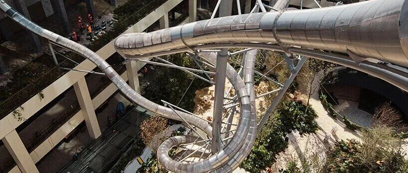

** ⬆️  ** 点击  ** 『  ** 蓝字  ** 』  ** 加关注，点亮  ** 『  ** 星标  ** 』  ** 不错过 ⬆️
[2026.11.11 / 行业动态 · ARCHITECTURE NEWS]
墨西哥城滑梯
Mexico City Slides
比利时艺术家卡斯滕·霍勒（Carsten Höller）与建筑事务所 Sordo Madaleno
合作，在墨西哥城的波兰科艺术中心创作了四座巨大的螺旋滑梯装置——《墨西哥城滑梯》（Mexico City Slides，2026），将于今年 12
月免费向公众开放。该项目通过建筑将运动转化为集体体验，滑梯从餐厅、办公室和未来的酒店向下延伸，为混合用途城市开发的日常节奏带来了一种意想不到的玩乐元素。
该作品由波兰科艺术中心和开发商 SOMA 联合委托，是安塔拉综合体（Antara）在格拉纳达区（Colonia Granada）最新扩建项目的一部分。
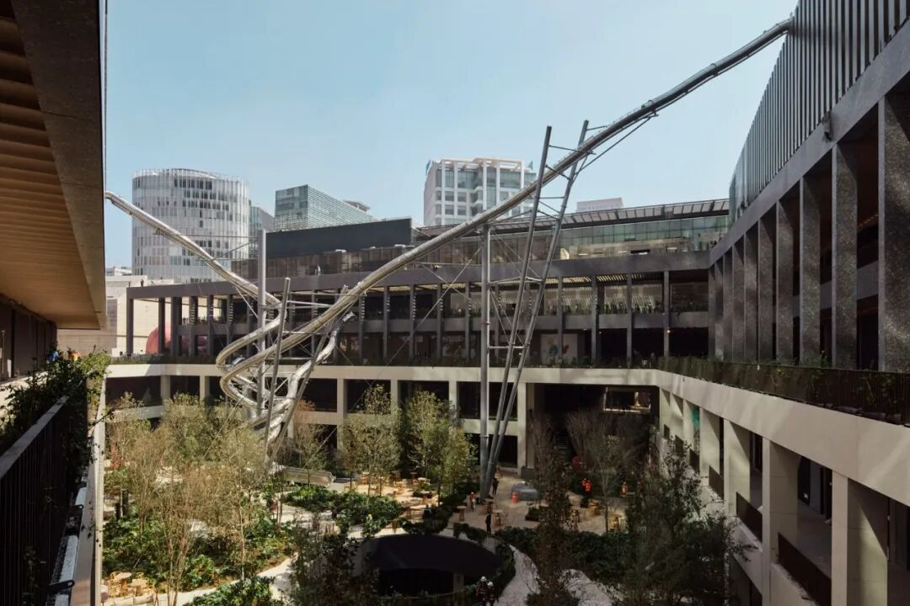
©  Fernando Farfán
01\. 让玩乐成为城市的一部分
霍勒的雕塑作品贯穿整个安塔拉综合用途开发项目，将餐厅、谷歌办公室、未来的墨西哥城瑰丽酒店以及波兰科艺术中心的新文化场馆连接起来，以一种意想不到的方式邀请人们体验滑梯的乐趣。
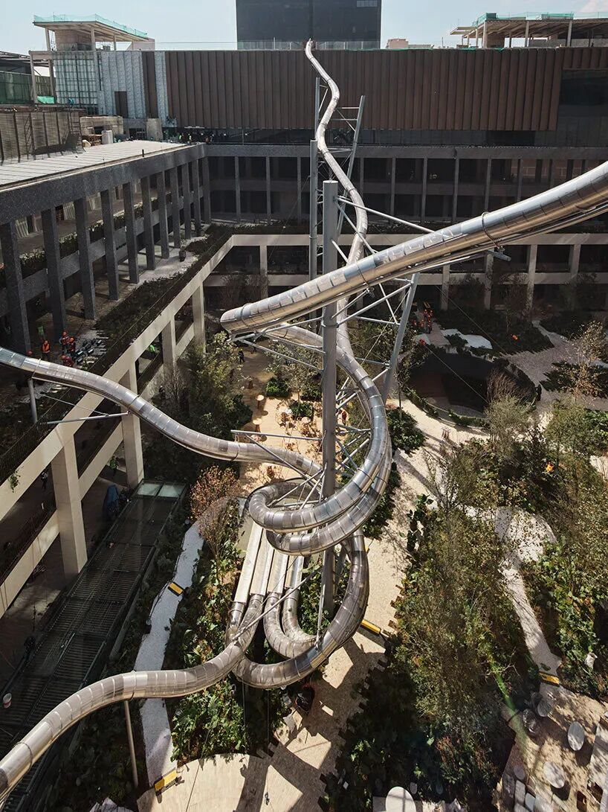
© Fernando Farfán
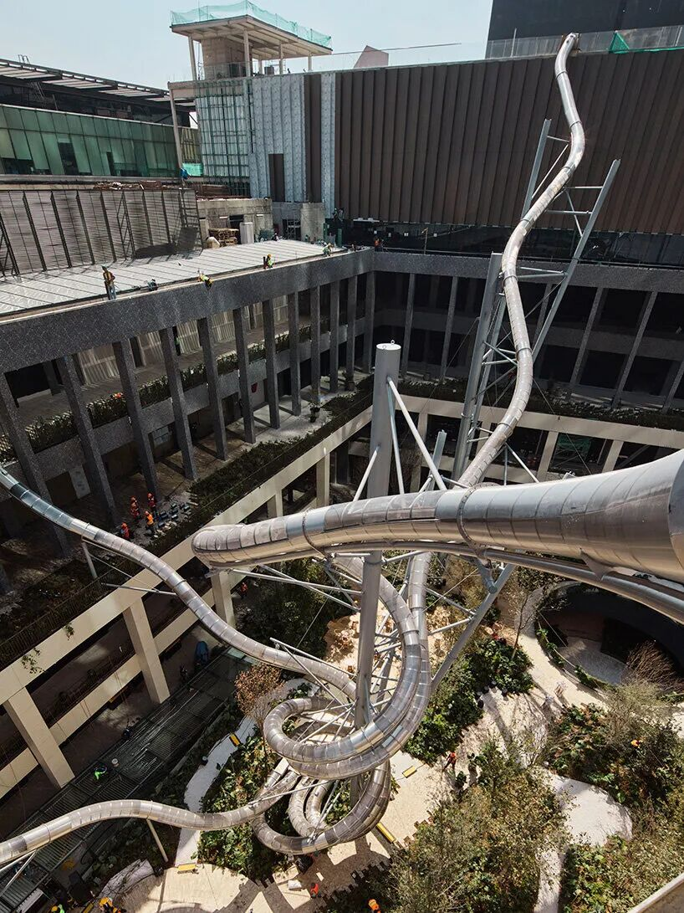
© Fernando Farfán
这四座滑道的高度从 12 米到 38 米不等，长度从 31 米到 90
米不等，分别从园区内的不同地点滑下，最终汇聚于同一着陆区。每条滑道可容纳一人，四位游客可以同时滑下、并肩而行。这能让来自餐厅、工作场所和住宿场所的访客进入同一个空间体验，暂时抛开不同场所带来的社会身份与功能差异。
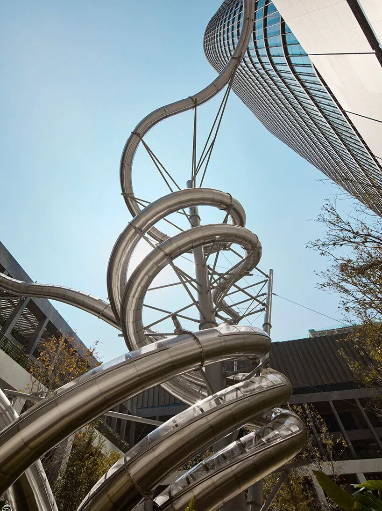
© Fernando Farfán
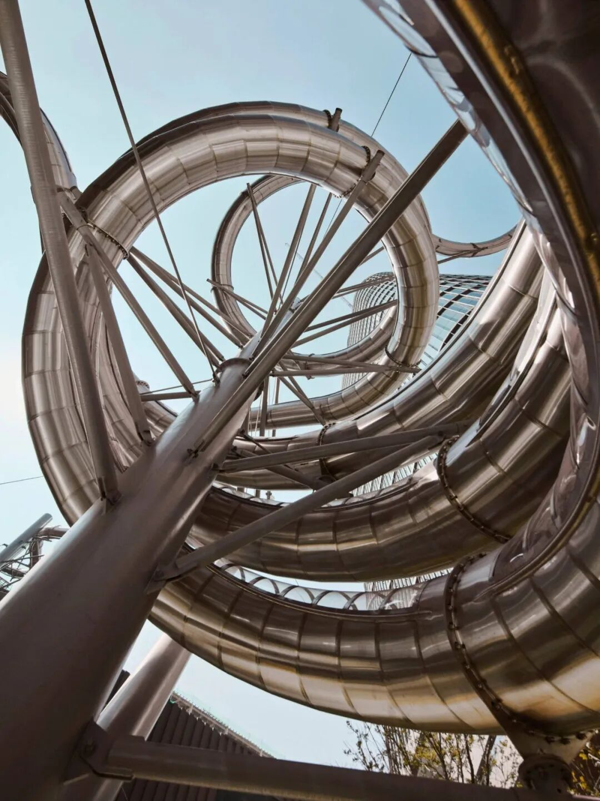
© Fernando Farfán
霍勒将这种相遇描述为一种平等的姿态。无论人们从何处出发，最终都会彼此相邻。即使对于那些选择不乘坐滑梯的人来说，这些滑梯也为项目增添了一抹独特的景观。
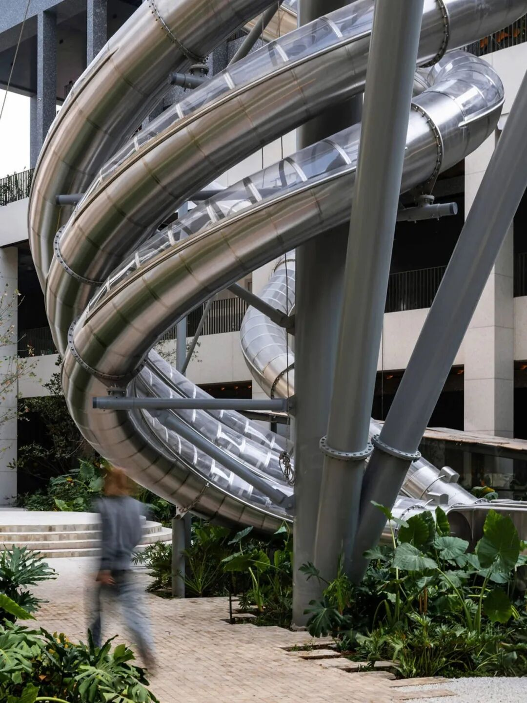
© Fernando Farfán
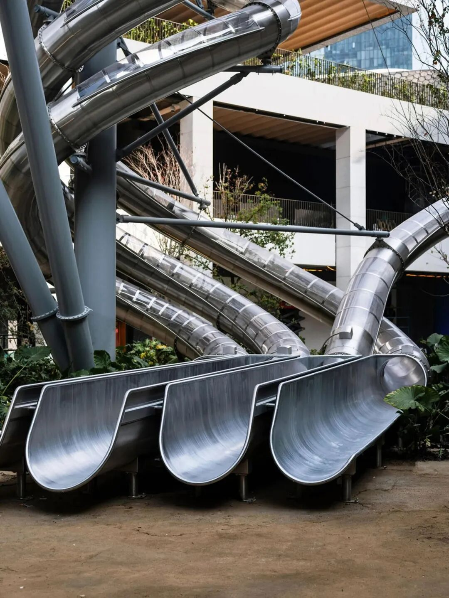
02\.  从趣味物件到建筑体验
自 1998
年以来，霍勒一直以滑梯为艺术媒介进行创作，探索这种通常与游乐场联系在一起的物品如何融入建筑环境。这位比利时艺术家将其描述为“里面有人的雕塑”。这种体验不仅关乎滑行的身体感受，也关乎滑梯本身的结构美学。
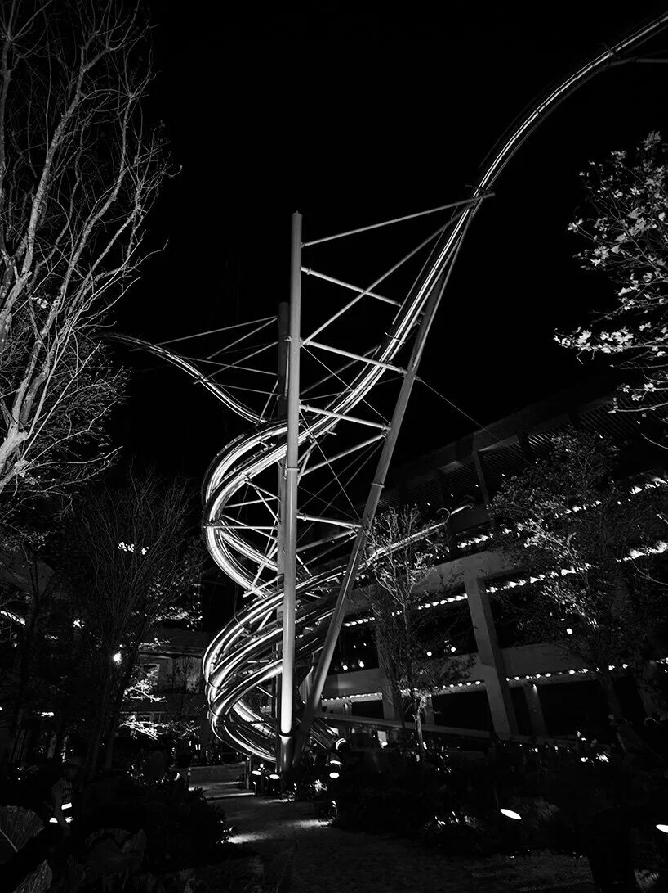
© Fernando Farfán
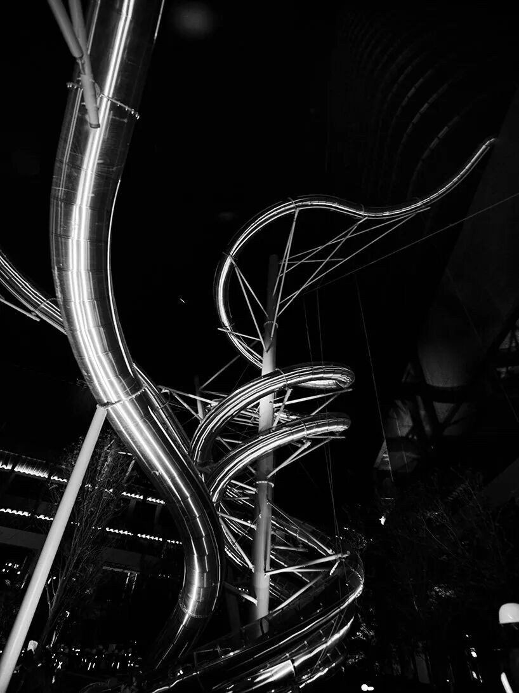
© Fernando Farfán
多年来，这一理念以不同的形式呈现。他的代表作品包括伦敦泰特现代美术馆的《测试场地》（2006）、纽约新博物馆的《维多利亚滑梯》（2011）、莱茵河畔魏尔维特拉园区的《维特拉滑梯塔》（2014）、伦敦海沃德画廊的《等距滑梯》（2015）、斯特罗齐宫的《佛罗伦萨实验滑梯》（2018）、丹麦建筑中心的《DAC滑梯》（2020），以及阿尔勒卢玛基金会《等距滑梯》（2021）的另一版本。最近，他的《斯德哥尔摩滑梯》（2025）成为了现代博物馆外立面的永久景观。
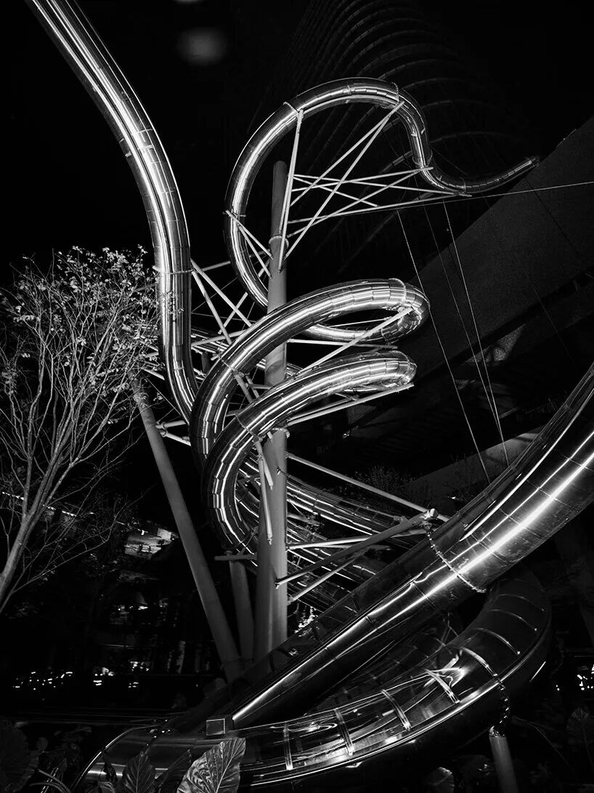
© Fernando Farfán
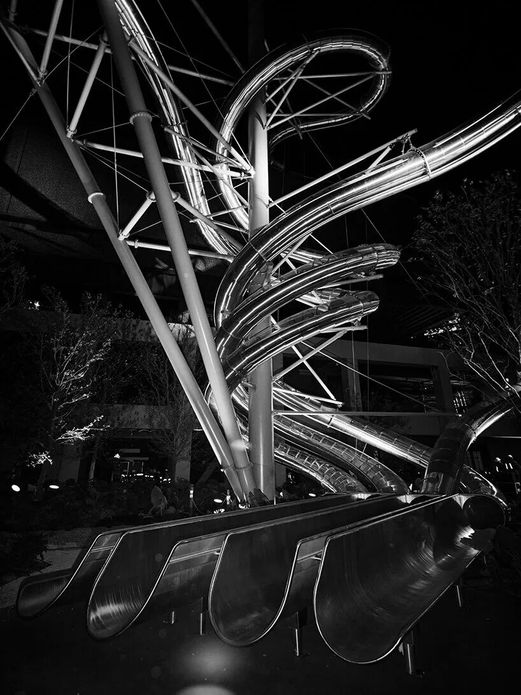
© Fernando Farfán
在墨西哥城，四条滑梯将这种持续的艺术探索带入更大的建筑环境，通过共享体验将安塔拉的不同区域连接起来。
03\. 可控结构内的失控刺激
对霍勒而言，滑行带来的不仅仅是速度的快感。下落的瞬间，恐惧、兴奋和愉悦交织在一起，体验者在短暂的刹那将自己交付给重力。他借用社会学家罗杰·凯卢瓦（Roger
Caillois）的说法，将这种感觉描述为“在原本清醒的头脑中涌现的狂喜与恐慌”。这种体验本身就存在某种矛盾：滑道本身是一个可控的精密结构，然而正是那种失控的感觉，才让滑行如此刺激。
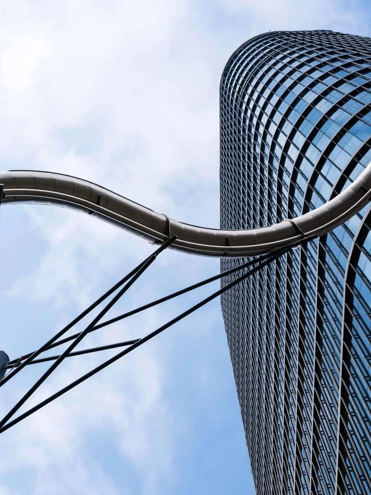
© Fernando Farfán
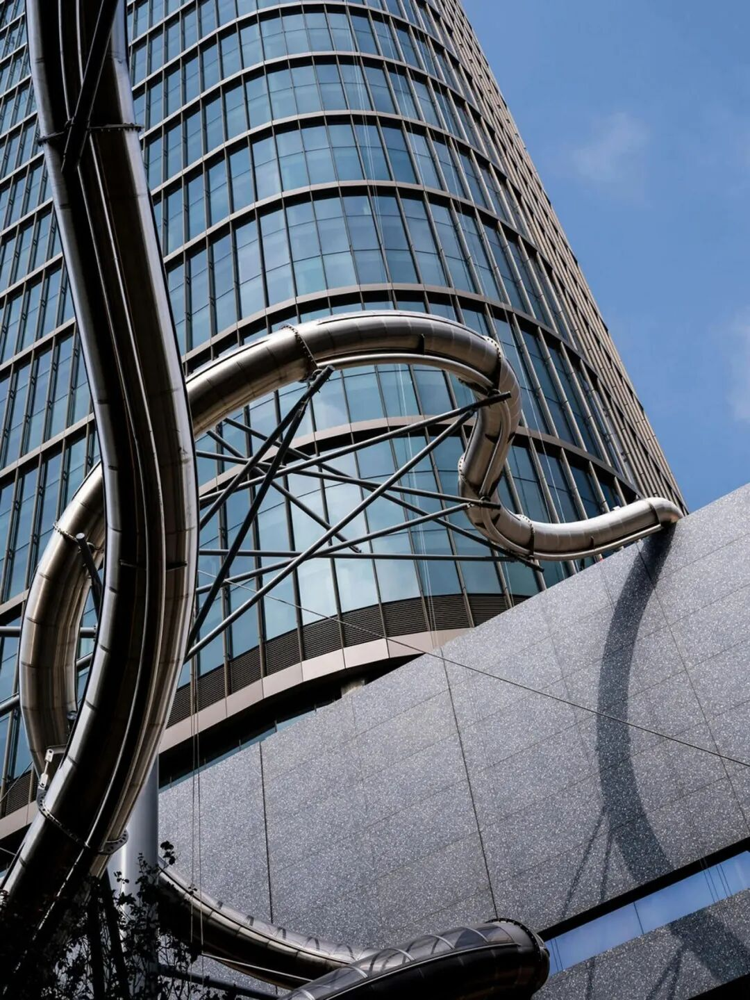
© Fernando Farfán
在《墨西哥城滑梯》项目中，四个人可以从安塔拉的不同区域同时出发，最终抵达同一个着陆点，将个人体验转化为一次共享的经历。在短暂的片刻里，来自餐厅、办公室或酒店的人们并肩而立，仅仅因为滑梯这件简单而纯粹的事物走到了一起。
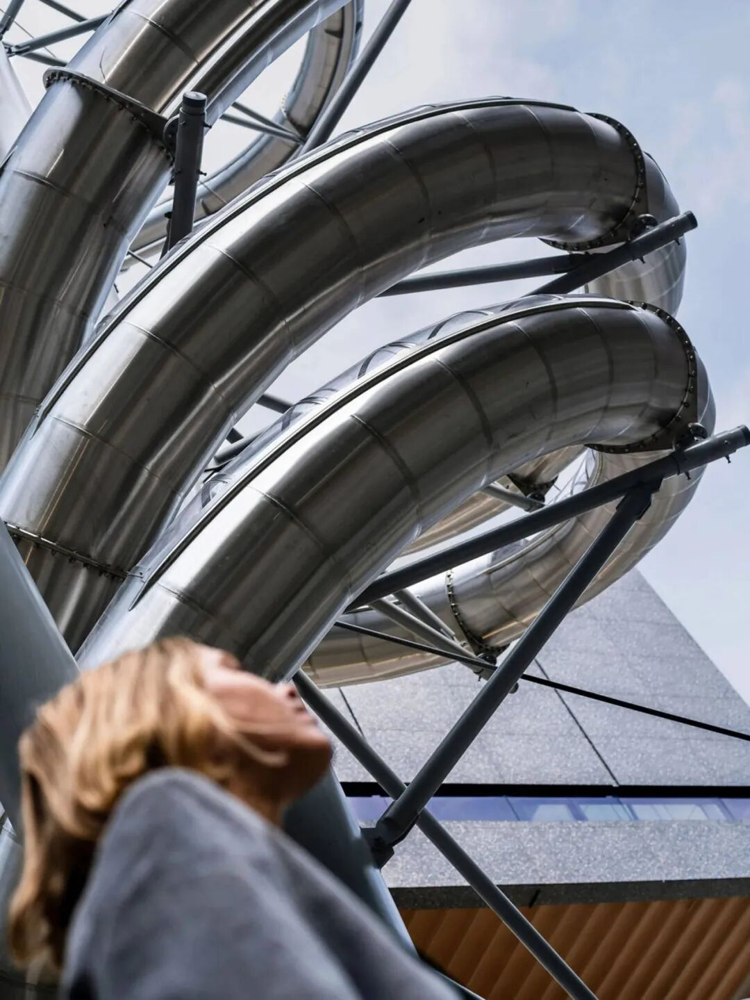
© Fernando Farfán
04\. 墨西哥城安塔拉改造项目
该装置是安塔拉（Antara）整体改造计划的一部分，安塔拉将于 2026 年迎来其二十周年纪念。该项目最初由 SOMA 在格拉纳达区（Colonia
Granada）的一处旧工业用地上开发，于 2006
年开业，是墨西哥城首个露天零售综合体。其最新扩建工程新增了零售和餐饮空间、办公区域、一座全新的公共花园，以及由 SOMA 旗下非营利当代艺术基金会 Arte
Abierto（成立于 2019 年）主导的文化项目。
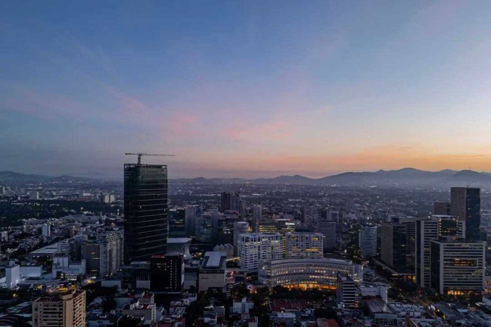
© Fernando Farfán
由由建筑事务所 Sordo Madaleno 设计的扩建项目，将景观步道、阶梯式露台和一个 2500
平方米的公共花园融为一体，并通过全新的步行空间连接了不同的功能区域。该项目还将展出丹麦艺术家团体 SUPERFLEX
的展览《现在怎么办》（2026），探讨人造环境与自然力量之间的关系。
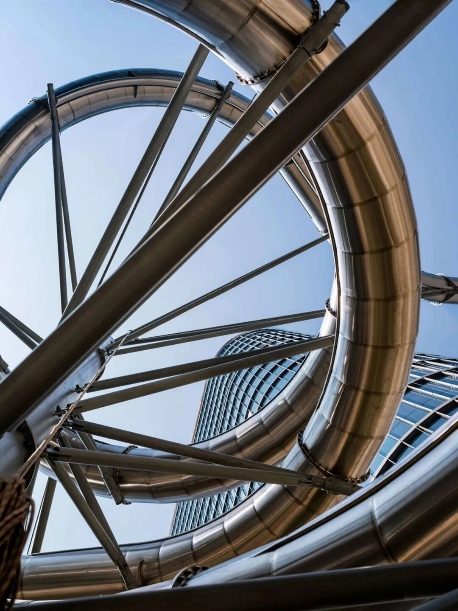
© Fernando Farfán
参考资料
https://  www.designboom.com/art/carsten-holler-people-together-four-giant-
slides-mexico-city-arte-abierto-polanco-soma-sordo-madaleno-antara/
https://www.dezeen.com/2026/11/09/carsten-holler-mexico-city/
** 文字编辑：  ** 思空建观
** 校对审核：  ** 斯坦
** 版权声明：  **
本文由archrace翻译编辑，其中观点不代表archrace立场。文中图文原始版权由原网站或涉及的相关组织、个人所有，如有版权问题，请联系删除。欢迎转发，禁止未经archrace允许以此编辑版本转载。
** 联系 Contact us  **

info@archrace.com

arch_race
** 发现 Find us  **

archrace.com

@archrace

archrace

@archrace_com
点击  『  ** 阅读原文  ** 』  进入官网
点  ** 『  ** 赞  ** 』  ** 、  ** 『  ** 推荐  ** ** 』  ** ** ，与人  『  ** 分享  ** ** 』
