# “漂浮餐桌（FLOATING TABLE）”设计竞赛结果

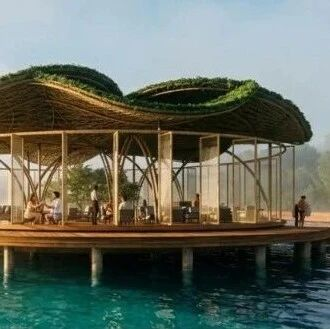

** ⬆️  ** 点击  ** 『  ** 蓝字  ** 』  ** 加关注，点亮  ** 『  ** 星标  ** 』  ** 不错过 ⬆️
[2026.11.08 / 竞赛结果 · COMPETITION RESULTs]
“漂浮餐桌”设计竞赛
FLOATING TABLE
由竞赛组织 AG360 发起的“漂浮餐桌（FLOATING TABLE）”设计竞赛
的目标是设计一座漂浮的美食亭，使其成为巴卡拉尔的新地标——一个融合美食、建筑和景观的空间，在标志性的七色泻湖上打造令人难忘的体验。
“漂浮餐桌”项目包含主餐厅、酒吧或休息室、用餐露台、专业厨房、服务区、洗手间、人行码头，以及参与者认为有助于丰富用餐体验的任何其他空间。优先考虑增设观景点、露台、瞭望台和步道，以加强游客与景观之间的联系。参赛者必须优先考虑采用可持续技术、负责任的水资源管理、保护水生生态系统，以及尽可能减少对景观改变的方案。
竞赛结果在今年10月底公布，第一名由来自美国的设计团队提出的”Lotus“设计方案赢得了第一名。其方案  源自一朵漂浮在巴卡拉尔湖上的莲花的构想，有着
灵感来自莲花的自然形态的
有机外壳，环绕着整个建筑，勾勒出一个轻盈的轮廓，与热带景观融为一体。该设计旨在在建筑与自然之间建立对话，将餐厅变成一个交汇点，在这里，美食体验与欣赏周围环境相得益彰。
第一名 /  Soheb Hasan，Rachael Michel，Ciara Adams（美国）
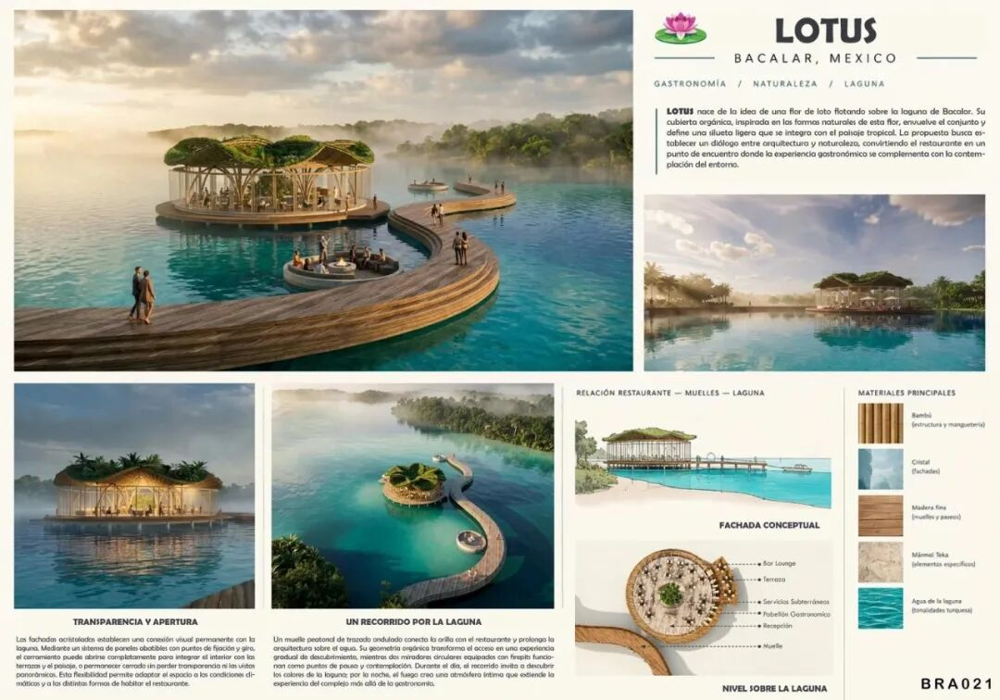

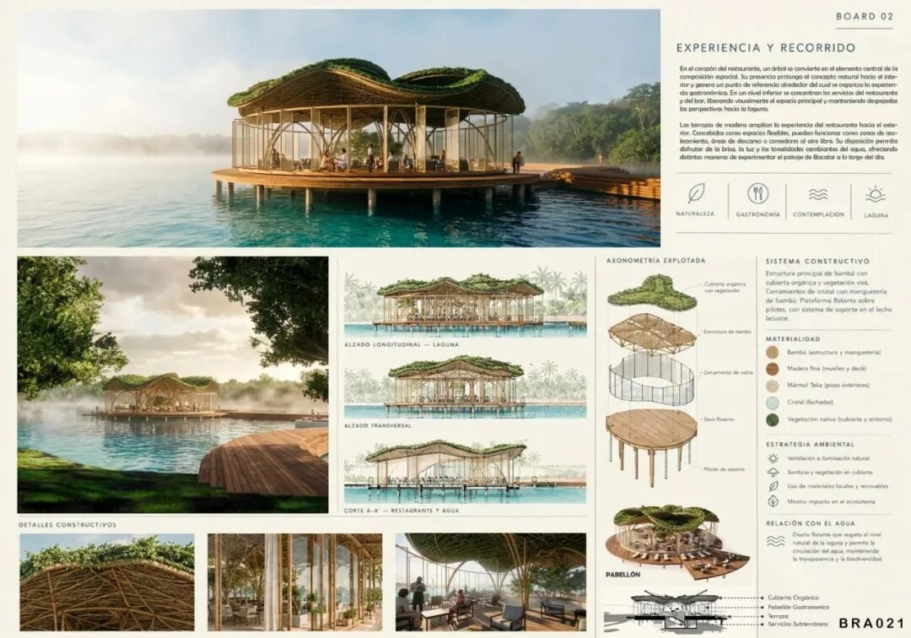
©  Soheb Hasan，Rachael Michel，Ciara Adams
第一提名 /  Laura Murillo Delgado，John Anderson Ángel Peña，Carlos F. Cortina
Roa，Juan José Bayona（哥伦比亚）
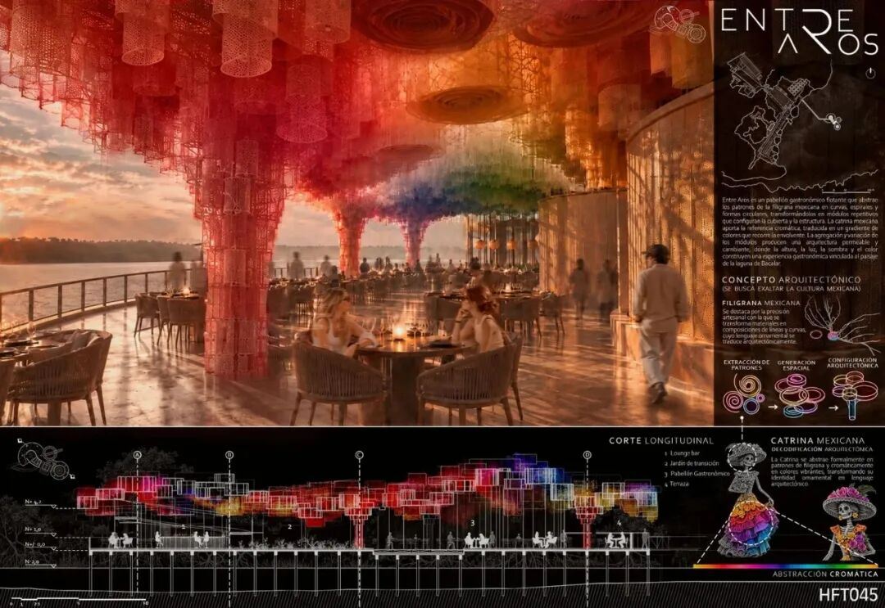

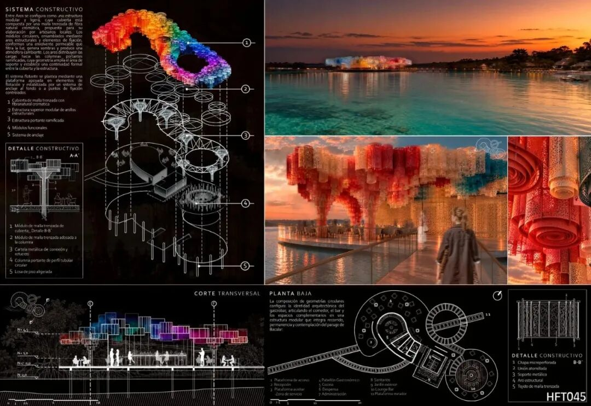
©  Laura Murillo Delgado，John Anderson Ángel Peña，Carlos F. Cortina Roa，Juan
José Bayona
第二提名 /  Juan Marcelo Favro，Guillermo Mario Bonetto（阿根廷）
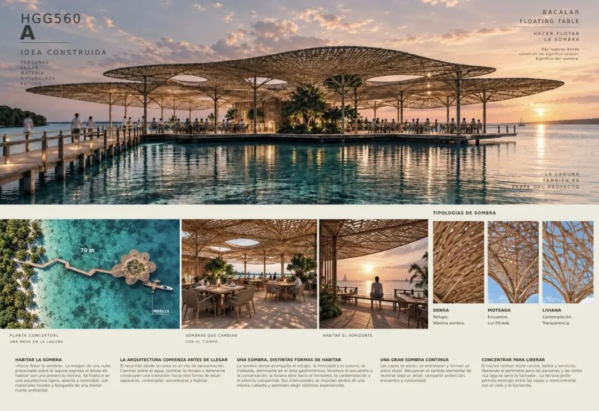

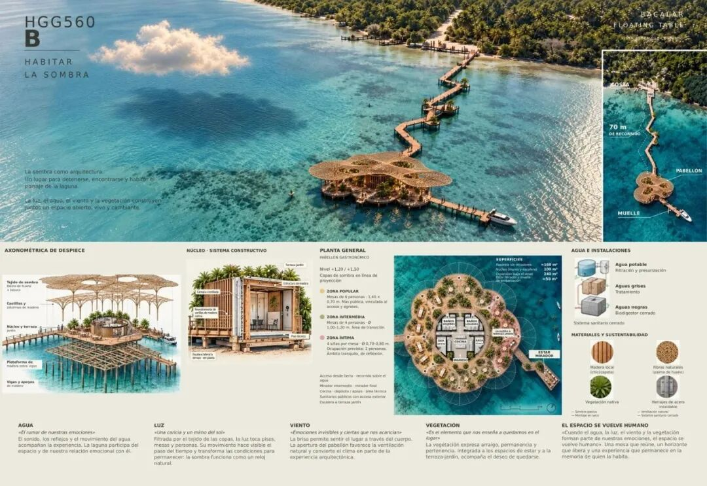
©  Juan Marcelo Favro，Guillermo Mario Bonetto
第三提名 /  Emilio Martínez Prado（墨西哥）
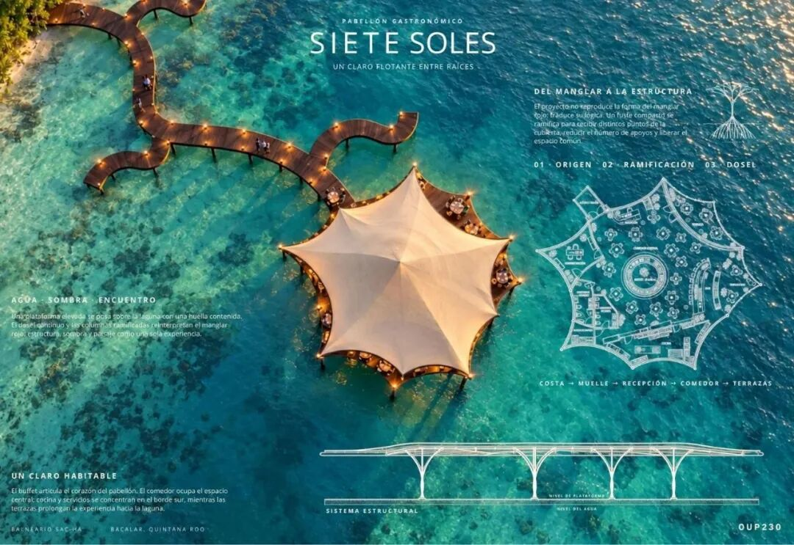

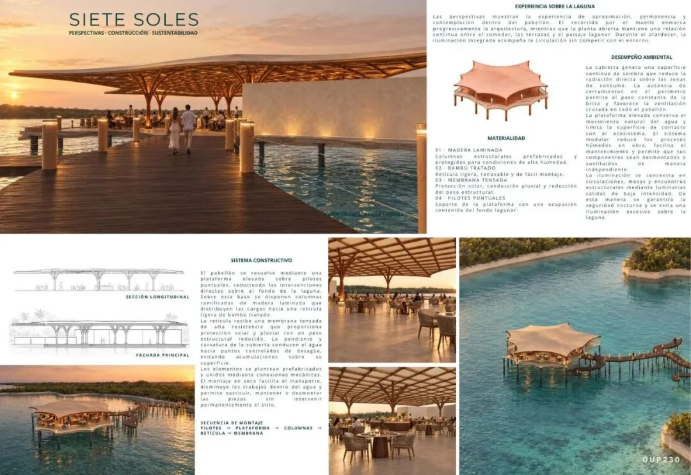
©  Emilio Martínez Prado
第三提名 /  Juan Carlos Perdomo Arcos（哥伦比亚）
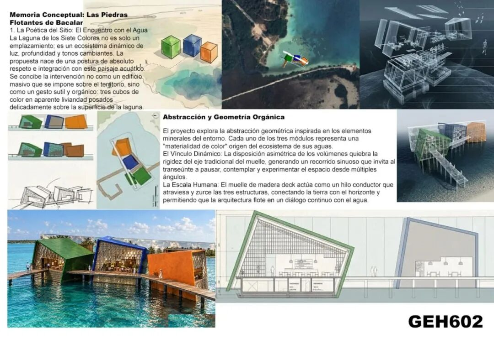

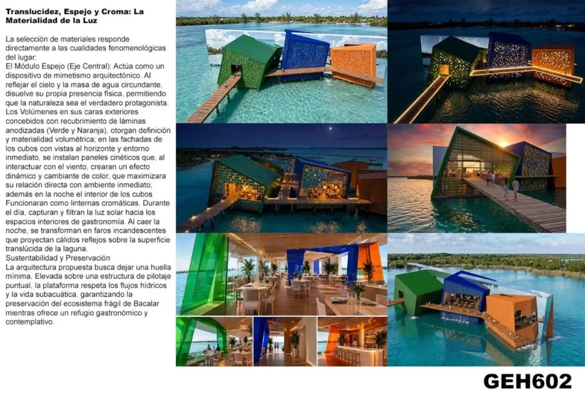
©  Juan Carlos Perdomo Arcos
参考资料
https://  www.concursosag360.com/
** 文字编辑：  ** 思空建观
** 校对审核：  ** 斯坦
** 版权声明：  **
本竞赛信息及文中涉及的图片均来自网络，原始版权属于竞赛主办方和竞赛提案设计师所有，如有版权问题，请联系删除。欢迎转发，禁止未经archrace允许以此编辑版本转载。
** 联系 Contact us  **

info@archrace.com

arch_race
** 发现 Find us  **

archrace.com

@archrace

archrace

@archrace_com
点击  『  ** 阅读原文  ** 』  进入官网
点  ** 『  ** 赞  ** 』  ** 、  ** 『  ** 推荐  ** ** 』  ** ** ，与人  『  ** 分享  ** ** 』
