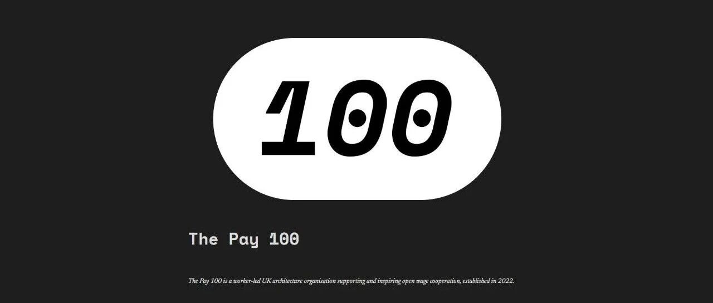
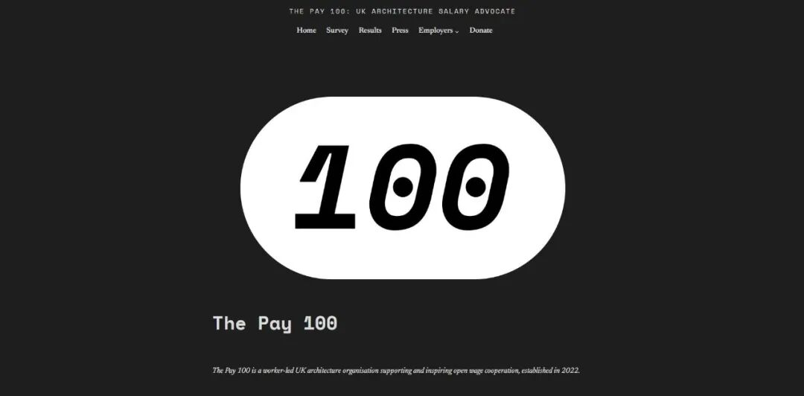
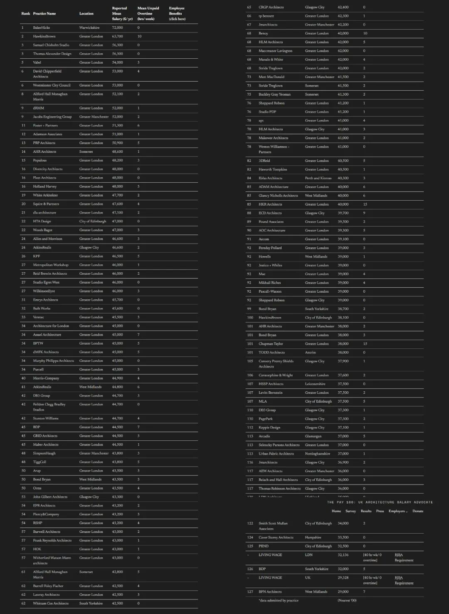
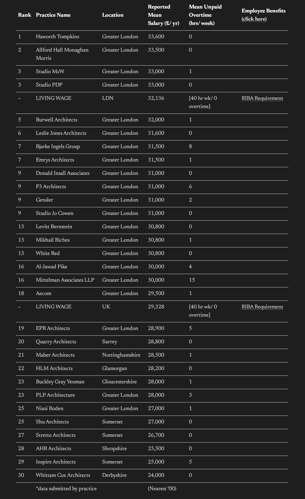
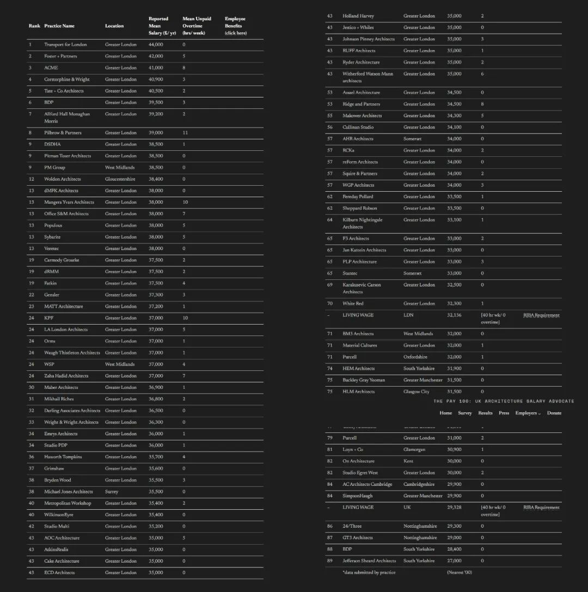
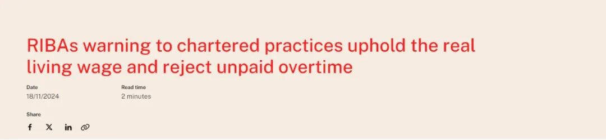
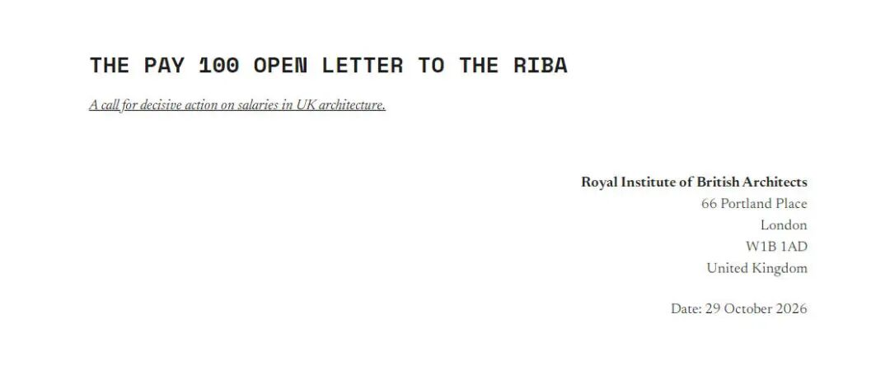
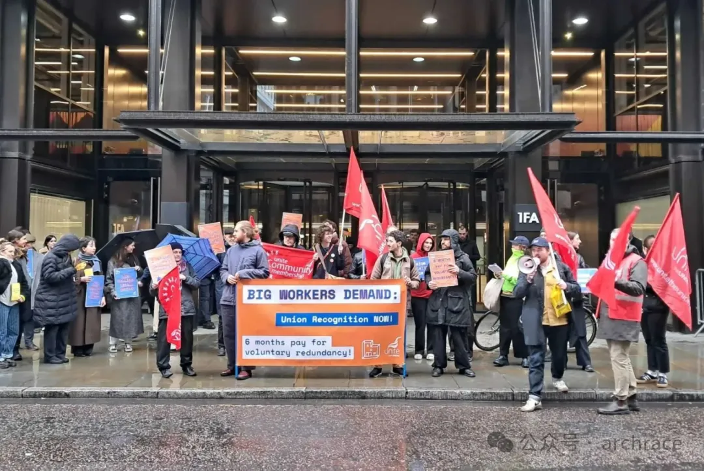

# “The Pay 100”发布英国建筑事务所薪资榜单：揭开无偿加班与低薪真相

** ⬆️  ** 点击  ** 『  ** 蓝字  ** 』  ** 加关注，点亮  ** 『  ** 星标  ** 』  ** 不错过 ⬆️
[2026.11.03 / 行业动态 · ARCHITECTURE NEWS]
“The Pay 100”发布英国建筑事务所薪资榜单
“The Pay 100” Releases Salary Ranking for UK Architecture Firms
“The Pay
100”是英国一家由基层从业者/建筑师发起并推动的薪酬透明化倡议组织，专注于英国建筑行业的薪酬调查。该组织自2022年起，每年面向英国各建筑事务所从业人员发起匿名调查，收集不同层级（如
Part I/Part II
建筑助理、5年以内的注册建筑师等）的真实年薪与加班数据，并在计算出各事务所的平均薪资后，在其官网上公开发布“英国建筑事务所薪资前100名榜单”。

“The Pay 100”首页
©  “The Pay 100”
01\. 英国建筑从业者的薪资状况
今年11月1日，“The Pay 100”公布了最新的调查报告和榜单。新榜单显示，在建筑师平均年薪排行榜上名列榜首的是工程设计公司
BakerHicks，该公司为“5年以内的注册建筑师”支付的平均年薪为 72,000 英镑；排名第二的是伦敦的 Hopkins Architects，为
63,700 英镑；并列第三的是伦敦的 Samuel Chisholm Studio 和 Thomas Alexander Design，为 56,300
英镑。薪酬最低的则是 BPN Architects（29,000 英镑），最高与最低的差距将近 2.5 倍。

“ 5年以内的注册建筑师”薪酬  榜单
©  The Pay 100
在“Part I 建筑助理”（通常为本科毕业后进入事务所实习的初级岗位）级别中，提供薪资最高的是 Haworth Tompkins（33,600
英镑），第二是 Allford Hall Monaghan Morris（33,500 英镑），Studio McW 和 Studio PDP 则以
33,000 英镑并列第三。最低薪酬为 Whittam Cox Architects 提供给该岗位的 24,000 英镑。

“Part I 建筑助理薪酬榜单  © The Pay 100
在“Part II 建筑助理”（通常为硕士毕业、考取执照前的中级岗位）级别中，提供薪资最高的是伦敦交通局（44,000
英镑），其次是福斯特建筑事务所（Foster + Partners，42,000 英镑），ACME 以 41,000 英镑排名第三。最低薪酬则是
Jefferson Sheard Architects 的 27,000 英镑。

“Part  II  建筑助理薪酬榜单
© The Pay 100
02\. 榜单揭露了低工资和无偿加班现象
这份调查报告显示，英国有 12 家事务所支付给“Part I 建筑助理”的工资低于 29,328
英镑的英国实际生活工资标准。然而，英国皇家建筑师学会（RIBA）于 2024 年 11 月 18
日针对特许事务所发布的指导意见中已明确提出，支付不低于生活工资标准的薪酬是特许事务所的硬性指标，显然有部分机构违反了这一规定。

©RIBA
此外，报告数据还显示，英国约有 69% 的建筑事务所存在普遍的“无偿加班”（Unpaid
Overtime）现象。平均每名受访建筑师每年因无偿加班损失的劳动价值折合约 2,246 英镑（相当于每年免费工作 15 天）。
正是由于低工资与无偿加班，导致建筑从业者的付出与回报严重不成正比，年轻建筑师和“Part II 建筑助理”在英国的离职与转行率居高不下。
03\.  “The Pay 100”的呼吁
结合最新调查报告，“The Pay 100”向 RIBA
发出一封公开信，要求学会采取切实行动改善建筑从业人员的经济状况，保障行业的长期健康发展。公开信的核心诉求主要集中在以下三个方面：
1\. 将“支付实际生活工资”列为特许事务所（RIBA Chartered Practice）的硬性准入门槛，要求 RIBA
撤销或拒绝认证那些给基层员工/实习生发放低于“实际生活工资”薪资的事务所特许资格。

©图源网络
2\. 严厉打击恶性低价竞标（Fee
Undercutting），指出事务所为了抢项目相互压价，最终将成本压力全部转嫁给底层建筑师（靠延长加班和降薪消化）。呼吁 RIBA
重新制定取费指导标准或出台监管机制。
3\. 提高行业全透明度与全面监管要求官方学会主动建立常态化的薪资与工时监管体系，不能仅仅依赖民间组织的自发调查。

“The Pay 100”给 RIBA 的公开信
©  “The Pay 100”
“The Pay 100”在公开信中这样说道：
“
五年来的透明化既展现了挑战的严峻性，也体现了建筑行业对变革的渴望。现在，英国皇家建筑师学会（RIBA）有机会在此基础上继续努力，推动更加开放的政策转化为持久的、全行业的进步。
”
04\. 后续影响与启示
作为英国建筑圈的“薪资榜单与反卷先锋”，“The Pay
100”旨在以民间自发、数据透明的方式推动全行业的薪酬良水循环。在长达五年的坚持与努力中，该倡议取得了显著成果——近年来，英国“Part I
建筑助理”等初级岗位的平均起薪增长率已达到了 11%。
虽然在法律层面上，受限于英国竞争与市场管理局（CMA）的反垄断法规，RIBA 无法强制规定最低设计费率或统一薪酬水平；但在 The Pay 100
的持续施压下，RIBA 正在重新评估特许事务所的合规准则与劳动权益审核机制。

2026年2月3日，在BIG伦敦办公室外举行的示威活动
©Gino Spocchia
随着榜单影响力的日益扩大，许多优秀毕业生在投递简历前会直接查阅 The Pay 100
的排名，这迫使不少大型事务所主动调整薪酬体系，以防在人才争夺战中处于劣势。
The Pay 100
给所有建筑从业者带来了深刻启示：改善从业者的生存现状，需要引入透明化、公信力和市场化的倒逼机制。当行业学会用数据说话、用公开透明保护劳动底线时，建筑设计才有可能重新回归一个尊严与创造力并存的职业。
参考资料
https://  thepay100.org/
https://www.dezeen.com/2026/11/02/the-pay-100-architect-salaries-survey/
** 文字编辑：  ** 思空建观
** 校对审核：  ** 斯坦
** 版权声明：  **
本文由archrace翻译编辑，其中观点不代表archrace立场。文中图文原始版权由原网站或涉及的相关组织、个人所有，如有版权问题，请联系删除。欢迎转发，禁止未经archrace允许以此编辑版本转载。
** 联系 Contact us  **

info@archrace.com

arch_race
** 发现 Find us  **

archrace.com

@archrace

archrace

@archrace_com
点击  『  ** 阅读原文  ** 』  进入官网
点  ** 『  ** 赞  ** 』  ** 、  ** 『  ** 推荐  ** ** 』  ** ** ，与人  『  ** 分享  ** ** 』
