# 火星盖房已经进入实操阶段？这家工作室连“火星栖息地”的墙身大样模型都做出来了

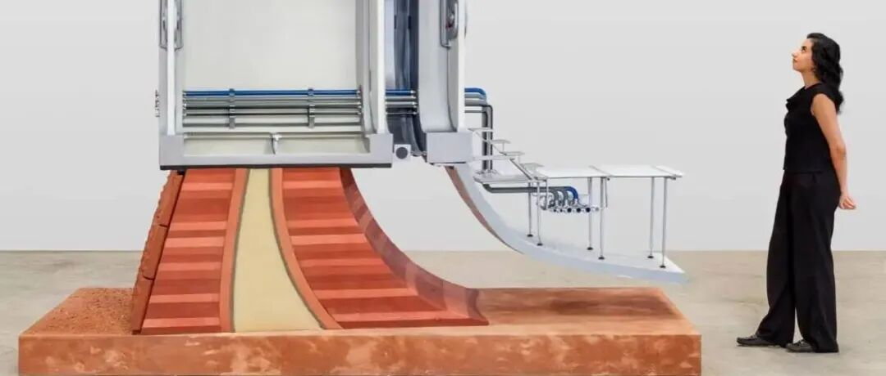

** ⬆️  ** 点击  ** 『  ** 蓝字  ** 』  ** 加关注，点亮  ** 『  ** 星标  ** 』  ** 不错过 ⬆️
[2026.11.02 / 行业动态 · ARCHITECTURE NEWS]
AENARA 开发火星栖息地模型，探索机器人建造技术
AENARA develops Mars habitat model exploring robotic construction
多学科设计工作室 AENARA 近日公布了其开发的一款火星栖息地“墙体剖面”模型，用于探索拟建火星栖息地（计划于 2075 年至 2080
年建造）的构造与生命维持系统。该装置作品由 Powerhouse 委托创作，将于 11 月 7 日在悉尼新的 Powerhouse Parramatta
博物馆展览“永恒的任务”开幕式上展出。
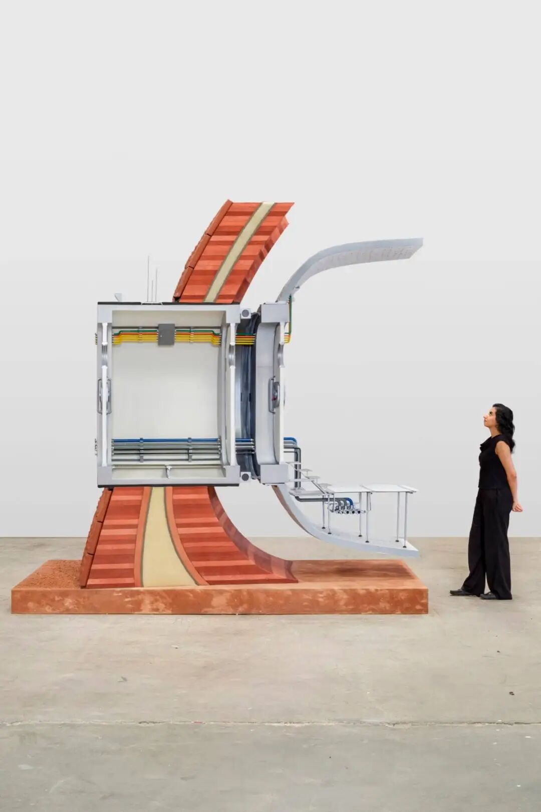
©  JW Pictures
该作品以多层组装的栖息地墙体为特色，旨在火星恶劣环境下维持加压且环境可控的内部空间。其组成部分包括多重防护结构外壳、可充气膜、隔热层以及用于电力、数据、水和空气循环的集成系统。
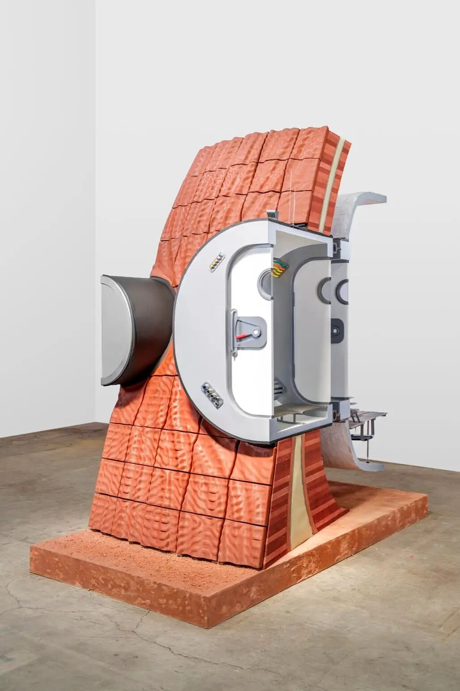
© JW Pictures
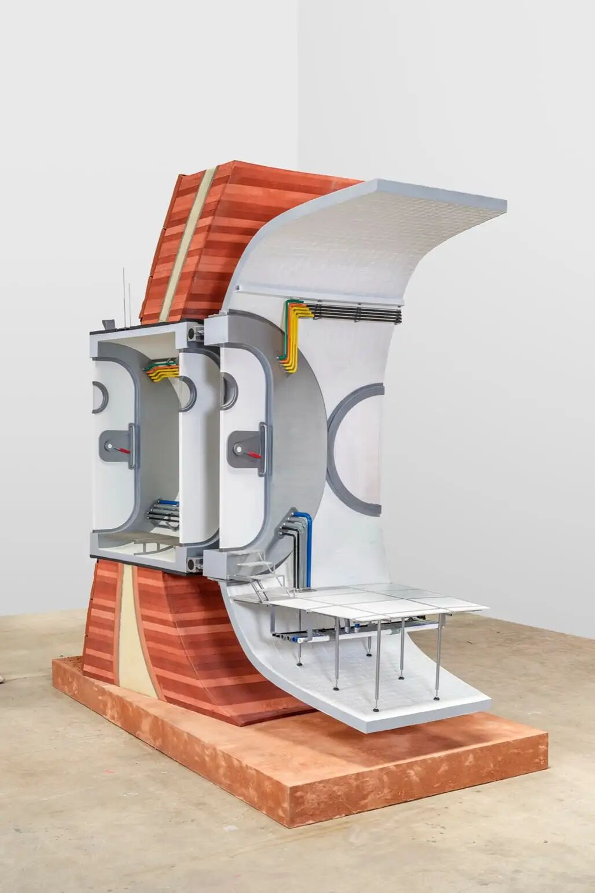
© JW Pictures
该装置是 AENARA 对未来外星居住进行更广泛研究的一部分，其基本栖息地概念源于 NASA 认可的一项研究，该研究针对一项由四名宇航员执行的火星探测任务。
设计方案探讨了如何利用火星地表材料自主建造居住空间，同时营造有利于人类健康和福祉的室内环境。自然光、大窗户和熟悉的类地室内环境是该概念的核心，而建筑外壳主要起到保护屏障的作用。
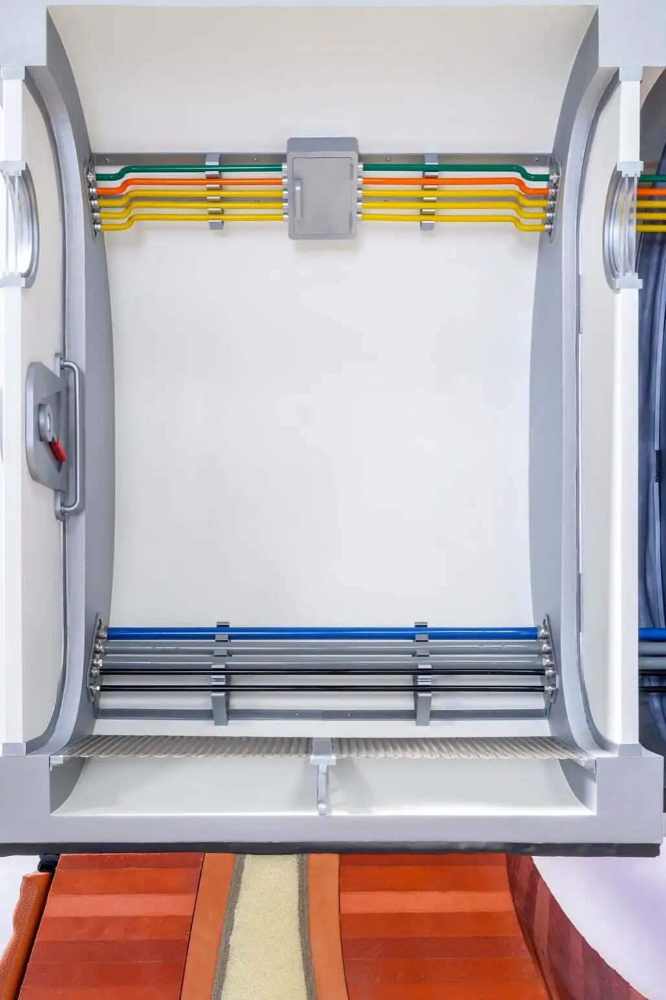
© JW Pictures
该剖面模型由钢、铝、Vectran 复合材料、3D 打印陶土和其他 3D
打印部件构成。团队指出，装置所用材料代表了拟建的墙体结构，但并不直接适用于太空环境。
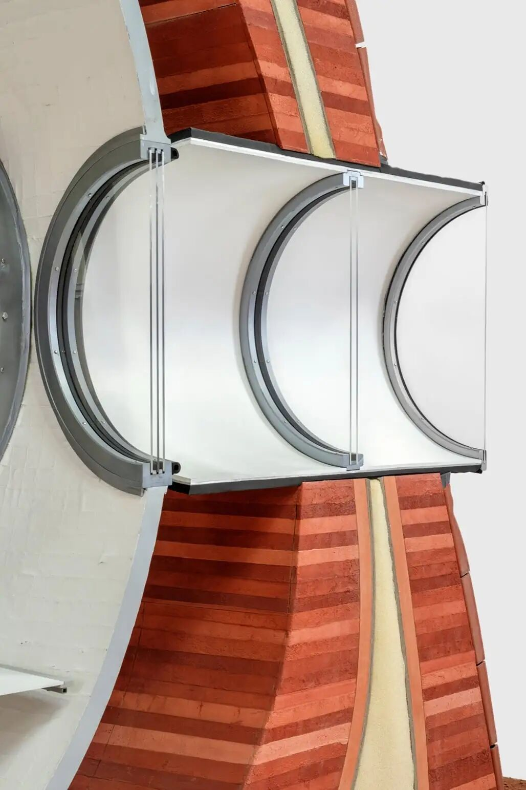
© JW Pictures
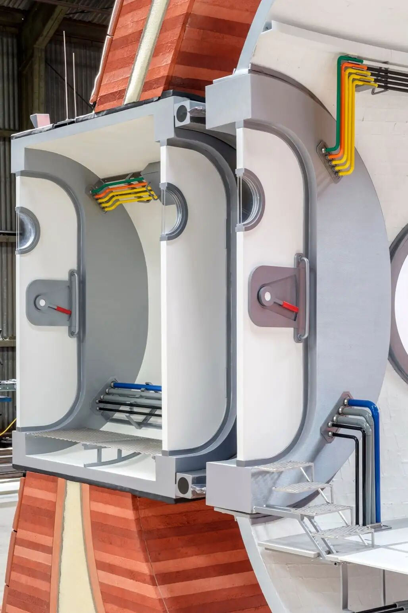
© JW Pictures
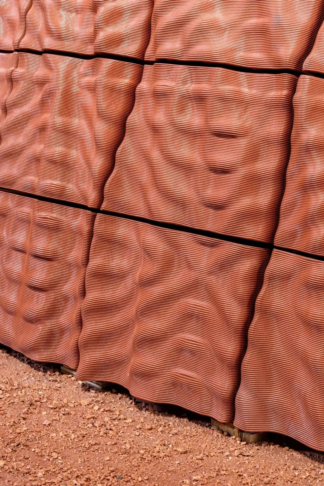
© JW Pictures
该团队补充说，该项目还研究了就地资源利用（ISRU）和机器人建造对地球建筑实践的潜在启示，以及与开发地外基础设施相关的社会、伦理和地缘政治挑战。
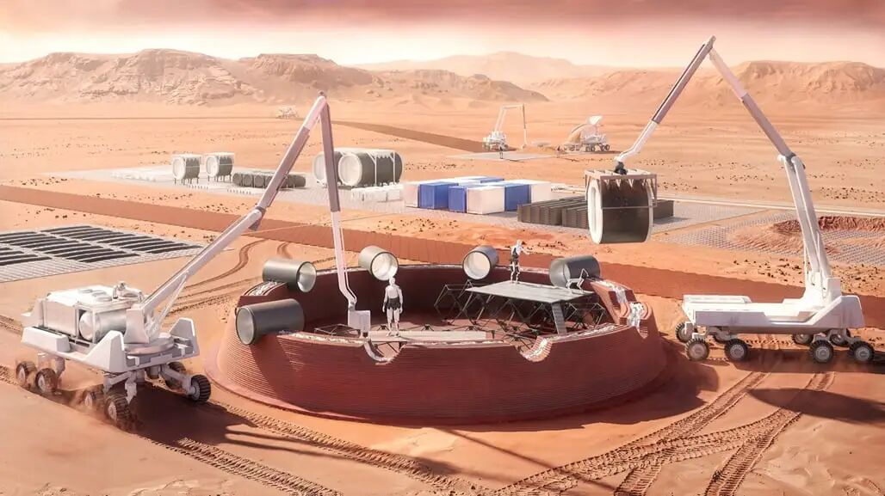
© JW Pictures
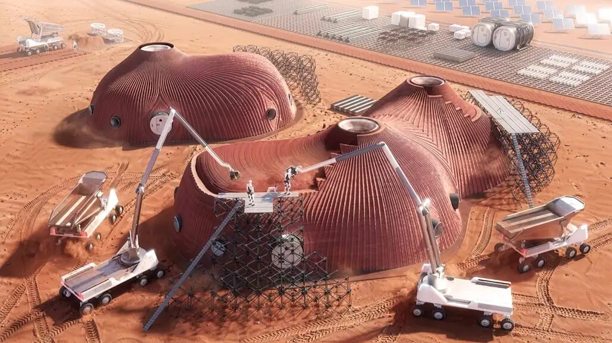
© JW Pictures
随着埃隆·马斯克及 SpaceX 计划于 2030 年代初启动载人火星登陆计划，国际上掀起了一股研究与设计火星栖息地的热潮。今年 10 月，NASA
曾举办竞赛，要求参赛者为一项为期 500 个火星日（约 513 个地球日）的任务开发综合食物系统，并为获胜项目颁发了 5 万美元奖金。此前，丹麦建筑事务所
BIG 也曾联合先进建筑开发商 ICON，为 NASA 设计了一款 3D 打印火星模拟栖息地。
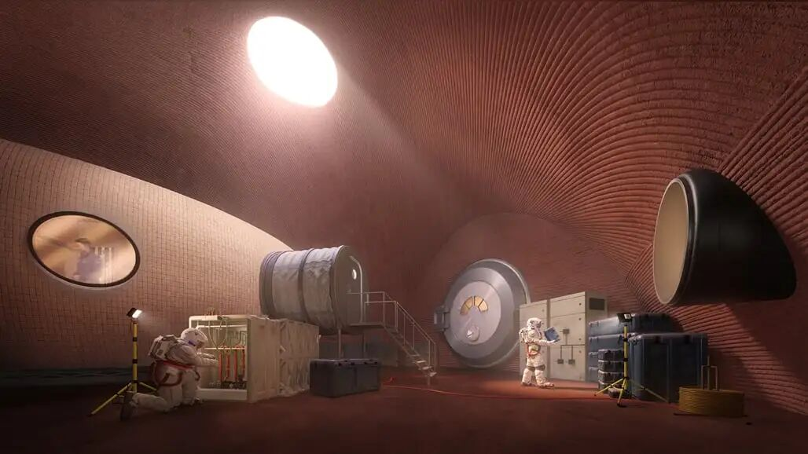
© JW Pictures
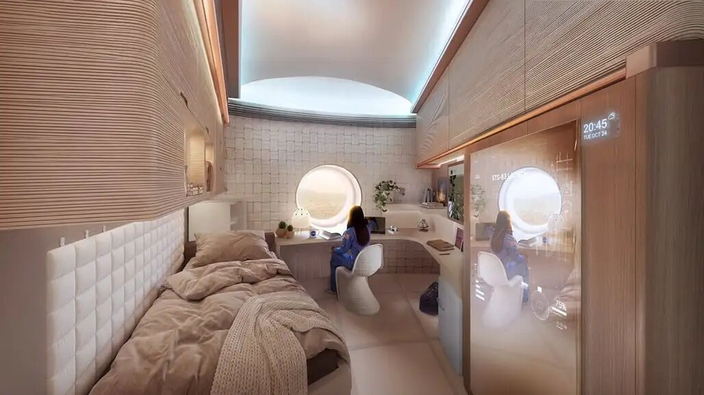
© JW Pictures
参考资料
https://  archinect.com/news/article/150571494/aenara-develops-mars-habitat-
model-exploring-robotic-construction
** 文字编辑：  ** 思空建观
** 校对审核：  ** 斯坦
** 版权声明：  **
本文由archrace翻译编辑，其中观点不代表archrace立场。文中图文原始版权由原网站或涉及的相关组织、个人所有，如有版权问题，请联系删除。欢迎转发，禁止未经archrace允许以此编辑版本转载。
** 联系 Contact us  **

info@archrace.com

arch_race
** 发现 Find us  **

archrace.com

@archrace

archrace

@archrace_com
点击  『  ** 阅读原文  ** 』  进入官网
点  ** 『  ** 赞  ** 』  ** 、  ** 『  ** 推荐  ** ** 』  ** ** ，与人  『  ** 分享  ** ** 』
**
