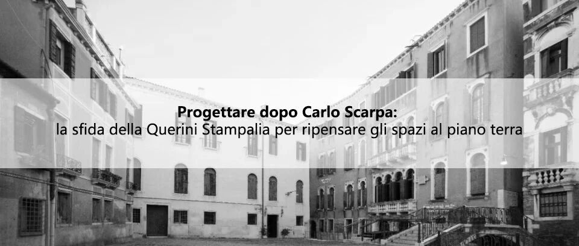
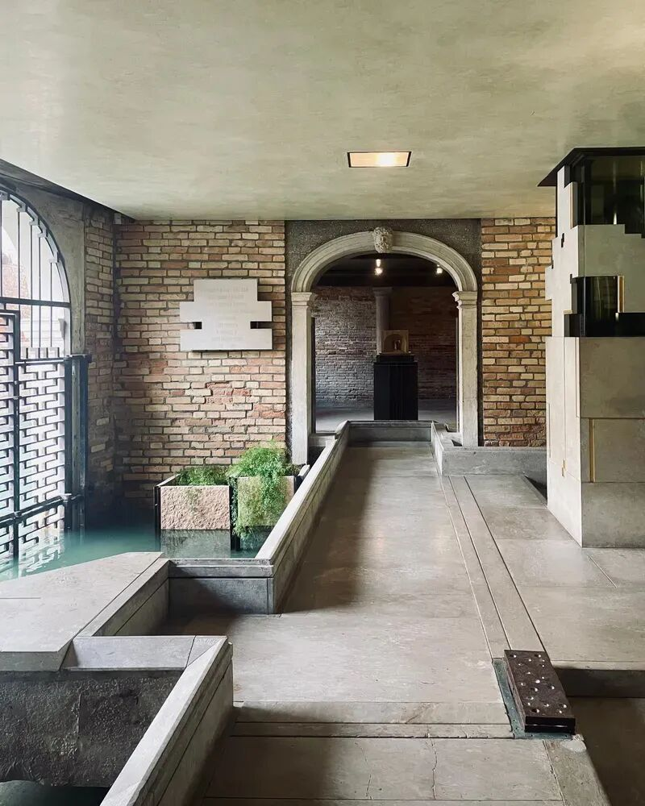

# 竞赛 | 致敬卡洛·斯卡帕：意大利奎里尼·斯坦帕利亚基金会底层空间改造竞赛

** ⬆️  ** 点击  ** 『  ** 蓝字  ** 』  ** 加关注，点亮  ** 『  ** 星标  ** 』  ** 不错过 ⬆️
[2026.11.13 / 设计竞赛 · competitions]
意大利奎里尼·斯坦帕利亚基金会底层空间改造竞赛
Renovation of the Ground Floor Spaces at the Fondazione Querini Stampalia,
Italy
奎里尼·斯坦帕利亚基金会（  Fondazione Querini
Stampalia）正在组织一项国际性的匿名创意征集活动，旨在对基金会一楼的自助餐厅/小酒馆和洗手间进行重新设计（重新利用和重新规划）。
通过此次创意征集，面向全球设计师、建筑师和工程师，以及建筑、规划和设计公司，基金会旨在收集兼具功能性、可持续性和美学品质的设计理念，以反映建筑的多层次历史、卡洛·斯卡帕（Carlo
Scarpa）的设计遗产以及后来的愿景，包括 Mario Botta 和 Michele De Lucchi 的改造过程。

©Elisa Scapicchio
每个方案都必须同时涵盖洗手间和小酒馆，并为这两个区域提供一个连贯的设计，同时与基金会非凡的多层次建筑环境进行对话，彰显其与水的关系，并保证工程的普遍可达性和可逆性。
基金会将自行决定是否继续推进或实施所选方案。入选并不赋予申请人任何权利或预期。
主办方
Fondazione Querini Stampalia
参赛资格
竞赛  面向全球设计师、建筑师和工程师，以及建筑、规划和设计公司
参赛费用
无
评委
Cristiana Collu, the Director of Fondazione Querini Stampalia；
Giovanna Mazzocchi, President of Editoriale Domus S.p.A. ；
Walter Mariotti, the Editorial Director of the Domus system；
Mario Cucinella, architect；
Toshiko Mori, architect and professor at the Harvard Graduate School of
Design；
Emilio Faroldi, Executive Vice-rector of the Politecnico di Milano.
日程
成果提交截止：  2027年2月5日下午1点前，需要上传至平台domusweb.it/it/callforideas-querinistampalia；
结果公布：2027年2月28日。
奖项设置
获胜方案将获得 3000 欧元（约合人民币22,172元）的奖金。
网站
点击文末阅读原文， 或前往 archrace 官网 https://www.archrace.com/ 查看。
** 文字编辑：  ** 思空建观
** 校对审核：  ** 斯坦
** 版权声明：  ** 本竞赛信息来自主办方，由 archrace
翻译整理，信息如有出入，请以主办方发布为准。欢迎转发，禁止未经archrace允许以此编辑版本转载。
** 联系 Contact us  **

info@archrace.com

arch_race
** 发现 Find us  **

archrace.com

@archrace

archrace

@archrace_com
点击  『  ** 阅读原文  ** 』  进入官网
点  ** 『  ** 赞  ** 』  ** 、  ** 『  ** 推荐  ** ** 』  ** ** ，与人  『  ** 分享  ** ** 』
