# 引地中海水造22公里泻湖，SOM 公布埃及地中海海岸20.6平方公里新城总体规划

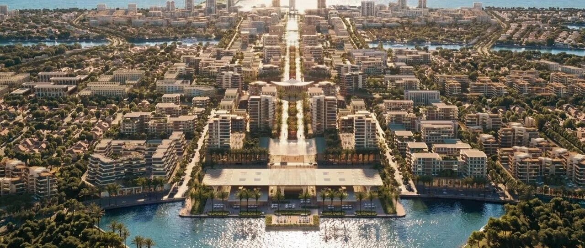

** ⬆️  ** 点击  ** 『  ** 蓝字  ** 』  ** 加关注，点亮  ** 『  ** 星标  ** 』  ** 不错过 ⬆️
[2026.11.06 / 项目作品 · Projects]
SOM 公布埃及地中海海岸20.6平方公里新城总体规划
SOM Unveils Master Plan for a 20.6-Square-Kilometer New City on Egypt’s
Mediterranean Coast
SOM 刚刚公布了埃及一座名为“阿拉姆·阿尔·鲁姆”（Alam Al Roum）的新城规划方案。该项目沿地中海海岸线绵延长达 7.2 公里。
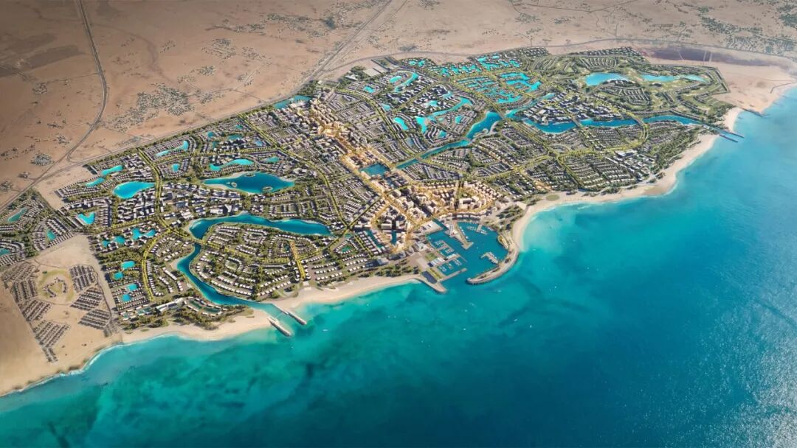
©SOM
新城位于马特鲁港（Marsa Matrouh）附近，总规划面积达 20.6 平方公里。规划中包含一个可供游泳的泻湖，以及总长 22
公里、与海水相连的泻湖水道系统。这些水道穿梭于建筑群之间，同时兼具雨水管理功能。
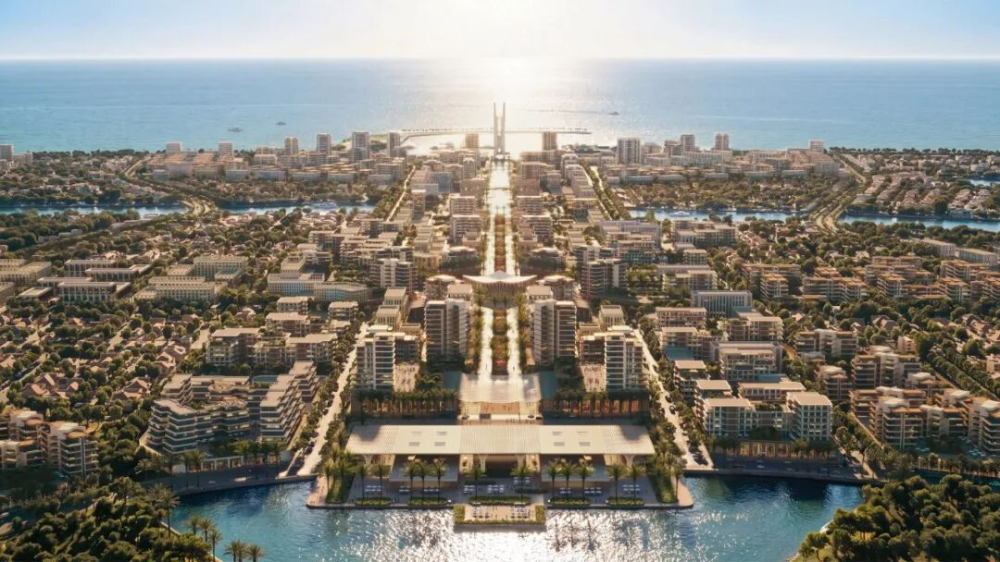
©SOM
SOM 负责人托马斯·赫西（Thomas Hussey）表示：
“
地中海沿岸孕育了世界上许多伟大的城市，这些城市历经数世纪，在气候、文化和经济力量的共同塑造下形成了今日的面貌。‘阿拉姆·阿尔·鲁姆’提供了一个难得的契机，让我们能够从零开始构想一座新城——它既能积极应对气候变化带来的现实挑战，又能提供卓越的生活品质。
”
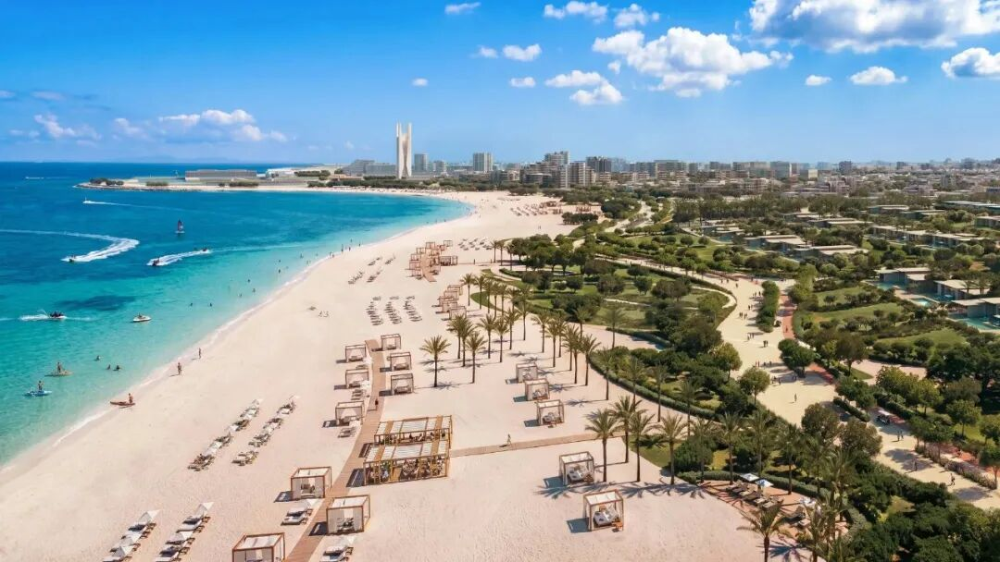
©SOM
SOM 在制定总体规划时，充分考量了埃及北海岸的自然景观与气候特征，通过优化建筑与公共空间的朝向及布局，有效利用了沿海微风与阳光。
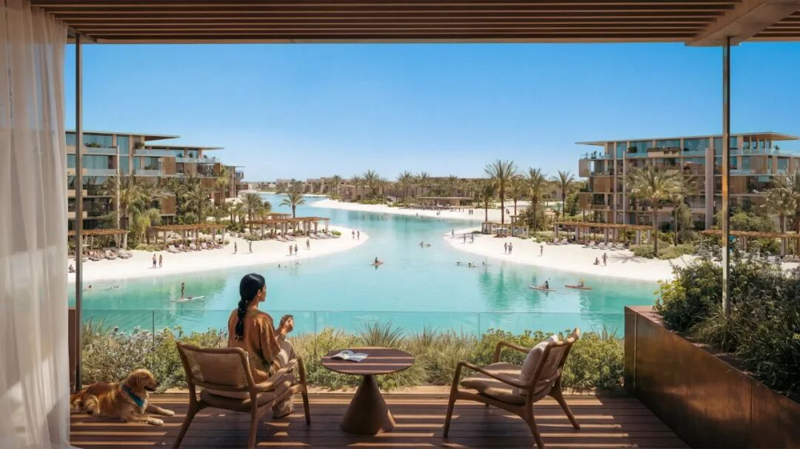
©SOM
为适应不断变化的沿海环境，该开发项目将采用抬高地面的设计；同时，滨水区域将通过自然干预手段加以保护，包括设置滨水缓冲带、雨水湿地、稳固沙丘以及构建“生态海岸线”（living
shorelines）。
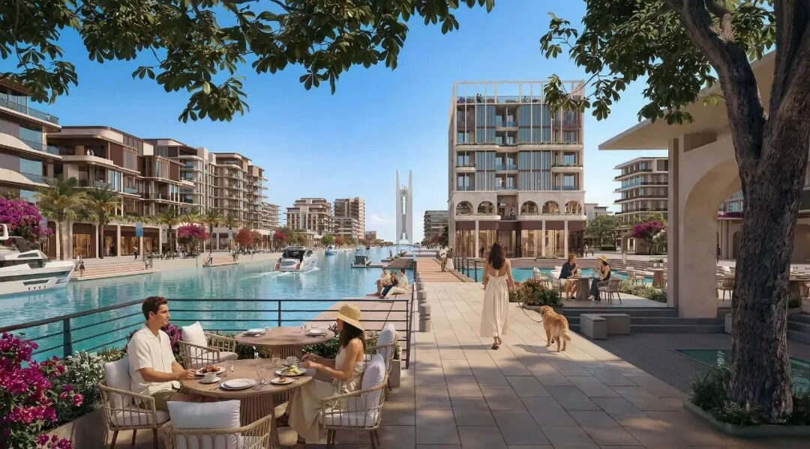
©SOM
“阿拉姆·阿尔·鲁姆”由开发商卡塔尔迪亚尔（Qatari
Diar）委托设计，规划内容涵盖滨海与泻湖畔的居住区、城镇中心、酒店与度假设施、高尔夫球场、教育区以及商业枢纽。一条宏伟的大道将构成城市的“中轴线”，连接地中海上的国际游艇码头与内陆的交通枢纽。
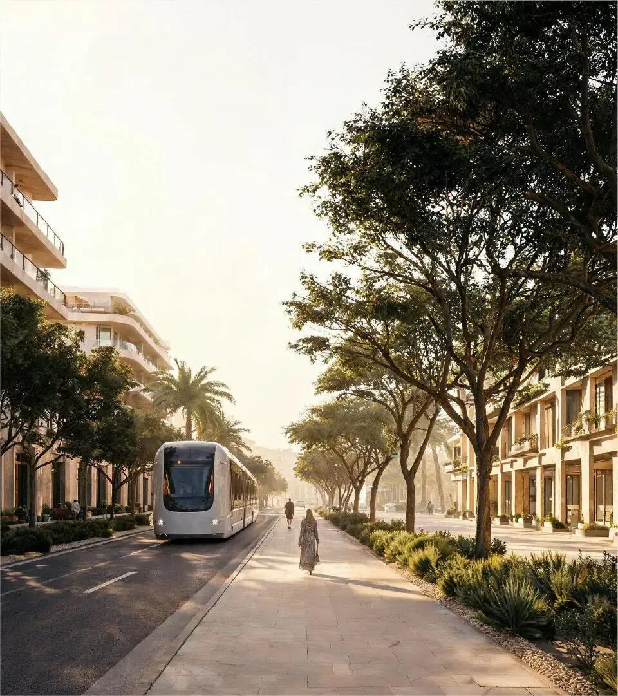
©SOM
为了将该城打造为全年皆宜的文化目的地，“阿拉姆·阿尔·鲁姆”的滨水市中心将设有文化码头、灯塔、露天剧场、游艇俱乐部、清真寺以及各类市场。
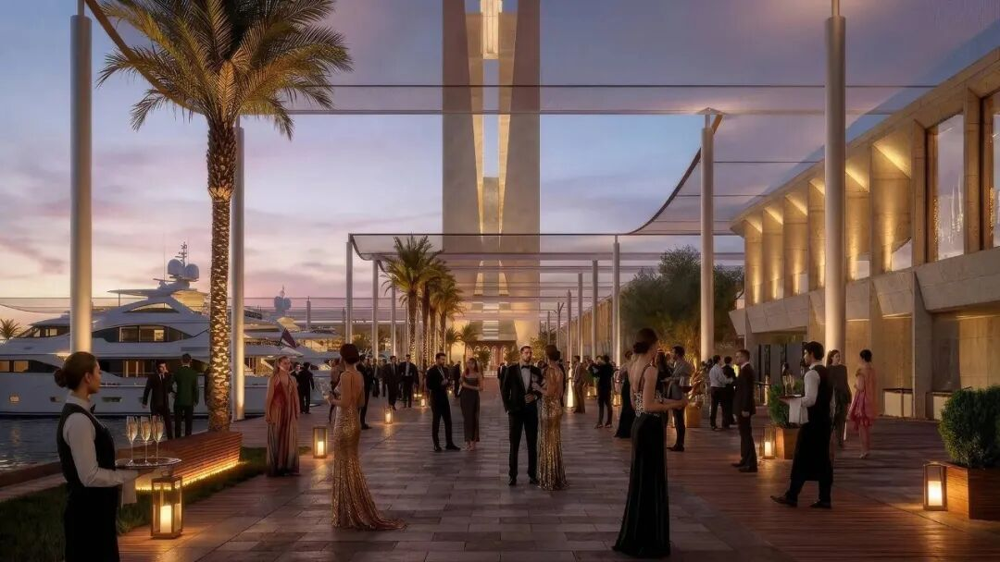
©SOM
卡塔尔迪亚尔（Qatari Diar）首席执行官哈马德·本·塔拉勒·阿勒萨尼（Hamad bin Talal Al-Thani）表示：
“
‘阿拉姆·阿尔·鲁姆’体现了我们对新一代地中海目的地的愿景——它超越了传统的季节性度假区概念，旨在打造一座充满活力、全年皆宜的滨海城市。我们将自然、海洋、酒店服务与日常生活融为一体，打造出一个经过精心规划的环境，充分彰显了埃及北海岸的独特风貌。通过与
SOM 以及我们全球专家网络的合作，我们正在构建一个与当地景观和气候深度融合的目的地，旨在为地中海地区的综合性海岸开发树立新的标杆。  ”
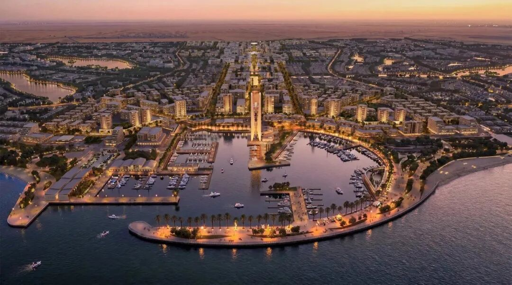
©SOM
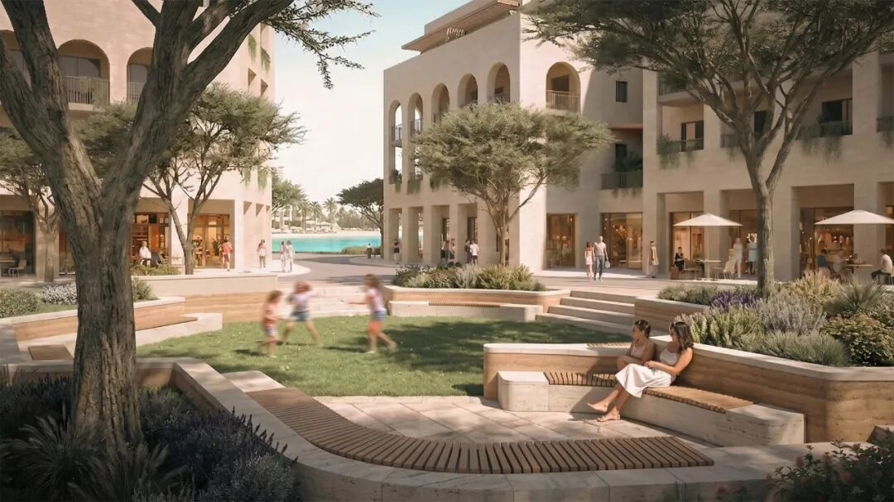
©SOM
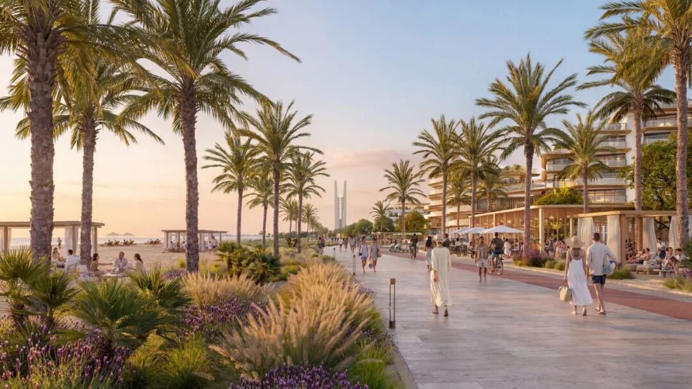
©SOM
近年来，埃及还在开罗以东建立了一座新首都，其最初设计理念也是由 SOM 提出，随后由国际建筑咨询公司 Dar al-Handasah Shair &
Partners 进行了深化设计。
参考资料
https://  www.dezeen.com/2026/11/05/alam-al-roum-city-egypt-som/
** 设计单位：  ** SOM
** 编辑排版：  ** Damian
** 版权声明：  **
本文内容来自网络，由archrace翻译整理，图文原始版权属于设计单位所有。欢迎转发，禁止未经archrace允许以此编辑版本转载。
** 联系 Contact us  **

info@archrace.com

arch_race
** 发现 Find us  **

archrace.com

@archrace

archrace

@archrace_com
点击  『  ** 阅读原文  ** 』  进入官网
点  ** 『  ** 赞  ** 』  ** 、  ** 『  ** 推荐  ** ** 』  ** ** ，与人  『  ** 分享  ** ** 』
