# 半世纪前的混凝土薄壳奇迹，因结构隐患宣布紧急封桥

** ⬆️  ** 点击  ** 『  ** 蓝字  ** 』  ** 加关注，点亮  ** 『  ** 星标  ** 』  ** 不错过 ⬆️
[2026.11.20 / 行业动态 · ARCHITECTURE NEWS]
波坦察的穆斯梅奇桥将关闭至 2028 年
The Musmeci Bridge in Potenza will be closed until 2028
意大利南部波坦察市（Potenza）的标志性现代工程杰作——穆斯梅奇桥（Ponte Musmeci，又称巴森托高架桥 Basento
Viaduct）由于结构损坏问题，已于近日被当地政府紧急全面关闭，并启动大规模修复工程。

© Elisa Scapicchio
这座由意大利结构工程大师塞尔吉奥·穆斯梅奇（Sergio
Musmeci）于1967—1976年间设计的桥梁，以无桥墩的波浪形钢筋混凝土连续薄壳结构闻名于世，也是20世纪建筑与结构找形史上的经典（2003年被意大利文化部列为“文化遗产纪念碑”）。

© Elisa Scapicchio
巧合的是，今年恰逢塞尔吉奥·穆斯梅奇诞辰一百周年。当地大学不久前刚为他举办过学术纪念研讨会，紧接着桥梁却因“年久失修”被迫关闭，在意大利建筑与工程界引发了不小的讨论。
01\. 形式与结构完美结合的杰作
1967年，塞尔吉奥·穆斯梅奇开始接手这座桥的设计时，波坦察急需一座基础设施，将首府与巴森托河以及当时沿河正在建设的工业区和第三产业区连接起来。最初当地政府仅计划建造一座功能性桥梁，以满足从A2高速公路进入城市的通行需求。但这位罗马工程师却有着更为宏伟的构想——创造一种形式与力的流动相契合、并将材料用量减少到极致的结构体系。
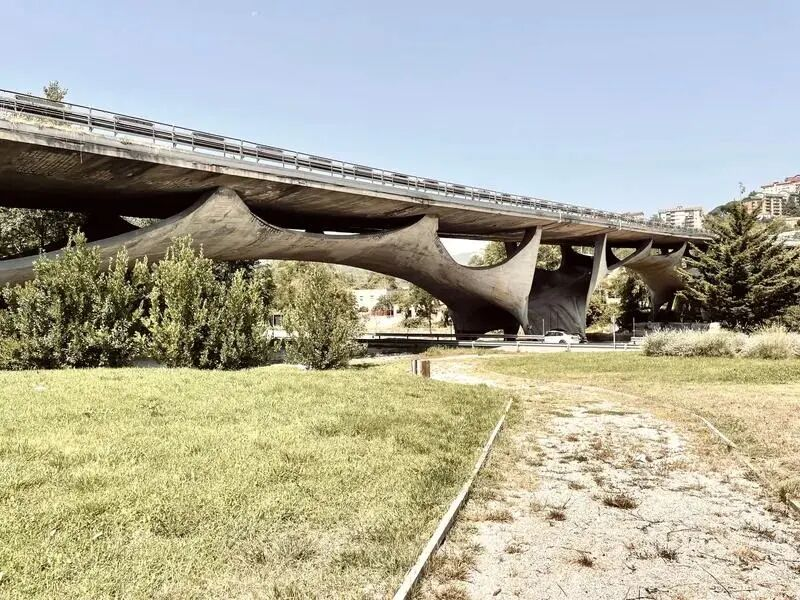
© Elisa Scapicchio
这座桥的设计指导原则是最小曲面与等应力结构。穆斯梅奇追求的正是用最少的材料和自重保证稳定性的结构形式。为了找到这个最佳形态，他不仅依赖理论计算，还运用当时的前沿技术，从肥皂膜、氯丁橡胶再到甲基丙烯酸酯，制作了大量比例模型，研究主应力线在连续表面上的分布规律。

© Elisa Scapicchio
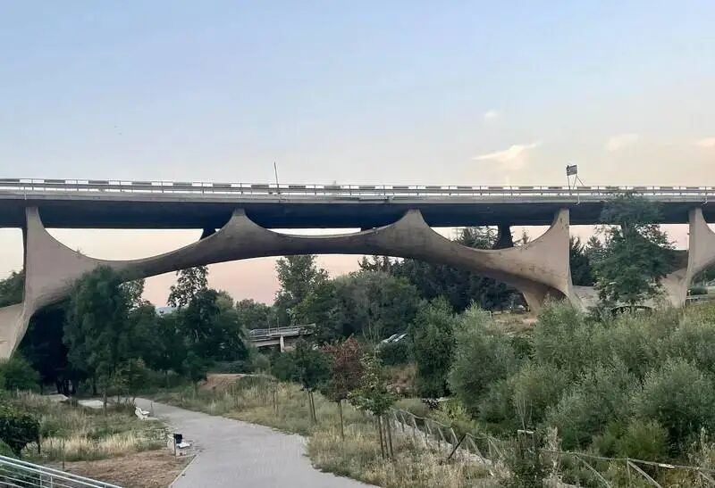
© Elisa Scapicchio
最终建成的这座高架桥主体全长约280米（含引桥部分逾500米），其核心的钢筋混凝土连续薄壳横跨铁路和巴森托公园，平均厚度仅为30厘米。这片起伏的壳体时而向上拱起与桥面相接，时而又回落到地面。与极具流动感的支撑壳体形成强烈对比的，是上方一条16米宽、纤薄而笔直的水平桥面。桥面与壳体共有32个接触点，两侧各16个（穆斯梅奇特意借用了一个生物解剖学术语，将其命名为“骨突”），彼此间距约17.5米，并向内退缩至路缘以内。这一细节进一步凸显了桥面与薄壳之间的“悬浮分离感”。
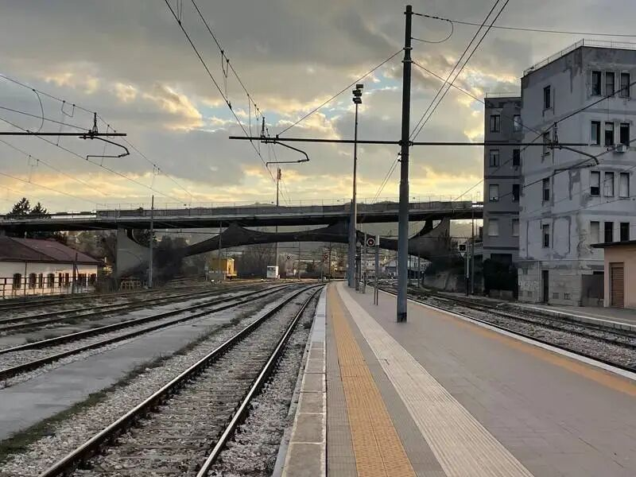
© Elisa Scapicchio
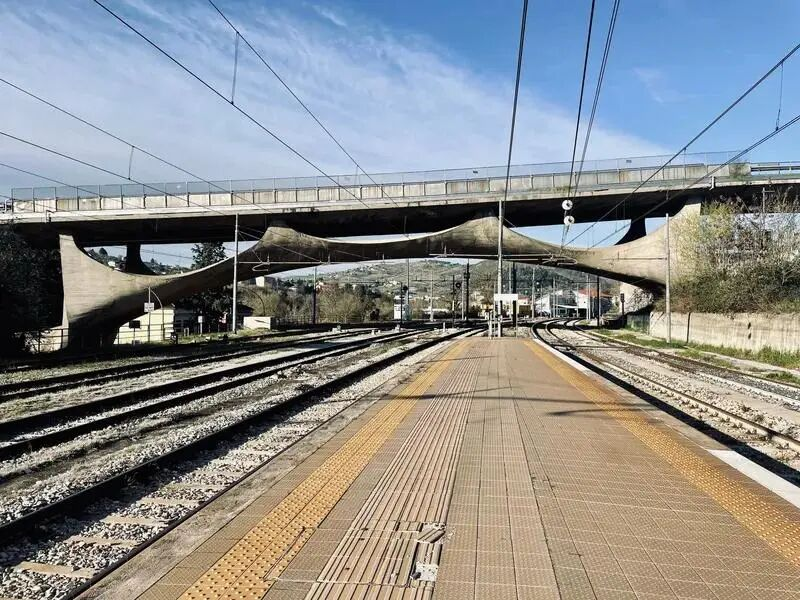
© Elisa Scapicchio
正是这种视觉与力学的戏剧性对比赋予了桥梁惊人的表现力，但也埋下了隐患——多年之后，桥面连接处发生了“格伯鞍座”（Selle
Gerber）错位的问题，最终导致桥梁被迫关闭。
02\. 关闭原因
此次穆斯梅奇桥关闭的起因是今年11月初，当地发现桥体出现混凝土碎块脱落现象。随后消防部门与工程技术人员介入勘察，发现结构受损比预期更为严重。波坦察市长
Vincenzo Telesca 随即下令全面封闭交通，称这是“保障公共安全不可推迟的决定”。
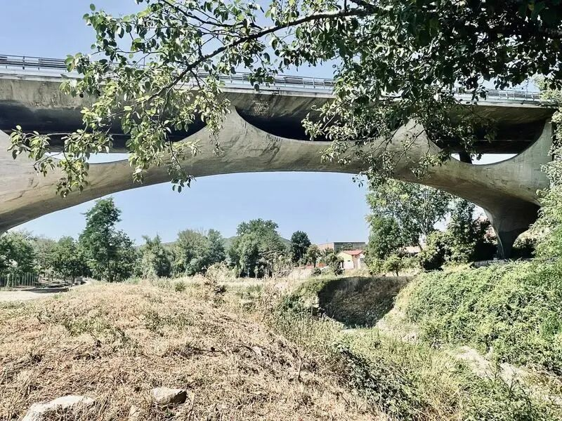
© Elisa Scapicchio
勘察报告显示，桥梁的致命隐患在于“桥面连接处的格伯鞍座错位”。所谓的“格伯鞍座”，是指在相邻两段桥面的衔接处，梁端混凝土分别被削去一半，形成一上一下两个“台阶”（工程上称为上下齿口或牛腿）。其中一段桥面作为支撑端在下，另一段桥面作为被支撑端搭在上方，中间夹着一块橡胶或金属支座垫，形似马鞍，因此得名“格伯鞍座”（以19世纪德国结构工程师
Heinrich Gerber
命名）。这是20世纪六七十年代现代主义混凝土桥梁设计中非常经典的节点，但也因为伸缩缝正好开在受力最集中的齿口正上方，极易出现老化病害。
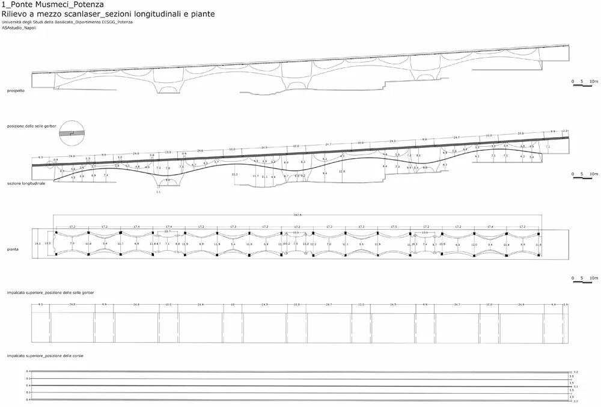
穆斯梅奇桥部分重绘图
©  wearch
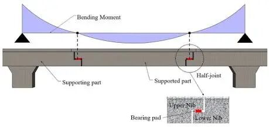
格伯鞍座节点示意及受力分析
©  ResearchGate
由于穆斯梅奇桥的桥面板采用了轻质薄壁的钢筋混凝土方格肋板，连接处的牛腿齿口本身截面就比较纤细，内部斜向钢筋构造密集。加上半个世纪以来缺乏系统性养护，路面渗水与冬季撒布的除冰盐顺着伸缩缝下渗，引发混凝土严重碳化、剥落及内部钢筋锈蚀，致使桥面面临突发性剪切脆性断裂的风险。
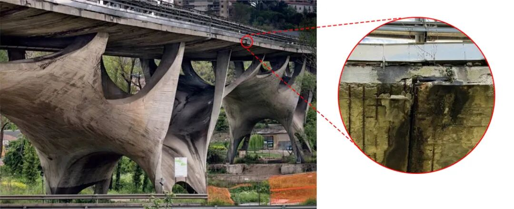
穆斯梅奇桥  格伯鞍座节点老化现状
©  Conf. del Calcestruzo
事实上，该桥近五年来已禁止重型卡车通行并实施限速，但最新监测显示节点错位与振动已危及普通轿车通行。

© Elisa Scapicchio
03\. 修复计划
波坦察市在11月9日的新闻发布会上公布了大桥的初步修复计划与预算：修复工程预算约为1,100万欧元，计划于2027年正式进场施工，预计2028年完成并重新通车。
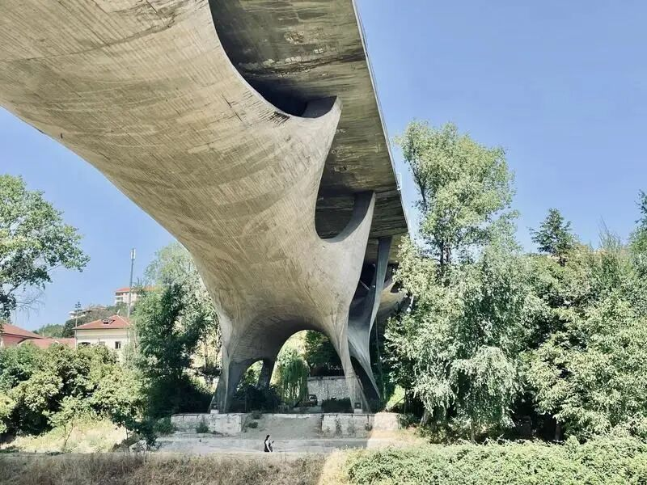
© Elisa Scapicchio
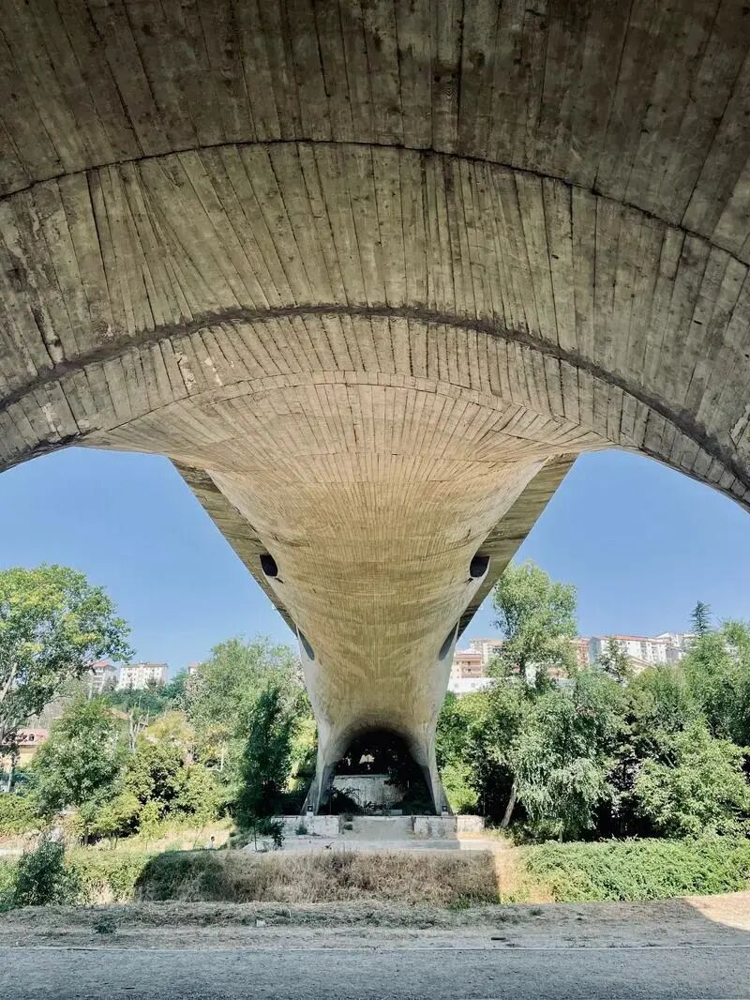
© Elisa Scapicchio
在具体修复过程中，工程团队需要利用液压千斤顶将每一段悬挂桥面整体顶升约1.40米，凿除并重建严重退化的牛腿接头混凝土，同时修复受损的薄壳外皮（保留原有的木模肌理），以恢复结构安全性与抗震性能。
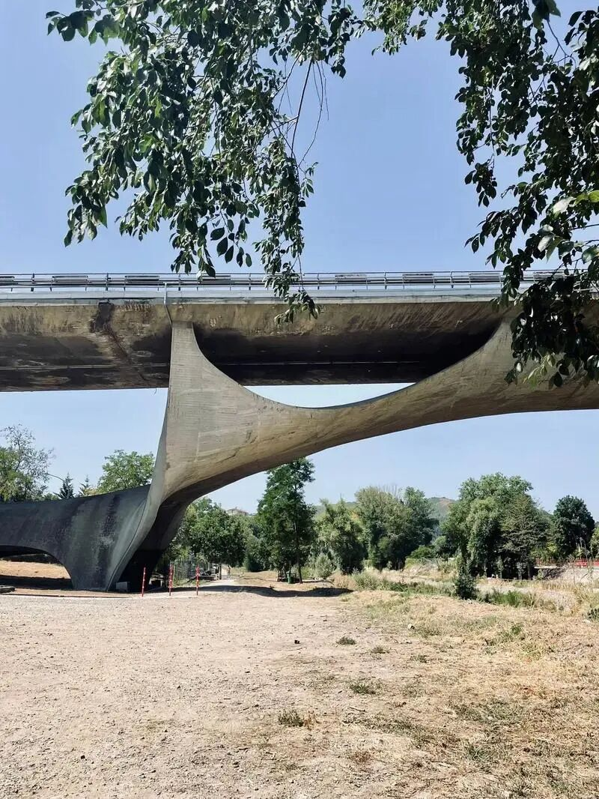
© Elisa Scapicchio
穆斯梅奇桥的突然封闭导致当地通勤严重拥堵，不过人们也很庆幸及时发现了结构隐患——这不仅避免了2018年热那亚莫兰迪大桥垮塌悲剧的重演，也让这座现代桥梁史上的杰作得以保存。
参考资料
https://  www.professionearchitetto.it/news/notizie/34605/il-ponte-musmeci-a-
potenza-chiude-fino-al-2028-storia-di-un-capolavoro-di-ingegno-italiano
** 文字编辑：  ** 思空建观
** 校对审核：  ** 斯坦
** 版权声明：  **
本文由archrace翻译编辑，其中观点不代表archrace立场。文中图文原始版权由原网站或涉及的相关组织、个人所有，如有版权问题，请联系删除。欢迎转发，禁止未经archrace允许以此编辑版本转载。
** 联系 Contact us  **

info@archrace.com

arch_race
** 发现 Find us  **

archrace.com

@archrace

archrace

@archrace_com
点击  『  ** 阅读原文  ** 』  进入官网
点  ** 『  ** 赞  ** 』  ** 、  ** 『  ** 推荐  ** ** 』  ** ** ，与人  『  ** 分享  ** ** 』
