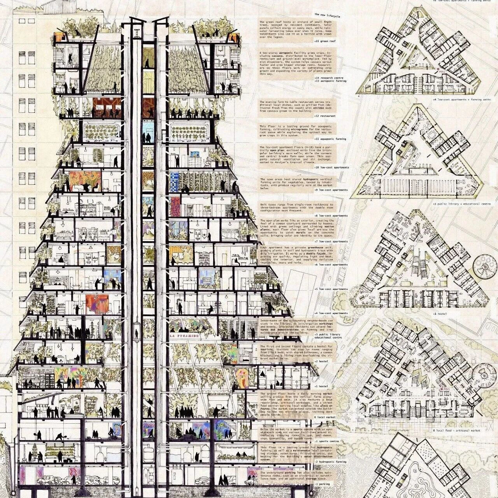
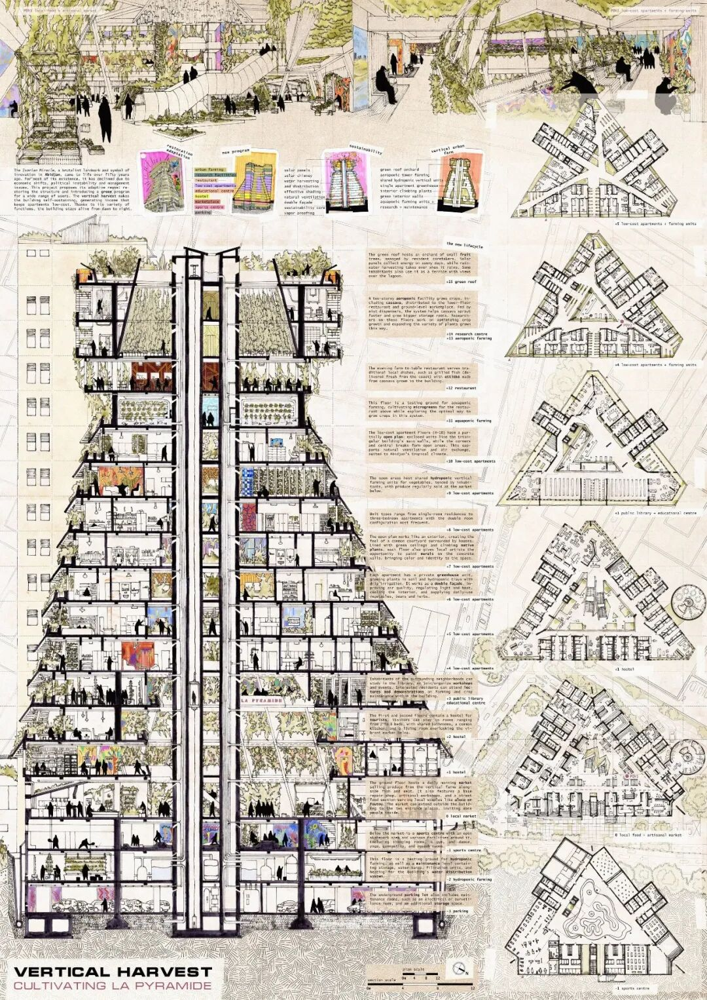
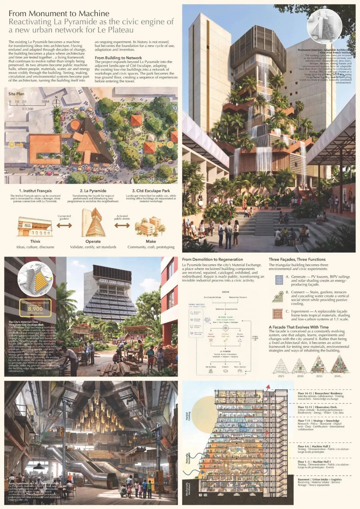
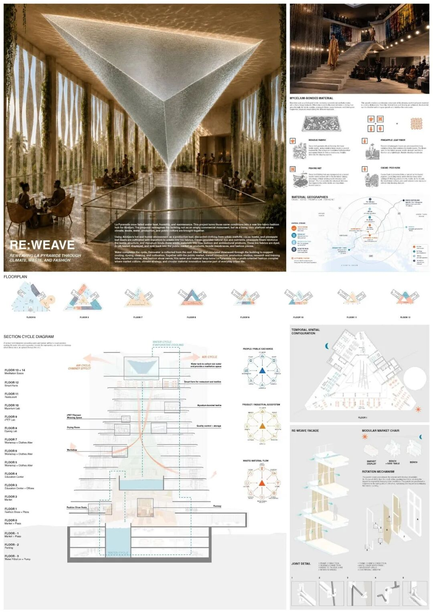
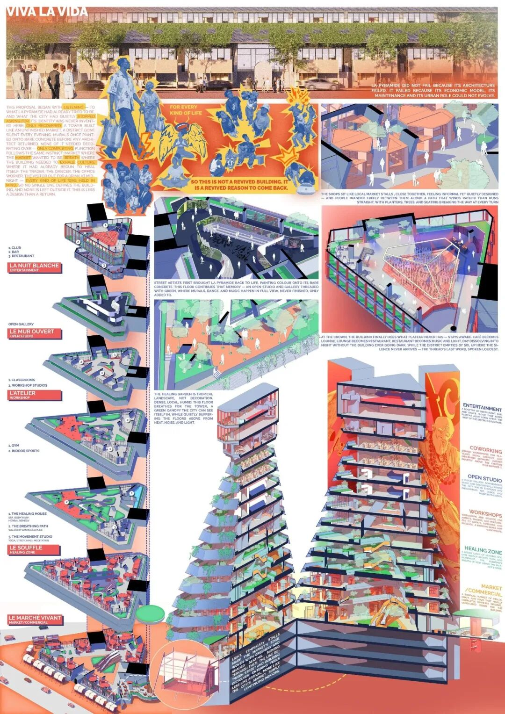
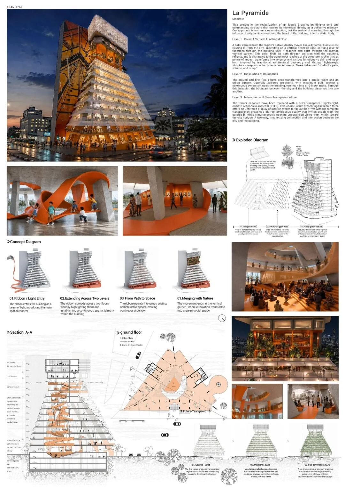
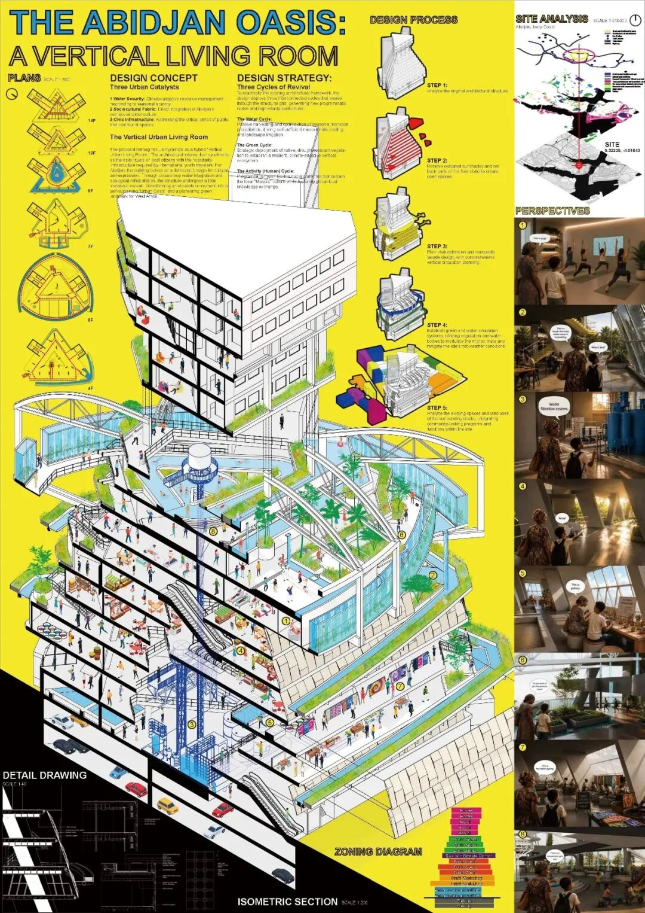
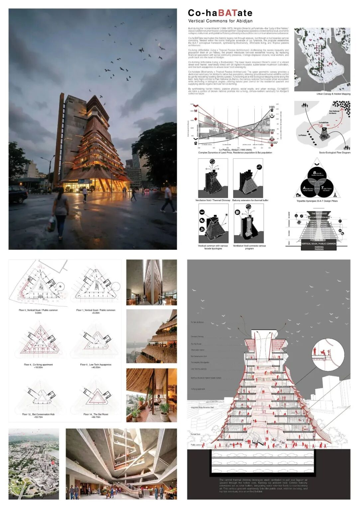
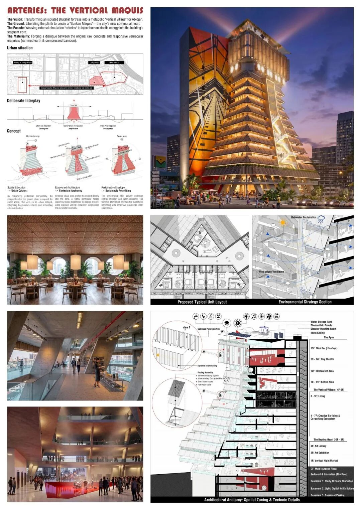

# 科特迪瓦阿比让金字塔大厦改造竞赛结果公布

** ⬆️  ** 点击  ** 『  ** 蓝字  ** 』  ** 加关注，点亮  ** 『  ** 星标  ** 』  ** 不错过 ⬆️
[2026.11.07 / 竞赛结果 · COMPETITION RESULTs]
科特迪瓦阿比让金字塔大厦改造竞赛
LA PYRAMIDE
由竞赛组织  IDOARCH 发起的  LA PYRAMIDE：科特迪瓦阿比让金字塔大厦改造竞赛在近日公布了结果。该竞赛  的目标是改造  科特迪瓦阿比让
金字塔大厦，使其焕发活力，将这座曾经辉煌却空置的纪念碑转变为城市中一个功能齐全、充满活力的组成部分。
金字塔大厦位于阿比让行政区的中心地带，高度为62米，  被誉为“高原女神”
，宛如一座纪念碑，见证着“科特迪瓦奇迹”的辉煌时代。这座由建筑师里纳尔多·奥利维耶里和工程师里卡多·莫兰迪于1968年至1973年间设计的15层粗野主义地标建筑，
以其富有韵律感的混凝土几何造型和独特的空心结构而著称，使光线和空气能够在宽敞的内部空间自然流通。
来自波兰的设计师  Aleksandra Stasica 提交的”  垂直丰收：培育‘金字塔’“方案赢得了第一名，评委评价其方案”
对现有结构进行适应性再利用，使其成为能够以最可持续的方式为当地社区做出贡献的生产性船舶。“
第一名 /  Aleksandra Stasica

©  Aleksandra Stasica
第二名 /  Phang Lim，Austin Lim

©  Phang Lim，Austin Lim
第三名 /  Sumi Kim，Eunho Kim，Yeon Lee

©  Sumi Kim，Eunho Kim，Yeon Lee
荣誉提名 /  Mohammad Mahibur Rahman，Prashanta Sen

©  Mohammad Mahibur Rahman，Prashanta Sen
荣誉提名 /  Majid Aghazade，Fatemeh Safinejad，Ali Rasouli，Hanieh Pardeneshin

©  Majid Aghazade，Fatemeh Safinejad，Ali Rasouli，Hanieh Pardeneshin
荣誉提名 /  Daoprasuk Seangsai，Bofong Lin

©  Daoprasuk Seangsai，Bofong Lin
荣誉提名 /  Yi-Chieh Liao

©  Yi-Chieh Liao
荣誉提名 /  Quy Ngo Thanh

©  Quy Ngo Thanh
参考资料
https://idoarch.com/la-pyramide  #winners
** 文字编辑：  ** 思空建观
** 校对审核：  ** 斯坦
** 版权声明：  **
本竞赛信息及文中涉及的图片均来自网络，原始版权属于竞赛主办方和竞赛提案设计师所有，如有版权问题，请联系删除。欢迎转发，禁止未经archrace允许以此编辑版本转载。
** 联系 Contact us  **

info@archrace.com

arch_race
** 发现 Find us  **

archrace.com

@archrace

archrace

@archrace_com
点击  『  ** 阅读原文  ** 』  进入官网
点  ** 『  ** 赞  ** 』  ** 、  ** 『  ** 推荐  ** ** 』  ** ** ，与人  『  ** 分享  ** ** 』
