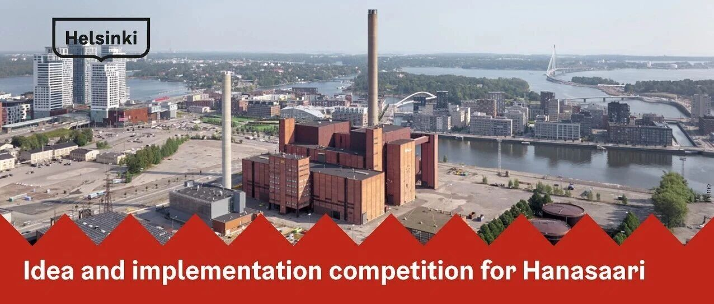
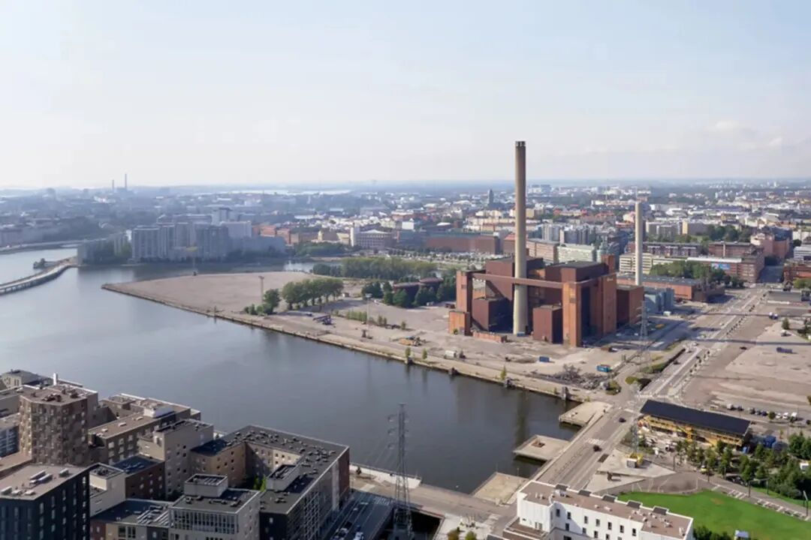

# 竞赛 | 赫尔辛基哈纳萨里（Hanasaari）前发电厂区域改造创意竞赛

** ⬆️  ** 点击  ** 『  ** 蓝字  ** 』  ** 加关注，点亮  ** 『  ** 星标  ** 』  ** 不错过 ⬆️
[2026.11.19 / 设计竞赛 · competitions]
赫尔辛基哈纳萨里前发电厂区域改造创意竞赛
Idea and implementation competition for Hanasaari -
芬兰
赫尔辛基市政府正筹备一项针对哈纳萨里前发电厂区域的国际创意及实施方案竞赛。竞赛旨在为该区域寻找一个雄心勃勃的总体规划、一个发电厂建筑改造方案，以及一个区域实施的合作伙伴。
这项分三个阶段进行的比赛于2026年11月开始，预计于2029年春季结束。
本次竞赛的目标是制定一个总体规划，该规划应满足以下条件：
具有该地区的特色；
城市结构和城市景观质量非常高；
兼顾文化和历史价值；
鼓舞人心、富有创新性且切实可行。
该计划将作为该地区开发、详细规划和实施的基础。
另一目标是找到一家运营商，该运营商将与其规划设计团队和合作伙伴一起，作为哈纳萨里新建住宅和商业区的主要实施者。该运营商还将负责实施电厂区域改造项目。

场地现状
©  Tuomas Uusheimo
本次竞赛的对象哈纳萨里（Hanasaari）地区是赫尔辛基索尔奈宁区（Sörnäinen）的一部分。该地区位于维尔洪沃里（Vilhonvuori）、卡拉萨塔玛（Kalasatama）和松帕萨里（Sompasaari）地区之间，靠近梅里哈卡（Merihaka）。哈纳萨里中心距离赫尔辛基中央火车站约两公里。未来，哈纳萨里将通过修建的桥梁与东部内城连接起来，从而完善城市结构。
此次创意与实施竞赛的场地占地约16公顷，涵盖了哈纳萨里B核电站的建筑群。该核电站总装机容量为38万立方米，建筑面积约3万平方米。哈纳萨里核电站已于2023年春季停止运营。
主办方
赫尔辛基市政府
参赛资格
竞赛允许单个具备专业资质的实体或组成联合体参赛，竞赛对参赛成员主体有相关业绩以及项目规模的要求，需要在竞赛要求的平台上完成注册报名，具体详见竞赛任务书。
参赛费用
无
评委
暂未公布
日程
报名开始：2026年11月16日；
报名截止：2027年5月12日；
第一阶段方案提交截止：  2028年6月初；
第一阶段入围团队结果公布：2028年秋；
第二阶段方案提交截止：  2029 年初；
最终结果公布：2029年春。
奖项设置
竞赛  获胜者将和市政府将于 2029 年秋季前最终确定一份关于项目后续规划和实施的实施协议。该协议将以谈判阶段拟定的实施协议草案为基础。
网站
点击文末阅读原文， 或前往 archrace 官网 https://www.archrace.com/ 查看。
** 文字编辑：  ** 思空建观
** 校对审核：  ** 斯坦
** 版权声明：  ** 本竞赛信息来自主办方，由 archrace
翻译整理，信息如有出入，请以主办方发布为准。欢迎转发，禁止未经archrace允许以此编辑版本转载。
** 联系 Contact us  **

info@archrace.com

arch_race
** 发现 Find us  **

archrace.com

@archrace

archrace

@archrace_com
点击  『  ** 阅读原文  ** 』  进入官网
点  ** 『  ** 赞  ** 』  ** 、  ** 『  ** 推荐  ** ** 』  ** ** ，与人  『  ** 分享  ** ** 』
