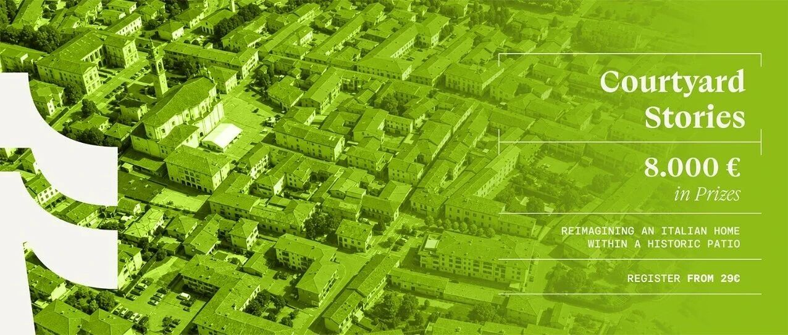
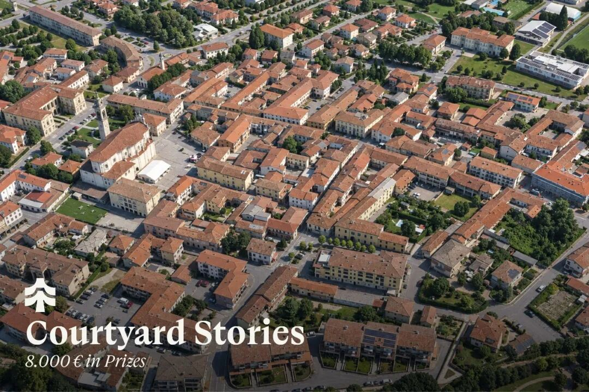

# 竞赛 | “庭院故事（COURTYARD STORIES）”：意大利庭院建筑群改造竞赛

** ⬆️  ** 点击  ** 『  ** 蓝字  ** 』  ** 加关注，点亮  ** 『  ** 星标  ** 』  ** 不错过 ⬆️
[2026.11.04 / 设计竞赛 · competitions]
“庭院故事”：意大利庭院建筑群改造竞赛
COURTYARD STORIES
Terraviva 发起了一项名为“庭院故事”（COURTYARD
STORIES）的全新国际建筑竞赛，邀请参赛者将一处意大利庭院建筑群改造为现代独栋住宅，旨在重新构想既有建筑与户外空间之间的关系…… 获胜者将获得总额高达
8000 欧元的奖金。
评选工作将由一个国际评审团负责，成员包括 Maxime Pauzon（Pauzon Filliatre Architectes）、Lucia
Paci（Operastudio）、Ivan Rota（IR Studio）、Andrea Bellentani（ABArchitecture）以及
Verena Hake（亚琛工业大学）。
Terraviva launches COURTYARD STORIES, a new international architecture
competition that challenges participants to transform an Italian courtyard
complex into a contemporary single-family home, reimagining the relationship
between inherited architecture and outdoor space…
Prizes up to 8.000 € will be awarded to the winners, selected by an
international jury including Maxime Pauzon (Pauzon Filliatre Architectes),
Lucia Paci (Operastudio), Ivan Rota (IR Studio), Andrea Bellentani
(ABArchitecture) and Verena Hake (RWTH Aachen University).

简介 / BRIEF
在意大利一处历史悠久的庭院内，又会演绎出怎样的新故事？在靠近贝加莫（Bergamo）的卡尔奇纳泰（Calcinate），一组曾见证乡村生活的建筑空间，为人们构想一种与过去共处的新方式提供了契机。
“庭院故事”（Courtyard
Stories）项目邀请参与者将这组建筑群中的部分空间改造为现代居所，通过统一的建筑构想，将主体建筑、附属建筑与私家花园有机融合。这一项目的愿景远不止于翻新，更在于探索如何从既有的历史环境中汲取灵感，开创出一种独具匠心的日常生活方式。
What new stories could unfold within the walls of a historic Italian
courtyard? In Calcinate, near Bergamo, a collection of spaces once shaped by
rural life offers the opportunity to imagine a different way of inhabiting the
past.
Courtyard Stories invites participants to transform part of this complex into
a contemporary home, bringing the main building, an adjoining structure and a
private garden into a shared architectural vision. The ambition goes beyond
renovation: it is to discover how an inherited setting can inspire an original
approach to everyday life.
奖项设置 / PRIZES
• 一等奖：3,000欧元（约合人民币22,302元）；
• 二等奖：2,000欧元（约合人民币14,868元）；
• 三等奖：1,000欧元（约合人民币7,434元）；
• 5 个金提名奖：免费会员优惠券；
• 10 个荣誉奖：免费竞赛优惠券；
• 前 30 名：在 Terraviva 渠道发表。
• 1st Prize: 3.000€；
• 2nd Prize: 2.000€；
• 3rd Prize: 1.000€；
• 5 Golden Mentions: coupon for a free membership；
• 10 Honorable Mentions: coupon for a free competition；
• 30 Finalists: published on Terraviva channels.
指南 / GUIDELINES
置身于外露的木桁架之下，让房间向花园敞开，或在不同楼层间建立意想不到的联系——每一个选择，都能挑战既有的居住惯例，并展现出紧凑型住宅所蕴含的多种可能性。这些要素应构成一个和谐的整体，其中需重点考量动线布局、自然采光、材料运用，以及室内与室外之间的关系。
由于没有预设的卧室数量，也无需遵循固定的起居与卧室区域布局，竞赛鼓励参与者重新审视传统的空间格局。灵活多变的功能空间、一体化的家具设计，以及巧妙的空间连接方式，能够充分挖掘紧凑型住宅的潜力。核心挑战在于构想出一种个性化的居住方式，并让既有建筑的特质，成为塑造独特居家愿景的灵感来源。
Living beneath exposed timber trusses, opening rooms towards the garden or
finding unexpected connections between levels: each choice can challenge
familiar conventions and reveal the possibilities of a compact dwelling. These
components should form a coherent whole, with particular attention to
circulation, natural light, materials and the relationship between indoors and
outdoors.
With no prescribed number of bedrooms or fixed arrangement of living and
sleeping areas, the programme encourages participants to question conventional
layouts. Flexible rooms, integrated furniture and inventive connections can
reveal the potential of a compact footprint. The challenge is to imagine a
personal approach to domestic life, allowing the character of the existing
architecture to inform an original vision of the home.
提交成果 / REQUESTED MATERIAL
两一张 A1 展板（59.4 x 84.1 厘米 - 横向）和一份提案简介（250-500 字）。
Two A1 panels (59,4 x 84,1 cm - horizontal) and a brief text describing the
proposal (250-500 words).
评委 / JURY
Maxime Pauzon  [Paris, France] | Pauzon Filliatre Architectes
Lucia Paci  [New York, USA] | Operastudio
Ivan Rota  [Bergamo, Italy] | IR Studio
Andrea Bellentani  [Modena, Italy] | ABArchitecture
Verena Hake  [Aachen, Germany] | RWTH Aachen University
日程 / SCHEDULE
• 竞赛启动：2026年11月3日
• “提前报名”（报名费89欧元）：2026年11月3日至2027年2月5日
• “标准报名”（报名费109欧元）：2027年2月5日至4月9日
• “延迟报名”（报名费139欧元）：2027年4月9日至5月7日
* 报名时输入折扣码：  COU20ARCHRACE  ，可享受报名费八折
• 作品提交截止日期：2027年5月7日
• 结果公布：2027年6月7日
• Competition Opening: November 3rd, 2026
• 89 € "Early" Registrations: November 3rd, 2026 - February 5th
• 109 € "Standard" Registrations: February 5th - April 9th
• 139 € "Late" Registrations: April 9th - May 7th
* Use 20% discount code：  COU20ARCHRACE
• Submission Deadline: May 7th, 2027
• Winners Announcement: June 7th, 2027
下载竞赛简报，请前往：
https://www.terravivacompetitions.com/courtyard-stories-competition-2026/
Download full brief here:
https://www.terravivacompetitions.com/courtyard-stories-competition-2026/
竞赛要求与参赛资格 / REQUIREMENTS & ELIGIBILITY
本次竞赛面向学生、建筑师、设计师、艺术家、工程师、城市规划师、创客及各类创意人士开放。参赛者可以个人或团队形式参赛。
The competition is open to students, architects, designers, artists,
engineers, urban planners, makers and creatives of all kinds. Participants can
compete individually or in teams.
** 文字编辑：  ** 思空建观
** 校对审核：  ** 斯坦
** 版权声明：  ** 本竞赛信息来自主办方，由 archrace
翻译整理，信息如有出入，请以主办方发布为准。欢迎转发，禁止未经archrace允许以此编辑版本转载。
** 联系 Contact us  **

info@archrace.com

arch_race
** 发现 Find us  **

archrace.com

@archrace

archrace

@archrace_com
点击  『  ** 阅读原文  ** 』  进入官网
点  ** 『  ** 赞  ** 』  ** 、  ** 『  ** 推荐  ** ** 』  ** ** ，与人  『  ** 分享  ** ** 』
