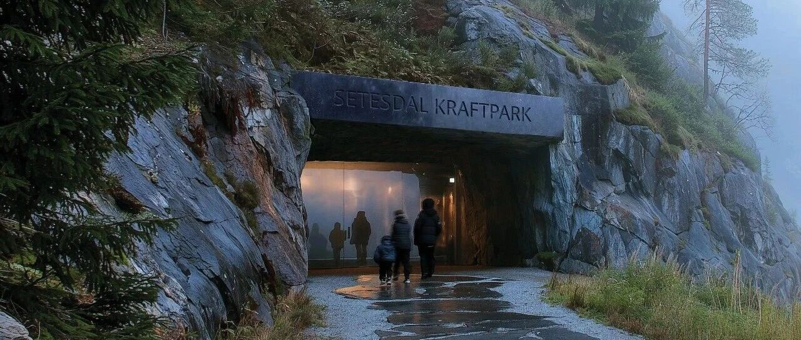
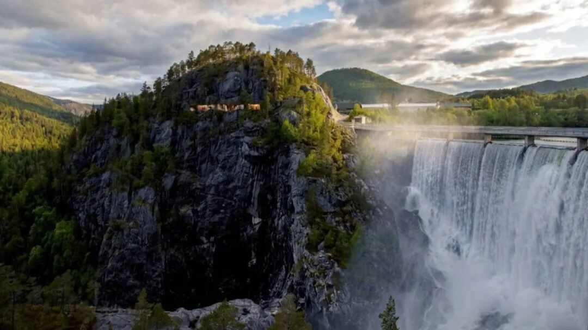
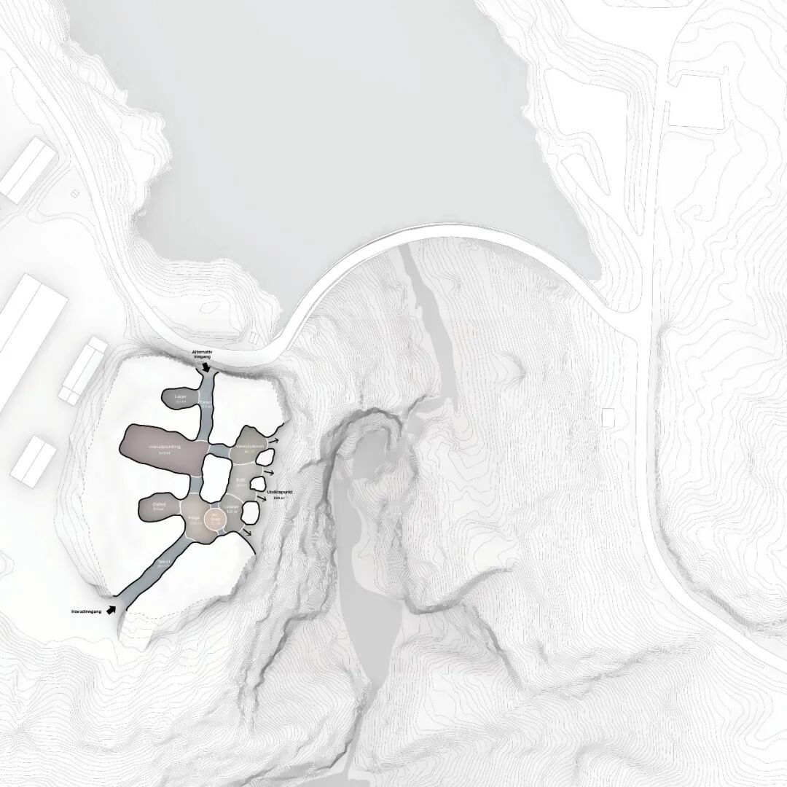
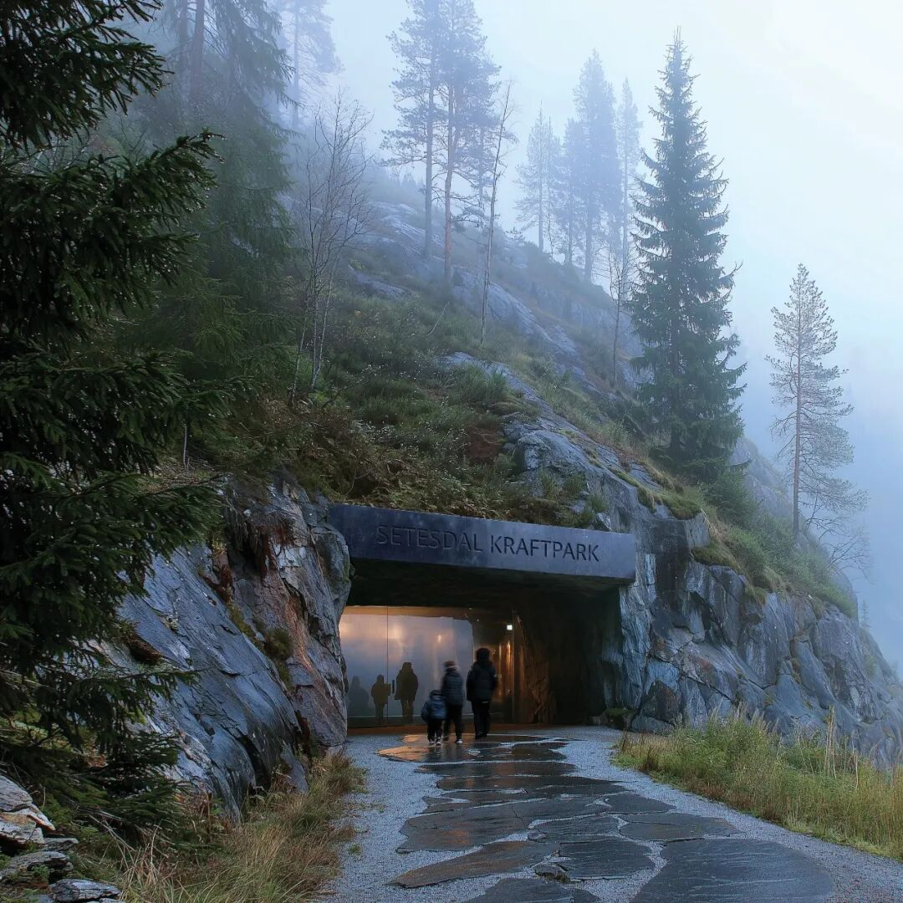
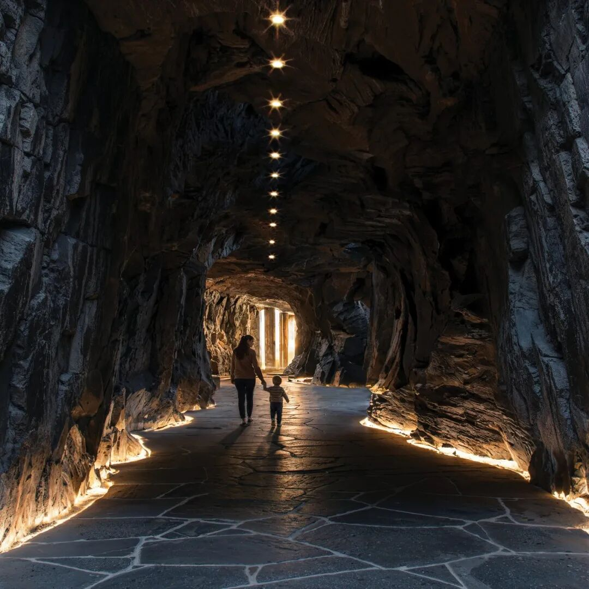
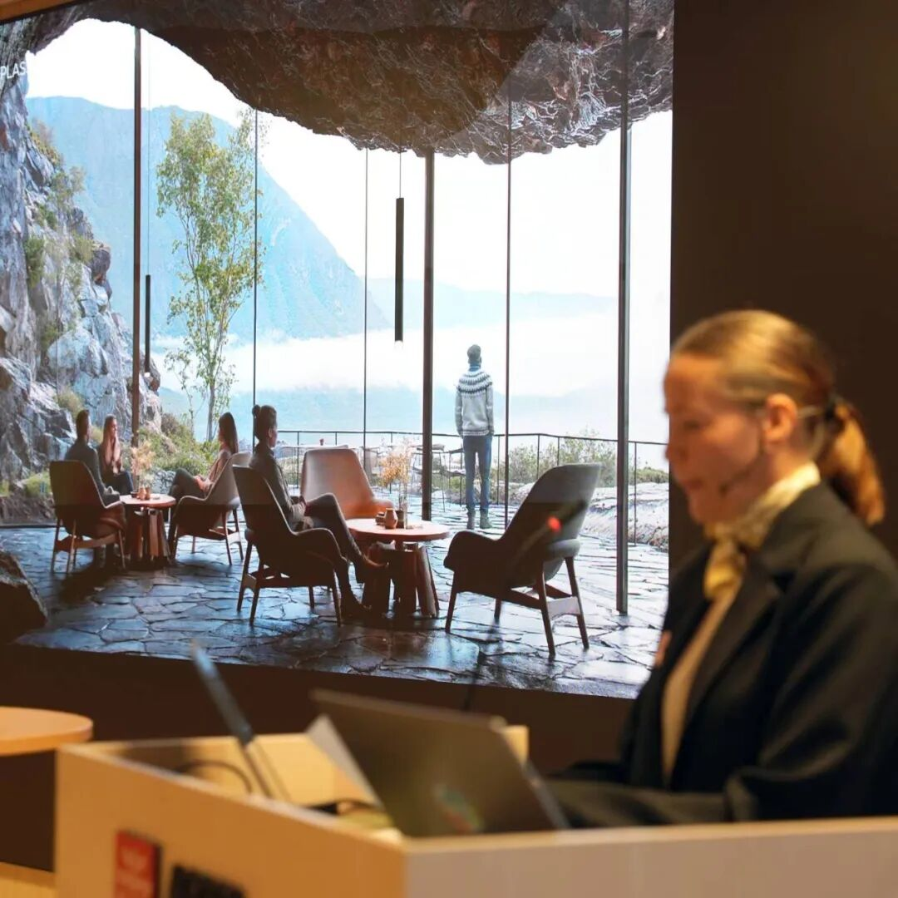
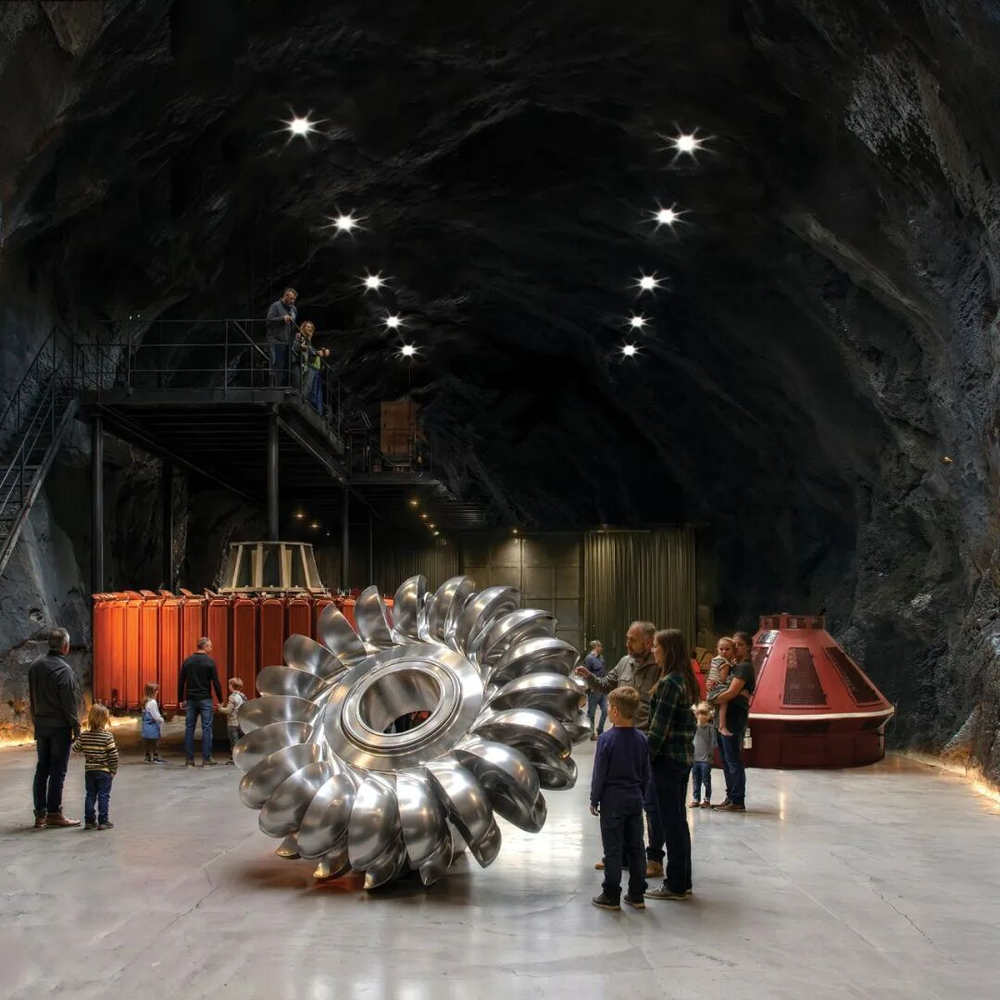
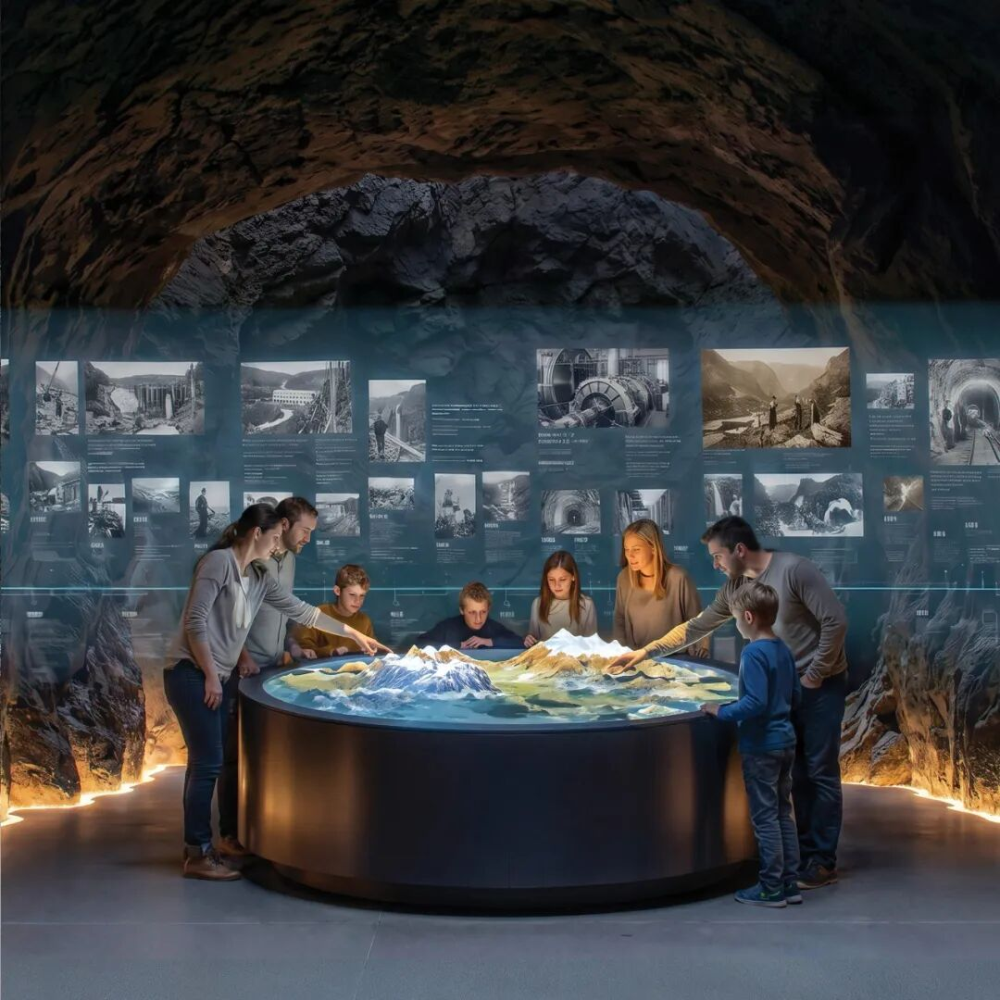
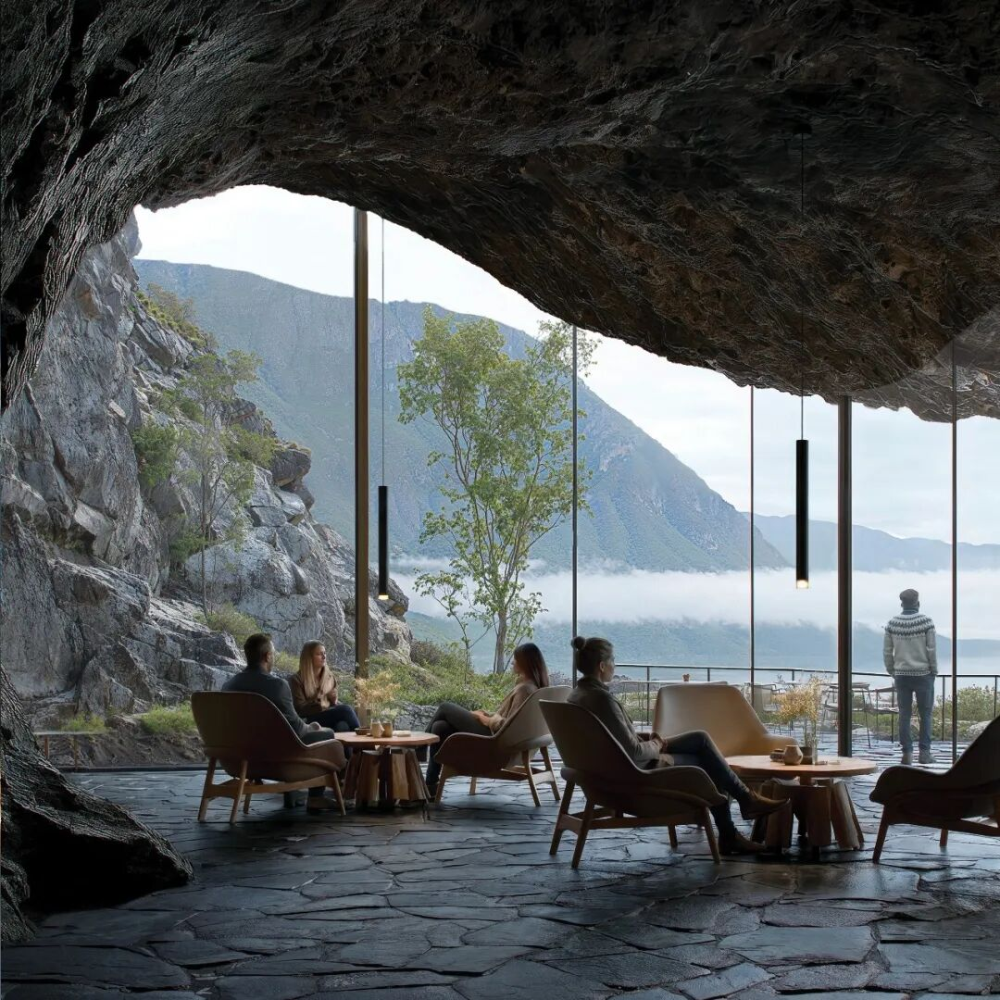

# 穿山凿洞做展览？挪威这个新项目把水力发电的历史藏进了大山里

** ⬆️  ** 点击  ** 『  ** 蓝字  ** 』  ** 加关注，点亮  ** 『  ** 星标  ** 』  ** 不错过 ⬆️
[2026.11.10 / 项目作品 · Projects]
塞特斯达尔能源公园  水力发电体验中心
New energy experience centre in Bykle
挪威正在塞特斯达尔能源公园（Setesdal Kraftpark）筹建一座全新的水力发电体验中心。  游客将穿梭于山体深处开凿的隧道与洞窟展厅，
探索该地区深厚的能源发展历史。  该项目由丹麦著名建筑事务所 EFFEKT 与 Høgde 公司联合为挪威比克勒（Bykle）地区量身打造。

©  EFFEKT，Høgde
01\.  嵌入山体深处的展览空间
项目选址于宏伟的萨尔夫斯福森大坝（Sarvsfossen
Dam）附近。长期以来，水力发电一直是当地社区生活与经济发展的核心命脉。设计团队希望充分利用当地的山地地形与洞穴空间，将这一工业遗产直接融入自然景观之中，而非置于传统的封闭展馆内。

©  EFFEKT，Høgde
方案设想让游客深入基岩，穿行于开凿在岩石内部的地下通道与隧道。在这段旅程中，参观者不仅能了解水力发电设施对当地社区的深远影响及其对挪威地貌的塑造，还能探索其在挪威国家电网建设中所扮演的关键角色。

©  EFFEKT，Høgde

©  EFFEKT，Høgde
地下体验的终点是一个通往开阔全景露台的出口，这种从封闭山体瞬间跨越至恢弘自然的剧烈反差，构成了整个项目最核心的空间体验之一。

©  EFFEKT，Høgde
02\.  景观即叙事，而非背景
体验中心巧妙地将周围的自然景观转化为展览媒介，把山体洞窟塑造成一段沉浸式的探索之旅。这一设计理念将自然环境视为叙事不可分割的一环：游客在近距离接触庞大基础设施的同时，也在切身体验中读懂水力发电的历史。

©  EFFEKT，Høgde
项目超越了传统的信息展台或静态陈列，提供了一种纯粹的空间体验——通过岩石、隧道与定点开阔的视觉通廊，引导游客直观感受能源基础设施的宏大体量及其与自然的相互关系。

©  EFFEKT，Høgde
塞特斯达尔能源公园植根于比克勒悠久的发电历史，这为项目赋予了深厚的文脉底蕴。体验中心不仅聚焦于水力发电的技术层面，更试图探讨“能源生产如何重塑区域发展、经济格局与公众生活”这一宏大课题。
Høgde 的  项目经理  Monica Sølyst说：
“  这一项目将以震撼人心的方式重现比克勒的能源历史。我们期待在比克勒打造一个前所未有的全新体验中心。  ”

©  EFFEKT，Høgde
不过，目前该项目的具体预算及开发建设主体尚未最终确定。当地部分居民也表达了担忧：此类项目虽然能带来可观的旅游收益，但其工程开发是否会对当地脆弱的自然生态造成干扰，仍需进一步评估。
参考资料
https://  www.effekt.dk/news/2026/10/15/effekt-and-hogde-envision-a-new-
hydropower-experience-centre-in-norway
** 设计单位：  ** EFFEKT
** 编辑排版：  ** Damian
** 版权声明：  **
本文由设计单位投稿并授权archrace发布，图文原始版权属于投稿设计单位所有。欢迎转发，禁止未经archrace允许以此编辑版本转载。
** 联系 Contact us  **

info@archrace.com

arch_race
** 发现 Find us  **

archrace.com

@archrace

archrace

@archrace_com
点击  『  ** 阅读原文  ** 』  进入官网
点  ** 『  ** 赞  ** 』  ** 、  ** 『  ** 推荐  ** ** 』  ** ** ，与人  『  ** 分享  ** ** 』
