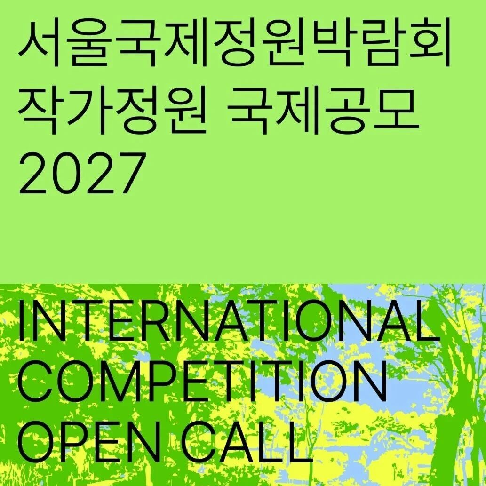
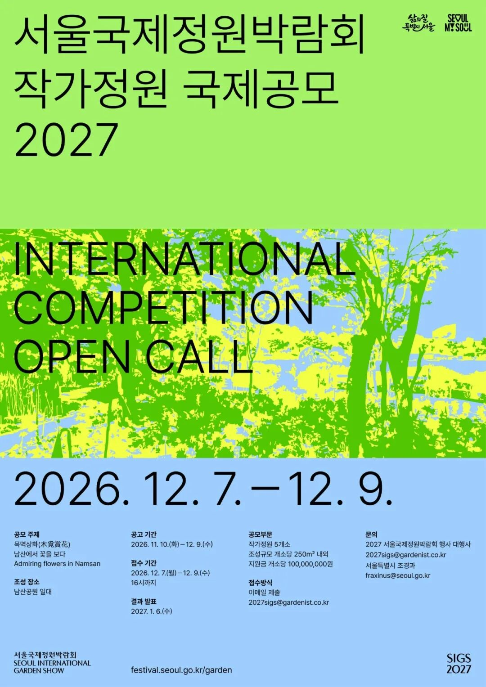

# 竞赛 | 2027 年首尔国际花园展（SIG 2027）展览花园设计竞赛

** ⬆️  ** 点击  ** 『  ** 蓝字  ** 』  ** 加关注，点亮  ** 『  ** 星标  ** 』  ** 不错过 ⬆️
[2026.11.12 / 设计竞赛 · competitions]
2027 年首尔国际花园展展览花园设计竞赛
Title
2027 年首尔国际花园展（Show Garden Competition for Seoul International Garden Show
2027，简称 SIG 2027）展览花园设计竞赛是首尔市旨在发掘创意花园设计，以推广都市花园文化，将其打造为日常艺术。

2027 年首尔国际花园展将于2026年5月至10月在韩国首尔市  首尔南山公园地区  举办，这次花园展的主题是：首尔，绿色生活。
这次竞赛将征集5个永久性花园装置，每个项目的大小约250平方米，每个装置的预算为一亿韩元。装置会在花园展期间及结束后继续保留。设计主题为：
木覓賞花（Admiring Flowers in Namsan）  。
主办方
Seoul Metropolitan Government, Organizing Committee for Seoul International
Garden Show 2027
参赛资格
竞赛对任何相关领域的专业人士开放
参赛费用
无
评委
暂未公布
日程
公告：2026年11月10日—12月9日；
报名及成果提交：2026年12月7日—12月9日。
*以上均为竞赛主办地的当地时间。
奖项设置
金奖：1,000万韩元（约合人民币49,892元）；
银奖（2组）：600万韩元（约合人民币29,935元）；
铜奖（2组）：300万韩元（约合人民币14,967元）。
网站
点击文末阅读原文， 或前往 archrace 官网 https://www.archrace.com/ 查看。
** 文字编辑：  ** 思空建观
** 校对审核：  ** 斯坦
** 版权声明：  ** 本竞赛信息来自主办方，由 archrace
翻译整理，信息如有出入，请以主办方发布为准。欢迎转发，禁止未经archrace允许以此编辑版本转载。
** 联系 Contact us  **

info@archrace.com

arch_race
** 发现 Find us  **

archrace.com

@archrace

archrace

@archrace_com
点击  『  ** 阅读原文  ** 』  进入官网
点  ** 『  ** 赞  ** 』  ** 、  ** 『  ** 推荐  ** ** 』  ** ** ，与人  『  ** 分享  ** ** 』
