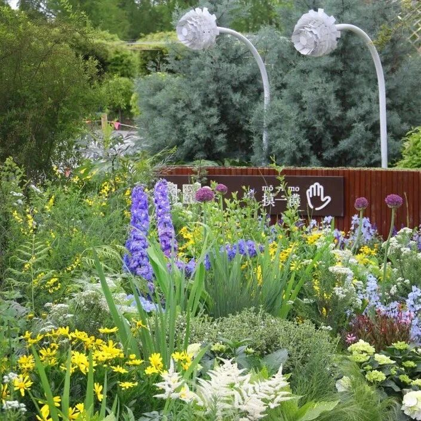
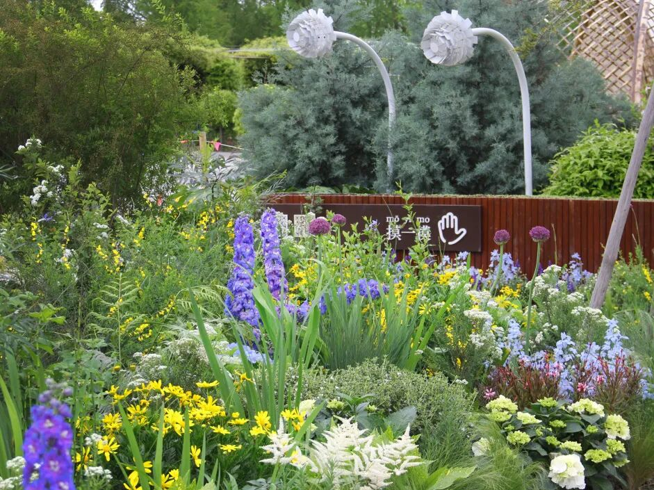
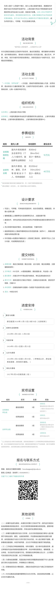

# 竞赛丨“一方花园，世界创想”：2027上海花园设计方案征集公告

** 三、参赛组别  **
** 1\. 全球高校师生组  **
面向国内外高校教师及在校学生，个人或小组均可参赛，鼓励跨专业、跨院校合作。
场地面积约  ** 80㎡  ** （8m×10m），至少一侧设置出入口；建设成本约  ** 10万元  ** 。
** 2\. 全球专业组  **
面向国内外景观、园林、建筑、艺术等领域的个人、机构或组织。
场地面积约  ** 200㎡  ** （10m×20m），至少一侧设置出入口；建设成本约  ** 40万元  ** 。
每名参赛者或每组可申报多套方案，同一方案不得跨组重复申报。团队须确定一名负责人，统一联络并确认全体作者署名  。
** 四、设计要求  **
入选方案将择优落地建造，并于  ** 2027年4月  ** 在上海国际花卉节期间实景呈现。花园应成为市民可进入、可停留、可记忆的春日风景。
  * ** 空间体验  ** ：打造可进入、可停留、可体验的花园空间。
  * ** 设计元素  ** ：结合花境营造、绿雕造型、休憩小品等元素。
  * ** 植物配置  ** ：以上海春季花卉及宿根草花为主，主题创意不限。
  * ** 实施条件  ** ：充分考虑建造技术、材料应用及实现成本。
  * ** 生态理念  ** ：体现环境友好，优先选用低碳、可循环材料。
  * ** 运营价值  ** ：鼓励塑造契合上海城市精神的标志性花园形象，具备长期保留与持续运营价值。
参赛作品可借助 AI 绘图技术辅助设计，但须在方案中说明工具名称、使用环节及人工设计内容，并对成果原创性负责  。
** 五、提交材料  **
提交概念方案，内容包括概念灵感、设计说明、概念效果图、主要植物类型等。
  * ** 展板规格  ** ：A0 竖排版 PDF 文件。
  * ** 数量要求  ** ：高校组限 1 张，专业组 1—2 张。
  * ** 匿名要求  ** ：方案文件中不得出现作者姓名、单位及其他身份标识。
  * ** 语言要求  ** ：中文或英文均可。
报名信息与方案分开提交。压缩包内包含报名表、原创性声明表和方案 PDF  。
** 六、奖项设置  **
** 全球高校师生组  **
  * ** 最佳创意奖  ** ：5项，每项奖励 5000 元落地项目设计费及证书。
  * ** 优秀创新奖  ** ：5项，每项奖励 2000 元创作补贴及证书。
** 全球专业组  **
  * ** 最佳创意奖  ** ：2项，每项奖励 30000 元落地项目设计费及证书。
  * ** 优秀创新奖  ** ：3项，每项奖励 10000 元创作补贴及证书。
以上奖金及设计费均为税前金额，获奖者应缴纳的个人所得税等相关税费由获奖者自理，主办方按国家有关规定代扣代缴。国际获奖者跨境支付产生的税费、银行手续费等由获奖者承担，实际到账金额以扣除相关税费后的金额为准。
获得落地项目设计费的团队，需另行签订合作协议，并配合完成深化设计与施工阶段的技术对接  。
** 七、进度安排  **
  * ** 报名与收稿  ** ：即日起至 2026年11月15日23时59分（北京时间）。
  * ** 初审与合规审核  ** ：2026年11月16日至11月20日。
  * ** 专家评审  ** ：2026年11月21日至11月25日。
  * ** 公示与颁奖  ** ：2026年11月25日至11月30日。
  * ** 深化与落地  ** ：拟于 2027年3月30日前完成  。
** 八、投稿方式  **
请将报名表、原创性声明表和方案 PDF 放入压缩包，发送至：
** fxzwzhangnan@sjtu.edu.cn  **
压缩包和邮件主题统一命名为：
** 组别“作品名称负责人姓名”  **
例如：全球高校师生组“春日花园张三”
联系人：张老师
联系电话：15618200355

图片  和  文  字  转自网络  ，信  息  版  权  归原  作者所有，在此仅作为学习交流。

