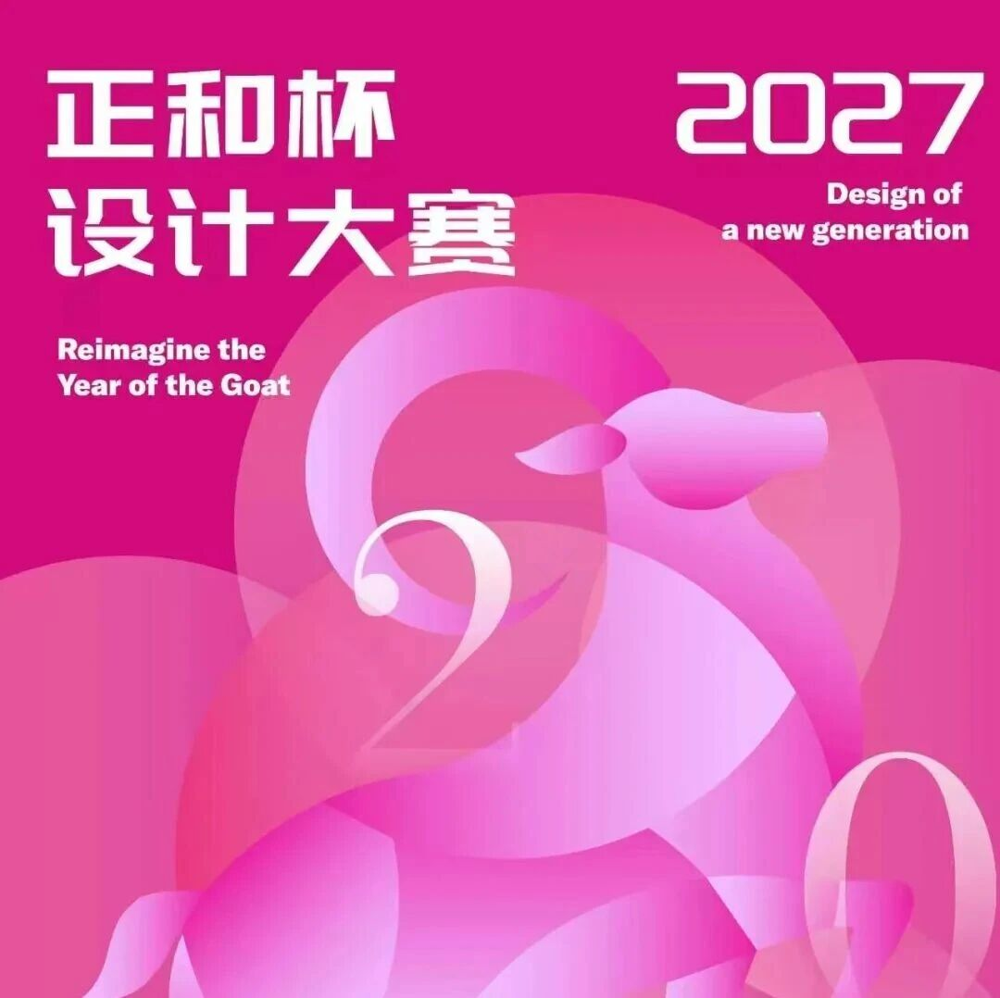
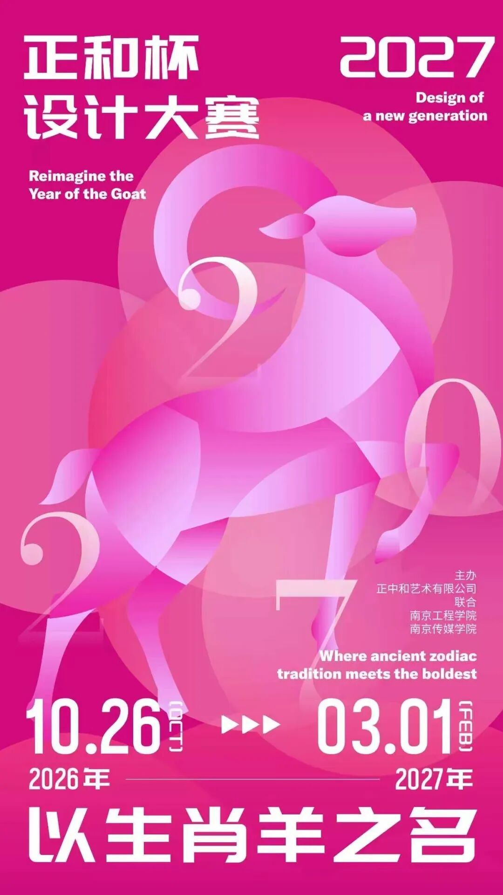

# 竞赛丨“以生肖羊之名” 第二届正和杯设计大赛 开始了

2026  年岁末，
一场面向全国大学生的命题创作正式开启：
赛事以中国生肖文化为年度母题，
2027年选取生肖羊为创作命题，
让传统文化在年轻的设计语言中焕发新生  。
第二届以羊为题，向全国大学生发出创作邀请。
今年，让我们  以生肖羊为灵感，
用你最擅长的设计语言，
讲述属于这个时代的羊故事。
** 0  ** ** 2  ** ** 主办单位  **
\- 主办单位：
南京正中和设计
\- 协办单位：
南京工程学院
南京传媒学院
** 0  ** ** 2  ** ** 时间安排  **
\- 征集时间：
即日起----2027年03月01日
\- 评审时间：
2027年04月
\- 赛事线上展览时间：
2027年05月01日
** PART 0  ** ** 1  ** ****
** 赛事宗旨  **
ZHENGZHONGHE DESIGN
第二届正和杯设计大赛以中国生肖文化为年度母题，以 "羊" 为创作命题，旨在弘扬中华优秀传统文化、激发青年一代的文化自信与设计创造力。
赛事秉持 "美、祥、善、新" 四大文化内核，鼓励参赛者从文化原型出发，运用当代设计语言与多元媒介，对生肖羊进行创造性转化，拒绝简单贴图的元素堆砌。
通过专业评审与产业链接，大赛致力于发掘兼具文化理解力与设计执行力的新锐设计人才，为全国青年设计者搭建展示才华、交流互鉴的专业平台，打通校园创意与产业落地之间的桥梁，推动生肖传统文化在当代设计语境下持续焕发新生。
** PART 0  ** ** 2  ** ****
** 征集对象  **
ZHENGZHONGHE DESIGN
全国各高校在校大学生（含专科、本科、研究生），个人或团队均可报名。图片类创作团队人数不超过6人，指导老师不超过2人；视频类创作团队人数不少于三人，不超过6人，指导老师不超过2人，
鼓励大家组团比赛。
** PART 0  ** ** 3  ** ****
** 作品规格  **
ZHENGZHONGHE DESIGN
1\. 作品文件：
（图片类）单幅画面限定A3幅面、300dpi、JPG/GIF、RGB/CMYK；上传不超过10张，单个文件不超过10MB
（视频类）高清及以上分辨率，编码格式：H.264、mp4格式，时间长度控制在5分钟以内，不超过500M（系列剧单集或合并的多集总长度不超过5分钟，文件大小不超过500M）
2\. 展示海报：1-5张，将作品文件编排于A3幅面、竖式、300dpi、JPG、RGB/CMYK，文件不超过10MB。
3.版面上须填写作品名称、赛道名称、作品编号。
** PART 0  ** ** 4  ** ****
** 奖项设置  **
ZHENGZHONGHE DESIGN
1.一等奖1名，奖金3000元，组委会颁发获奖证书。
2.二等奖3名，每名奖金1000元，组委会颁发获奖证书。
3.三等奖5名，每名奖金500元，组委会颁发获奖证书。
4.优秀奖若干名，组委颁发获奖证书。
说明：获奖证书的设计、制作与邮寄产生工本费  19元  /人，由参  赛者承担，请通过官方公布的唯一渠道缴纳，谨防假冒收费。
** PART 05  **
** 投稿赛道  **
本届赛事共设七大创作方向，参赛者可任选其一投稿，用你最擅长的形式回应羊主题。
赛道一：AIGC漫剧创作
以生肖羊为主角，运用  AI  工具创作完整漫画或动画剧集，讲一个有起承转合的完整故事。
赛道二：纹样设计
提取羊的  文化  符号与造型基因，设计一套可实际应用的纹样系统，建议附应用效果示意。
赛道三：系列海报设计
围绕生肖羊主题创作系列海报，建议不少于三张，体现统一的系列感与视觉语言。
赛道四：IP形象设计
塑造具有高辨识度与延展性的羊  IP  形象，包含三视图与表情、场景等延展应用。
赛道五：包装创意设计
将羊主题融入包装设计，可聚焦食品、文创、美妆、礼盒等具体品类。
赛道六：产品设计
以羊为灵感的产品创意设计，涵盖文创、家居、数码周边等方向。
赛道七：空间展示设计
以羊主题为核心的展示空间或装置设计方案，如展陈空间、公共艺术装置、快闪店概念。
赛道八：UI界面设置
以羊主题为核心的app界面设计方案，如交互设计，界面设计，组件设计等
** 投稿方式  **
投稿邮箱：  2983073240@qq.com
邮件标题建议：正和杯＋赛道名称＋作品名称＋作者姓名。
邮件正文请注明作者信息（姓名、学校、联系方式、指导老师如有）与作品简介，并按各赛道要求上传作品附件。
组委会联系地址：江苏省南京市江宁区江宁MAX科技园

** 特别声明  **
1\. 所有投稿作品及论文的署名权归投稿者所有。
2\. 主办单位对所有来稿并获得等级奖的作品拥有但不限于进行复制用以宣传、信息网络传播、出版、发行、展览、改编,用于商业盈利等权利。
3\.
所有参赛作品必须遵守我国相关的法律、法规以及道德规范，内容应积极健康向上，符合民族文化传统。作品内容涉及有国家当代疆域版图的，以中国国家相关出版社或相关国家地图网站（如：中华人民共和国自然资源部网站）相关地图为准，并在文档中说明本作品地图来源。
4\. 凡向主办单位投稿者，均被视为认可本公告所有条款，主办方保留对各项条款的修订及最终解释权。
5\. 所有参赛作品必须为原创作品，不能侵犯他人知识产权。
6\. 参赛作品应为参赛者近两年内原创作品，且截止投稿前未获得过其他赛事省级以上等级奖。
图片  和  文  字  转自网络  ，信  息  版  权  归原  作者所有，在此仅作为学习交流。

