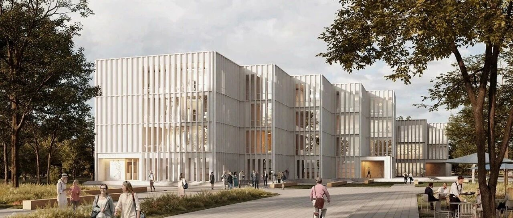
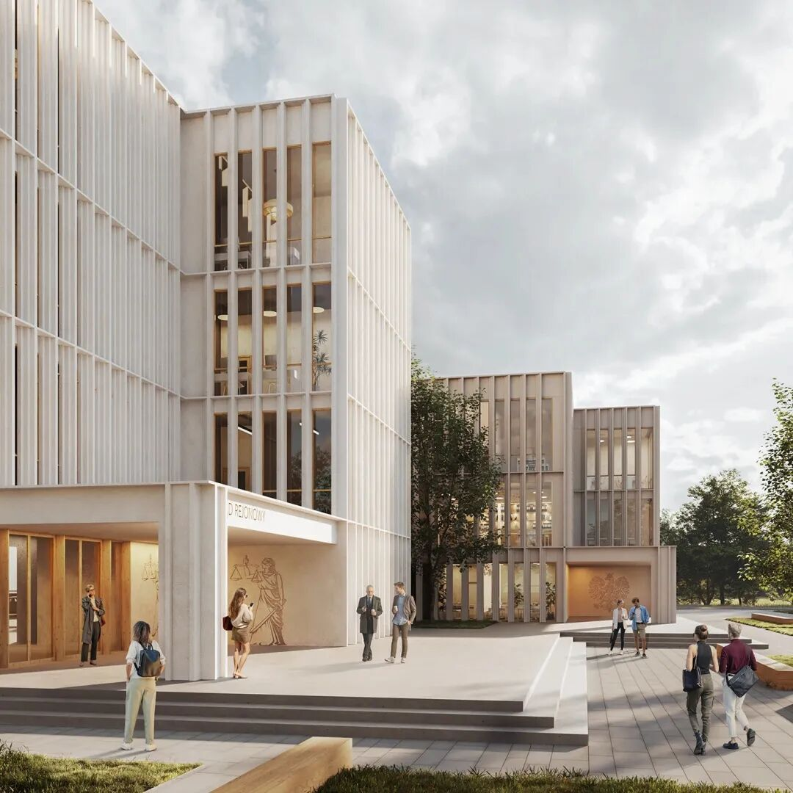
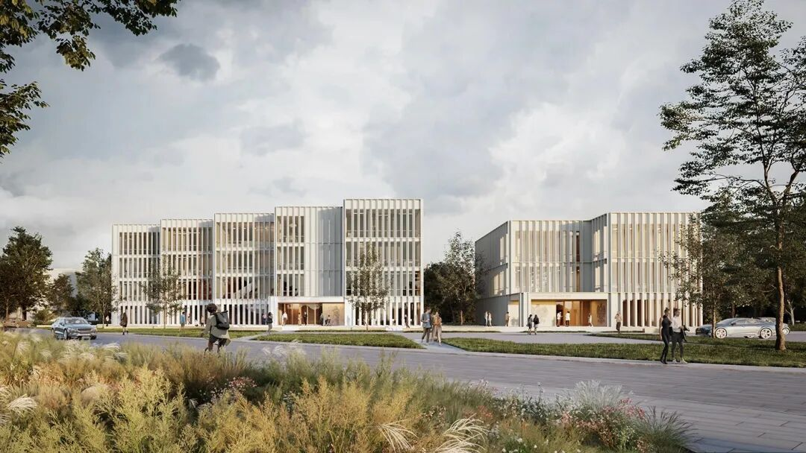
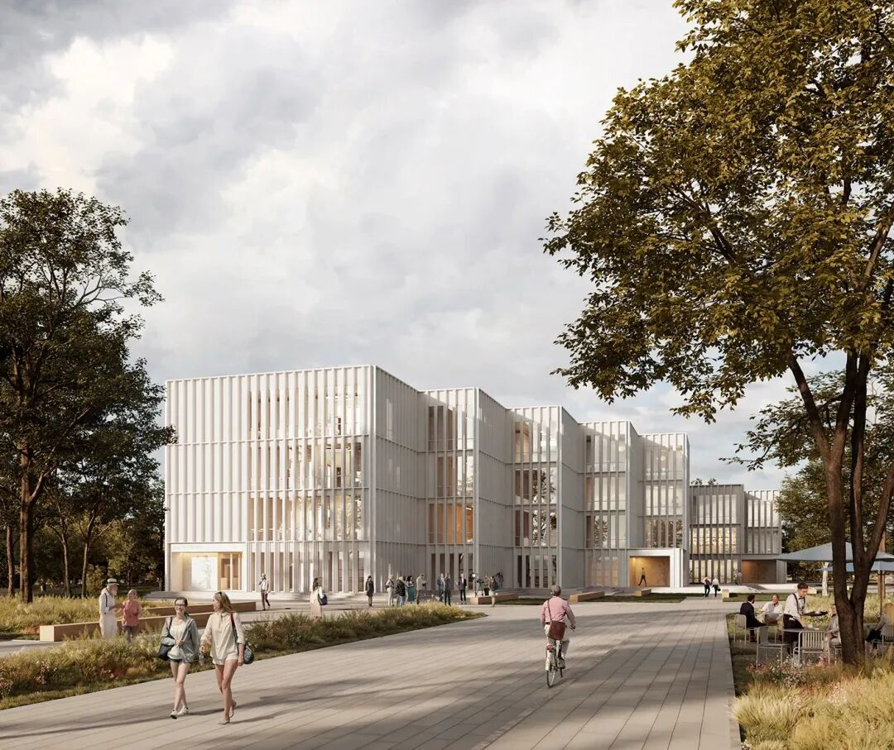
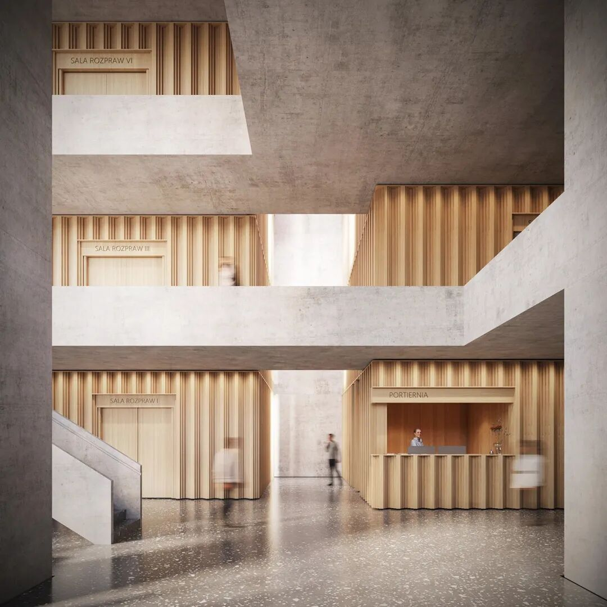
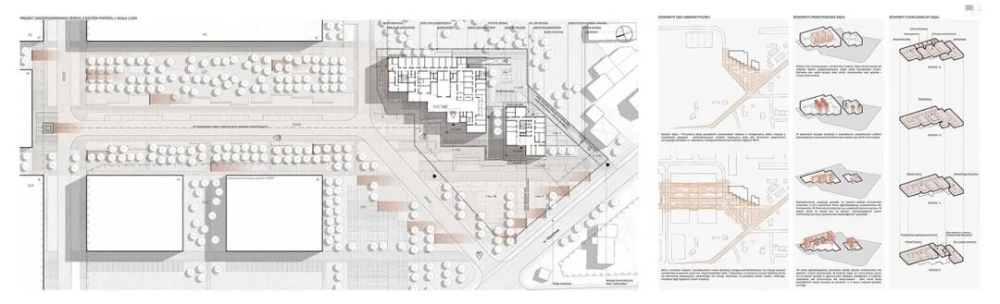
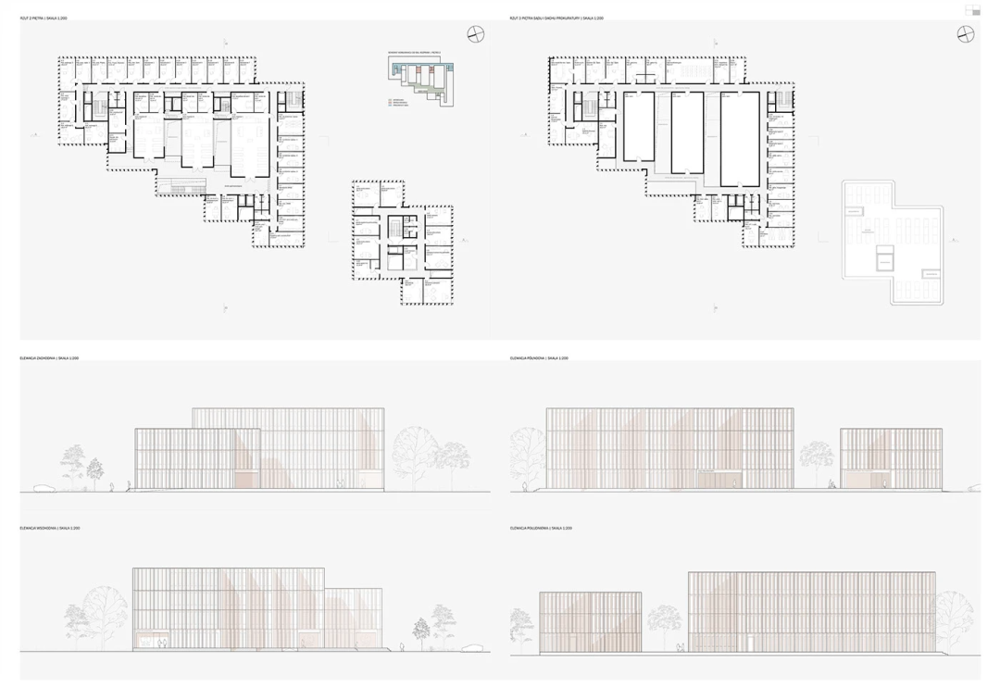
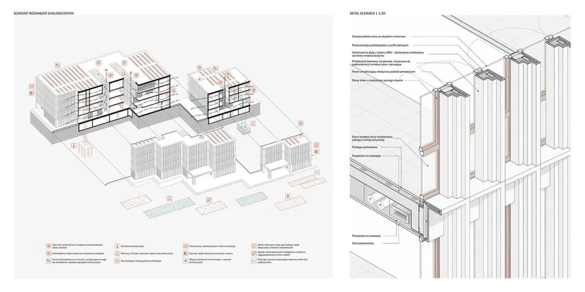

# 竞赛方案丨波兰孔斯凯地方法院和地区检察官办公室建筑设计竞赛荣誉提名奖

** 波兰孔斯凯地方法院和地区检察官办公室建筑设计竞赛荣誉提名奖  **
Honorable mention in the Architectural competition for the design of the
construction of the District Court and District Prosecutor's Office in
Konskie, Poland

该荣誉提名奖授予此方案，是因为其提议将城市公共空间——即规划中的法院和检察官办公室建筑的前景，与地方规划中定义的一般无障碍景观绿地区域及公共通道区域相整合。方案通过对其宽阔道路带的布置，以及通过提议开发地方规划中建议的、封闭城市内部空间的行政服务区域来实现这一目标。
Justification for selection of the work:
The honorable mention was awarded for the proposal to integrate the urban
public space - the foreground of the projected court and prosecutor's office
buildings with the adjacent areas defined in the local plan as an area of
landscaped greenery of a generally accessible character, the area of a public
access road, through the arrangement of its wide road strip and through the
proposal for the development of administrative services areas closing the
urban interior suggested in the local plan.

设计的法院和检察官办公室建筑以富有节奏的错落形态构成，为这一内部空间营造了背景引入效果，同时从 Wjazdowa
大街提供了对建筑的完整视野。值得关注的是，方案通过运用具有特色的立面节奏，以及选择强调司法建筑级别与庄严感的建筑手法，呈现了有趣的构图解决方案。
Shaped with rhythmic faults, the designed buildings of the court and
prosecutor's office create a backstage introduction to this interior, while at
the same time providing full exposure of the object from Wjazdowa Street.
Noteworthy is the suggestion of interesting compositional solutions through
the use of a characteristic rhythm of the elevation and the selection of
architectural means emphasizing the rank and seriousness of the edifices of
justice.

图片  和  文  字  转自网络  ，信  息  版  权  归原  作者所有，在此仅作为学习交流

