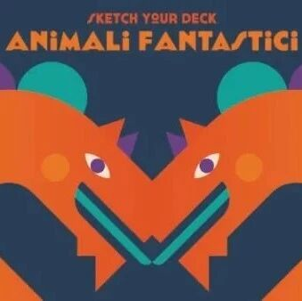
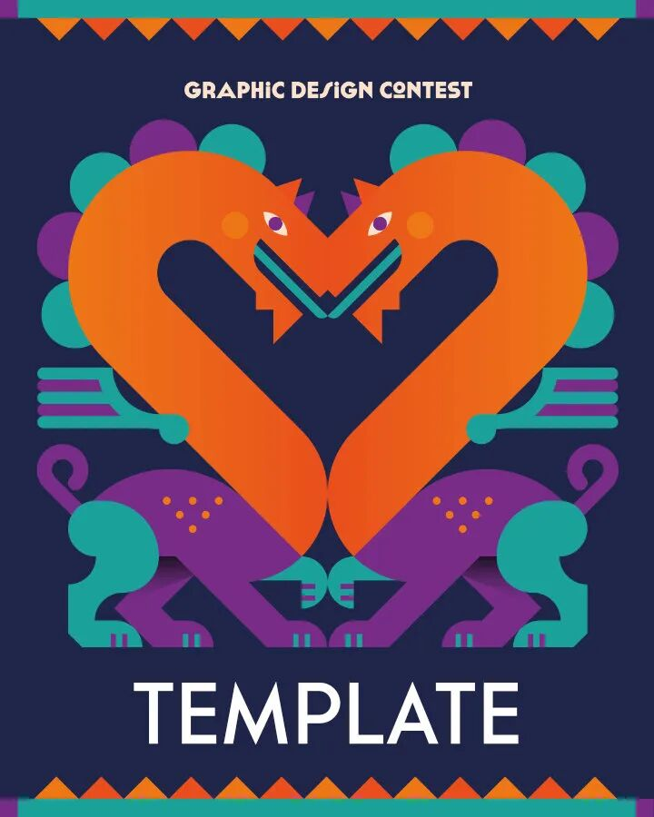
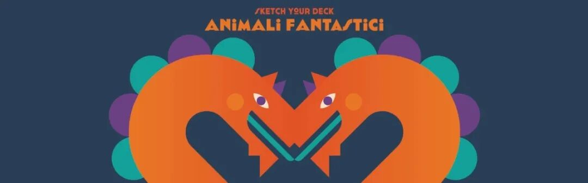

# 竞赛丨“奇幻动物”滑板原创图形设计大赛

意大利滑板和潮牌艺术家  Bonobolabo欣然推出“奇幻动物”大赛，这是一项旨在创作原创图形的设计活动，其作品将被制成限量版滑板。
该竞赛由意大利工业设计协会（ADI）设计博物馆联合举办，两位重量级人物参与其中：自由职业插画师及艺术总监弗朗切斯科·波罗利（Francesco
Poroli），他将担任评委并设计项目灵感来源的视觉形象；以及意大利工业设计协会副主席安东尼内拉·安德里亚尼（Antonella Andriani）。
该项目面向来自世界各地的平面设计师、摄影师、插画师及艺术家，诚邀各位以创意诠释“奇幻动物”主题，让神话或虚构的生物跃然纸上，幻化成栖居于梦境中的动物形态。
获胜的插画将获得1000欧元。
这些制作完成的滑板将通过增强现实技术赋予生命，用户可通过ARIA——增强现实平台应用激活该功能。
入选作品的展览与颁奖活动将在一个享有盛誉的场所举行：米兰的意大利工业设计协会（ADI）金圆规奖博物馆。
参赛资格
竞赛面向所有不同背景的平面设计师、摄影师、插画师和艺术家开放
参赛费用
免费

参赛规则
第1条 竞赛主题
这个项目面向来自各个背景的平面设计师*、设计师、摄影师*、插画师*和艺术家*，邀请他们用自己的创造力来解释神奇动物的主题，神话或从未存在的人物通过塑造生活在我们梦想中的动物而活跃起来。
第2条 材料的使用
所选材料将由Bonobolabo用于滑板板的生产以及与比赛相关的沟通和促销活动。
插图或图形的知识产权将留给艺术家。
在提交项目后，参与者明确授权Bonobolabo在www.bonobolabo.com网站及其社交渠道上发布该作品。
第3条 参赛条款和方式
注册是通过购买相应的模板，贡献€10，其中包括：
参与所需的模板，项目上传平台的管理，对参赛者的技术支持，支付秘书费用，并确保整个比赛期间组织和支持的高质量。
每个参与者或组可以为每个购买的模板提交一个图形。
提交项目的截止日期是2026年11月30日。
第4条 图形处理技术特点
图形必须插入一个单独的层并放置在 PDF 文件内，并遵循以下参考：
蓝边框： 表边界
红边框： 图形剪切区域
图像必须是矩形的，如示例中所示。
您可以使用任何技术和颜色组合。
PDF文件必须：
以 CMYK 色彩模式制作
最大大小为 10 MB
被命名为“姓氏.pdf”
是垂直格式的。
第5条 交稿方式
艺术家必须填写下面的报名表格。
如果您愿意，您可以在自己的社交渠道上发布图形，在IG的故事和帖子中标记TikTok @bonobolabo。
第6条 评审
陪审团由：
Francesco Poroli，自由插画家和艺术总监
Antonella Andriani，ADI（工业设计协会）副总裁
Marco Miccoli，Bonobolabo的设计师和策展人
Tai Yuh Kuo，Alkanoids和Aria – The AR平台的创始合伙人
评审团将评估作者的项目，并挑选9名入围者。
第七条 选择标准
评判参数将是：原创性，图形的创造力，与主题的一致性和项目适应滑板制作的能力。
第8条 AI的使用
人工智能不能用来完成工作。
（修改日期：2026年10月15日）
第9条 奖项
Bonobolabo将获得获奖图形，并向艺术家颁发1000欧元的固定奖金。
该表还将作为增强现实动画的基础，可通过ARIA - AR平台应用程序激活。
第10条 展览与奖励
9幅入围的图形将印在滑板上，并在颁奖典礼上向各自的作者致敬。
主要数据：
2026年11月30日 – 比赛结束
2026年12月6日 -9名决赛选手公布
2026年12月20日 – 米兰ADI设计博物馆Compasso d’Oro展览和获奖者宣布
大赛官网
https://www.bonobolabo.com/sketch-your-deck/
图片  和  文  字  转自网络  ，信  息  版  权  归原  作者所有，在此仅作为学习交流。

