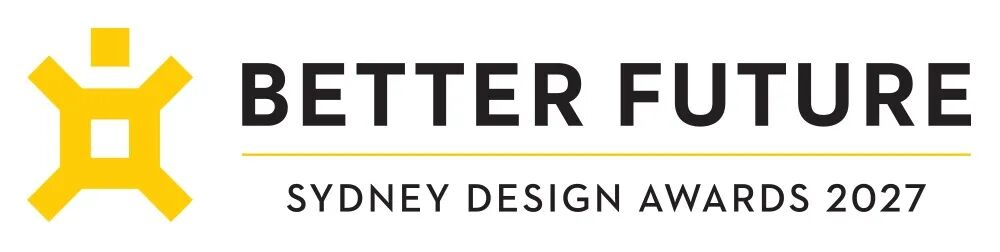
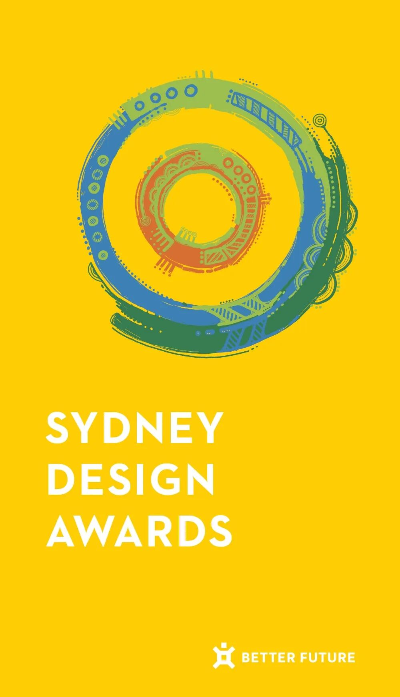

# 竞赛丨2027悉尼设计大奖全球启动

悉尼设计大奖（SYDNEY Design Awards）作为BETTER
FUTURE旗下的城市设计奖项计划之一，诞生于科技与创新不断拓展边界的时代。将无限可能落地成真，离不开卓越的设计力量。奖项设置丰富多元的参评赛道，为优秀设计获得市场认可提供平台，表彰引领行业前行的创作者，致敬他们的创意与魄力。

** 主办单位  **
BETTER FUTURE
** 参评对象  **
本次大赛面向所有设计从业者与机构开放，近两年内创作或完工的项目均可申报。
**** 主要类别  ** **
本次大赛根据参赛者所属领域不同，分为  ** 建  筑设计、室内设计、空间+、产品设计、传达设计、广告与营销设计、服务与系统设计、时尚设计
、网页与应用程序设计  ** ** 以及  ** ** 未来趋势  ** ** 十大类别共计超过  ** ** 99  ** 个子类别。
**** 参评方式  ** ** 登  陆  https://betterfutureawards.com/syd27  ，注册
并设置账户，创建提名后，英文在线填写申报信息并按照要求上传相关图文资料。
**** 费用说明  ** **
** 早鸟价：  **
539.3澳元＋1  0%增值税/项目
** 常规价：  **
606.6澳元＋1  0%增值税/项目
** 终期价：  **
674  澳元＋10%增值税/项目
**** 资料要求  ** **
参赛者需提供以下信息：
** 1\. 项目信息  **
  * 必填项：
① 项目名称
② 项目开始时间（年月日）
③ 项目完成时间（年月日）
④ 设计公司信息（名称、规模、委托人信息、联系方式等）
⑤ 项目所在地
  * 选填项：
⑥ 设计团队  （500单词以内）  ⑦ 图像版权署名（50单词以内）  ⑧ 项目的网址以及INS和领英  想要提及的账户
⑨ 补充说明（不对外公开，200单词以内）
** 2\. 设计说明  **
用英文总结所提交的作品，要求以书面语形式撰写，言简意赅、逻辑清晰，字数均为250单词以内：
① 项目概况
② 项目简介
③ 项目需求
④ 用户体验
⑤ 项目营销
⑥ 项目隐私
** 3\. 作品图像  **
  * 必填项：
① 最多可上传10张项目高分辨率照片
② 单张图片大小不超过3MB
③ 尺寸2500×2500像素以内，最短边不低于1000像素
④  不要使用CMYK文件模式，以及上传PDF、docx或bmp文件
⑤ 图片名称（无空格以及特殊符号，20-30字符以内）
  * 选填项：
⑥ 1-2个视频链接（视频需上传至YouTube或Vimeo）
** 奖项设置  **
每个类别将评选出  ** 金奖、银奖、入围  ** 和  ** 入选作品  ** ，此外奖项还分设  ** 最佳工作室  ** 及  ** 设计冠军奖
** 。
图片  和  文  字  转自网络  ，信  息  版  权  归原  作者所有，在此仅作为学习交流。

