# 扎哈把“一丹中心”中间掏空，硬生生立出一条峡谷

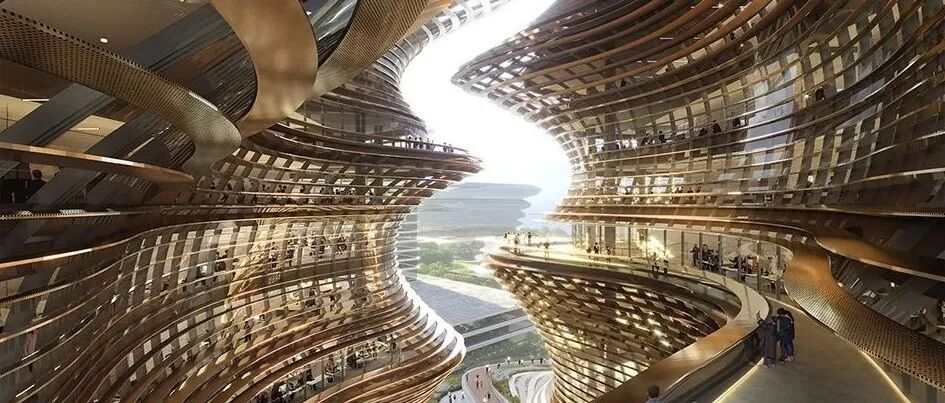

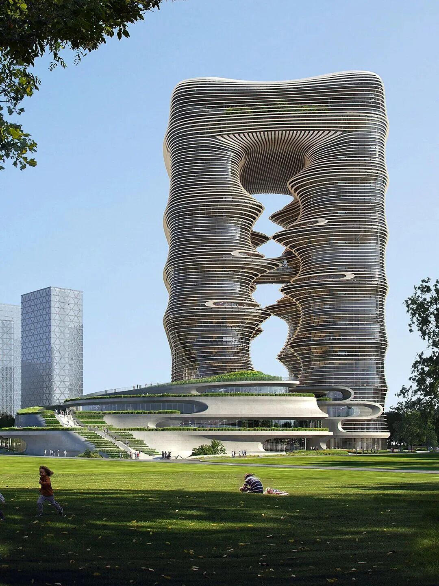
一座弧线塔楼相对而立，在顶部相连，形成一座巨大的“当代山门”。中央留出的峡谷中庭贯穿垂直空间，两侧楼板层层退台，阳台全部朝向空腔展开。人走进去后，视线始终与天空相连，室内与室外的边界被自然消解
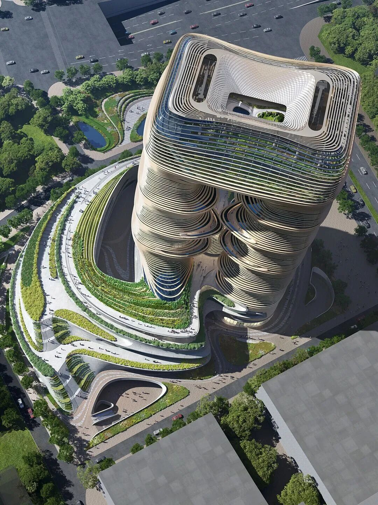

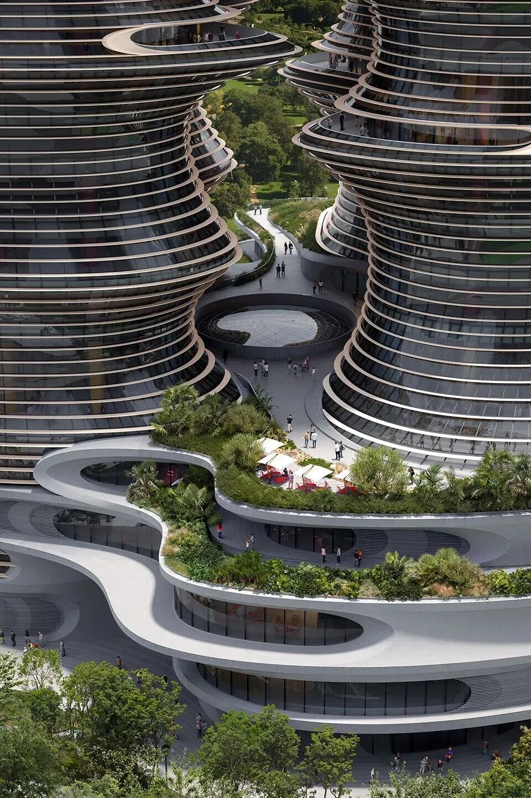

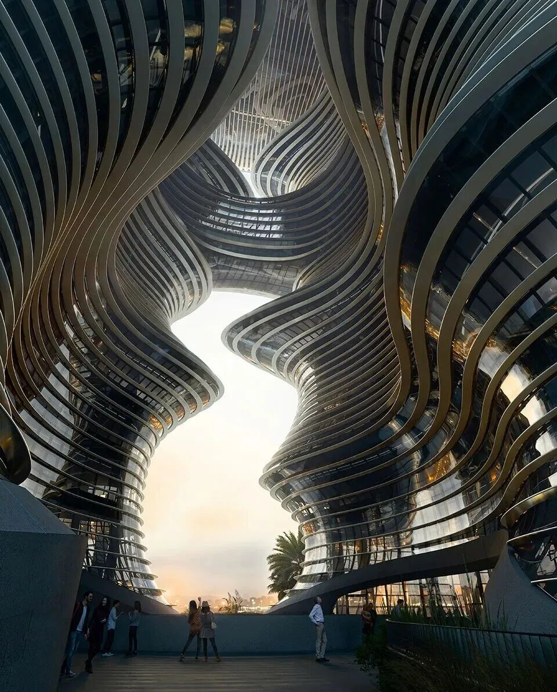
把自然地貌搬进高空
真实地理中的峡谷从来不是墙，而是风、光与人穿行的通道。设计团队将这种山地意象引入建筑，让风穿过空腔，让自然光从顶部落向底部，也让人的活动沿着螺旋坡道向上延伸。
峡谷底部设有圆形天窗，阳光由此进入室内公共空间；空中连桥再次连接双塔，形成上下错落的立体路径。办公、会议、展览和学习交流围绕中庭展开，每一层都有不同的停留体验。
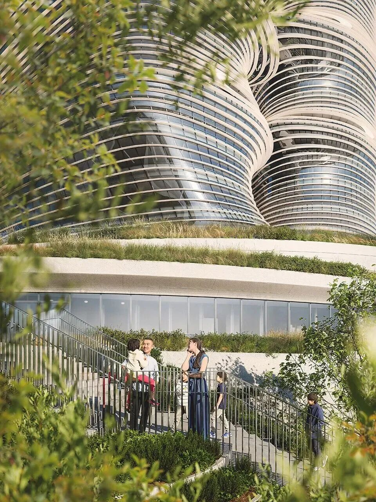

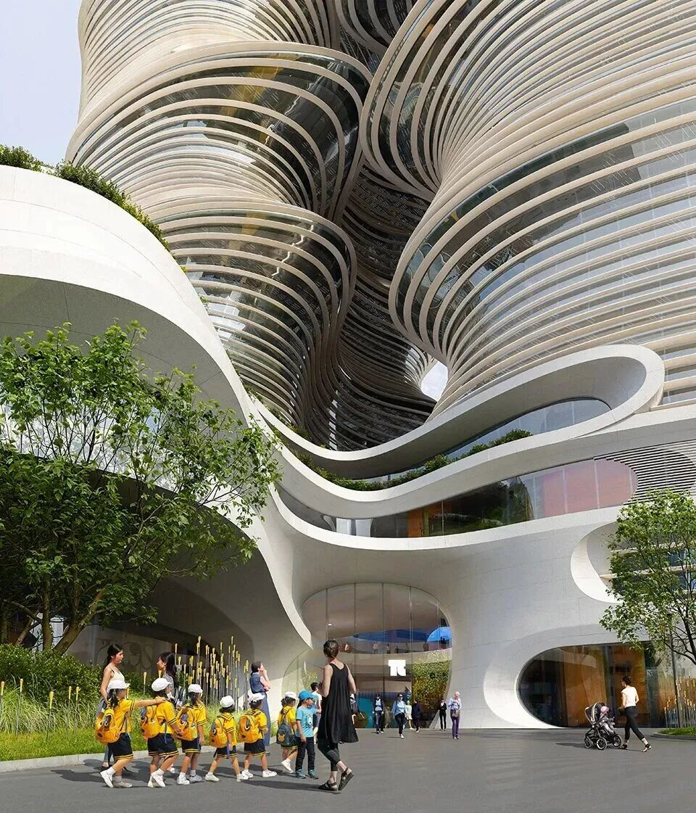
让学习成为一场向上的行走
一丹中心以终身学习为主题，空间组织呼应了中国传统书院“门内有庭、庭后有径”的递进逻辑。入口广场是“门”，城市客厅是“庭”，螺旋坡道和退台花园则是通往知识殿堂的“径”。
在这里，学习不只是进入教室听讲，也是在坡道上相遇、在露台上交谈、在光影中思考。建筑用开放路径表达教育的本质：知识需要交流，思想需要在碰撞中生长。
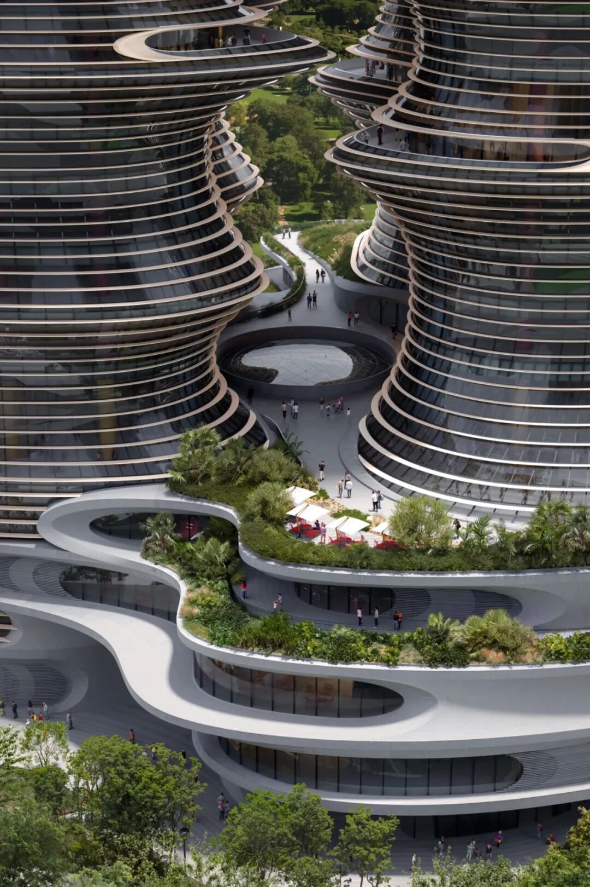
参数化设计塑造流动外观
两座塔楼的楼板呈弧形层叠，每一层略微旋转偏移，形成连绵起伏的轮廓。外立面采用渐变肌理板材与清透玻璃，晨昏光线变化时，建筑会呈现出不同的明暗层次。
塔楼平面的切角折线呼应“一”字横划，空中连桥内侧的微鼓倒角呼应“丹”字的一点。传统文化符号被转化为可感知的空间细节，也让“一丹”真正融入建筑形体 。
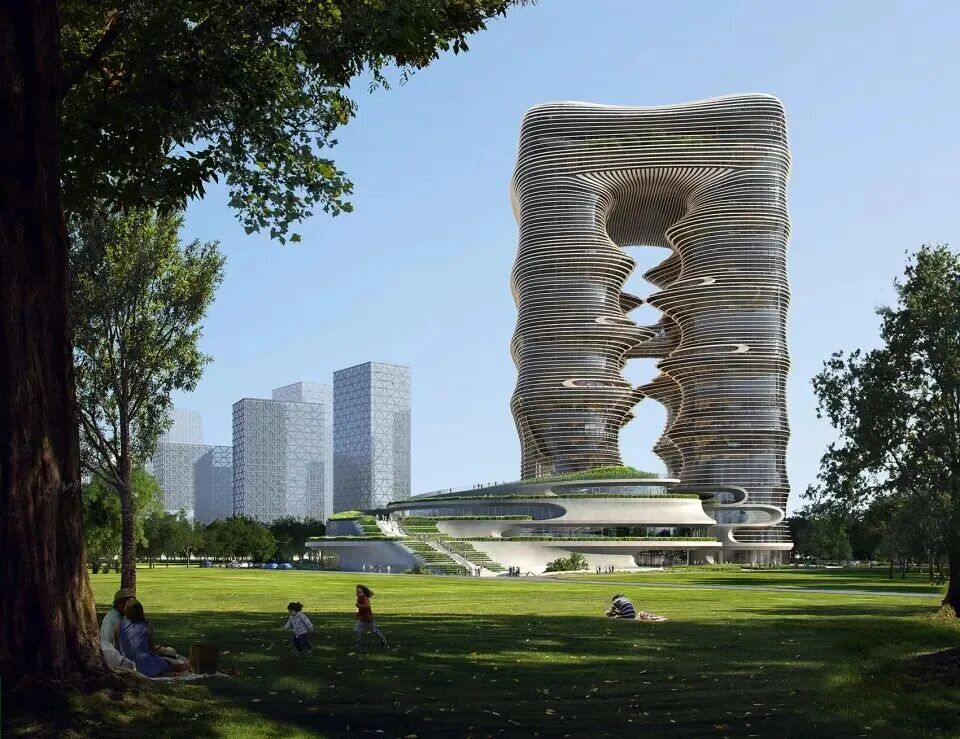
工程难度藏在流畅造型背后
项目总建筑面积约16.65万平方米，建筑高度139.18米，包含24层塔楼、5层裙房和3层地下室。双塔在中段被掏空后，重力和侧向力都需要绕开空腔传递，结构体系远比普通塔楼复杂。
2025年9月，位于117米高空、跨度38米的钢结构连体桁架完成合拢，单件总重量约1200吨。这些数字背后，是复杂曲面施工、高空焊接和结构协同带来的巨大挑战
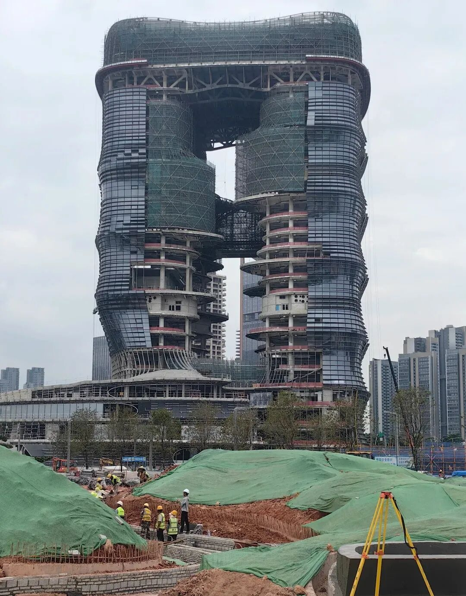

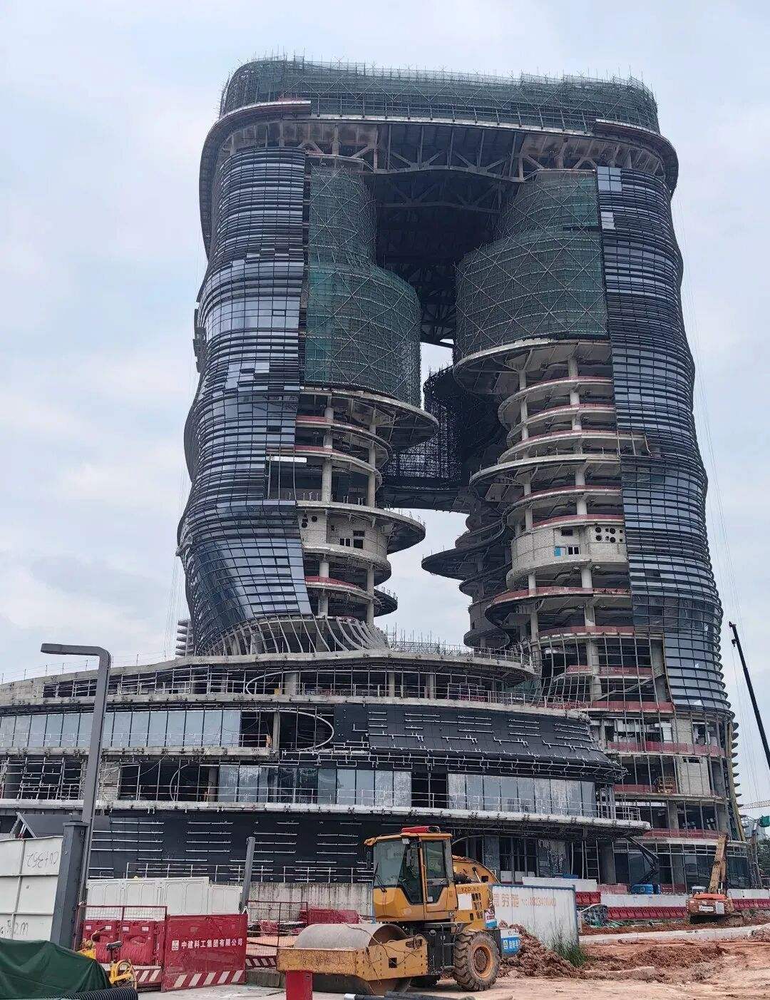

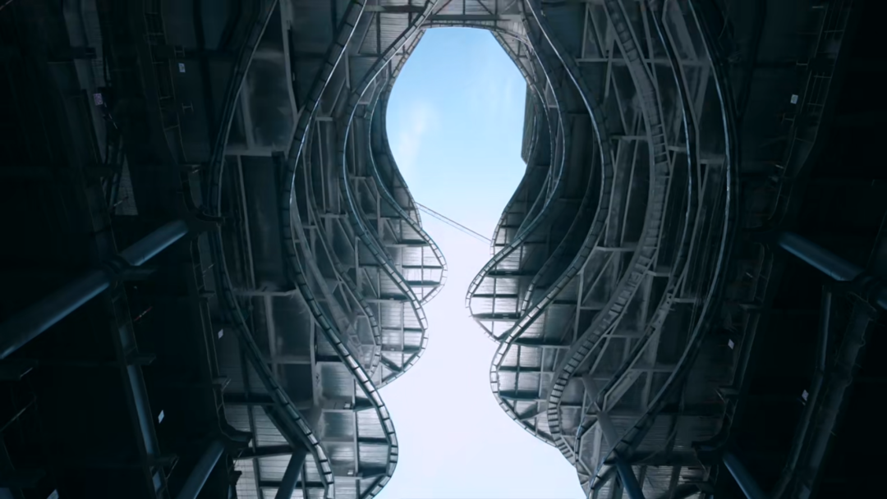

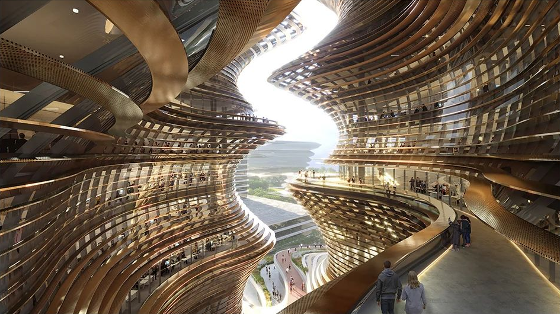
一座有呼吸的城市地标
一丹中心的价值，在于它让超高层建筑重新向城市敞开。人们可以穿过峡谷、走上坡道、停留在露台，建筑因此有了温度和尺度。
当夜幕降临，内部灯光沿峡谷逐层亮起，整栋楼就像一座悬浮于前海上空的发光地景。它既属于经过的人，也属于仰望它的人；既是办公综合体，也是一座不断生长的公共课堂。
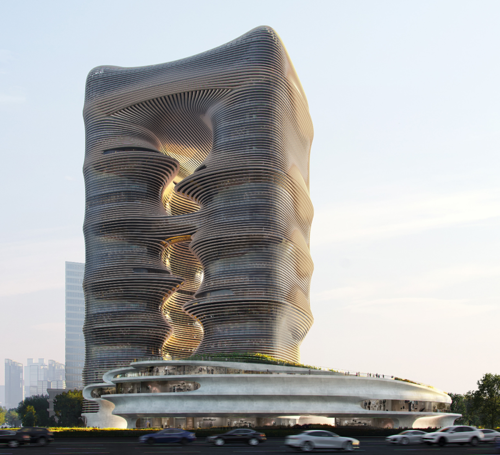

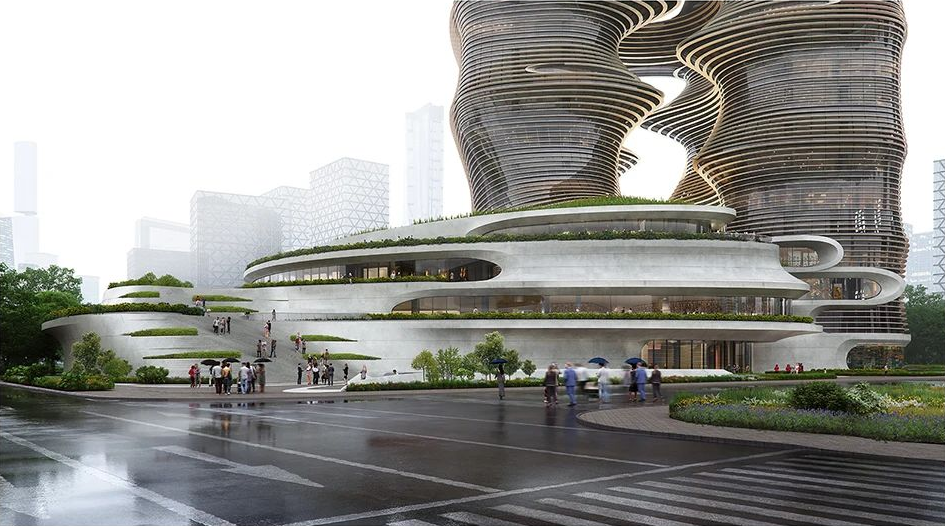
**
图片  和  文  字  转自网络  ，信  息  版  权  归原  作者所有，在此仅作为学习交流。

**
