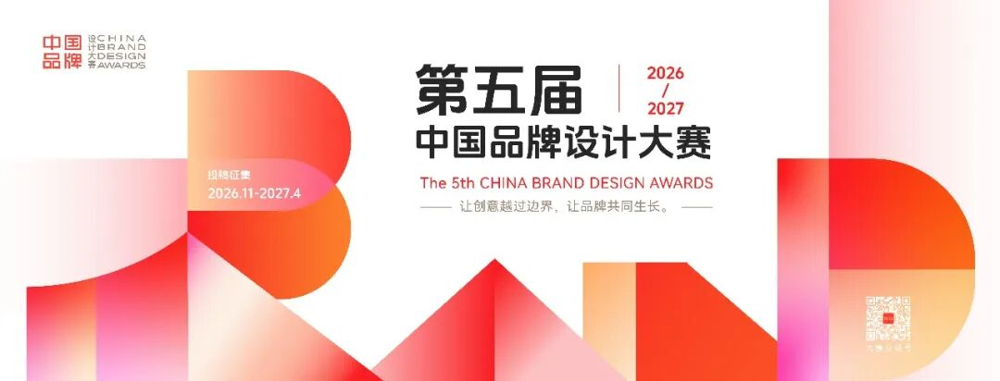
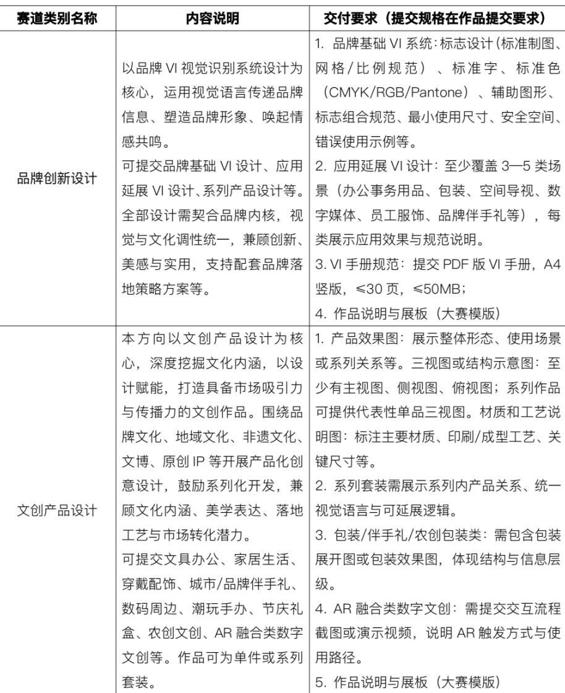
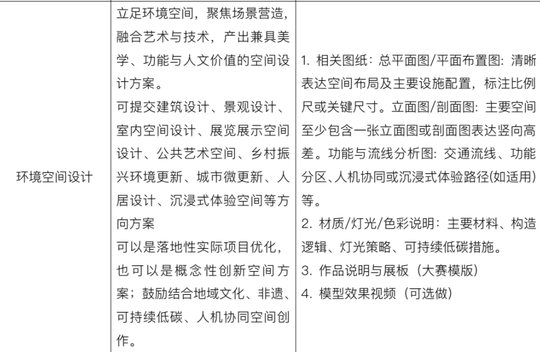
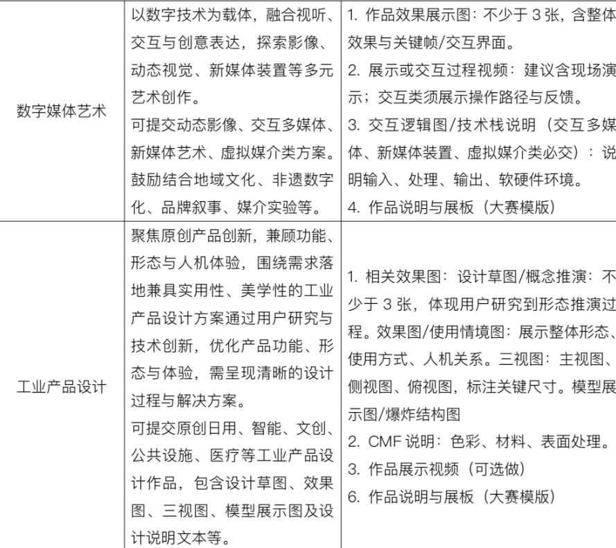
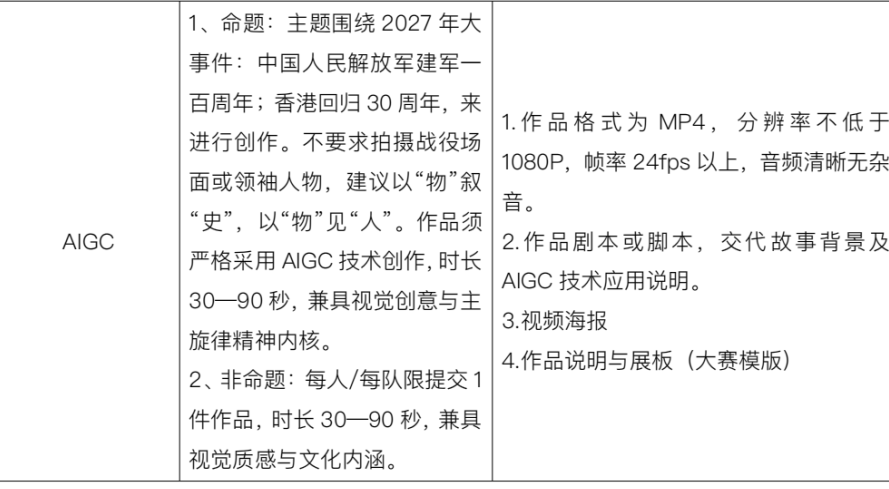

# 竞赛丨2026第五届中国品牌设计大赛 品牌与创新赛道启动

** CHINA BRAND  **
** 第五届中国品牌设计大赛  **
** 品牌与创新赛道  ** ** 启动  **
本赛道作为中国品牌设计大赛的核心板块，聚焦品牌传播、文化创意与视觉表达。赛道涵盖多种设计类别，鼓励参赛者围绕品牌形象建设、地域文化挖掘、非遗元素传承等主题进行创作，突出品牌设计的原创性与文化创意的创造力，展现青年设计力量。
_** 参赛对象  **
个人或团队均可参赛。
** 学生组  ** ：全国高等院校在校学生，包括本科生、研究生及相关专业学生。
** 专业组  ** ：高校教师、青年设计师、企业设计人员、设计机构从业者及其他专业创作者。
**_ 参赛投稿  _ **
大赛采取采取网站报名。登录中国品牌设计大赛官网的大赛主页面，点击【品牌与创新赛道】选择所在区域、参赛类别并按要求填写、上传报名内容和作品。
**_ 赛道类别与内容  _ **
【品牌与创新赛道】设有  ** 品牌创新设计、文创产品设计、环境空间设计、数字媒体艺术、工业产品设计、AIGC  ** ** 六大选题方向  ** 。

**_ 作品提交要求  _ **
** 1.按照各类别要求提交  **
不符合主题类别的作品，取消参赛资格；同一个作品，同一件作品只能选择一个赛道一个类别提交，不可一稿多投，发现取消参赛资格；不按作品类别要求格式提交、作品无法打开或播放、画面分辨率低不清晰，取消参赛资格，责任由参赛者自行承担。
** 2.本赛道AI使用规范  **
除AIGC类别外，其余类别仅允许将AI技术作为辅助工具使用，不接受全流程使用AIGC完成的作品。全流程AI作品（除AIGC类别外）视为无效作品，取消参赛资格。
使用AI工具的作品须明确标注工具名称、人（脑）机参与比例，并在提交方案中说明AI的具体应用步骤、实际作用，同时提交相关证明材料作为附件，未如实申报的作品，按全流程AI作品处理。
** 3.文件规格参考  **
** ·图片  ** ：JPG/PNG格式，分辨率300dpi，RGB/CMYK，单张图片大小不超过5MB，图片数量不超过6张
** ·视频  ** ：展示或交互过程视频（建议含现场演示），MP4格式，分辨率不低于1920×1080，帧率不低于
24fps，时长不超过5分钟，文件大小不超过500MB。
** ·作品说明  ** ：包括作品介绍、制作流程、技术说明、AI标注等，不超过500字。不得出现个人信息和学校信息。
** ·宣传海报  ** ：按照比赛模版制作，竖版A3幅面(297mm×420mm)，300dpi，JPG/PNG格式，不超过5M。
** 作品展板（参赛模板）下载请至官网。  **
**_ 网上投稿时间  _ **
2026年11月10日至2027年4月30日
**_ 联络方式  _ **
中国品牌设计大赛组委会
官网：www.brandesign.org.cn
图片  和  文  字  转自网络  ，信  息  版  权  归原  作者所有，在此仅作为学习交流。

