# 竞赛丨星火杯 · 2026中国航展AIGC影视创意大赛

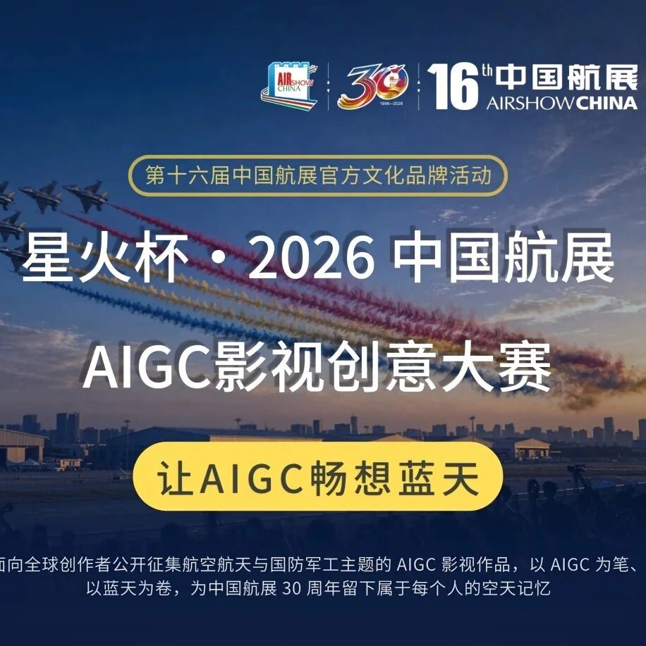

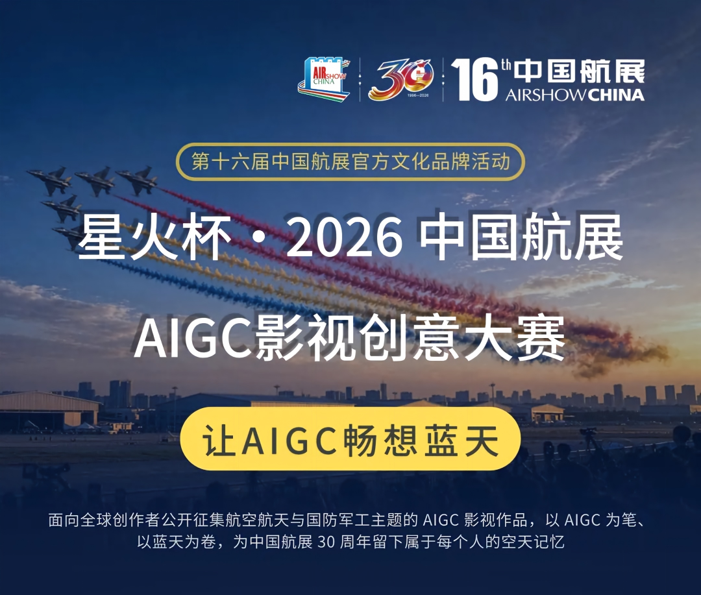
由珠海航展集团有限公司授权并指导、珠海横琴格数科技有限公司主办、北京星火智缘科技有限公司承办、中国图像图形学会等单位支持的“星火杯·2026中国航展AIGC影视创意大赛”正式启动。作为第十六届中国航展官方文化品牌活动，本次大赛以“让AIGC畅想蓝天”为主题，面向全球创作者公开征集航空航天与国防军工主题的AIGC影视作品，以AIGC为笔、以蓝天为卷，为中国航展30周年留下属于每个人的空天记忆。
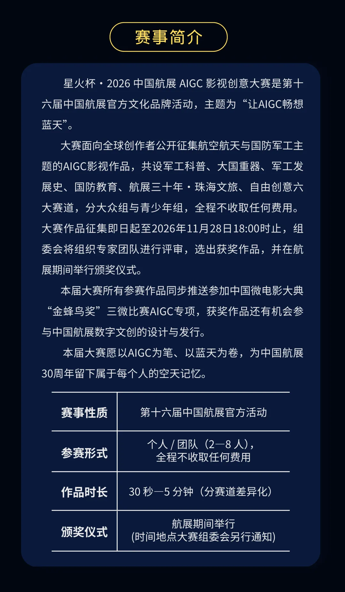

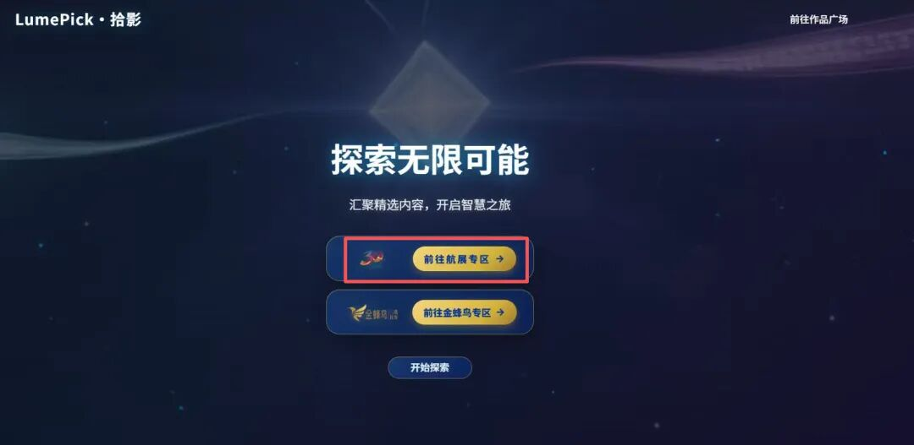

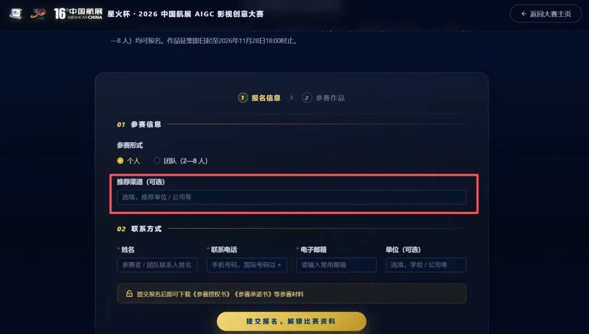
大赛共设六大赛道，即军事装备科普可视化、军工力量与大国重器、军工发展史·薪火相传、国防教育·全民国防、航展三十年·珠海文旅、自由创意·未来畅想，坚持广泛征集、分类提示、不作题材方面的特别限制。作品时长30秒至5分钟，按赛道差异化设置；赛事分大众组（18岁以上专业创作者与爱好者）和青少年组（18岁以下中小学生）两个组别，同赛道分组评审，个人或2—8人团队均可参赛，全程不收取任何费用。
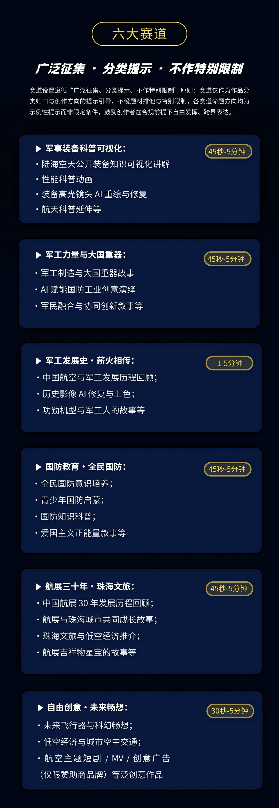
奖项方面，大赛共设50个奖项名额。其中，大众组30名，设最佳短片一等奖1名（奖金5000元及单日专业观众票2张）、二等奖2名（各奖3000元及专业观众票1张）、三等奖3名（各奖1000元及专业观众票1张）、最佳创意奖1名（奖2000元及专业观众票1张）、优秀作品奖3名（各获专业观众票1张）、入围奖20名（各获价值500元航展文创礼品一份）；青少年组20名，奖项结构对应设置，获奖者将获得相应奖金和航展文创礼品。组委会可视情况对奖项内容进行调整。
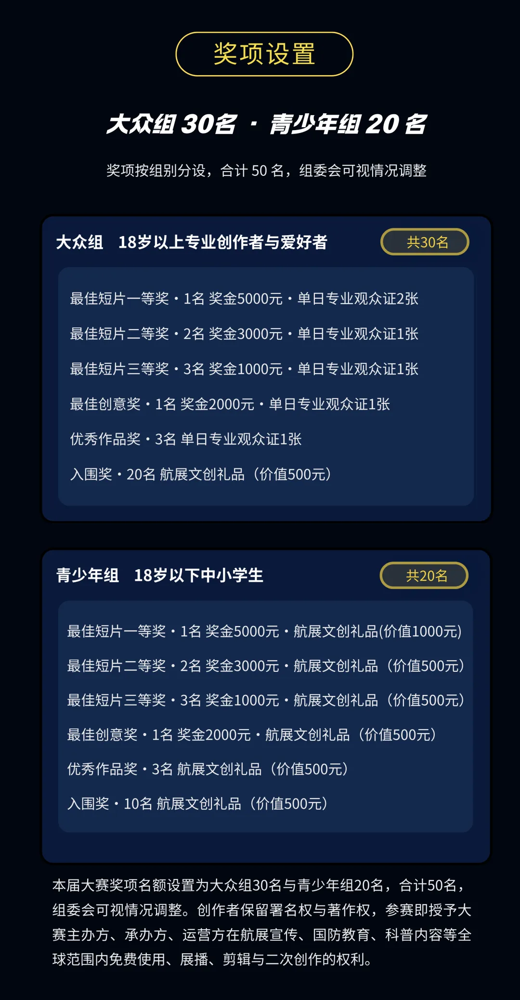
参赛报名唯一通道为大赛官网“拾影网”大赛专区（www.lumepick.top）。参赛作品须提交完整提示词、AI生成过程主要工程截图与工具清单，确保原创。
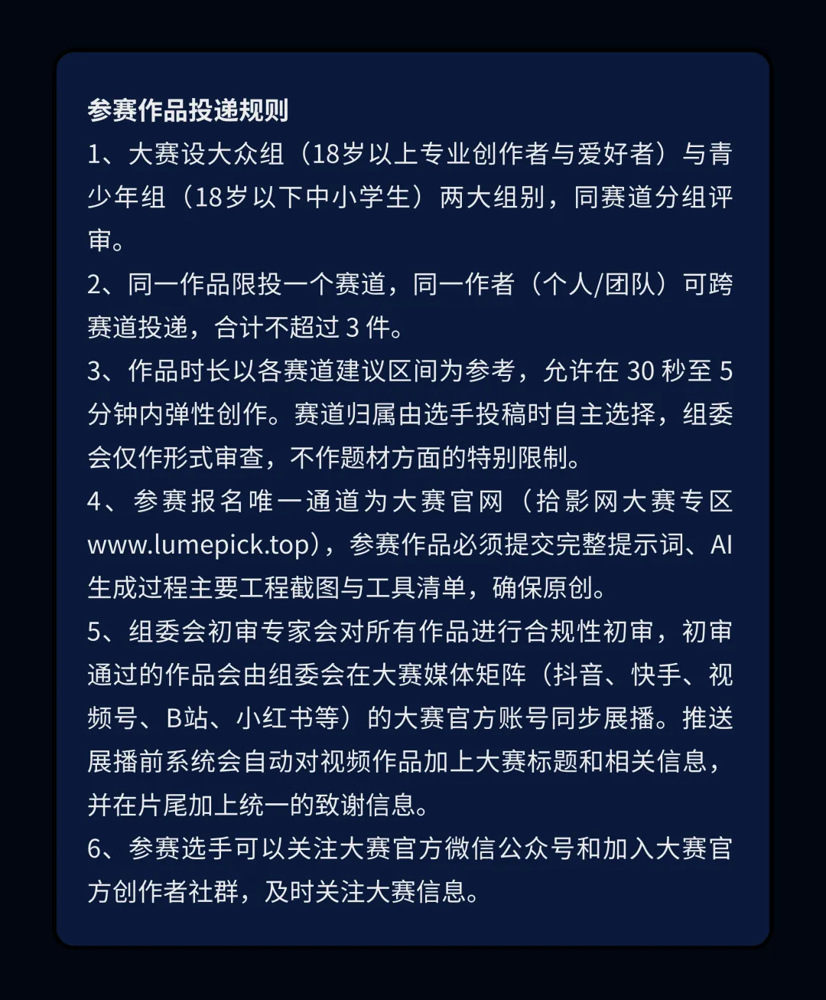
同时须严格遵守《中华人民共和国保守国家秘密法》等法律法规，仅限使用官方公开披露的装备型号、外观与基础科普参数，成片须在左下角全程标注“AI生成”。通过初审的作品，将由组委会在抖音、快手、视频号、B站、小红书等大赛官方新媒体矩阵同步展播。征集截止后，组委会将组织专家团队评审，并在航展现场举行颁奖仪式。
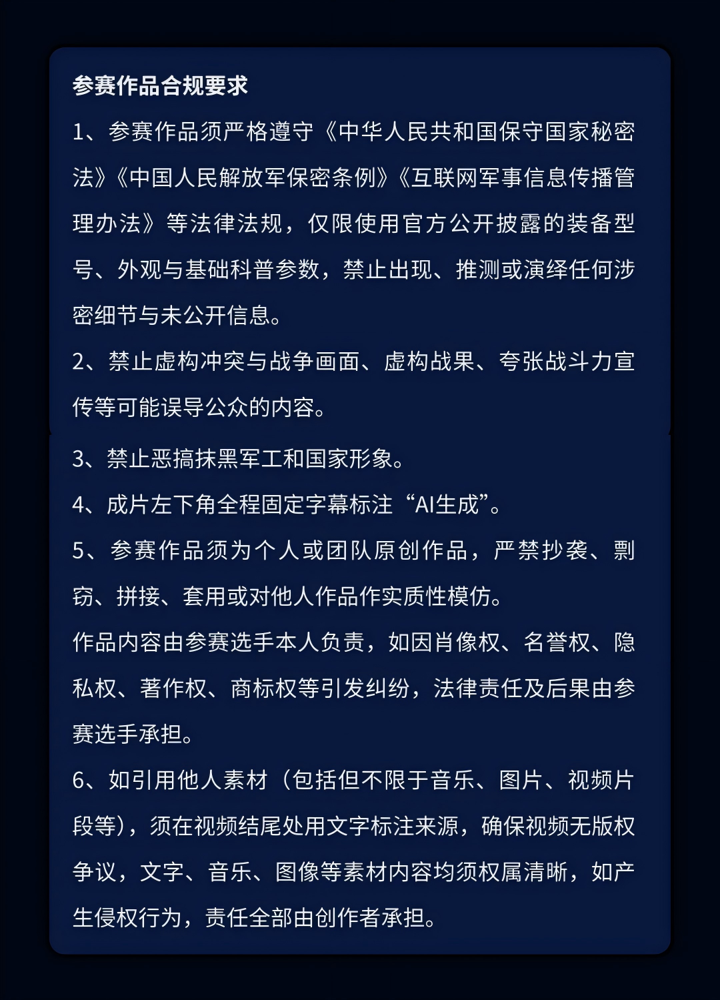
据介绍，本届大赛全部参赛作品将纳入中国航展官方AIGC合规素材库，用于航展宣传、国防教育与科普展播；创作者保留署名权与著作权。获奖作品有机会参与中国航展数字文创的设计与发行，优秀创作者还将进入大赛AIGC人才库，优先获得军工宣传片等商业项目合作机会。
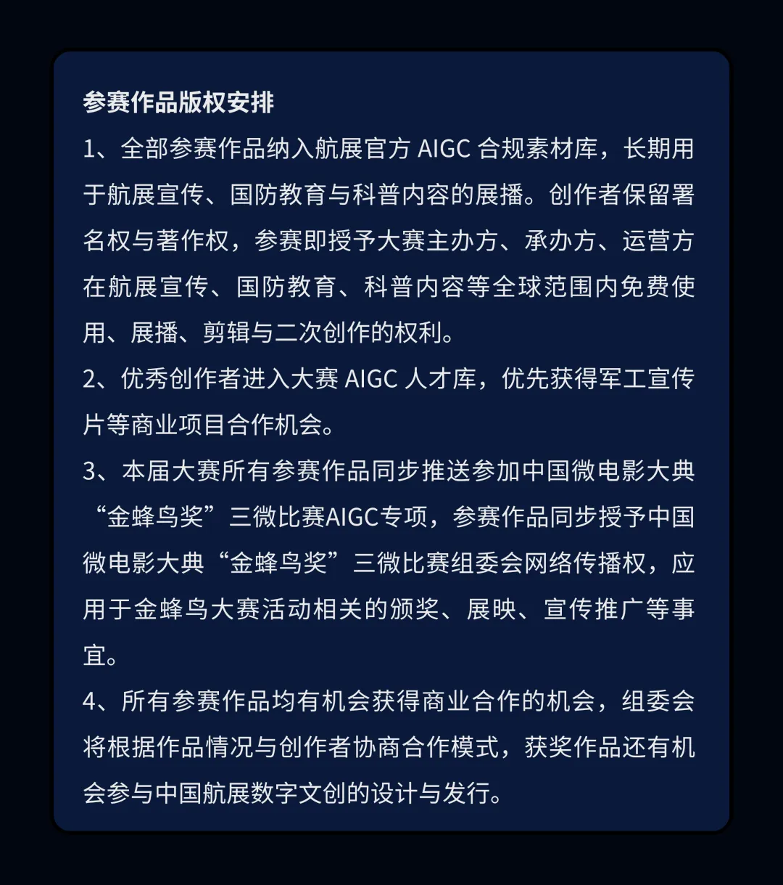

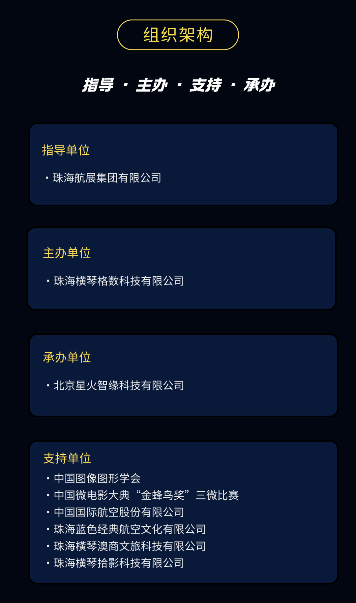
本次大赛得到了中国图像图形学会、中国微电影大典“金蜂鸟奖”三微比赛、中国国际航空股份有限公司、珠海蓝色经典航空文化有限公司、珠海橫琴澳商文旅科技有限公司、珠海横琴拾影科技有限公司的大力支持。
为进一步扩大本次活动的影响力，大赛所有参赛作品同步推送参加中国微电影大典“金蜂鸟奖”三微比赛AIGC竞赛单元，获奖作品可纳入学习强国全国影像精品资源库，并在强国剧场、腾讯新闻、央视频、人民法治网、抖音等多平台同步公益展播；优秀创作者还有机会受邀出席金蜂鸟2026年度颁奖盛典活动。
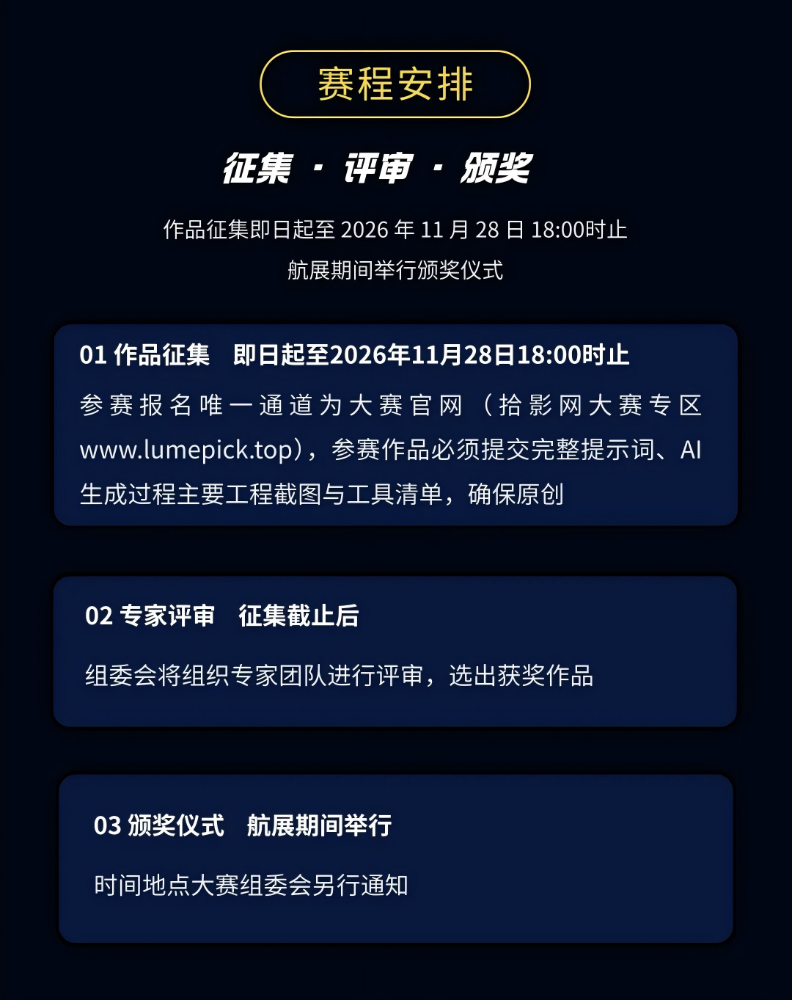
即日起至2026年11月28日18:00
时止，大赛面向全球创作者开放报名。无论你是专业影视人、AI创作爱好者，还是心怀蓝天梦想的青少年，都可以用镜头与算法，讲出你心中的航空故事。三十年凌云志，一卷蓝天等你落笔——快来报名，让你的创意飞上蓝天！
图片  和  文  字  转自网络  ，信  息  版  权  归原  作者所有，在此仅作为学习交流。

