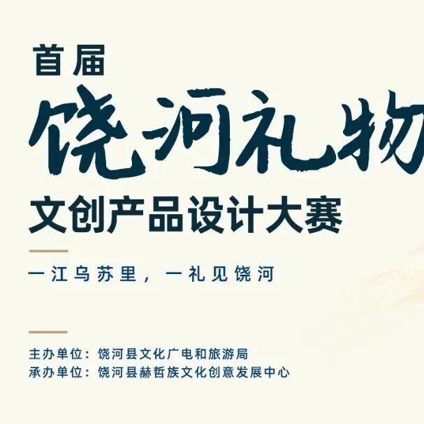
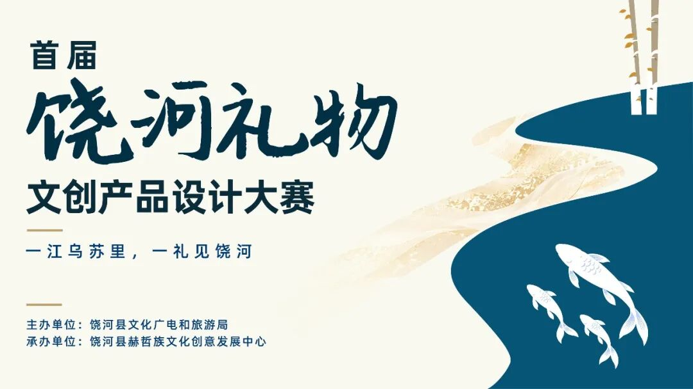

# 竞赛丨2026首届“饶河礼物”文创产品设计大赛

** 首届“饶河礼物”  ** **
** 文创产品设计大赛  **

** 一、大赛背景  **
饶河县文化底蕴深厚，拥有赫哲族渔猎文化、小南山九千年玉文化、东北黑蜂与湿地生态、东北抗联红色印记、关东风情等特色文化资源。为深入挖掘本土文化价值，推动文化创意与旅游产业深度融合，丰富文旅产品供给，进一步深化“蜜淌乌苏里，鱼跃赫哲乡”品牌形象，特举办本次大赛。
** 二、大赛主题  **
一江乌苏里，一礼见饶河
** 三、大赛时间  **
大赛周期为即日起至2026年12月底。其中，作品征集  截止时间为2026年11月22日24时
，获奖名单预计于12月下旬通过公众号“饶河县赫哲族文化创意发展中心”公布。大赛时间安排如有调整，将通过上述公众号公告。
** 四、组织机构  **
主办单位：饶河县文化广电和旅游局
承办单位：饶河县赫哲族文化创意发展中心
本次大赛设立组委会，由主办单位、承办单位共同组成，大赛组委会办公室设在饶河县赫哲族文化创意发展中心，负责大赛组织实施、作品征集、评审组织及咨询答复等工作。
** 五、大赛内容  **
** （一）大赛流程  **
本次大赛规划为三个阶段：作品征集、专家评审、成果发布与展示。
** （二）大赛赛道设置  **
** 1.实用性设计赛道：  **
深挖饶河本土文化内涵，围绕日用生活物件、潮流玩具、非遗衍生工艺品、装饰陈设、主题包装及各类创意伴手礼等开展方案设计，兼顾文化艺术性与实用性。
** 2.AI数字设计赛道：  **
融合数字技术创作手段，以饶河地域文化内核为创意来源，聚焦数字内容IP创作、数字创意产品研发等方向。作品形式包括但不限于IP形象设计、短视频、表情包等。
** （三）作品要求  **
1.作品应具有创新性，体现知识、艺术、技术等方面的融合，并具备转化为实物产品或数字产品的可行性。
2.作品所体现的价值观应坚持正确的政治方向，不得违背我国法律体系与公序良俗。
3.AI数字设计赛道作品应体现参赛者本人的创造性投入（如创意构思、提示词设计、后期加工等），使用的AI工具须在报名表中如实说明。
** （四）参赛对象  **
面向全社会开放，涵盖全国高校师生、文创设计与文旅企业、独立设计师、非物质文化遗产传承人、AIGC创作者及传统文化爱好者等群体。以个人或团队名义参赛均可，团队参赛须确定1名负责人；每件（套）作品署名作者不超过5人。
每名参赛者（团队）报送作品不超过2件（套），如超过则以报送时间先后为序取前2件（套）。
主办、承办单位中参与本次大赛组织与评审工作的人员不得参赛。
** （五）作品报送  **
** 1.报送作品内容  **
** （1）实用性设计赛道：  ** 作品高清图片  （3-5张，三视图或多角度图，JPG格式，单张不小于1MB）
；《首届“饶河礼物”文创产品设计大赛报名表》电子版；知识产权承诺书签字后扫描件。
** （2）AI数字设计赛道：  ** 作品高清图片  （JPG格式，单张不小于1MB）  或视频资料
（视频分辨率不低于1920×1080；时长不少于20秒，不超过3分钟，MP4格式；视频中不得添加水印及LOGO）
；《首届“饶河礼物”文创产品设计大赛报名表》电子版；知识产权承诺书签字后扫描件。
** 2.提交方式  **
请参赛者将全部作品材料打包为一个压缩文件，以  “饶河礼物+参赛赛道+作者姓名+联系电话”
命名，于2026年11月22日24时前，发送至邮箱raohewenchuang@163.com，邮件主题与压缩包同名。
** （六）奖项设置  **
** 1.实用性设计赛道：  ** 一等奖1名；二等奖2名；三等奖3名；优秀奖若干。
** 2.AI数字设计赛道：  ** 一等奖1名；二等奖2名；三等奖3名；优秀奖若干。
大赛组委会有权根据参赛作品整体质量，进行奖项空缺或获奖名额调整。
** 六、参赛者须知  **
1.本次大赛不收取任何报名及参赛费用。
2.参赛作品须为原创，版权清晰、无权利争议，曾在各级同类文创大赛中获奖的作品不得以相同内容重复参赛。作品知识产权归参赛者所有；因抄袭、盗用等引发版权纠纷的，责任由参赛者自行承担，大赛组委会有权取消其参赛、获奖资格并追回相关奖励。
3.参赛者投稿即视为同意授权大赛组委会（主办单位、承办单位）在非营利的推介、展示、宣传等活动中免费使用其作品（使用时注明作者署名），大赛组委会不再另行支付费用。
4.使用AI工具辅助创作的，须在报名表中如实说明；参赛者应确保作品最终呈现内容不侵犯任何第三方合法权益，因AI生成内容引发的权属及侵权争议，由参赛者自行承担。
5.获奖及优秀作品将通过官方线上平台进行宣传展示。主办单位将视情况协助对接文创企业、景区景点推动成果转化，具体合作事宜由主办单位与参赛者另行协商确定。
6.参赛者报名时提交的个人信息仅用于本次大赛的资格审核、联络、评审、公示及证书发放等工作，大赛组委会将依法予以保护。
7.大赛组委会对本次大赛保留最终解释权和调整权。
** 七、联系方式  **
联 系 人：于老师
联系电话：15663998875
联系时间：工作日上午9:00-11:00，下午14:00-16:00。
** 附件：  附件1首届“饶河礼物”文创产品设计大赛报名表.docx  **
** 附件2知识产权承诺书.docx  **
图片  和  文  字  转自网络  ，信  息  版  权  归原  作者所有，在此仅作为学习交流。

