# 俞挺新作：苏州大山·博物志民宿

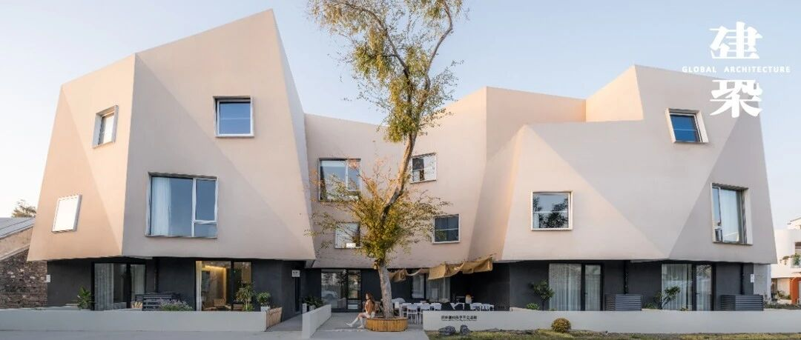

我孤独地漫游，像一朵云，在山丘和谷地上飘荡，忽然间我看见一群金色的水仙花迎春开放，在树荫下，在湖水边，迎着微风起舞翩翩。
——华兹华斯
2023年6月，Wutopia Lab设计的大山·博物志民宿于林渡暖村落成开放，是我们在林渡暖村设计建成的第二栋房子，是苏州伴宅的延续。
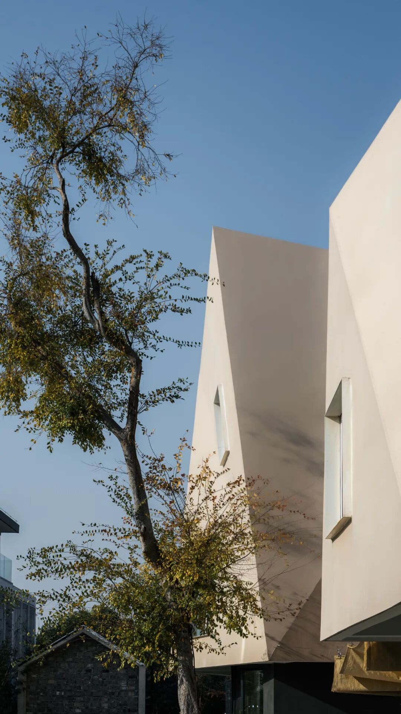
局部立面 ©CreatAR Images
场地与业态
场地是由4块宅基地共同组成，并被周边地块紧密围合。场地上的房子早已荒废闲置，部分房子已成严重危房。场地内有一个大树，业主希望能将其保留下来。
房子的荒废对应的问题也是我们面对乡村振兴项目时普遍存在的现象——乡村“空心化”，要解决这个问题的根本策略是要引入人和业态。
业主希望打造一个适合家庭旅居的集中式管理运营的乡村民宿，后来确定了以自然博物为主题的大山·博物志民宿。
困惑
大山项目刚启动时，作为林渡暖村首开项目的苏州伴宅的土建工程快要完工，其独特的建筑形象已初见端倪，我们都对此很有信心。
有那么一瞬间，我想偷个懒，复制一下伴宅的设计逻辑，毕竟设计方式的统一也会产生统一的风貌。要不要真的这么做呢？仔细想了一下，答案显然是否定的。
虽然两个房子功能相同，基地也离得很近，但定位、体量、场地特点却截然不同。
苏州伴宅面临开阔场地，有着丰富的延展空间，而大山·博物志民宿则被周边基地紧密围合，两者尺度也相差很大，显然不太适用于之前的设计逻辑。
如果基地位于CBD,一千多平方米的房子是一个类似邻里服务中心的极其小尺度的建筑，甚至不太可能呈现这种体量的单一功能房子。但是在乡村，这确实是一个非常大的体量，如何处理这个“庞然大物”呢？
灵感
翻看基地照片的时候，我想起比利时画家马格利特的代表作《Le Calcul
Mental》，这是一幅极具代表性的超现实主义风格的绘画。在传统的乡村背景中，一系列白色几何体以各种方式不可思议的呈现方式置入画面，或悬浮，或嵌入。宛如梦境，堪为奇观。白色几何体类似素描画室里的石膏几何体，但却是巨大的体量。这种与环境极具反差感的呈现方式与本项目是极其相似的。
为什么不试一下呢？
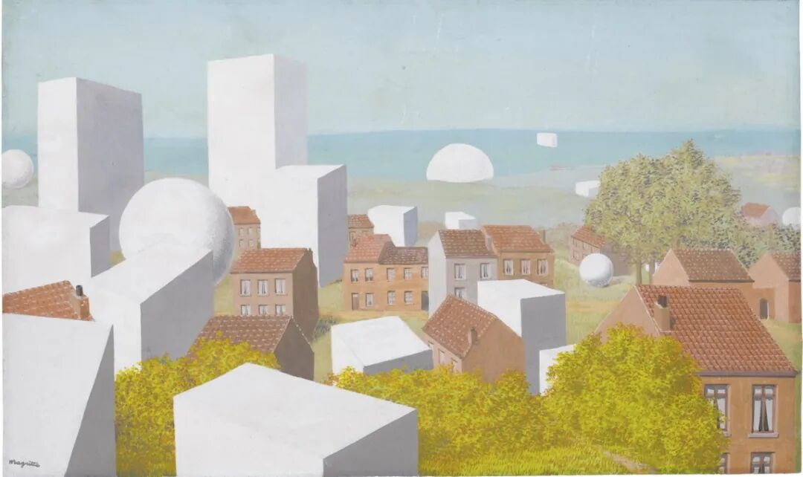
Le Calcul Mental by René Magritte
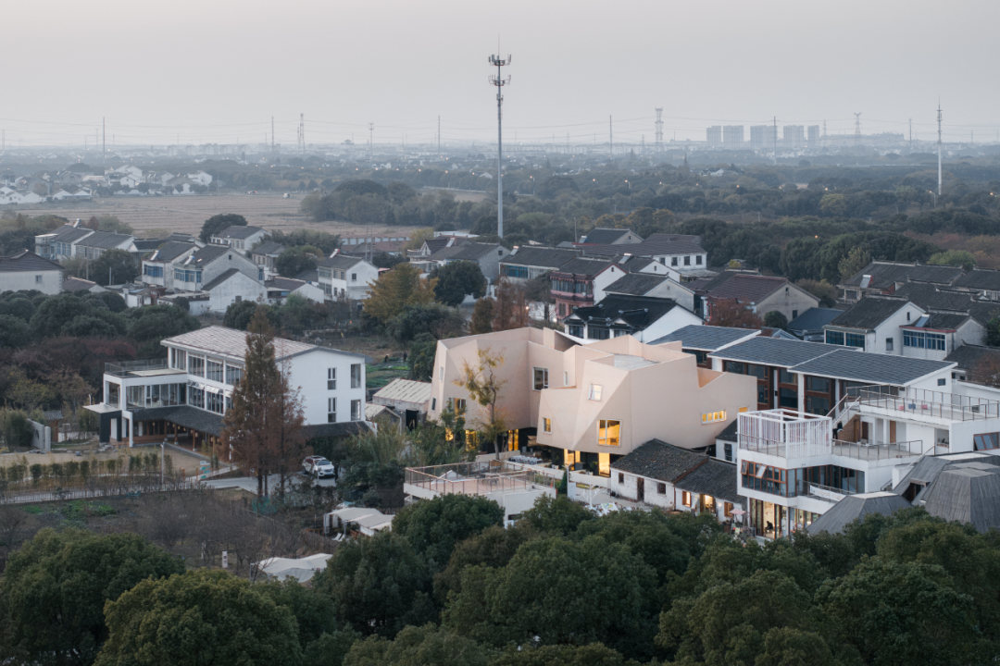
鸟瞰 ©CreatAR Images
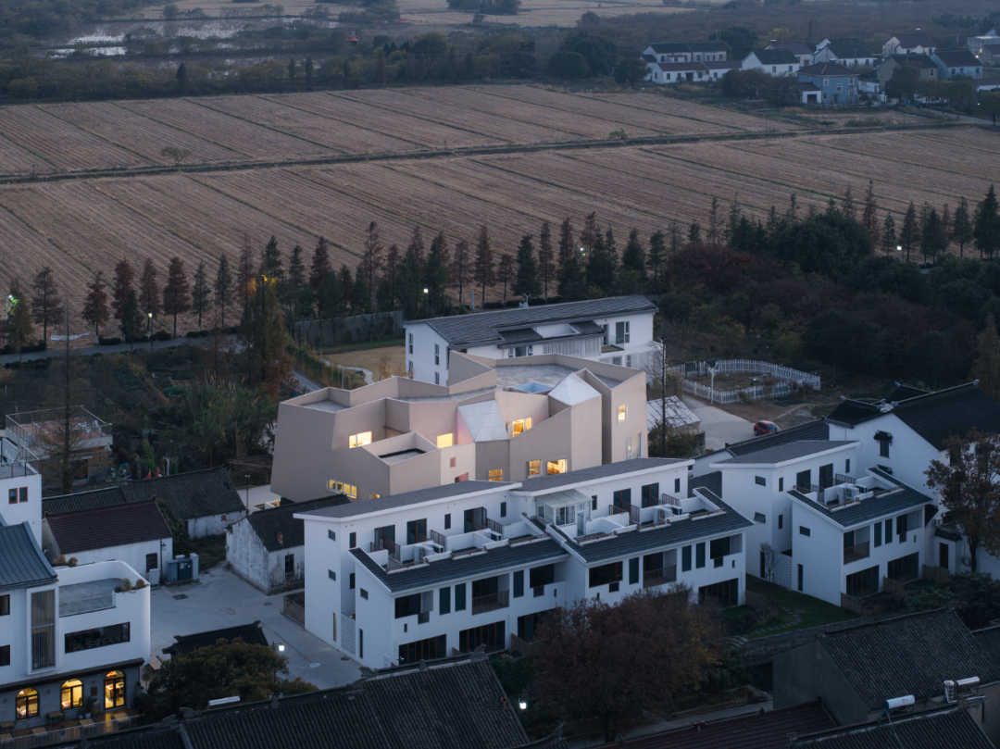
鸟瞰 ©CreatAR Images
造山
马格利特是个画家，素描教室里的几何体块是他熟悉的元素。我想借鉴的是超现实主义的呈现方式，而不是具体的形象。
我心目中的江南离不开鳞次栉比的屋顶，离不开小桥流水，也离不开山。熟悉我的人或许都知道我对于“造山”的“执念”。
消解体量
尽管是一座“山”，我们也希望建筑能够以一种宜人的尺度来呈现，而不是巨大的压迫感。我们首先把建筑外墙向内侧倾斜，既强化了大山的形象寓意，又降低了近人范围的压迫感。这个处理方式我们很熟悉，在金地方邻泗泾商业中心项目里我们也是这么做的。
如果建筑的轮廓不是平直单调，同样也可以降低建筑的压迫感。
场地的原建筑外轮廓线是根据不同宅基地建筑外墙围合连接的，顺应着基地轮廓线的走势，建筑外轮廓线呈现为一段段折线段的拼合。为保留大树而形成的退让范围，也同样形成一个建筑轮廓的局部内凹，既强化了建筑的入口，又弱化了建筑的体量。
山是立体的，剖面关系上也进行“切削”，在保持形体整体性的前提下，我们做出了退台处理，既可以增加可使用的延展空间，同样也可以降低压迫感。
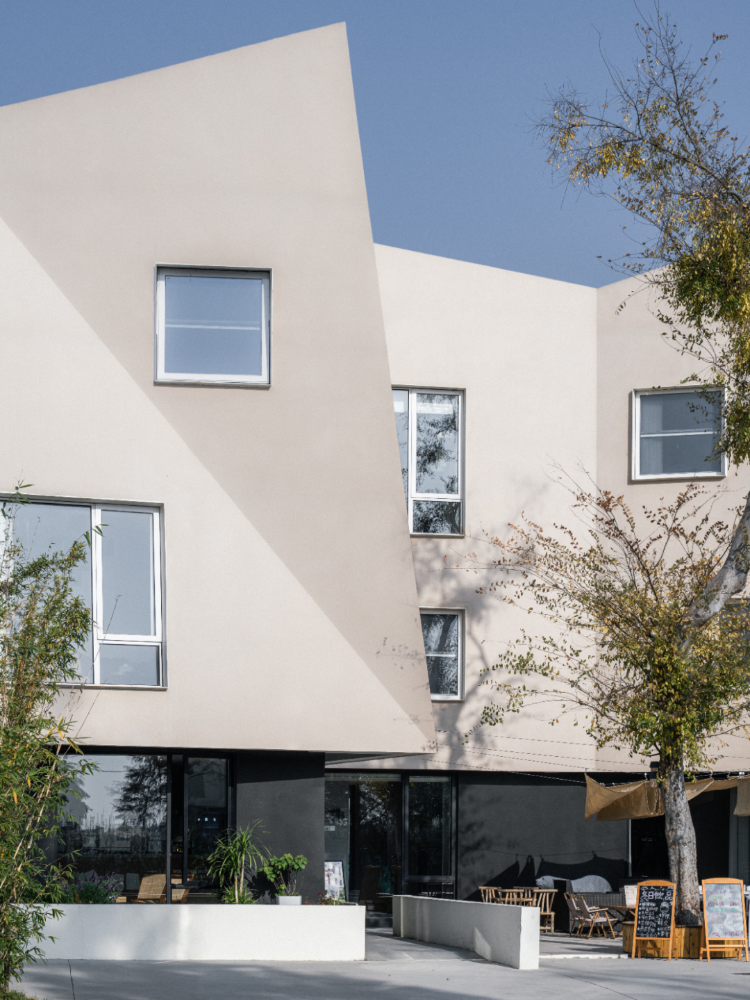
主入口 ©CreatAR Images
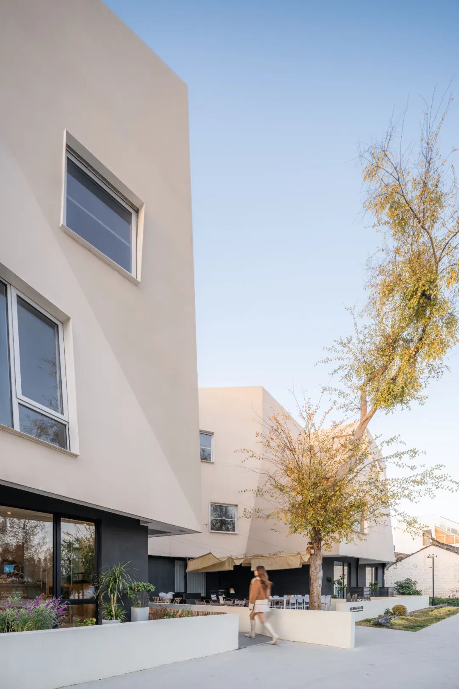
主入口 ©CreatAR Images
悬浮
曾经有一段时间，我试图研究用动词或状态来呈现建筑设计的方法或建筑的相对关系。
超现实主义的呈现方式是戏剧化的，单独矗立在地面的大山还不够戏剧化。我要把大山“悬浮”起来，这会是一个很酷的概念。
如果想要大山“悬浮”，那就需要把首层消隐。建筑一共分为三层，二层及以上是由折面组成异形体块，是白山的暗喻。首层轮廓形状相对方正，黑色涂料且相对后退。通过视觉层面的弱化处理，形成首层的相对消隐，以突出悬浮般的效果。
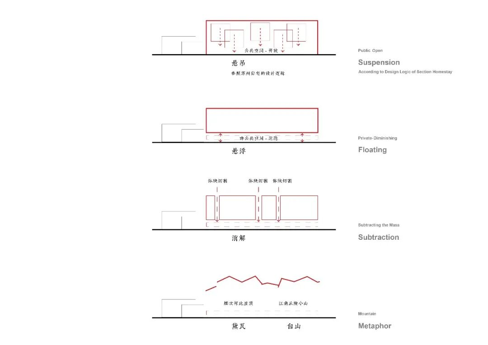
分析图 ©Wutopia Lab
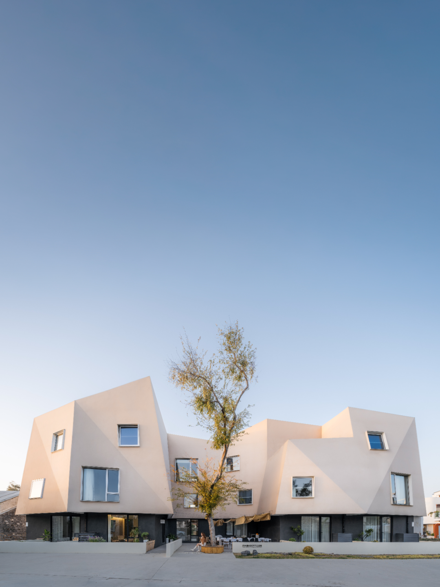
立面 ©CreatAR Images
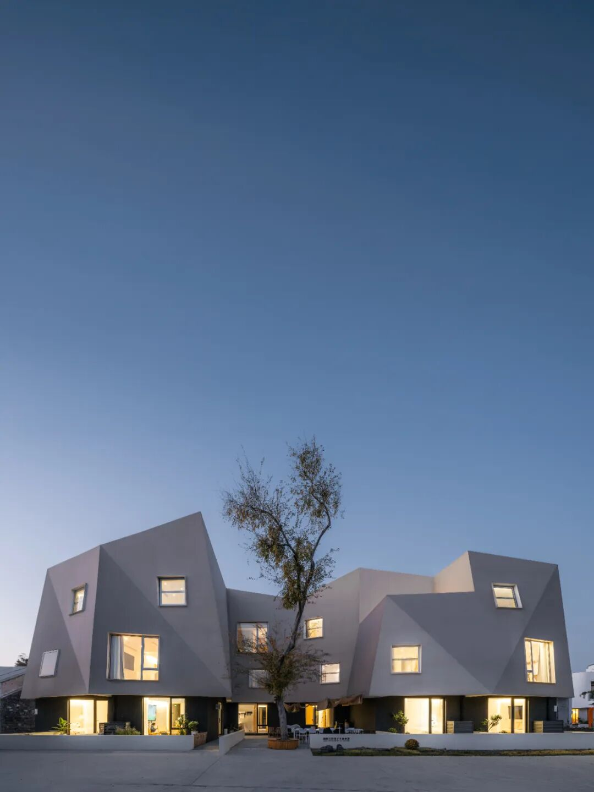
立面夜景 ©CreatAR Images
平面
当确定完大山的体块关系之后，我的第一反应是做一个串联式的巡游路径，宛如栈道的路线，沿途也能有诸如洞穴、悬崖等与大山对应的空间意象。把大山的意象贯彻到底。业主对大山呈现的建筑形象感到耳目一新，但对平面组织方式有所顾虑。是的，理想化的参观路径与单个房间的居住体验有巨大冲突。公共空间固然重要，居住品质也是居住者最重要的体验。对待这个事情，我不能太任性。
业主希望每个户型都要有较好的采光和延展空间，相对独立的入户方式，宽松的室内空间，以及适当比例的复式户型。
于是我微调了策略，我将需求转化成三种原型，“一”字型、“田”字形和复式。每种类型都可以结合庭院和露台做出延展空间。并通过单元式的组合方式实现相对独立的入户方式。
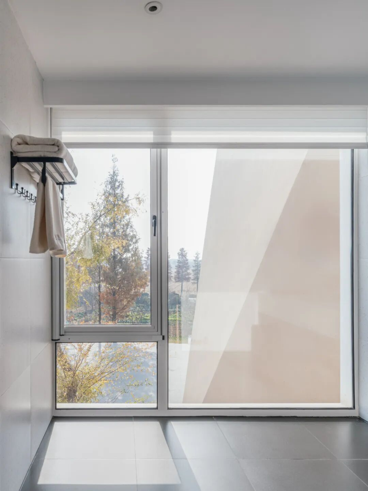
卫生间 ©CreatAR Images
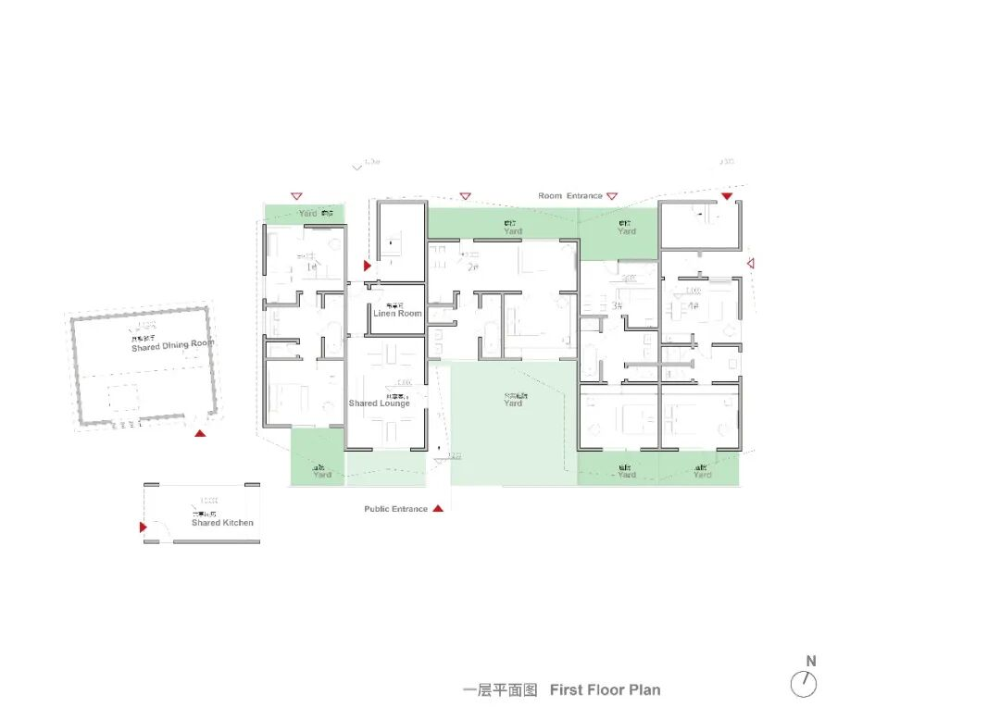
一层平面图 ©Wutopia Lab
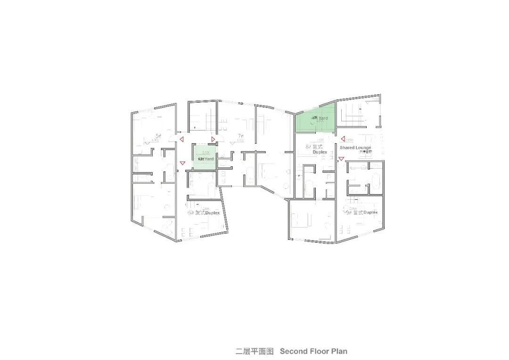
二层平面图 ©Wutopia Lab
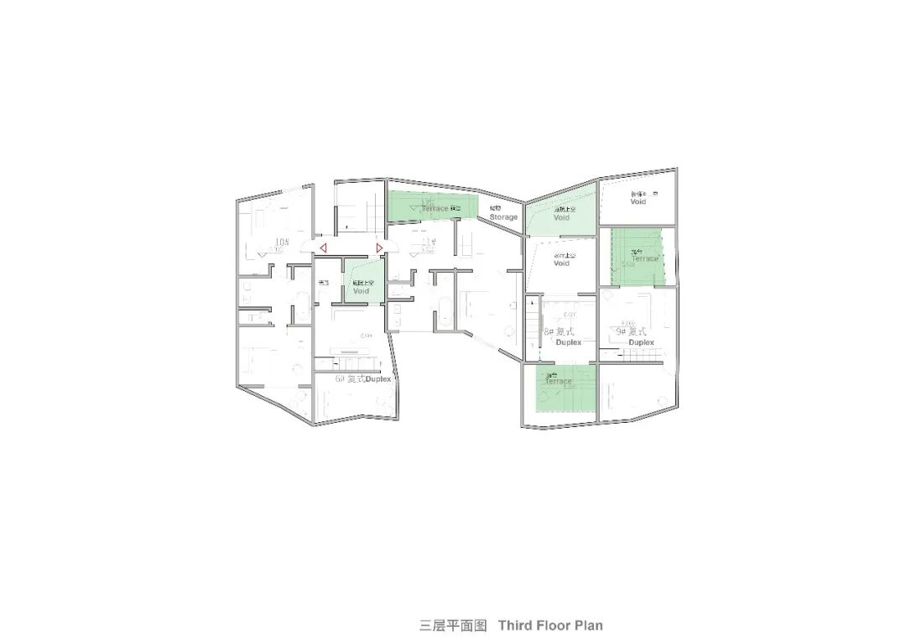
三层平面图 ©Wutopia Lab
厨房与餐厅
除了主体建筑，西侧地块还散落着两座已经成为危房的民居，与主体建筑是脱离开的，作为厨房和餐厅。如果再做两个更小尺度的山，就会显得很滑稽。
我们观察到原建筑立面空斗式砖墙的肌理很有特色，那就局部保留。面对这两处个废墟。我们分别使用了“内置”和“嵌套”的手法来清晰明了地表达改造区域与既有建筑的关系。
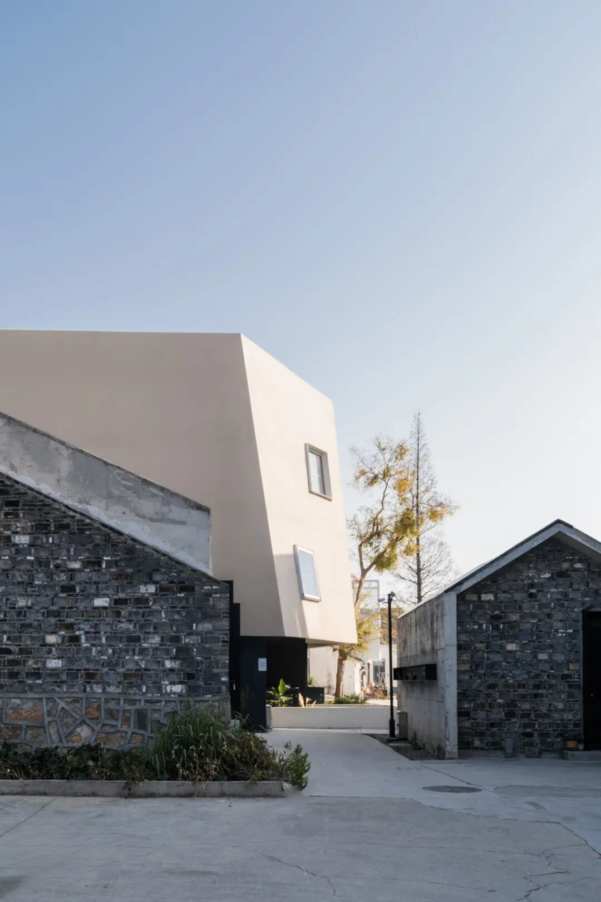
“内置”和“嵌套” ©CreatAR Images
建造
虽然“大山”的造型无疑会消解了巨大体量的压迫感，但复杂的造型也会让业主产生对施工难度及造价控制的顾虑。通过与结构工程师的讨论，我们优化了建筑外墙的呈现方式，仍然是框架结构的变型，通过设置通长拉筋的方式，在合理角度倾斜的墙体仍然可以用砌筑轻质砌块的方式建造，大大降低悬挑区域的自重荷载。
二、三层采用米黄色真石漆的局部斜墙来塑造 “大山”的折面造型，一层的建筑轮廓相对于二、三层后退，并采用黑色真石漆，创造出“悬浮感”。
最终在低施工难度、低成本控制的要求下，实现了复杂的建筑造型。
大山
建筑立项的名字，通常都是一串拗口的地块编号。在建造阶段，大家都习惯性地叫这个造型特异的房子为“大山”。后来业主询问我房子叫什么名字合适，我觉得“大山”就挺好。
随着运营主题的确认，以观察昆虫、爬宠等体验为特色的自然博物概念与大山的设计概念也完美地契合，希望住在大山里的乡村博物体验能成为住客的亲子回忆。
乡村与都市
当我看到完工之后的鸟瞰照片时，比悬浮白山更魔幻的是远处相隔太湖的苏州湾新区，对比乡村宛如海市蜃楼。其中最为醒目的是法国建筑师包赞巴克设计的苏州湾文化中心。这种海市蜃楼般的呈现以及以飘带为设计意象的长达370米的超尺度建筑，又何尝不是一种超现实主义呢？
乡村与都市都在演变。每个时代的痕迹都会成为乡村与都市的重要组成部分，也都可能会随着社会发展被更替。
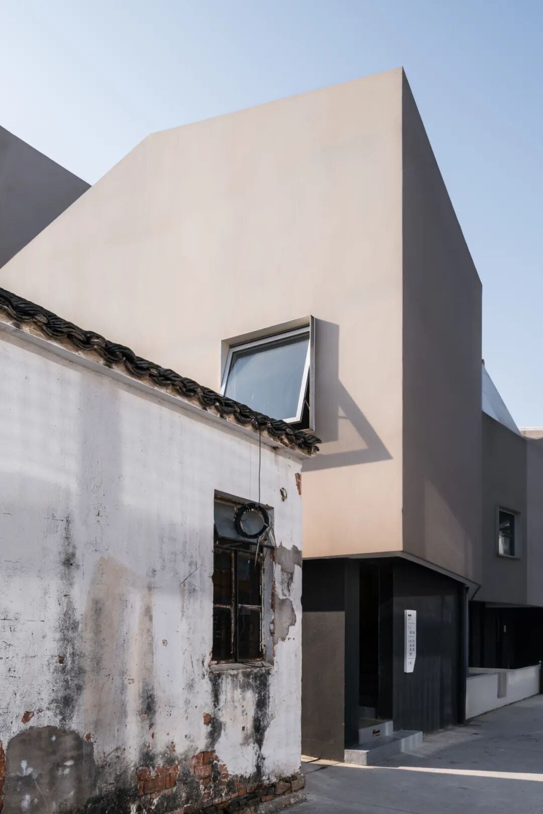
新旧对比 ©CreatAR Images
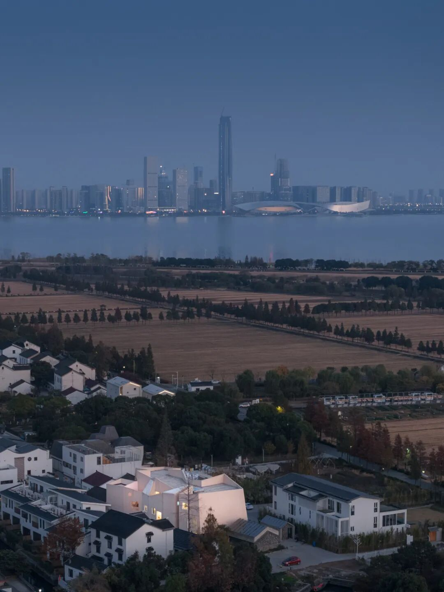
“海市蜃楼” ©CreatAR Images
项目图纸
项目名称：大山·博物志民宿
设计公司：Wutopia Lab
主持建筑师：俞挺
项目建筑师：黄河
设计团队：莫默（实习）、庄寅霏（实习）、林建明（实习）
深化公司：江苏华亚工程设计研究院有限公司
深化团队：乔烨、陈洁茹、陈向阳、朱勤玉、杨金平、徐胡清
照明顾问：张宸露、尉诗羽
业主：景程文化旅游发展（苏州）有限公司
地点：江苏省苏州市吴中区横泾街道上林村
面积：1237平方米
建成时间：2023年6月
材料：真石漆
摄影：CreatAR Images
视频：CreatAR Images

编辑：吉文 | 视觉：慕熙 胡音
联系：赵赵（id：cunquchina）
往｜期｜精｜选[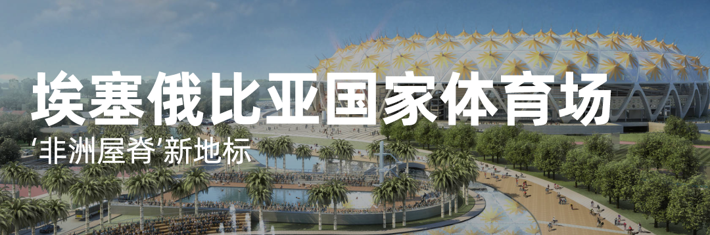](https://mp.weixin.qq.com/s?__biz=Mzg2NjA5OTE5Nw==&mid=2247681168&idx=1&sn=c4ff61997fe7cb15825477f5e339fe8f&scene=21#wechat_redirect)[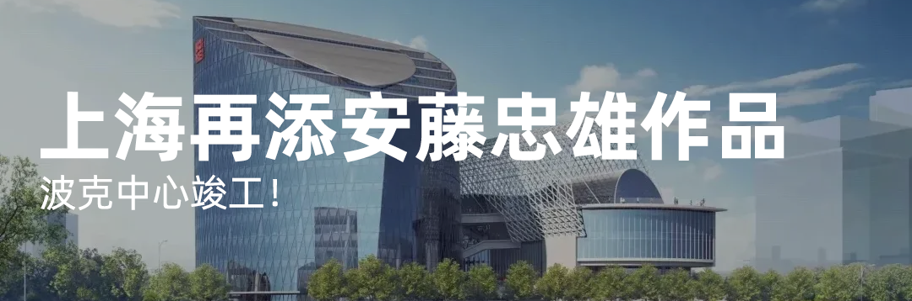](https://mp.weixin.qq.com/s?__biz=Mzg2NjA5OTE5Nw==&mid=2247680993&idx=1&sn=c3e7635900a63a7c414df45a9b0bc95e&scene=21#wechat_redirect)
GA｜能｜见｜度

欢迎在以上12大平台  搜索、订阅“GA环球建筑”  一同见证设计的力量

