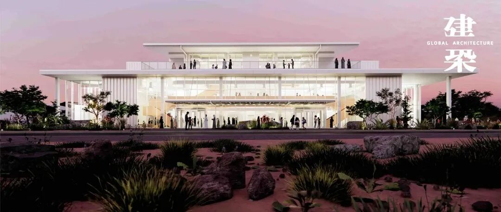
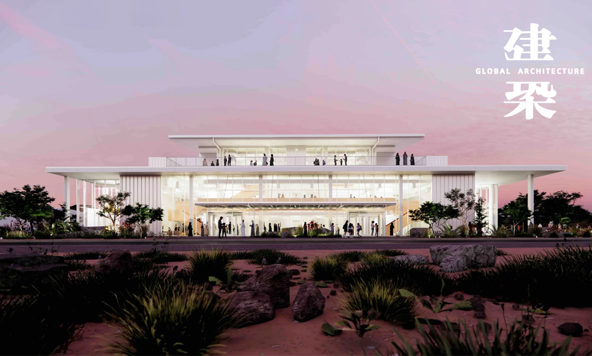
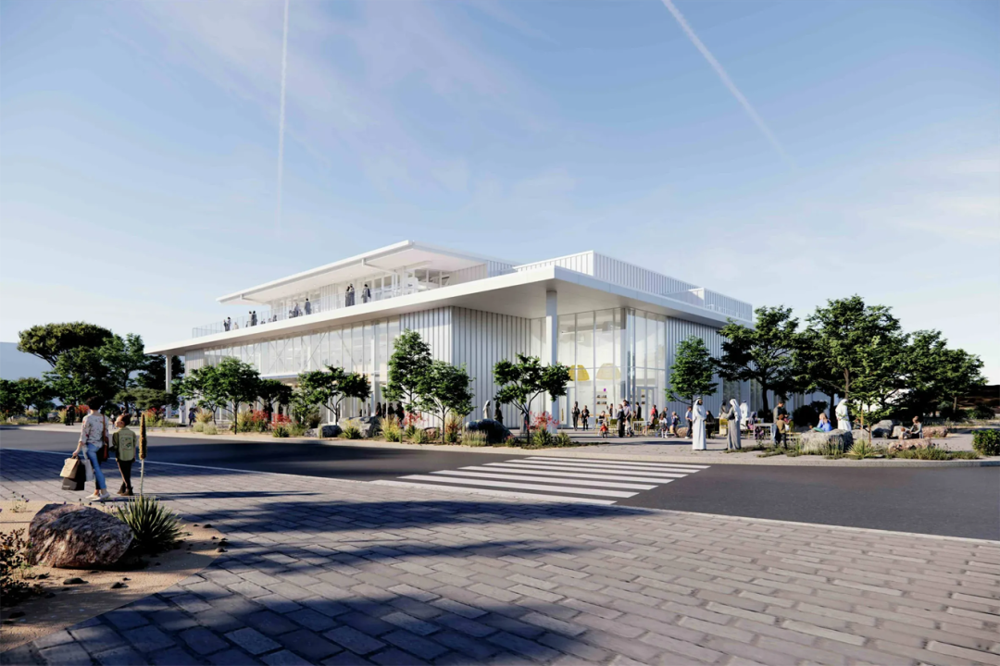
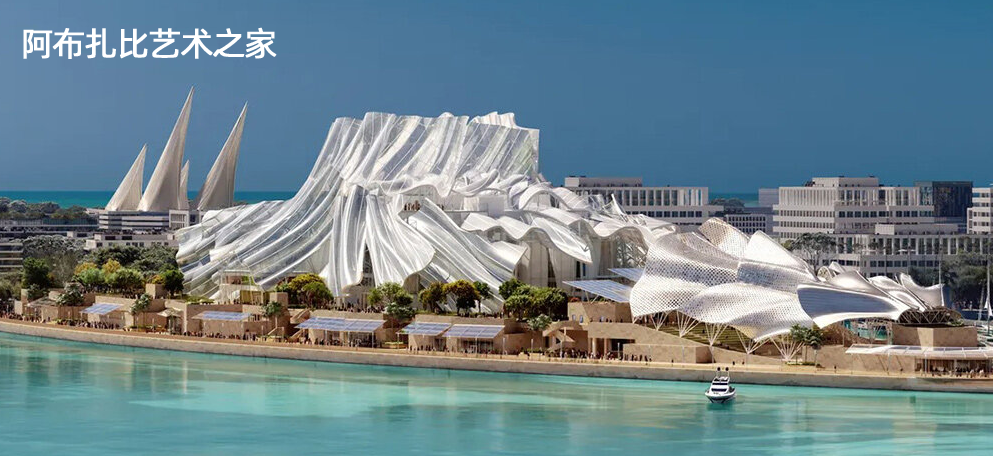
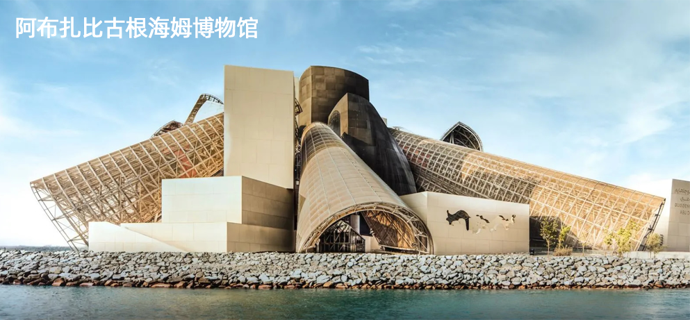
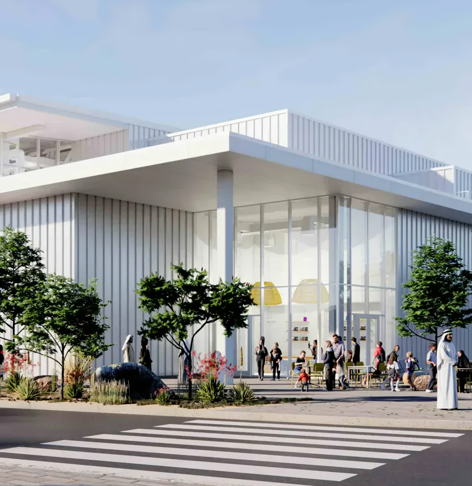
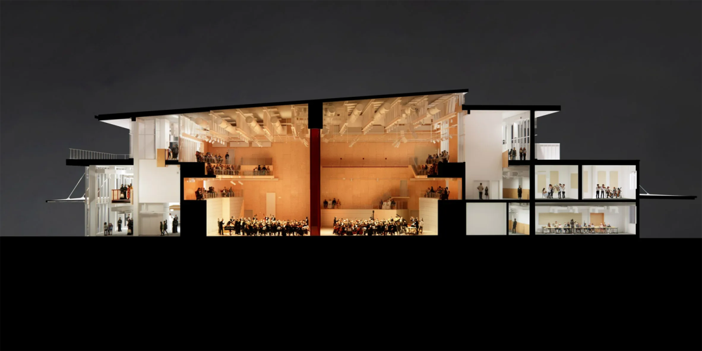
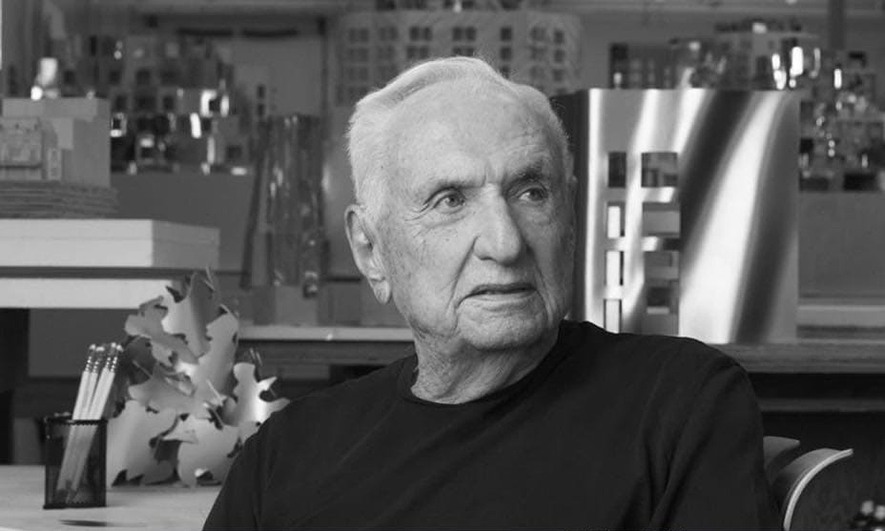
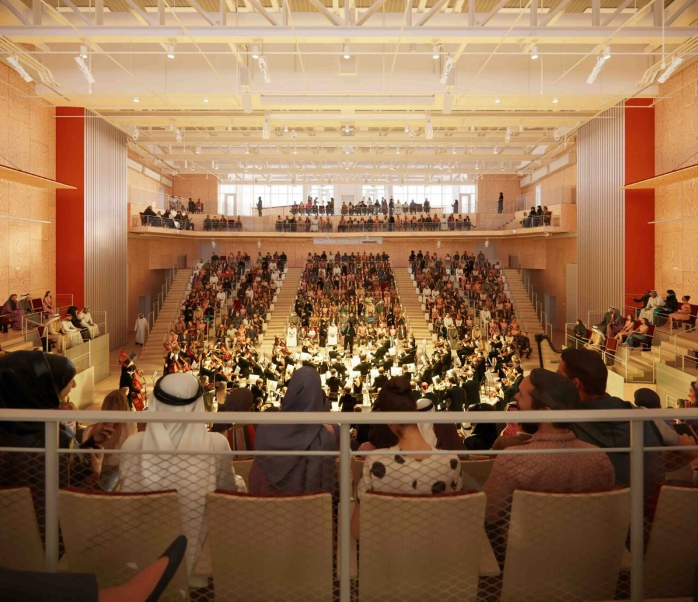
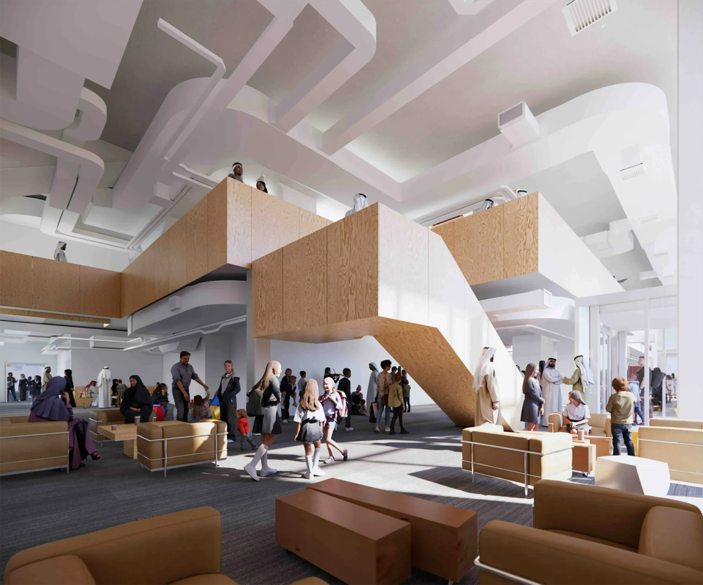

# 弗兰克·盖里遗作公布，不以“奇观”取胜的音乐中心

2026年10月底，阿布扎比文化与旅游部正式揭晓“阿布扎比青年管弦乐团音乐中心”方案。它由弗兰克·盖里设计，是盖里2025年12月去世前完成的最后作品之一。

这是继阿布扎比古根海姆博物馆（Guggenheim Abu Dhabi）、阿布扎比艺术之家（Dar al Funoon Abu
Dhabi）之后，盖里在阿布扎比参与设计的第三个文化建筑。项目位于米纳扎耶德港区，计划2027年1月建成开放。

建筑规模不大，但核心功能明确而具体：一座600座音乐厅、18间排练及练习室，为6至9岁儿童提供免费音乐教育，首批招收100人，课程兼及西方古典音乐与阿拉伯音乐传统。

建筑为两层，屋顶长而平直，水平展开；高玻璃立面由白色面板分隔，室内楼梯和阳台步道以木材包覆，顶层向屋顶露台敞开。

就设计而言，这座建筑呈现出盖里职业生涯中比较罕见的“收缩”与“克制”。Dezeen的报道指出，与其标志性的流体、有机、仿佛处于运动中的雕塑形态相比，青年管弦乐团音乐中心的外观远为简洁（pared-
back）。
中文建筑媒体Rebas的评述进一步点明，这座音乐中心“不以奇观取胜”，视觉重心从盖里惯用的扭转体量，转向通透的公共空间以及人在建筑中的活动本身。换言之，这是一座把建筑表现力让位于日常使用逻辑的盖里作品，其设计意图不在于制造城市地标，而在于让儿童在排练室、楼梯、阳台与舞台之间形成连续的学习与表演动线。

室内延续简洁风格，木材与大玻璃构成主要交通空间。楼梯连接不同标高公共区域，上层通往室外露台。

阿布扎比自2021年成为联合国教科文组织“音乐创意城市”，这座中心也是当地音乐教育与表演设施建设的一环。

**

**
**
** ** 编辑：吉文 | 视觉：慕熙 胡音  **
** 联系：赵赵（id：cunquchina）  **
**
**
**
**
** 往｜期｜精｜选  ** **
** ** 
**
** 
**
**
**
**
**
** GA｜能｜见｜度  **
**
**

**
** ** 欢迎在以上12大平台  ** ** 搜索、订阅“GA环球建筑”  ** ** 一同见证设计的力量  ** **
** **
** ** ** ****

** ** ** **
