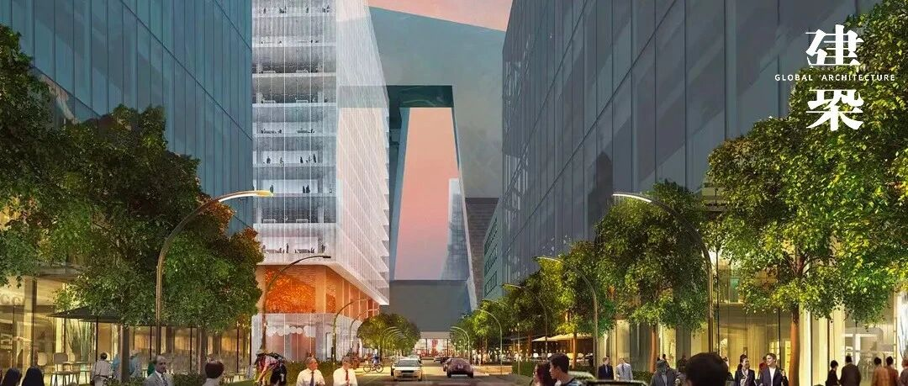
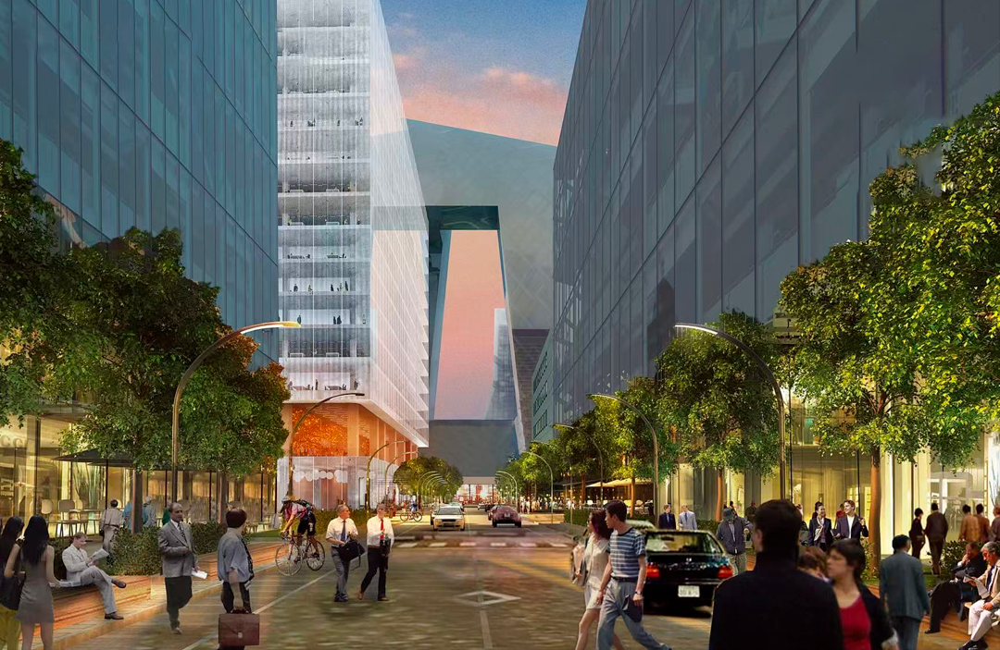
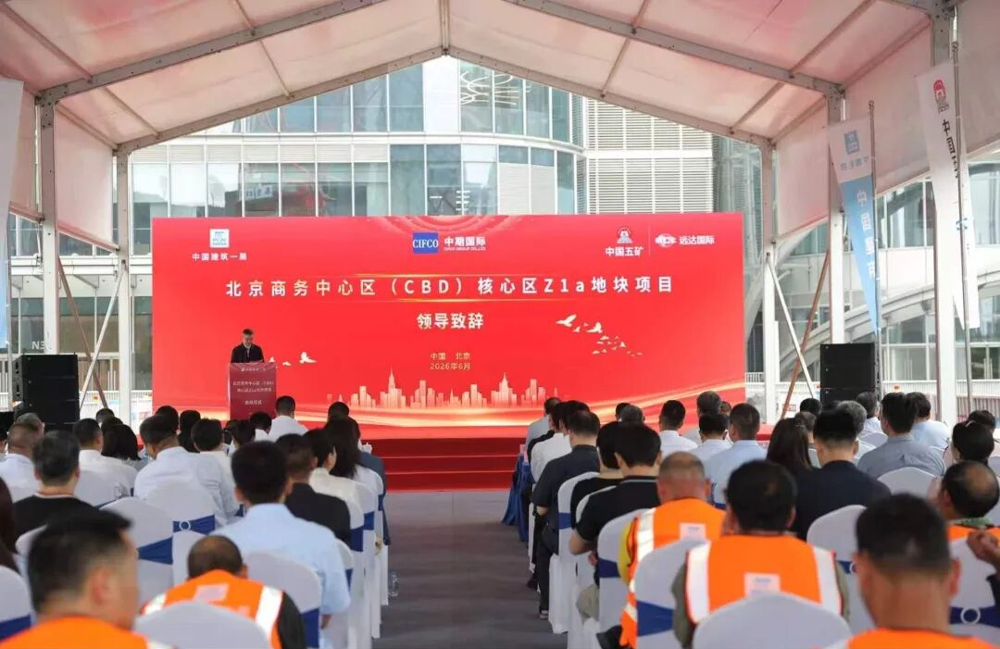
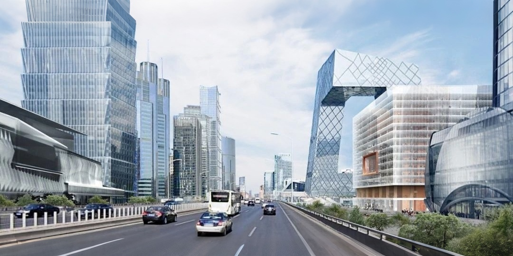
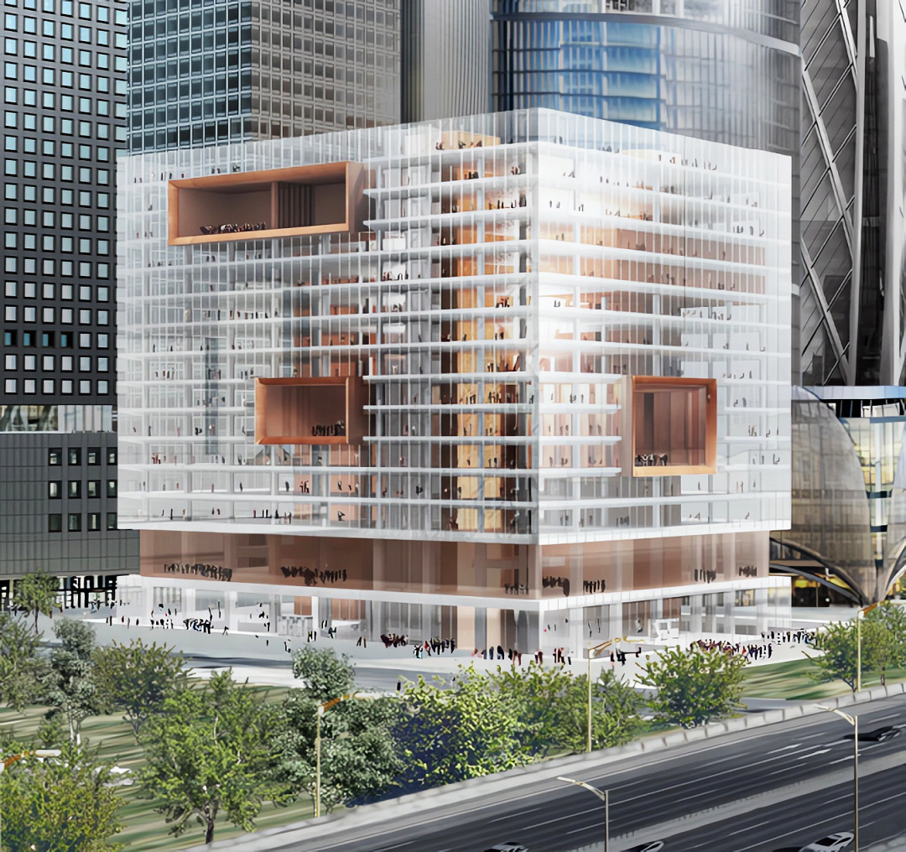
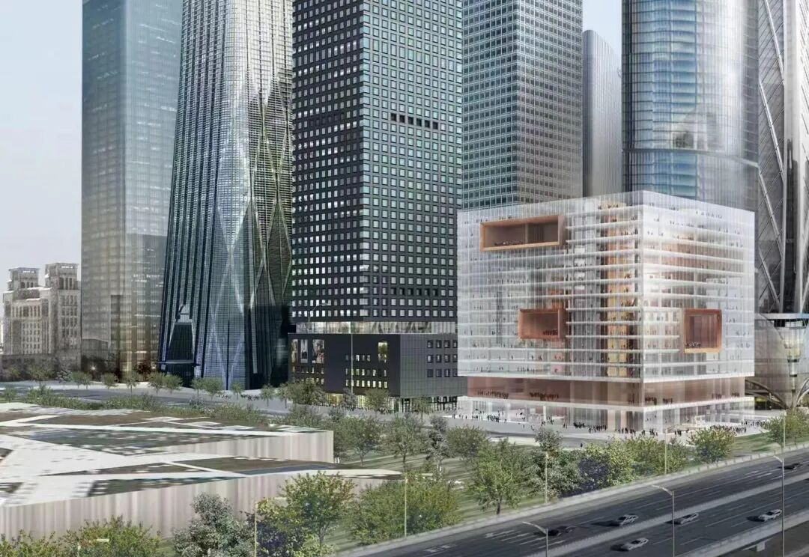
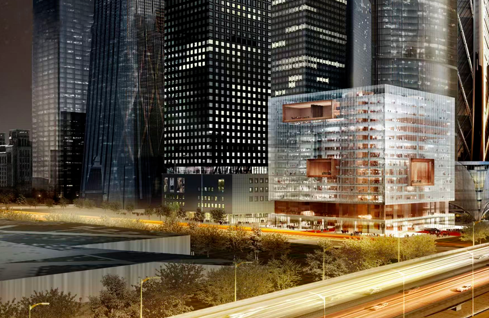

# 北京CBD压轴之作：中期总部大楼

以下文章来源于摩天星球  ，作者小摩看星球
**摩天星球** .  专注高层建筑的概念、设计和建设。

北京CBD核心区，中期总部大楼（Z1a地块）被视为“九宫格”的最后一块拼图。
今年7月中旬，该项目正式开建，由中建一局承建。未来，它将成为集国际期货交易中心、商业金融、高端办公、媒体中心等功能于一体的具有全球影响力的国际金融新地标。

项目紧邻东三环，北邻光华路与央视大楼相望，地理位置可谓寸土寸金。建筑高70米，地上14层，地下6层，总建面11.4万平方米。抗震设防烈度为8度，耐火等级为1级。

这座大楼并未沿袭传统总部建筑的封闭与高冷，而是以“可呼吸、可插拔、可生长”为设计哲学，为CBD“九宫格”格局画上点睛之笔。
建筑师摒弃独立塔楼的惯常做法，将形体切分为三个错落有致的体块，各自朝向三条城市道路，形成通透的“城市切口”。这样的处理，既消解了大体量带来的视觉压迫，又为街区留出了风道与光廊，让建筑不再是冷冰冰的屏障，而成为与城市街巷彼此渗透、相互呼应的活性介质。

内部功能同样紧凑而多元，交易中心、会议中心、媒体制作与信息传播空间一应俱全，地下层则依核心区统一规划，与周边楼宇实现商业和交通的无缝接驳。可以想见，未来这里人流、信息流、资金流将在此交汇涌动。

作为中国国际期货有限公司展示国际形象的重要载体，中期总部大楼更承载着连接国内与国际金融市场的使命。
待到竣工后，这座“会呼吸”的大楼将与三星大厦（Z2b地块）、大家保险大厦（Z5地块）、国寿金融中心（Z13地块）和中信大厦（Z15地块）等共同构成完整的核心区建筑群。

** ** 编辑：吉文 | 视觉：慕熙 胡音  **
** 联系：赵赵（id：cunquchina）  **
** 往｜期｜精｜选  ** **
** ** 
** 
** GA｜能｜见｜度  **

** ** 欢迎在以上12大平台  ** ** 搜索、订阅“GA环球建筑”  ** ** 一同见证设计的力量  ** **

