# 333米！深圳国企第一高楼，设计藏了“山和水”

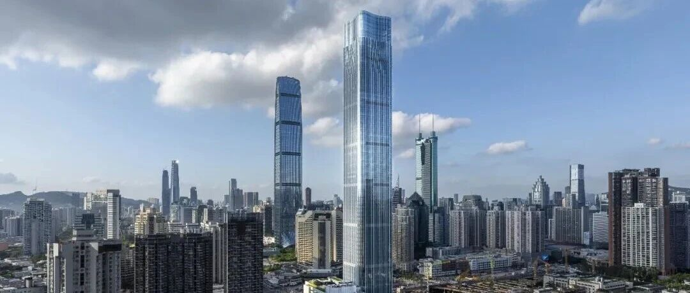

以下文章来源于摩天星球  ，作者小摩看星球
**摩天星球** .  专注高层建筑的概念、设计和建设。
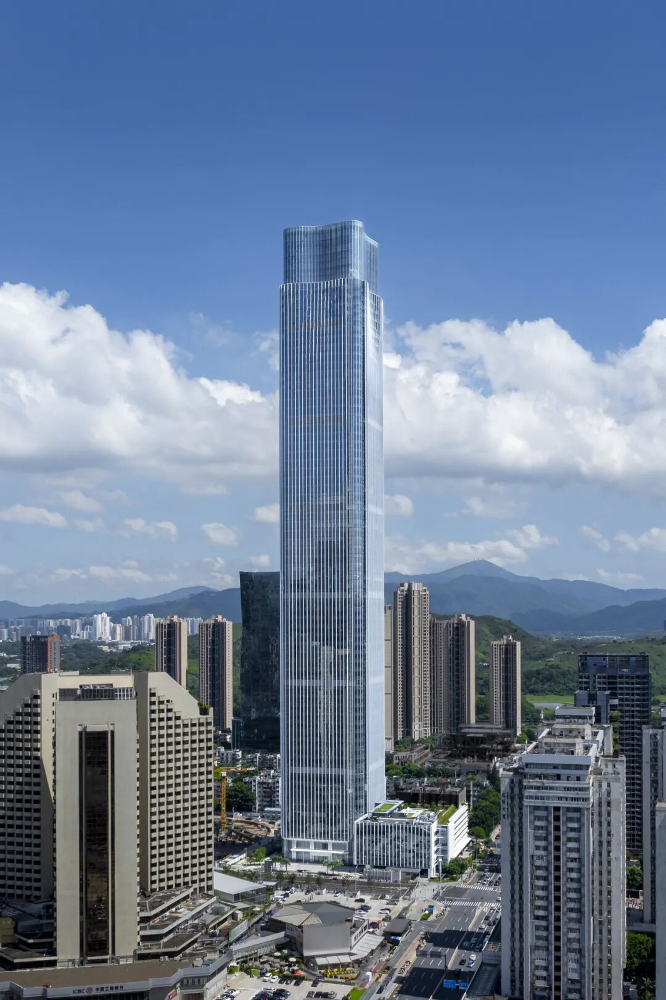
深圳罗湖蔡屋围这一带，333米高的城建云启大厦已经立起来了。
项目总用地9950.67平方米，总建筑面积约18.99万平方米，地上72层、地下5层，裙房6层，总投资约44亿元，是深圳市国企第一高楼。
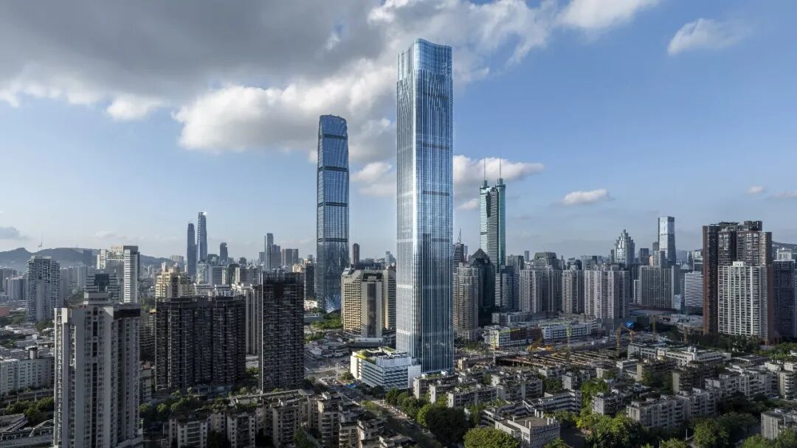
Gensler从“泉水、山脊与层叠梯田”中取形，造型简约大气。
塔冠取“泉水”意象，寓意欣欣向荣、蓬勃发展；塔身以“山峰”为原型，寓意财富积聚、基业稳固；裙房以“阶地”层层递进，寓意生生不息。这一从“冠”到“基”的垂直叙事，将深圳开放、创新的城市精神转译为可感知的建筑形式。
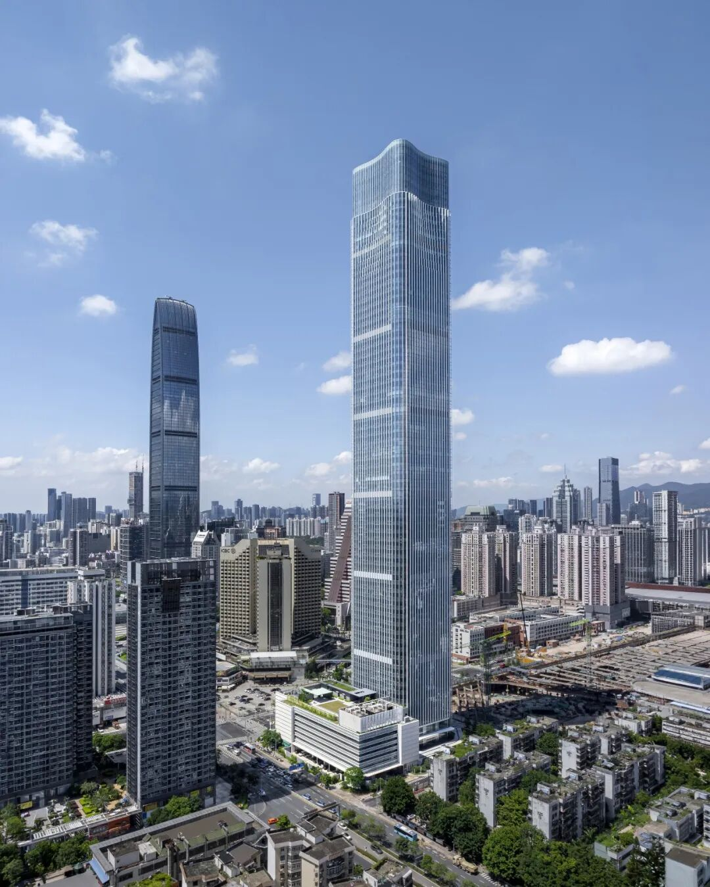
下沉广场、地面绿化、裙房屋顶花园和塔楼中庭连成一套立体景观，绿意从地面往上走，在不同高度之间接上关系。首层架空后形成南北贯通的步行景观廊道，人从街边过来，能更自然地进入建筑和周边街区。
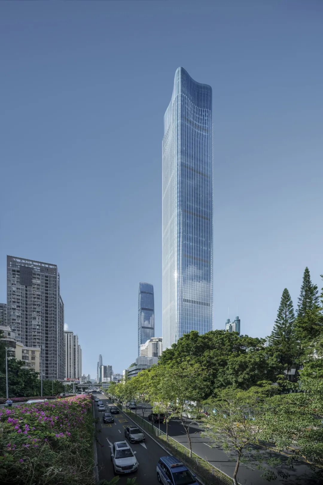
深圳的气候也被放进设计里。景观、通风、遮阳和雨水管理不是各做各的：立体绿化、可渗透地面和屋面、海绵花园回应雨水管理；自然通风结合水平与垂直气流组织，遮阳构件与建筑形态协同，太阳能板、通风格栅和屋顶设备收进顶部构成。
生态策略不是孤立技术，而与体量、流线和场地景观一起工作。
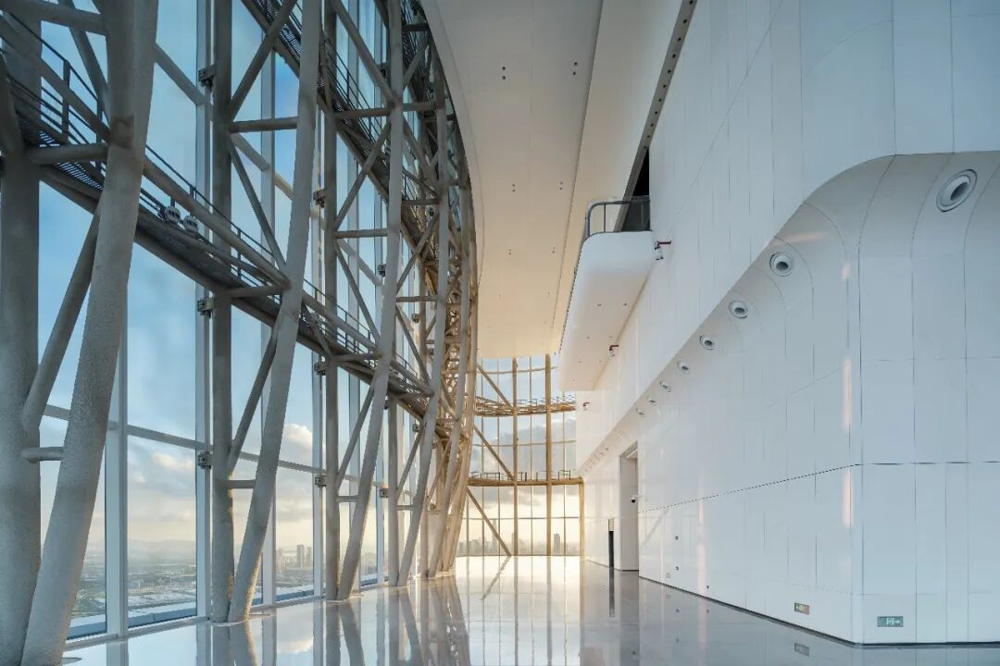

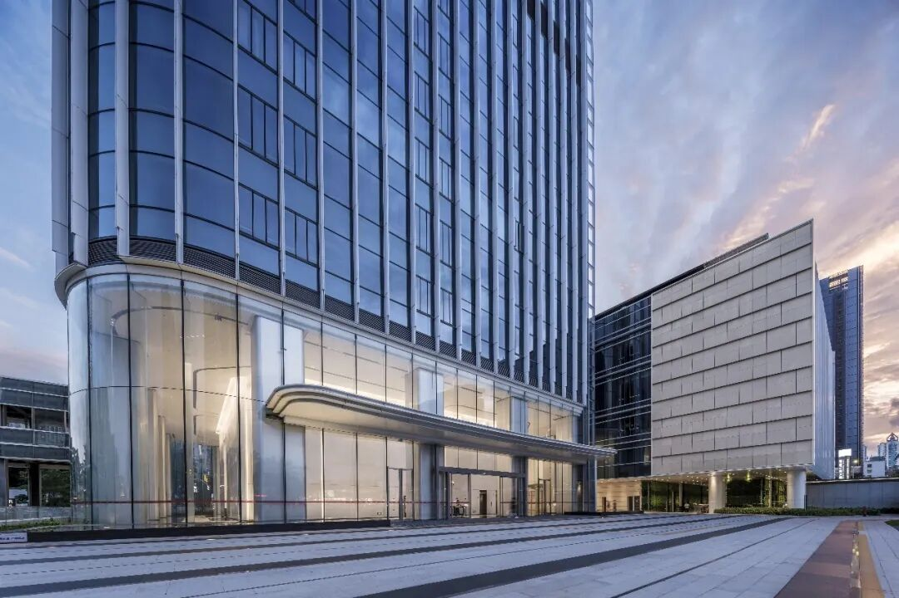
作为蔡屋围城市更新统筹片区首发项目，云启大厦承载城建集团总部功能，面向总部企业和金融机构，把办公、商业、文化装进同一综合体。
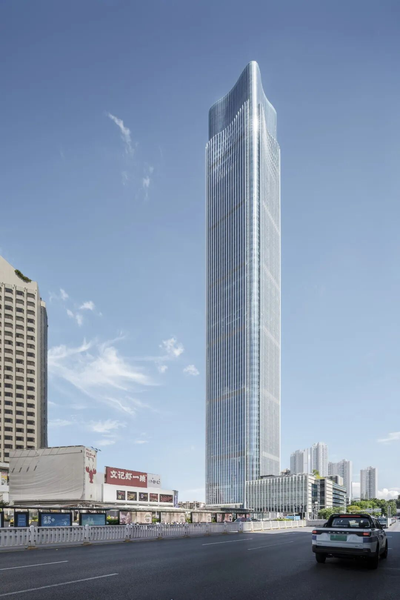

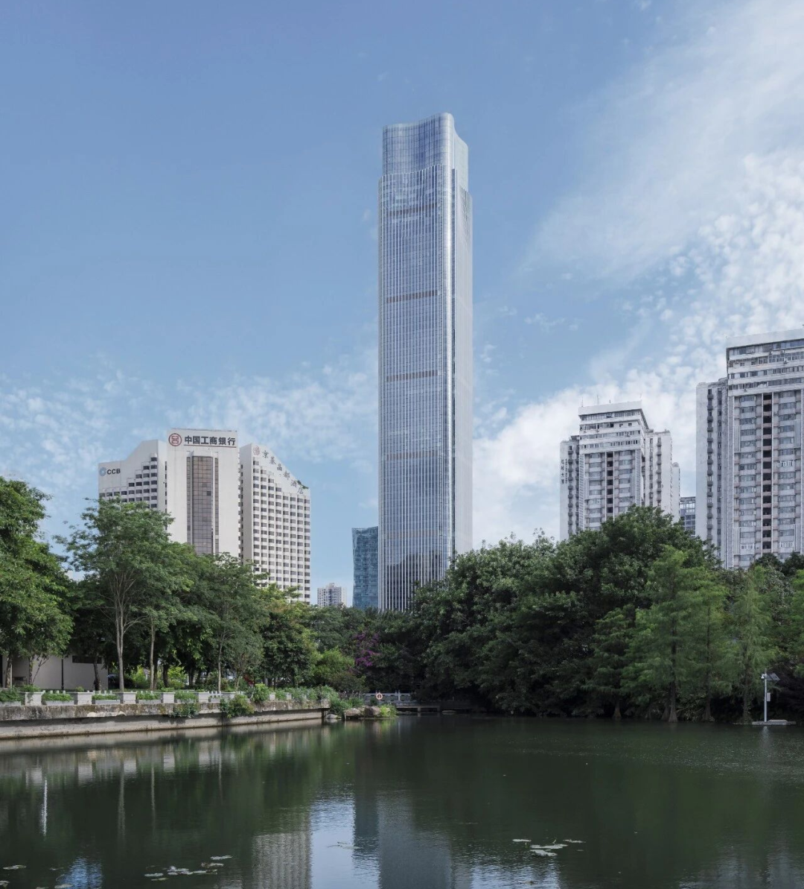
地面与地下统筹步行、公交换乘、办公商业人流和机动车落客；下沉广场既是景观，也是连接城市步行与建筑内部活动的节点，首层大堂兼顾步行到达与落客。
办公空间强调灵活、连通与健康，为协作和未来调整留余地。
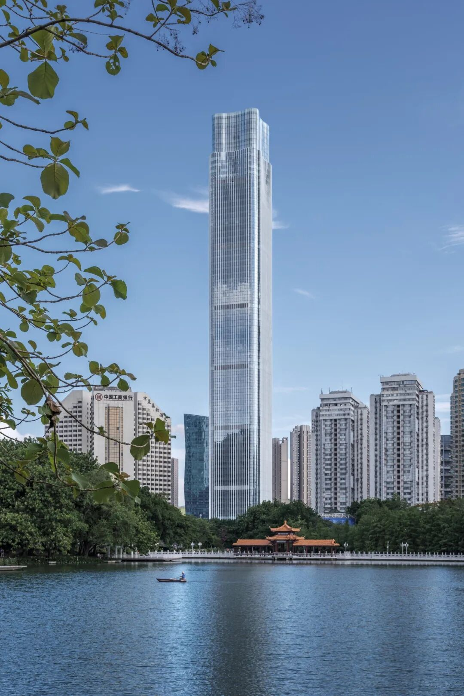
从山峦梯田的轮廓，到贯穿地面、裙房与塔楼的景观，这座建筑把城市活力、空间体验与环境响应放在同一垂直系统中，让天际线上的标识也成为工作、交流与日常生活的容器。
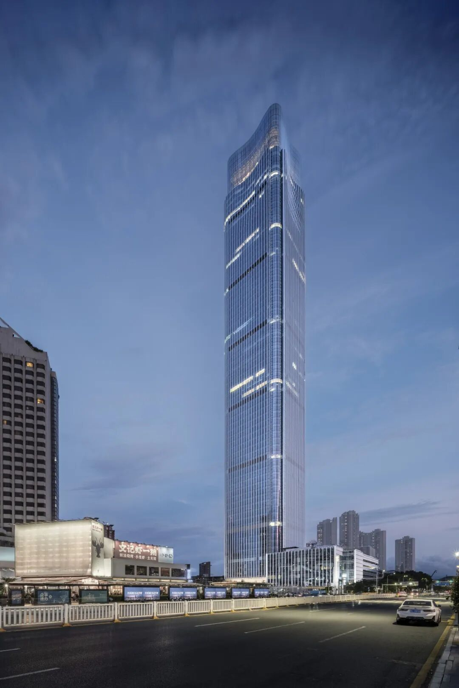

** ** 编辑：吉文 | 视觉：慕熙 胡音  **
** 联系：赵赵（id：cunquchina）  **
** 往｜期｜精｜选  ** **
** ** 
** 
** GA｜能｜见｜度  **

** ** 欢迎在以上12大平台  ** ** 搜索、订阅“GA环球建筑”  ** ** 一同见证设计的力量  ** **

