# 中期选举一翻盘，特朗普的凯旋门项目就卡住了？

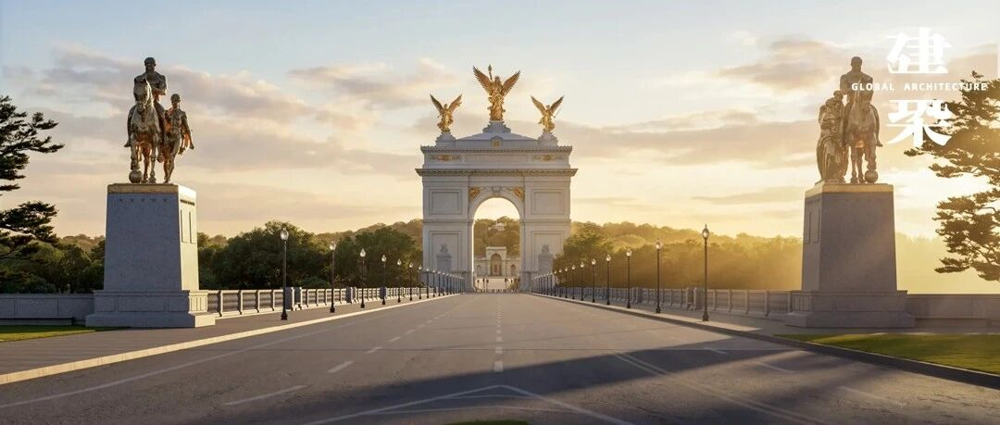

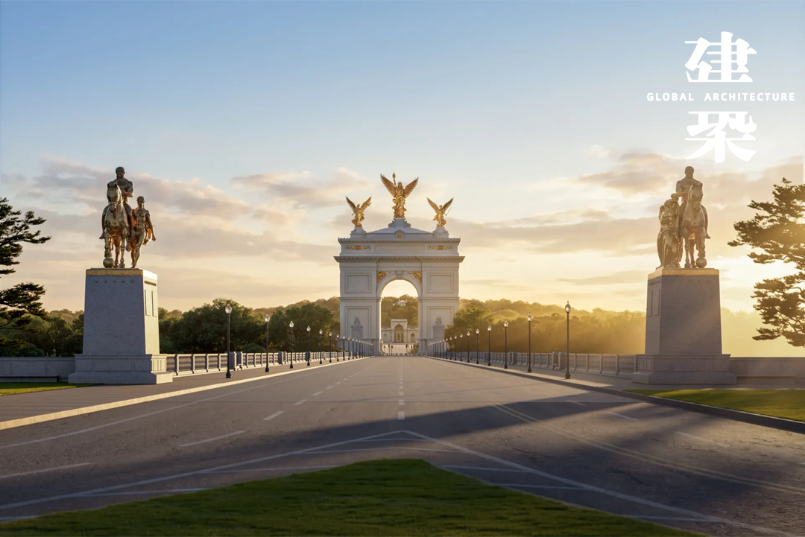
11月3日，美国中期选举结果尘埃落定，民主党夺回参众两院控制权。
目前，中期选举震荡波正在传导，其中包括对特朗普首都建设计划的影响，尤其尚未动工的华盛顿凯旋门项目，将可能使原本顺畅的行政推进，转入行政、立法、司法三线拉扯。
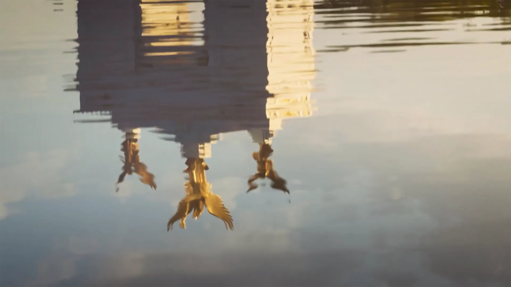

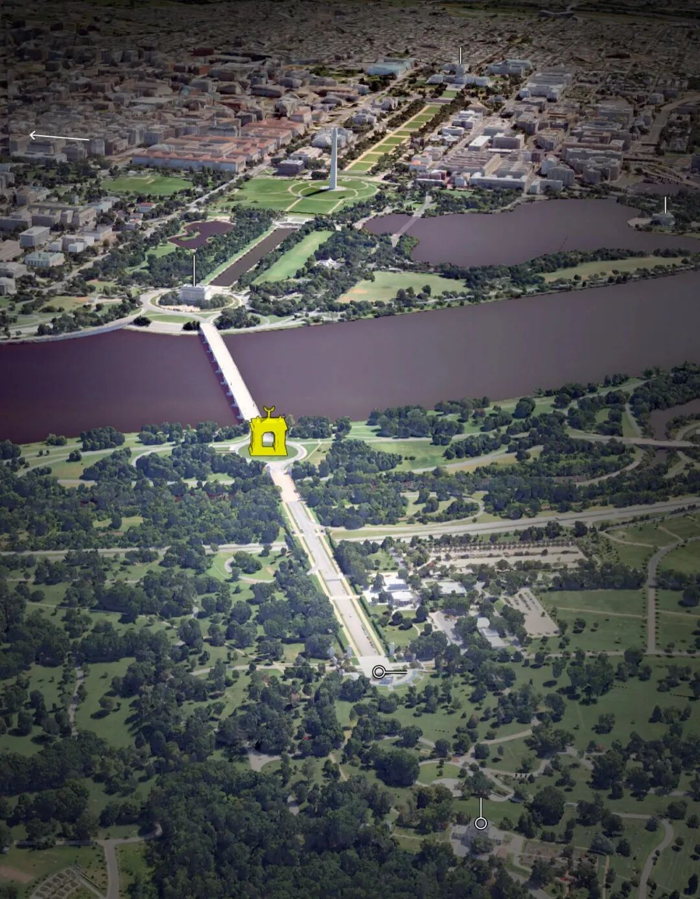
自中期选举结束的两天后，即11月5日，国家首都规划委员会（NCPC）以8票赞成、4票反对批准了凯旋门的最终选址与建筑方案。白宫方面在批准后立即表示准备“很快”动工。
然而，当晚，联邦地区法院法官塔尼娅·丘特坎（Tanya
Chutkan）应华盛顿特区和弗吉尼亚州的请求，发布了为期14天的临时限制令，禁止启动施工、挖掘及相关准备工作，并在裁定中写道“损害是确定的”，因为政府已明确表示将在批准后几乎立即开工。
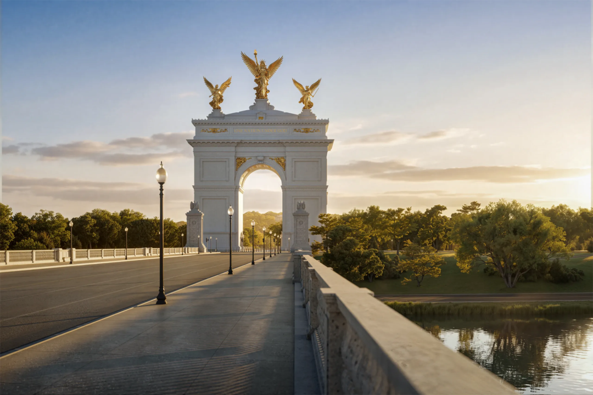

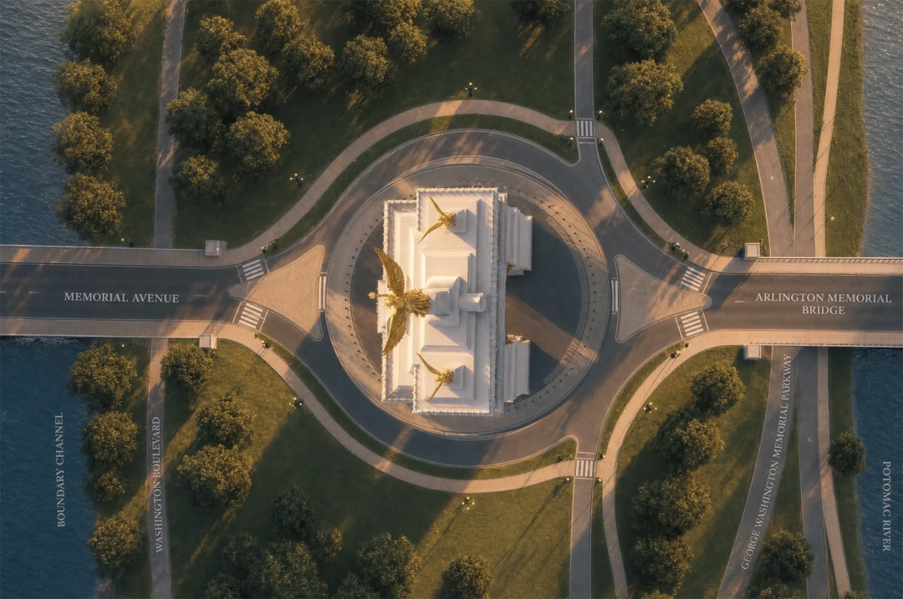
11月11日，作为民主党最具代表性的政治家族之一，肯尼迪家族九名成员正式加入诉讼，请求法院阻止工程，理由是该构筑物高250英尺，会在阿灵顿国家公墓肯尼迪兄弟墓地上投下阴影，构成对安息之地的贬损。
此外，退伍军人团体则早在2026年2月即已提起诉讼，核心论点之一是该项目未经国会授权，而国会才对毗邻阿灵顿国家公墓的联邦土地上的建设拥有决定权。
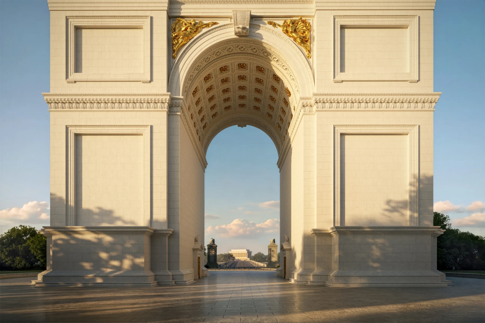
面对争议与阻力，特朗普政府似乎不为所动，持续以效果图和总统标志性金色字体来推销总统钟爱的项目，甚至开通了凯旋门项目官网。
不过，至少目前，特朗普这一浮夸的建筑项目已被暂缓，而更广泛的法律战仍在前方。
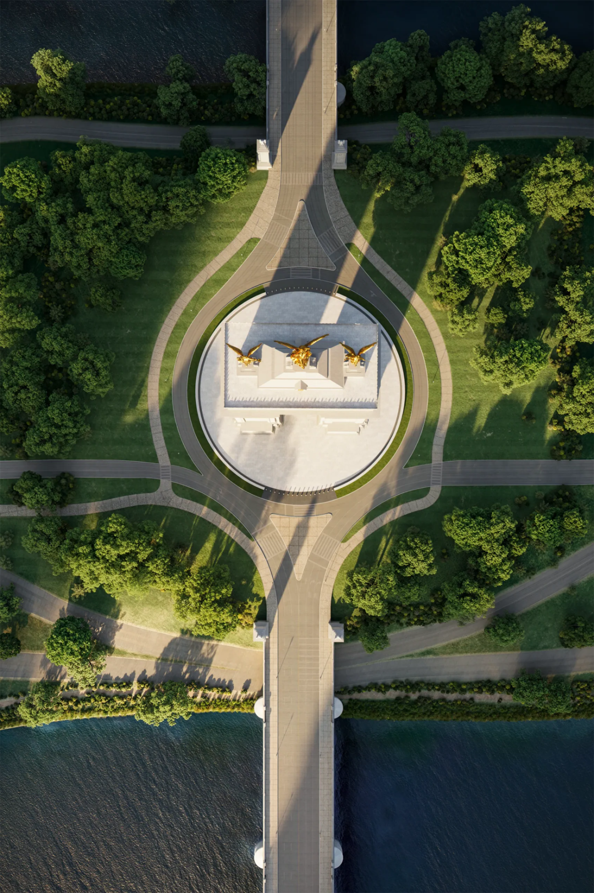
这座官方名为“美国凯旋门”的建筑，选址波托马克河哥伦比亚岛纪念环岛，正落在林肯纪念堂与阿灵顿公墓的视觉轴线上。媒体评估项目整体投资约2亿美元。
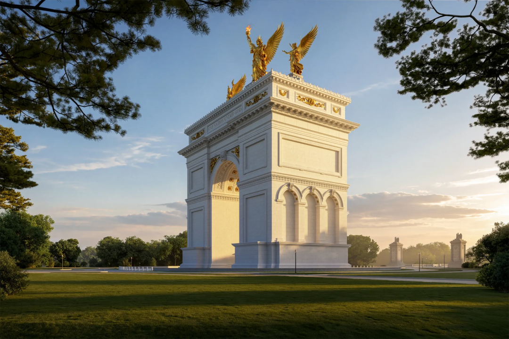

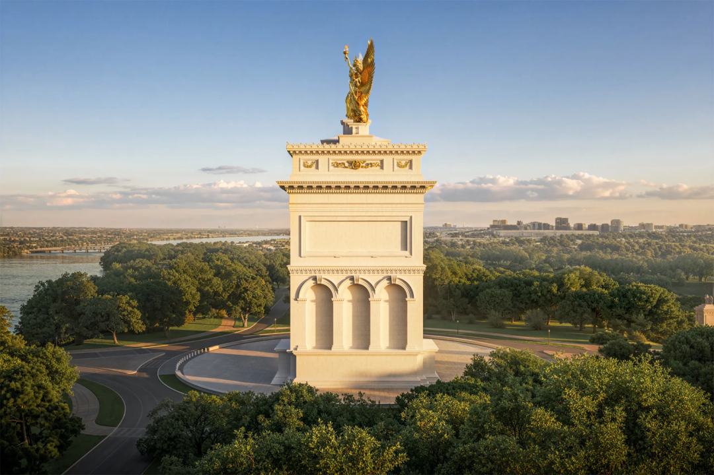
建筑高度定为250英尺（约76米），这一数字被解释为对《独立宣言》发表250周年的“数字致敬”；建成后它将超过巴黎凯旋门（约50米）和朝鲜凯旋门（约60米），成为全球最高的凯旋门式建筑。
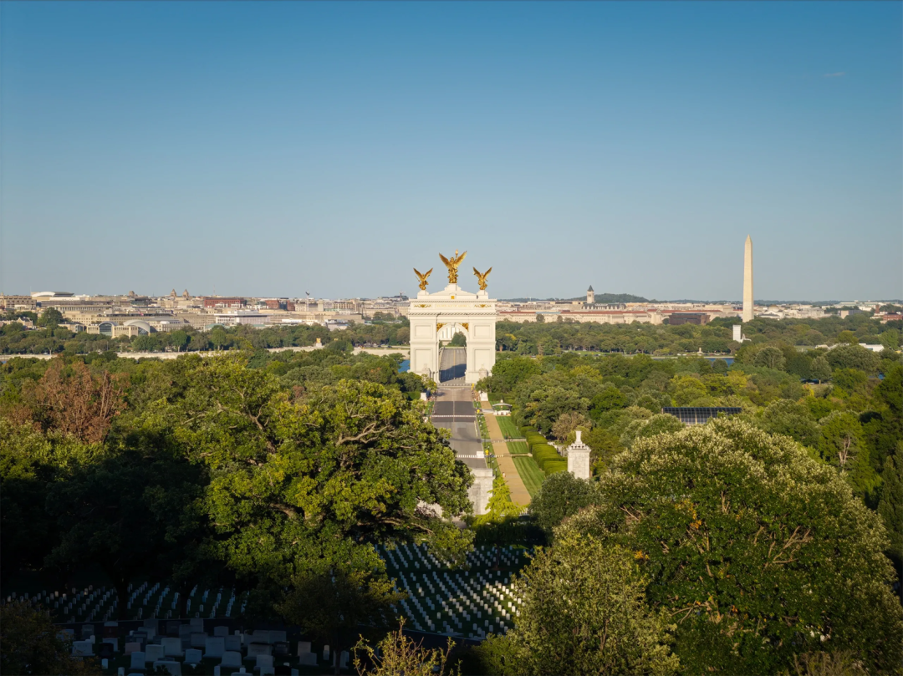

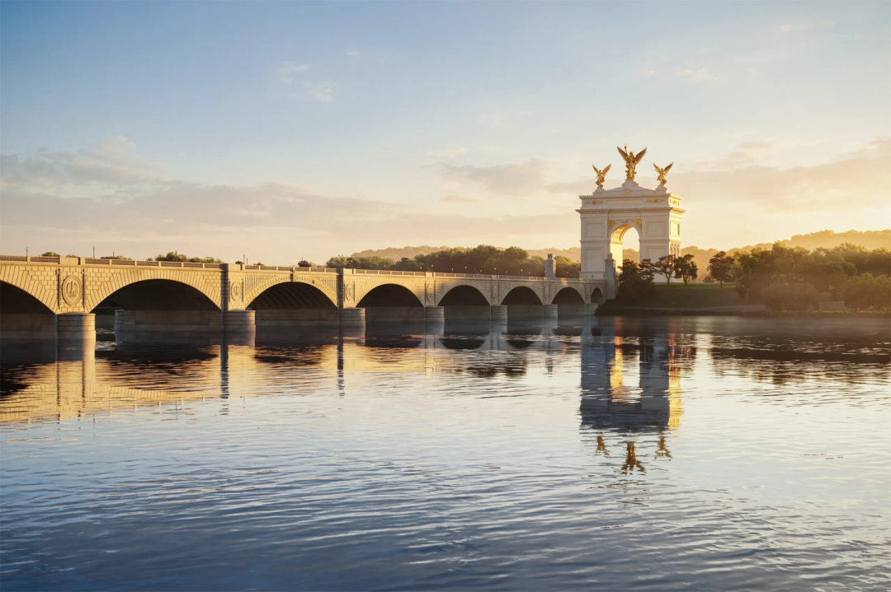
设计由Harrison Design承担，主创建筑师为Nicolas
Charbonneau。方案采用典型的新古典主义语汇，以巴黎凯旋门为原型，但在尺度与装饰密度上做了显著放大。
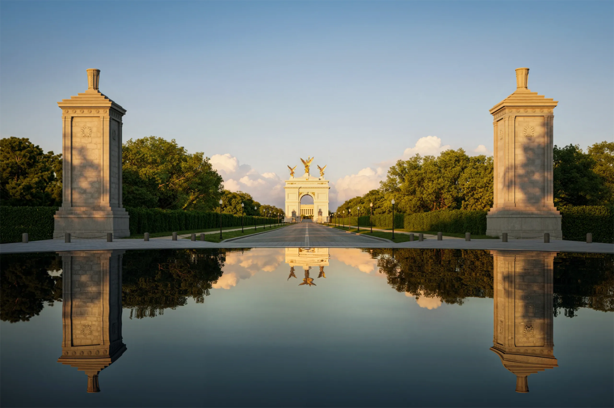
拱门主体为石质饰面结构，正面镌刻金色铭文“One Nation Under God”，另一侧则为“With Liberty and Justice for
All”，直接援引美国效忠誓词与立国信条。
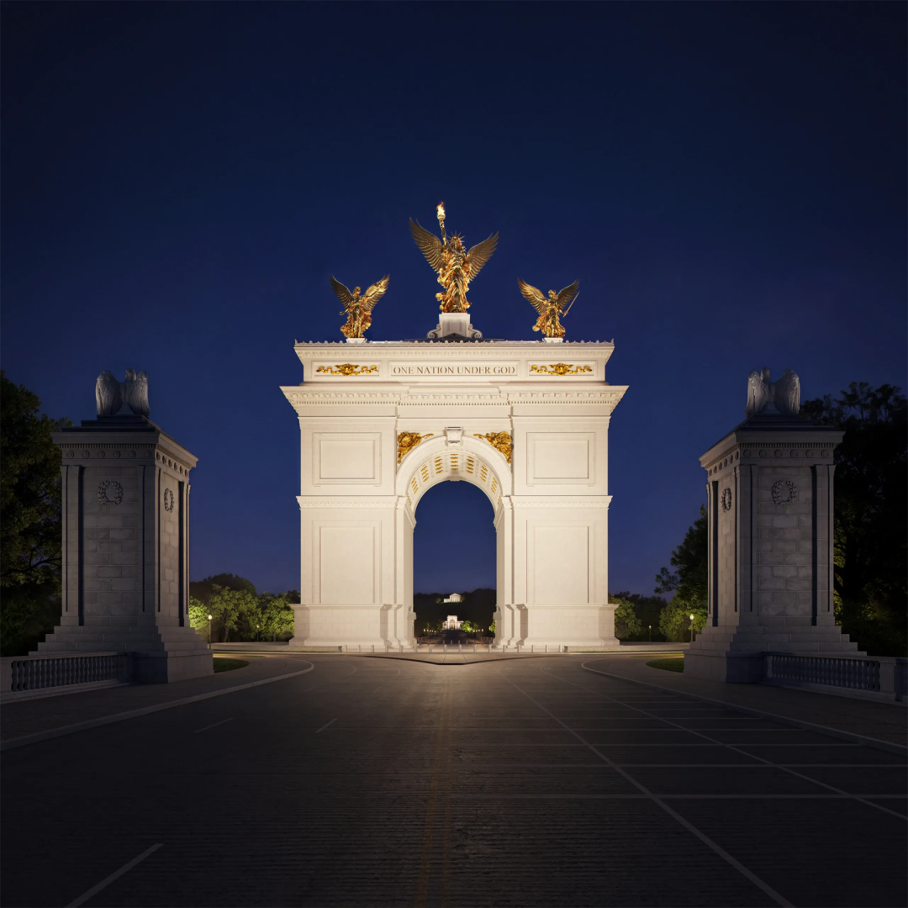

** ** 编辑：吉文 | 视觉：慕熙 胡音  **
** 联系：赵赵（id：cunquchina）  **
** 往｜期｜精｜选  ** **
** ** 
** 
** GA｜能｜见｜度  **

** ** 欢迎在以上12大平台  ** ** 搜索、订阅“GA环球建筑”  ** ** 一同见证设计的力量  ** **

