# 投资80亿，高168米！全球最大的球形巨幕落户杭州！

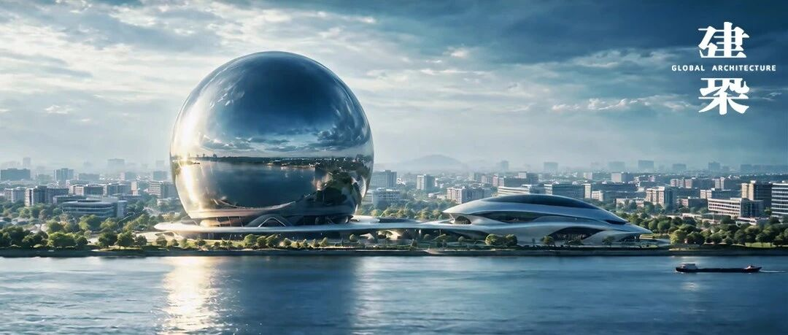

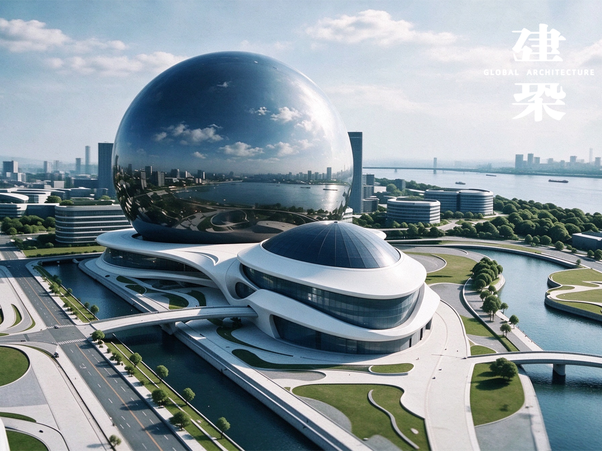

杭州，即将解锁一项世界之最！

2026年10月30日，在钱塘区服务业大会上，“视界之眼”球型沉浸式巨幕演艺中心项目正式亮相，建成后，将是全球规模最大的球形沉浸式演艺场馆。

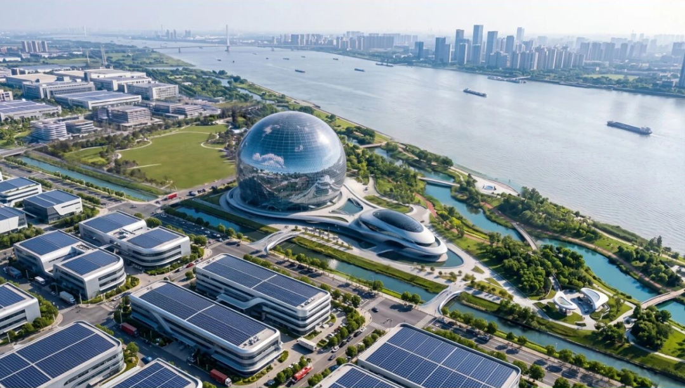

它的选址位于金沙嘴一线沿江的核心区域，目标直指“继西湖、大运河之后，杭州又一张可漫步、可体验、可记忆的城市名片”。

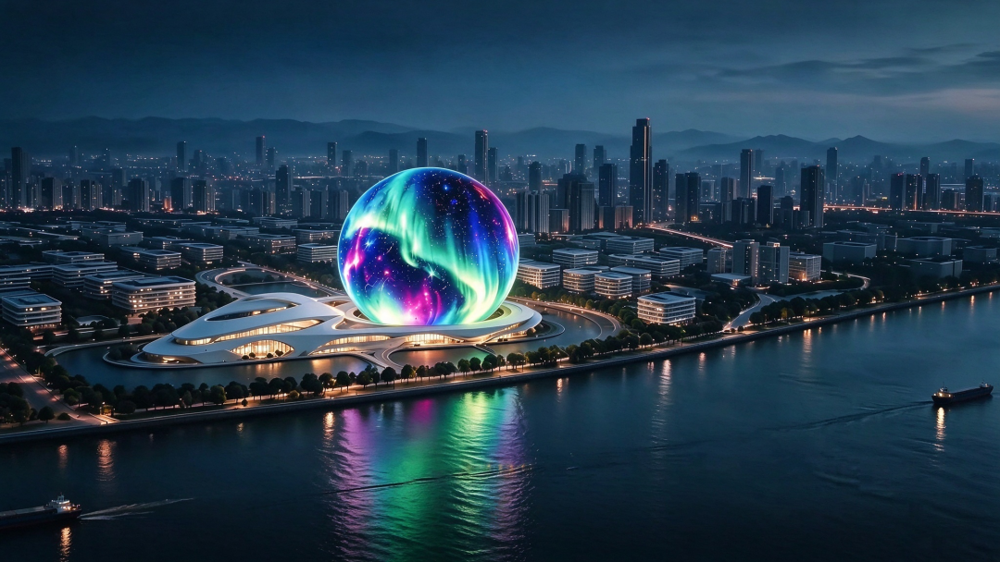

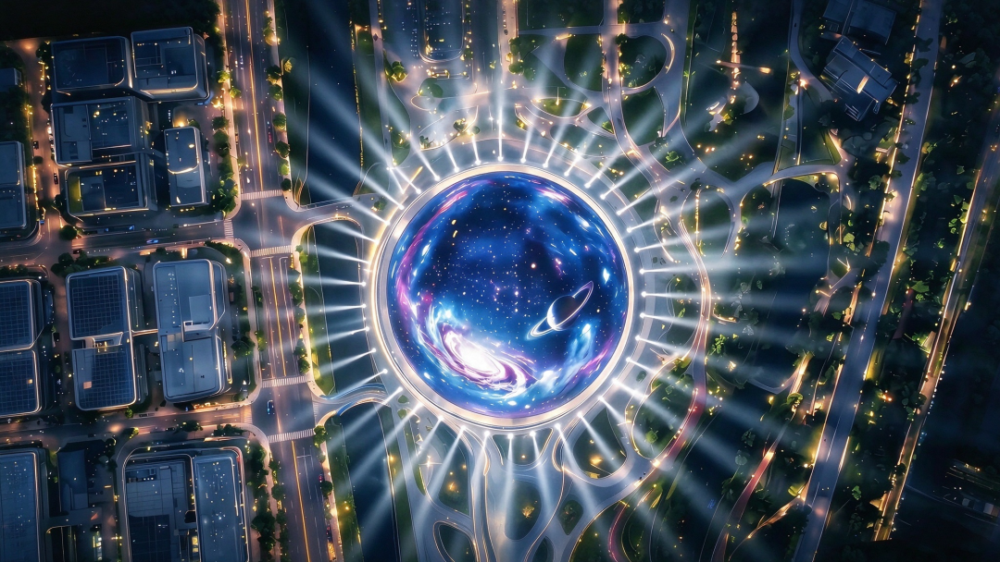

项目由信时国际投资有限公司（中国香港）主导、视界之眼（杭州）数字娱乐科技有限公司投资建设，总投资约80亿元，主体用地约84亩，并谋划周边约240亩拓展配套。

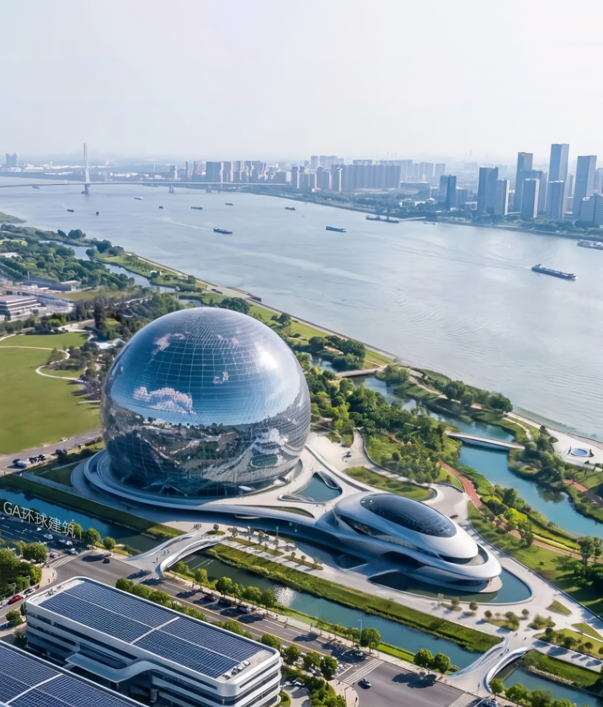

球体直径约168米、高约122米，内设约2万个座位，外立面LED屏约7.2万平方米。投用后预计年客流900万至1300万人次，年营业收入超26亿元。

作为参照，美国拉斯维加斯MSG Sphere的球体直径约157米、高约111米、座位约1.76万个，外屏约5.4万平方米。视界之眼在直径、高度、座位数和外屏面积四项指标上均设定了更高的数值。

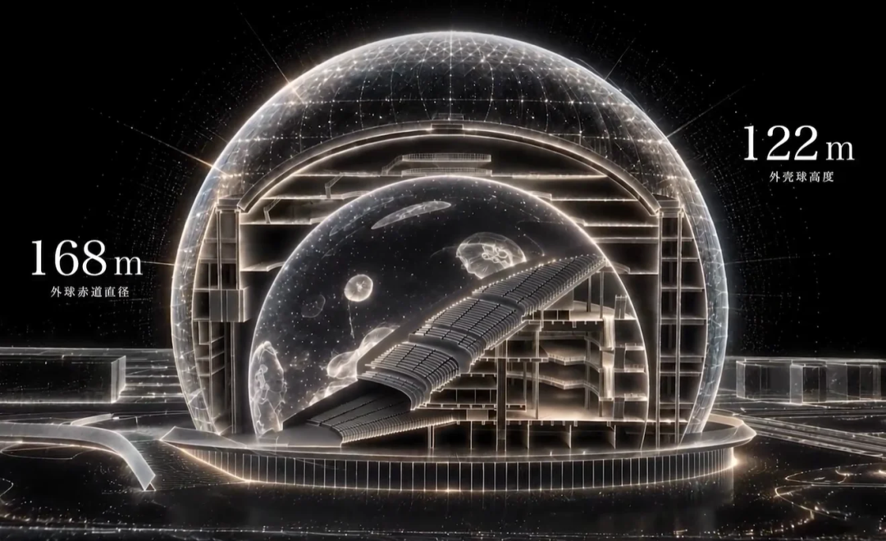

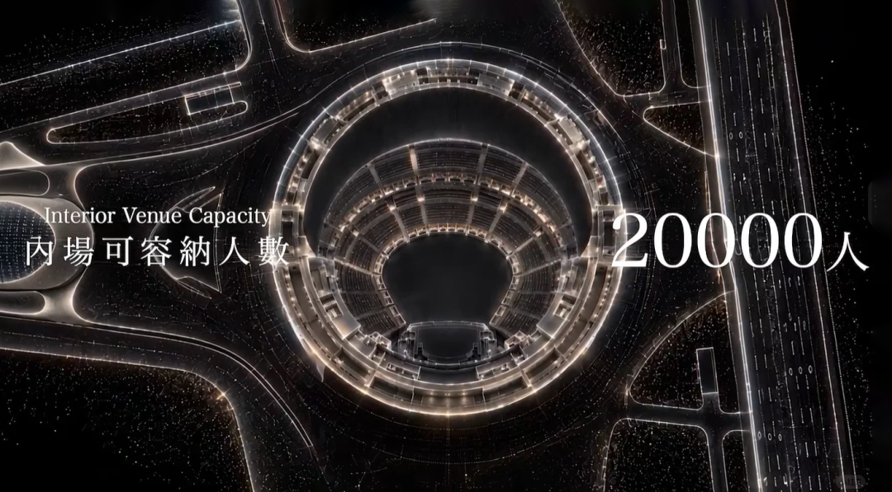

能否实现“全球规模最大的球形”，取决于后续设计深化与工程落地能否兑现纸面参数。

它的难题尤其体现在近乎全屏化的表皮。7.2万平方米LED意味着球体几乎没有“非显示立面”；显示单元如何附着球面网壳、曲面精度如何保证像素连续，都考验工程技术。美国MSG Sphere曾以参数化建模优化富勒式网壳与铸钢节点，控制误差并减重约40%。视界之眼直径更大，节点精度更严，毫米级偏差可能变成拼接缝或亮度断层。

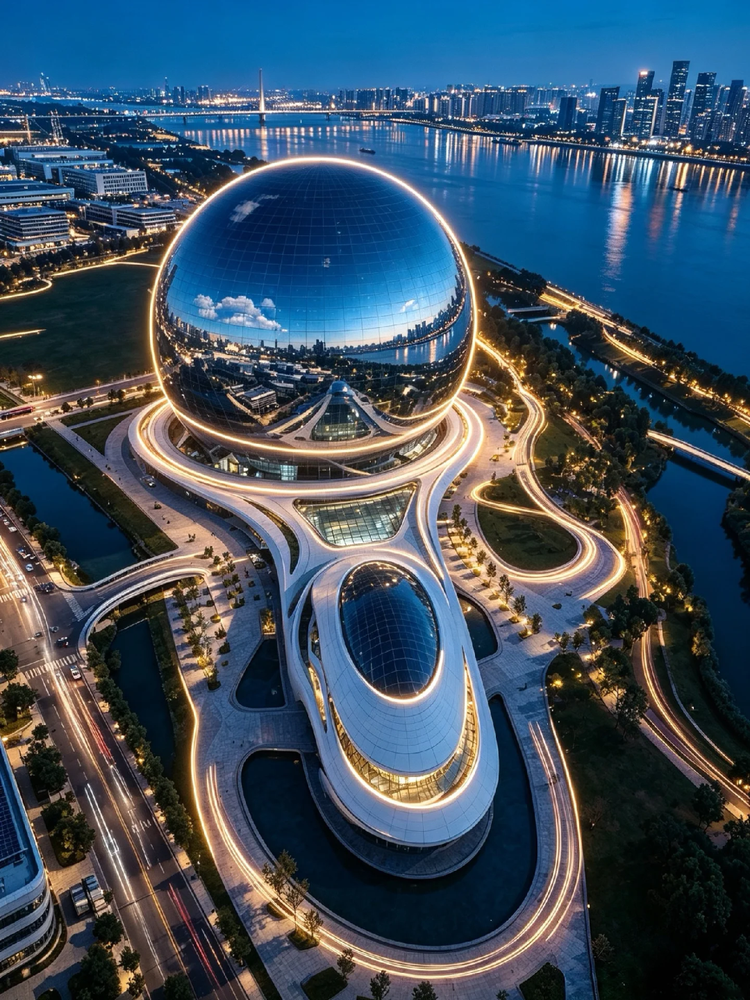

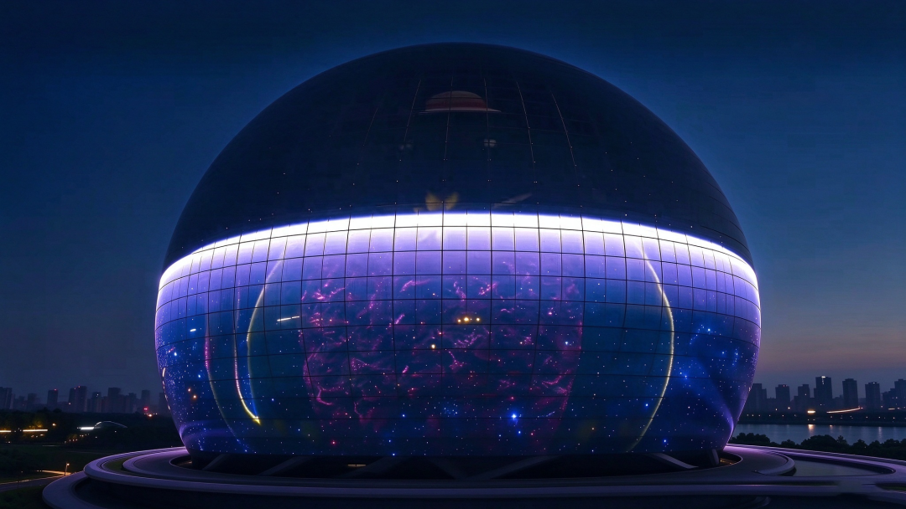

内部同样极具挑战。

球幕内表面是巨型显示面，2万座位带来人体荷载、视线遮挡和声学反射；球形凹面会聚焦声音，造成局部过强或不足；吸声与扩散构造需加在网壳内侧，又不能破坏屏幕视觉完整性等。

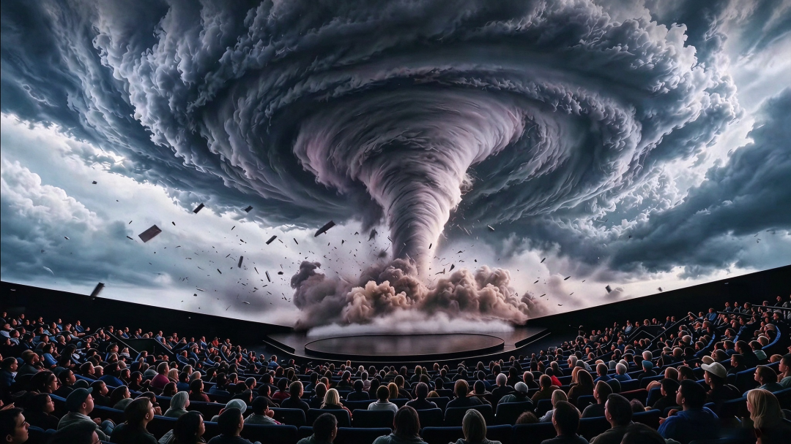

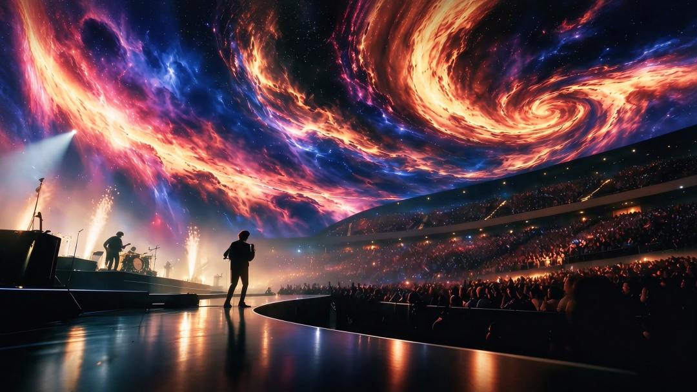

据介绍，项目全部国产化的设计，将完美体现中国应用科技和文化创新已跻身世界领先水平。

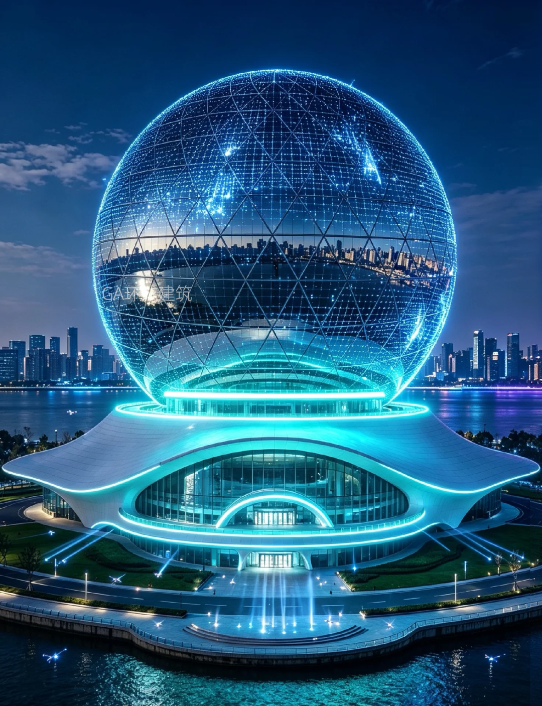

“我们建设的是一座奇观，超乎想象的尺寸，超乎想象的形态，带来的是视觉感官的直接冲击力。”信时国际投资总裁、视界之眼总经理黄俊豪说，“观众走进剧场，在巨大、超高清的屏幕环绕下，不再是坐在屏幕前看内容，而是真正走进了我们为其塑造的场景之中，将获得从未有过的沉浸式体验。”

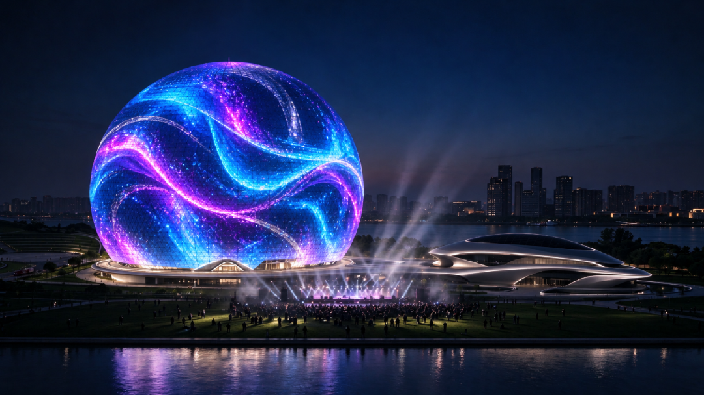

未来，球内计划承载沉浸式剧目、万人演唱会、品牌发布及电竞、街舞、击剑、拳击等赛事；球外布局漫展、音乐节、庆典和无人机灯光秀等。球外将持续开展漫展、音乐节、节日庆典、无人机灯光秀、主题文化活动等。

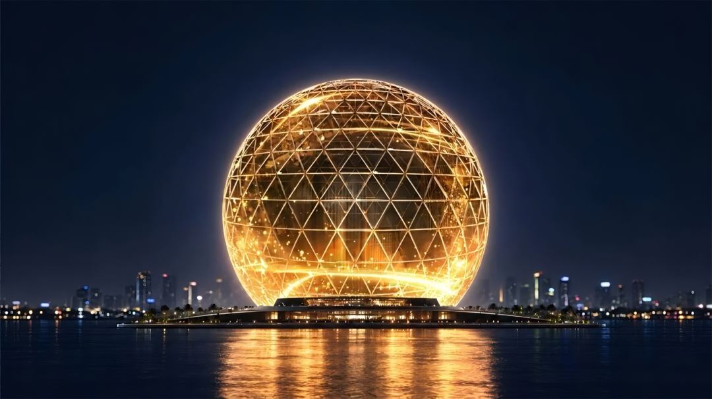

编辑：吉文 | 视觉：慕熙 胡音

联系：赵赵（id：cunquchina）

往｜期｜精｜选

GA｜能｜见｜度

欢迎在以上12大平台

搜索、订阅“GA环球建筑”

一同见证设计的力量

预览时标签不可点

不喜欢
