# 投资39亿，上海工业博物馆，幕墙开工！

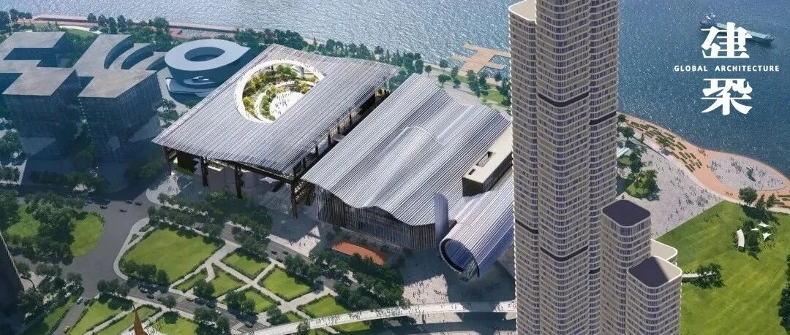

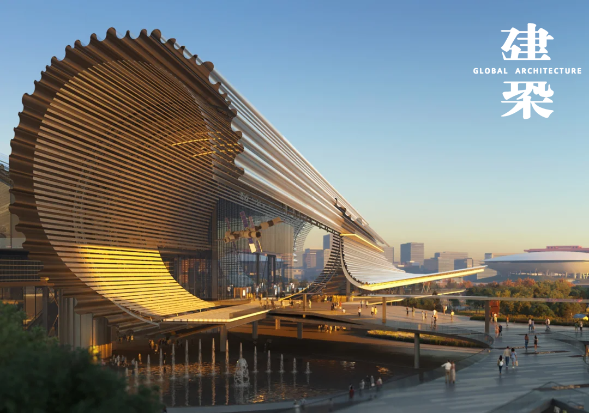
11月4日，上海工业博物馆幕墙工程全面开工，进入外立面实质性施工阶段。该馆由上海城投集团、东浩兰生集团合资组建的上海工博建设管理有限公司建设，机施集团负责幕墙专业实施。
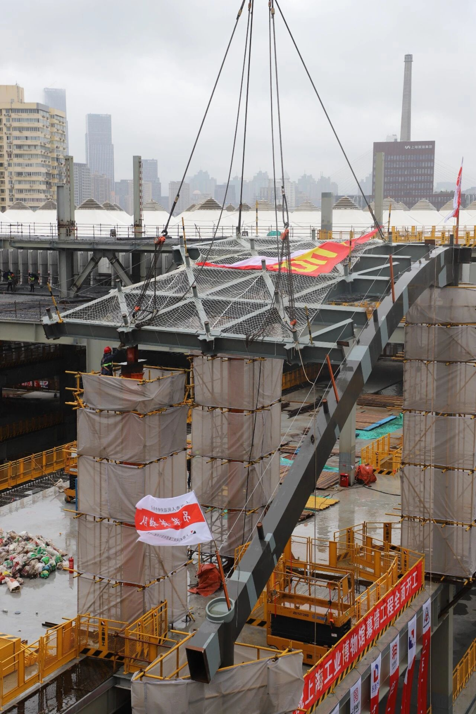
博物馆位于黄浦滨江江南制造总局旧址，定位世界一流国家级工业博物馆，也是工信部国家工博馆体系首馆。
项目总投资约39亿元，建设用地3.18万平方米，总建筑面积约11万平方米，建筑高度45米，地上7层、地下2层。
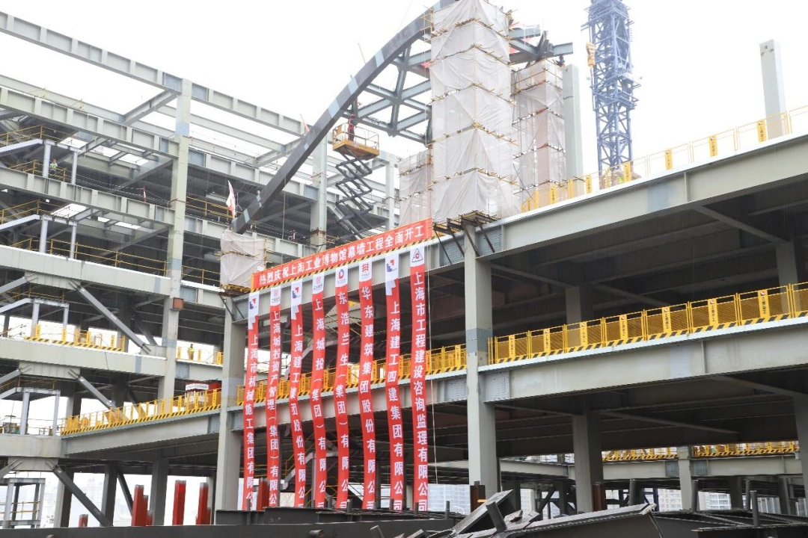
设计由华建集团华东建筑设计研究院有限公司牵头，联合株式会社隈研吾建筑都市设计事务所完成。
方案以“无界、生长”为理念，以“工业画卷式连续波浪形屋面”为核心，用起伏连续的屋面轮廓表现“工业浪潮”涌动。这一独特造型，被网友趣称中国“最卷”博物馆。
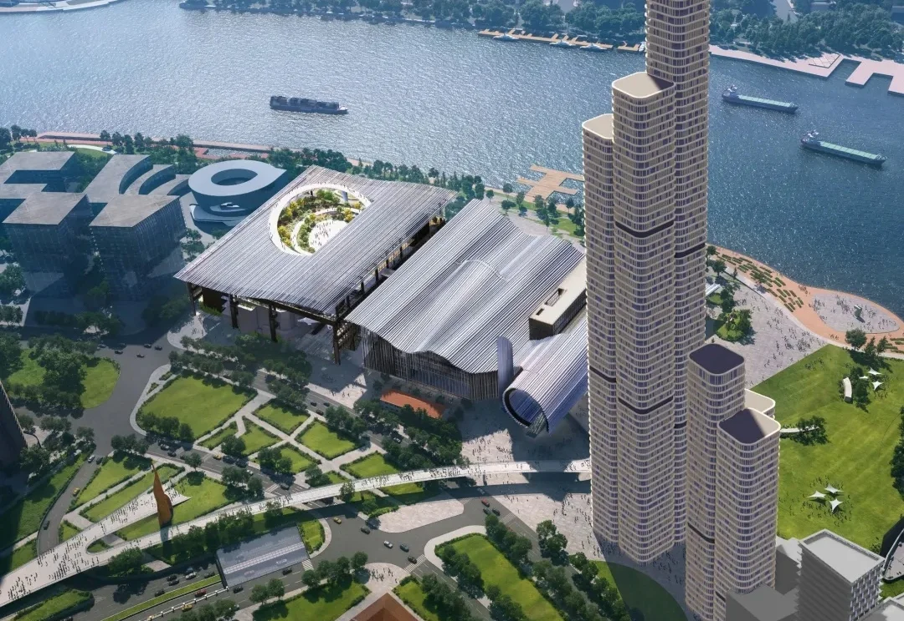

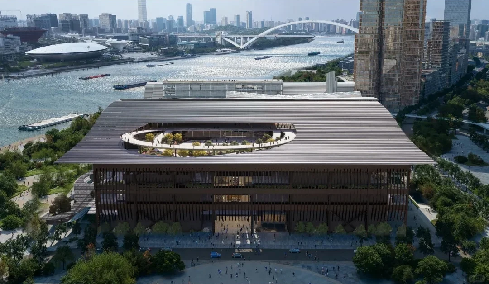
贯穿南北的“工业之门”为直径35米巨型空间通廊，西接世博彩虹桥，南延至滨江大台阶，既过渡城市与江岸，也承载首发首秀、时尚消费体验。
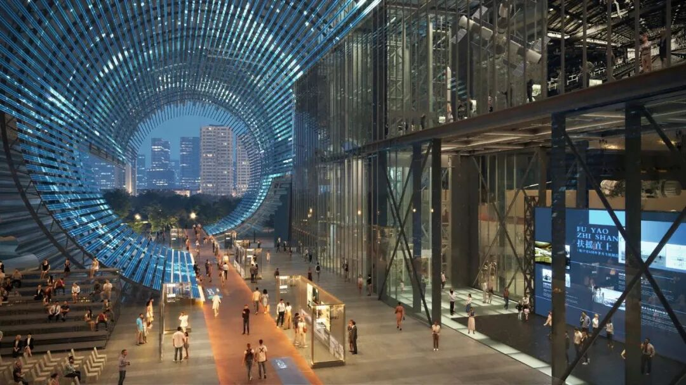

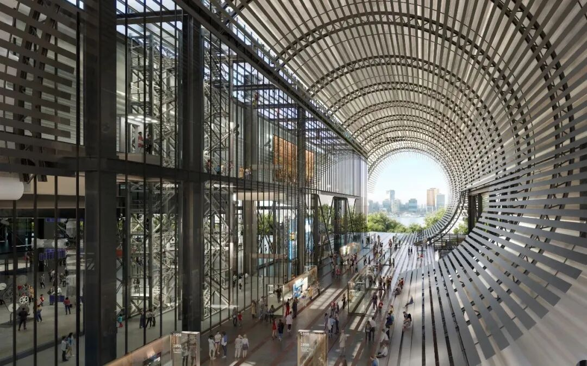

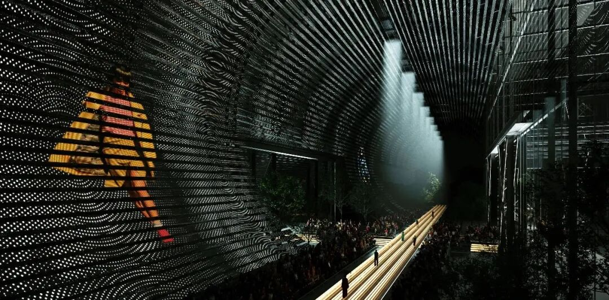
滨江大台阶则将建筑基座与公共水岸缝合，使博物馆的室外空间成为滨江公共活动链条的一部分。
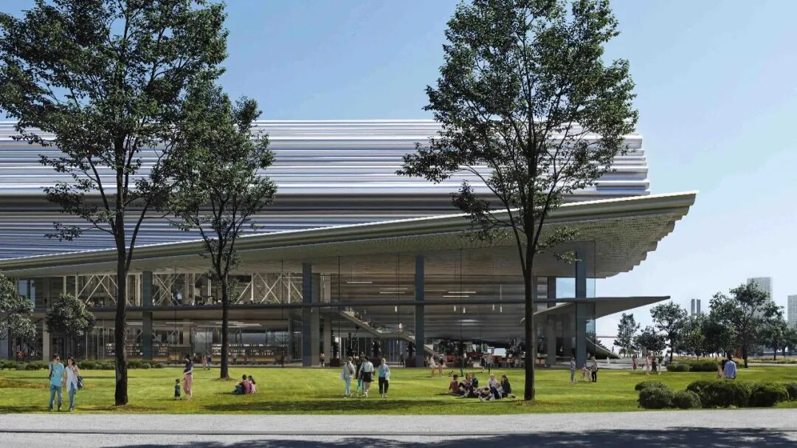

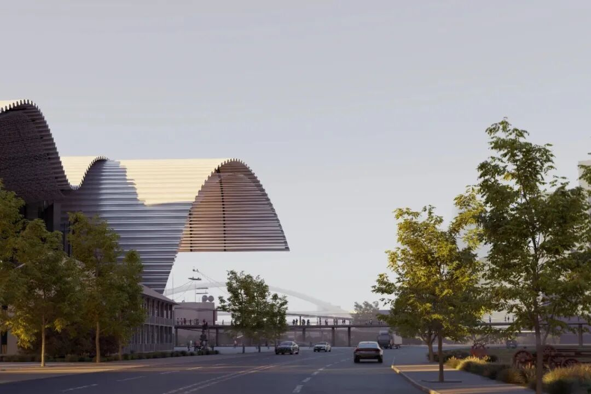
博物馆标志性外观由波浪形屋面和外立面幕墙共同构成，屋盖分R1、R2、R3三个分区。
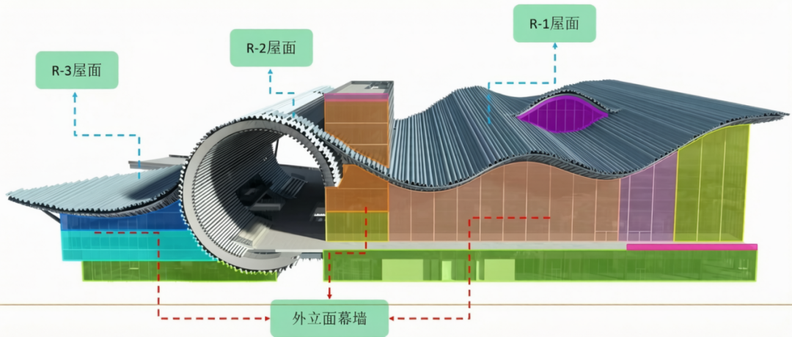
双曲异形大跨屋盖包含单层网壳及配套金属屋面，投影面积3.2万平方米；线形复杂、杆件上万，施工难度大、精度要求高。
据介绍，今后的施工中，机施集团项目团队将分区域采用两种工艺：吊装区域用“临时支撑体系+高空整体单元式吊装”，整体提升区域用计算机同步液压整体提升技术。
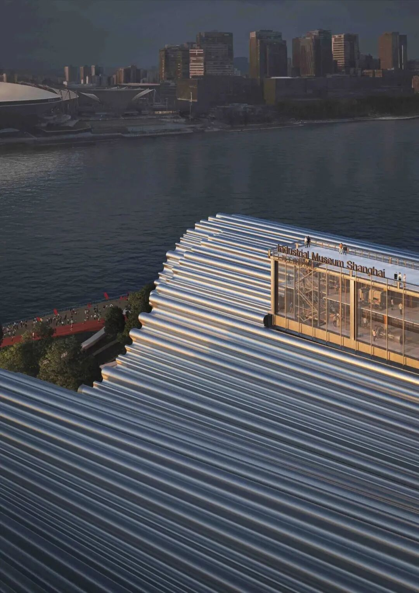

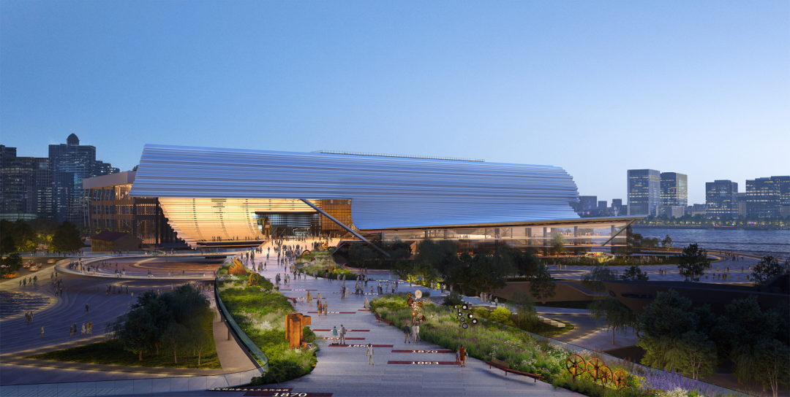
项目预计2027年竣工。届时呈现的不只是一段可以行走、观看、触摸的上海工业地理，更将填补上海缺乏综合性工业博物馆的空白。
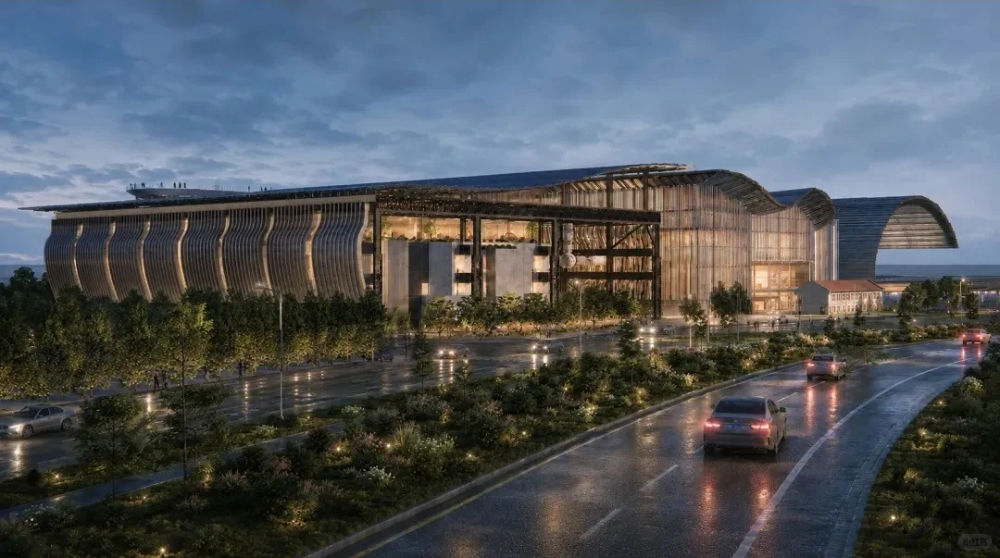
注：本文效果图仅供参考，
以最终实际建成为准。

** ** 编辑：吉文 | 视觉：慕熙 胡音  **
** 联系：赵赵（id：cunquchina）  **
** 往｜期｜精｜选  ** **
** ** 
** 
** GA｜能｜见｜度  **

** ** 欢迎在以上12大平台  ** ** 搜索、订阅“GA环球建筑”  ** ** 一同见证设计的力量  ** **

