# 407米！深圳在建第一高楼，幕墙完工！

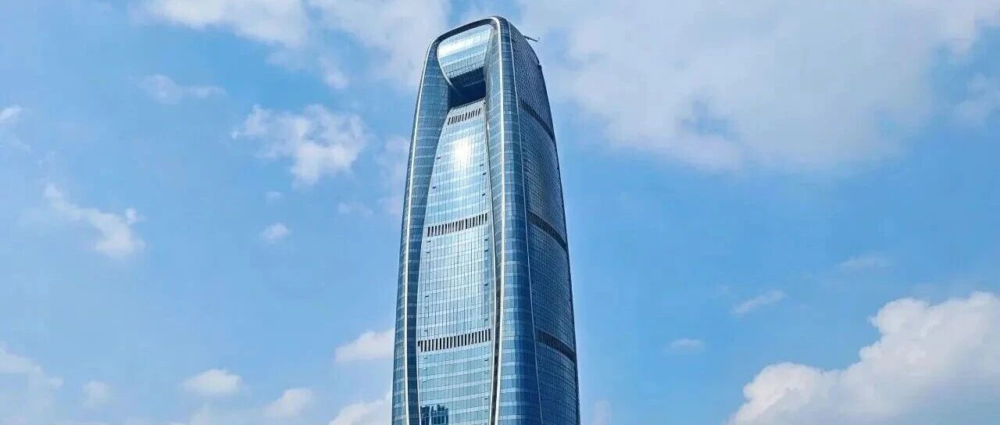

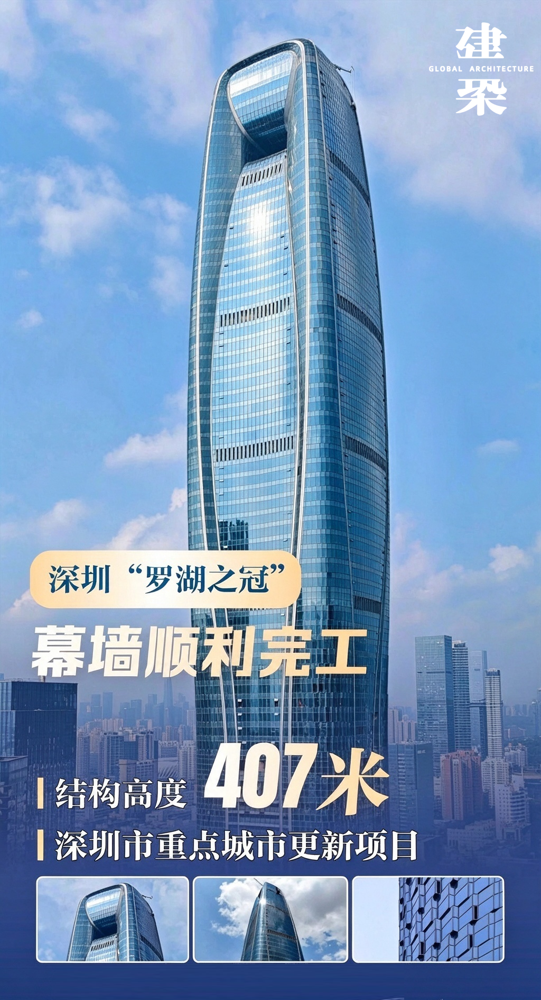
近日，深圳云投大厦项目幕墙施工收官，标志着这座超高层地标“外衣”正式落成。
作为深圳市城市更新建设重点公投项目，它坐落于原“中华第一仓”梅园仓库地块之上，承载着该区域从传统仓储向金融科技总部转型的使命。
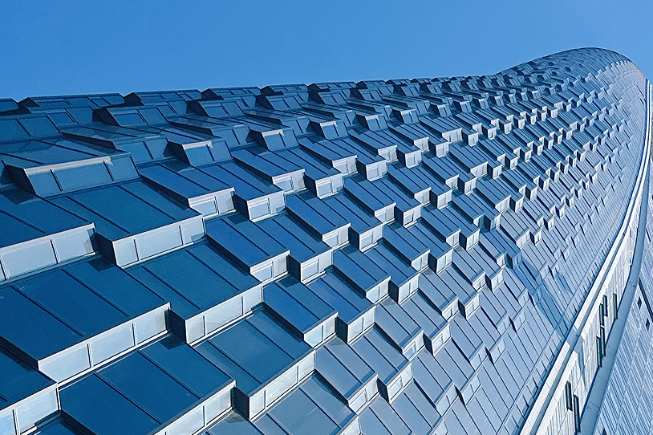
云投大厦结构高度407米，地上83层，裙楼5层，是目前深圳在建第一高楼，竣工后将成为深圳第三高楼，仅次于平安金融中心与京基100大厦。
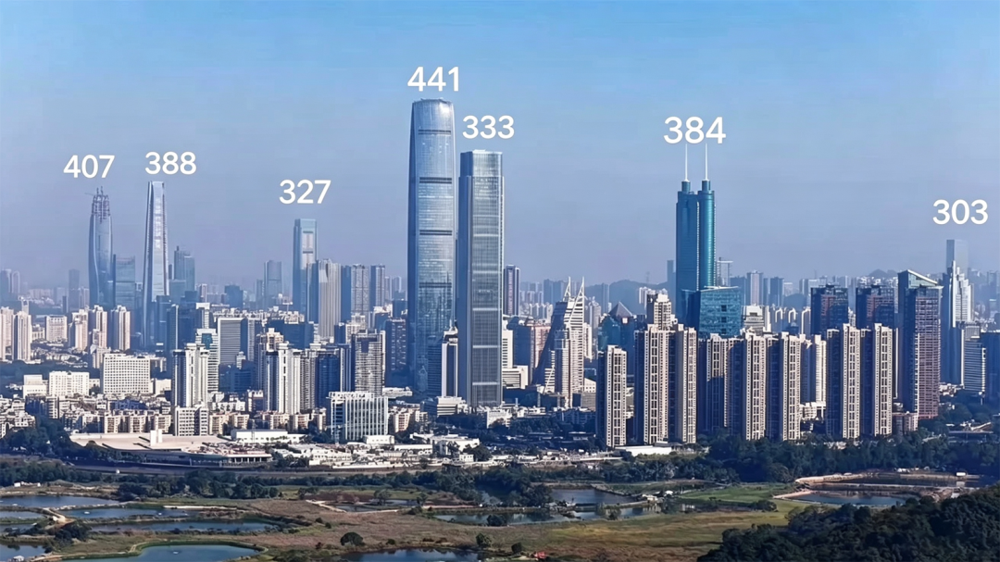

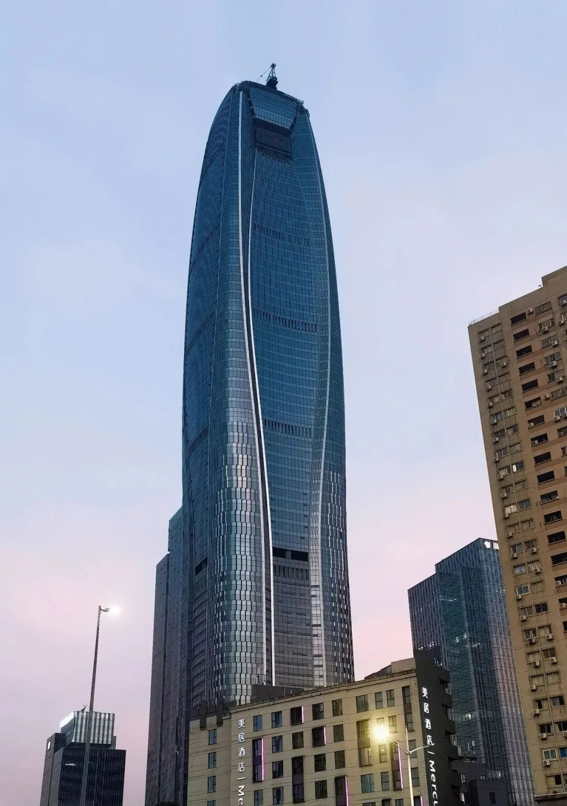
建筑设计由伍兹贝格与AUBE欧博设计联合完成，理念围绕“罗湖之冠”展开，整体造型灵感源自四叶草，以“酒杯”为意象，曲线内收、轮廓舒展，具有极强的流线感与现代视觉冲击力。
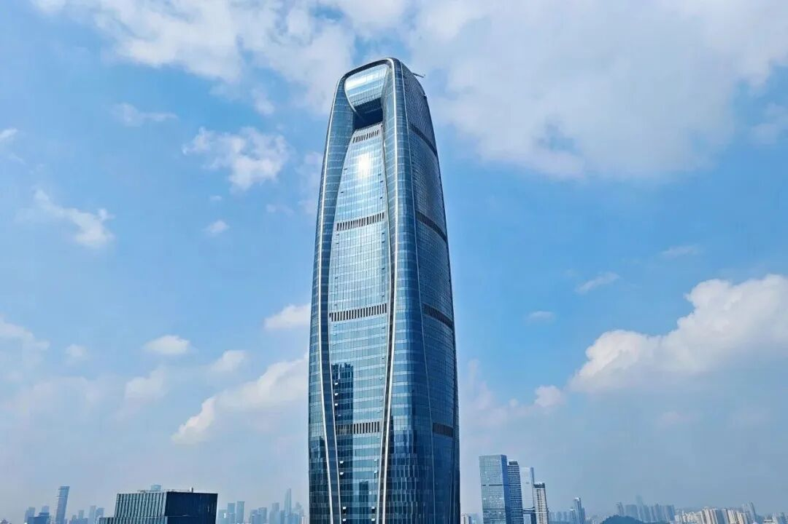
大厦幕墙面积9.43万平方米，  PAG朋格幕墙负责幕墙设计。
外立面集合渐变流线、鱼鳞错落、风洞弧形曲面等20余种异形幕墙，层层交织，为塔楼披上专属“鳞片”。
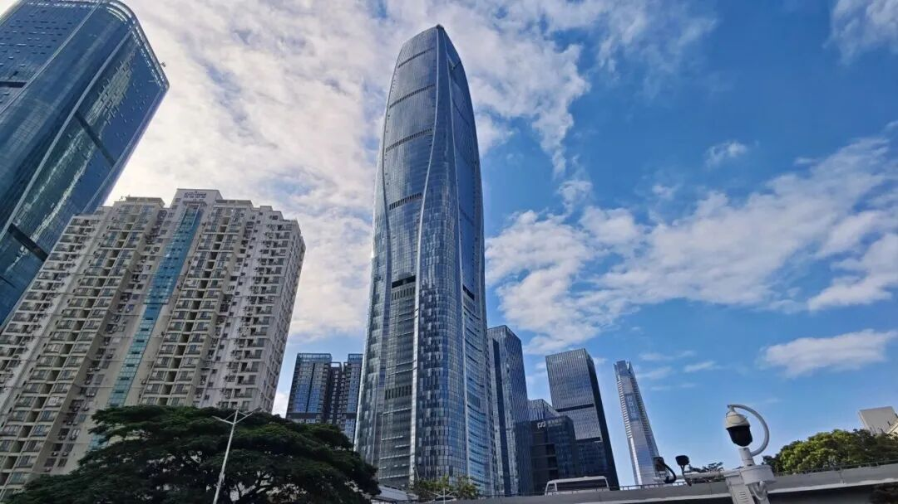
渐变倾斜效果依赖板块错位实现，上下层最大错位达1米；复杂单元体逾万樘，型材开模近600套，构件空间角度跨度70°至120°，设计、加工与安装难度不小。
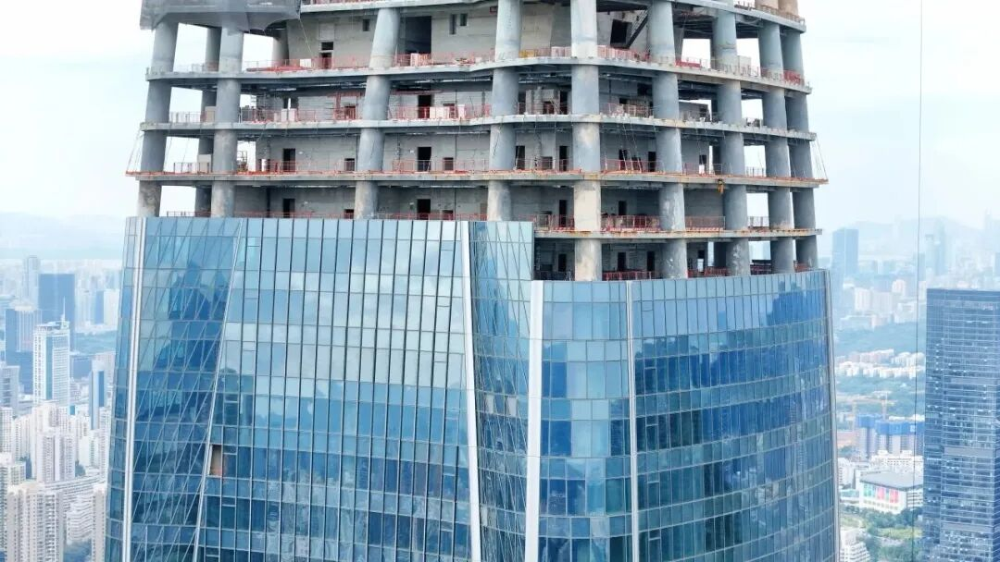
为精准呈现弧形鳞片效果，项目联合设计团队提出“折线拟合弧形+横梁分体”方案，避开玻璃热弯和型材拉弯工艺，将精度误差控制在1.5毫米以内。
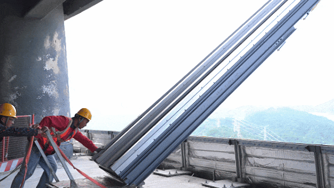
最具标识性的处理在塔冠：自75层起，核心筒分为南北两部分，抵达顶部时逐步向内收缩，形成一个镂空通风口，“罗湖之冠”由此得名。
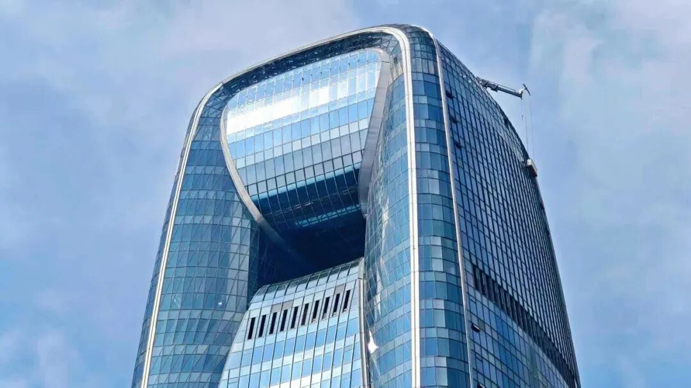
这个风洞并非纯粹的造型修辞，其核心功用在疏导高空强风带来的巨大气压，使屋顶大堂区域在自然风力下保持气流平稳。
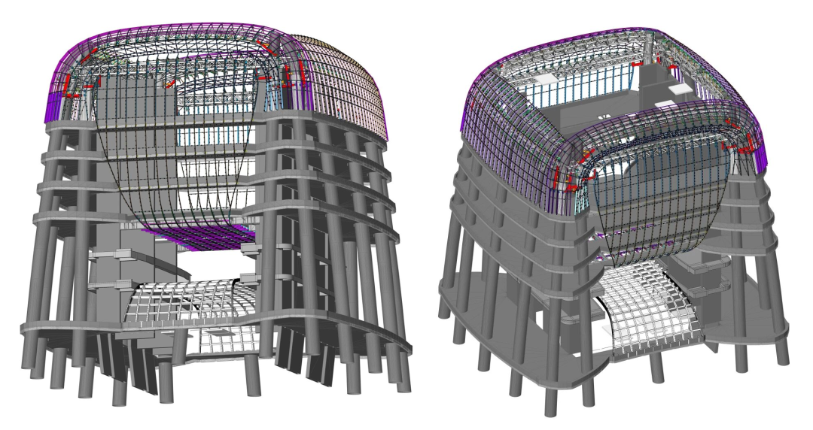

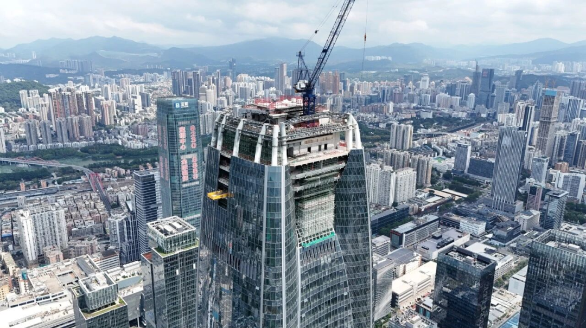
日前，云投大厦斩获2026年世界垂直城市学会（CVU）首届中国奖“最佳未来建筑奖”，反映出业界对其在超高层复合功能与城市界面重塑方面的认可。
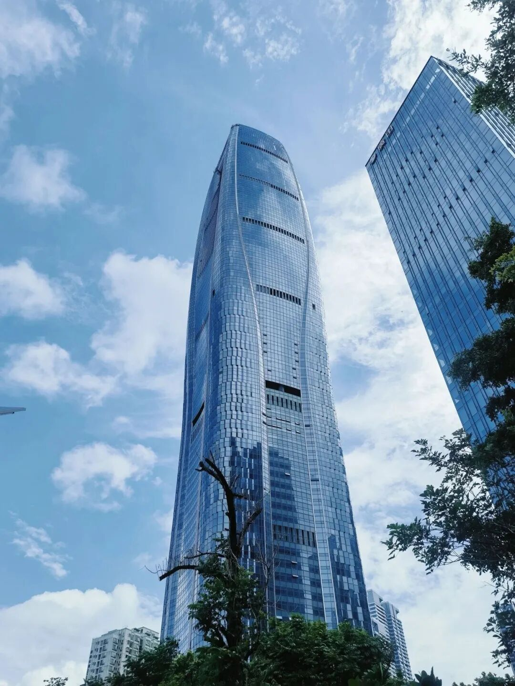
本文图片来源：中建五局

编辑：吉文 | 视觉：慕熙 胡音
联系：赵赵（id：cunquchina）
往｜期｜精｜选[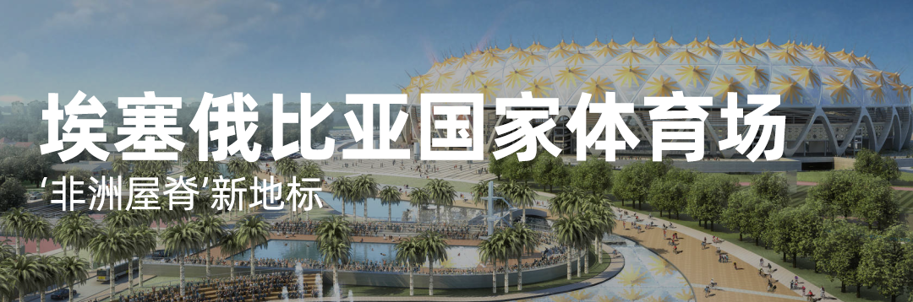](https://mp.weixin.qq.com/s?__biz=Mzg2NjA5OTE5Nw==&mid=2247681168&idx=1&sn=c4ff61997fe7cb15825477f5e339fe8f&scene=21#wechat_redirect)
GA｜能｜见｜度

欢迎在以上12大平台  搜索、订阅“GA环球建筑”  一同见证设计的力量

