# KPF操刀，TP-LINK杭州总部露真容，投资约10亿！

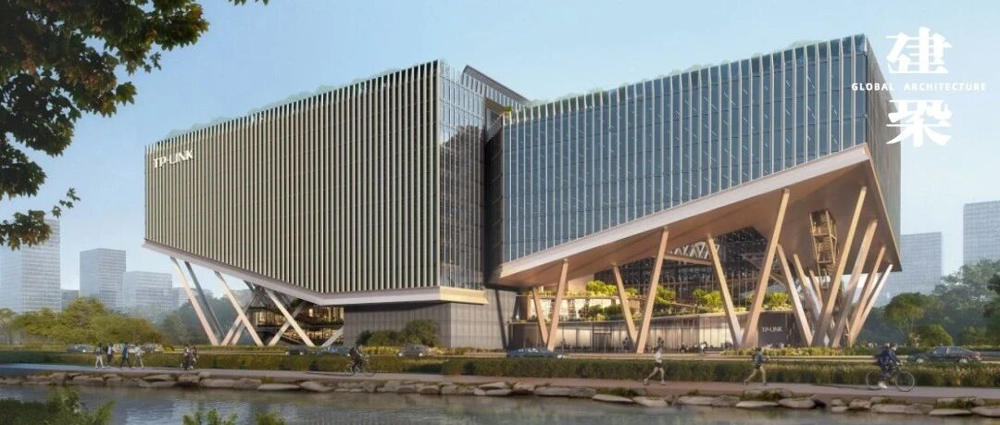

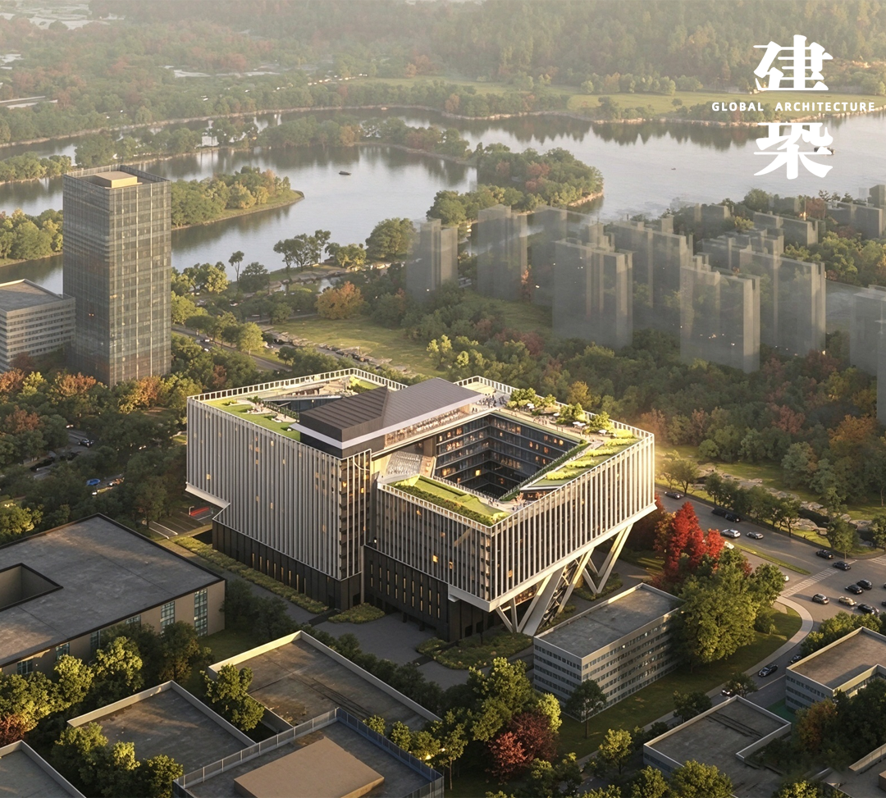
TP-LINK（普联技术）杭州新总部的正式名称为“杭州联吉智能终端产品基地”，目前，该项目外立面基本完成，预计2027年初竣工！
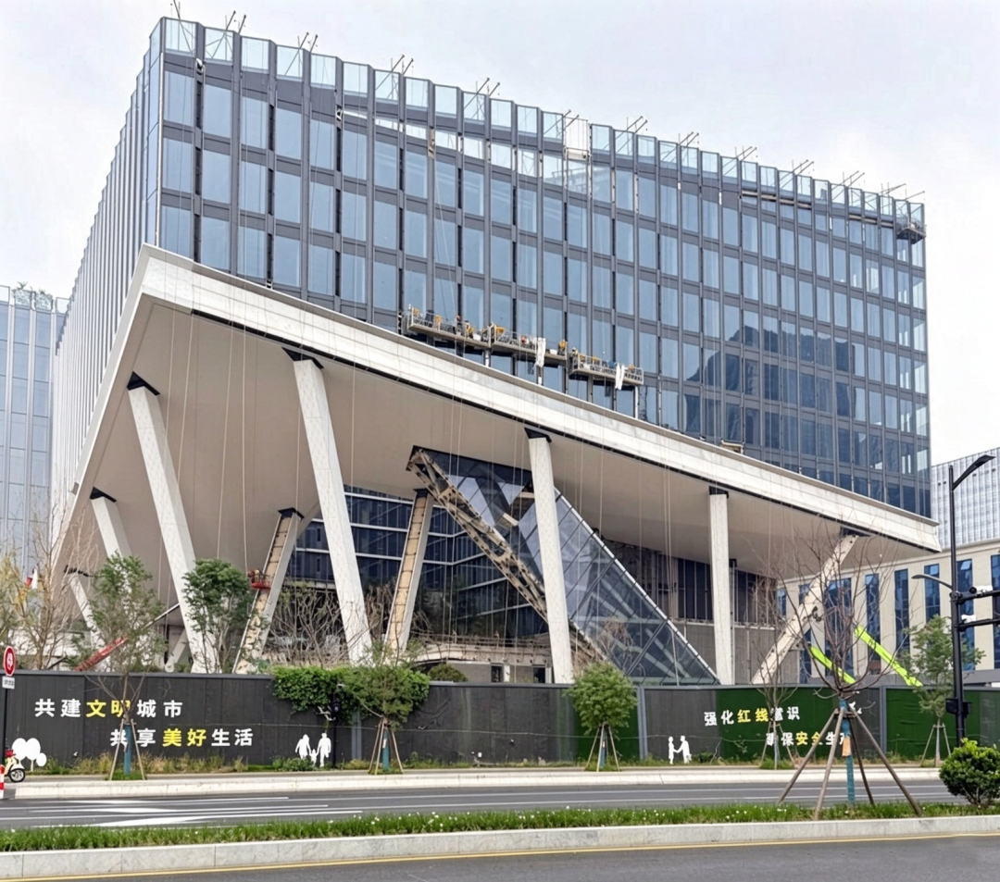
作为全球路由器出货量第一、产品覆盖170多个国家和地区的网络设备巨头，TP-LINK投资约10亿元打造杭州总部，并以此推动“深、杭双总部”战略。
杭州总部也是其第二大研发中心，集研发、系统集成、解决方案与运营等功能于一体。
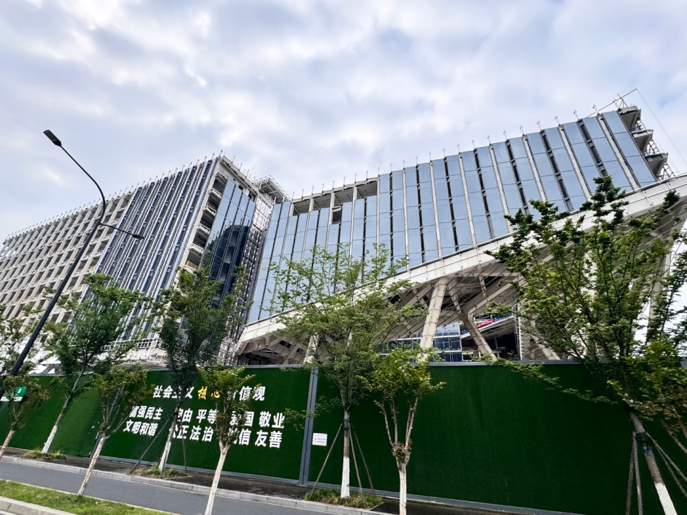
图源：Claire成长日记
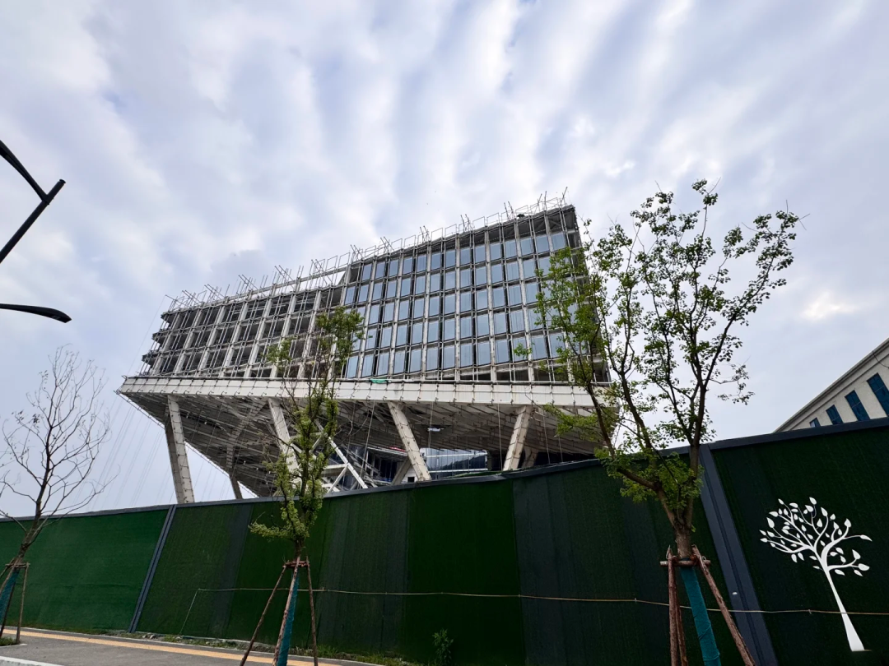
图源：Claire成长日记
项目位于杭州高新区，用地约38亩，总建筑面积约11万平方米，地上11层、地下2层。
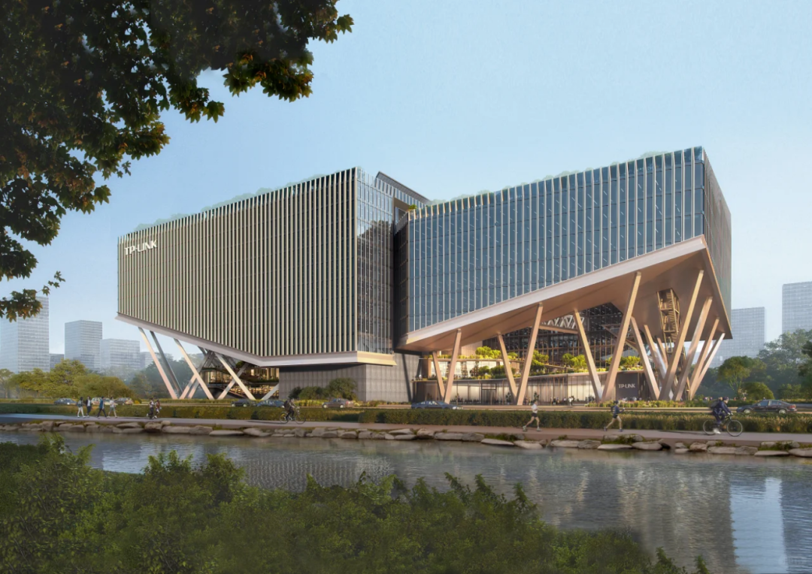
建筑由国际顶尖事务所KPF领衔设计，以“未来风、国际范、江南韵味”为定位，将杭州传统庭院空间作当代转译。
设计在中部置入两个剖面错位的庭院，形成“8”字形流线骨架：底部串联零售、餐饮与共享配套，屋顶环廊贯通两座主体，使公共动线在水平和垂直方向闭合。办公空间朝内庭院与白马湖双向取景，在紧凑研发功能中嵌入自然尺度。
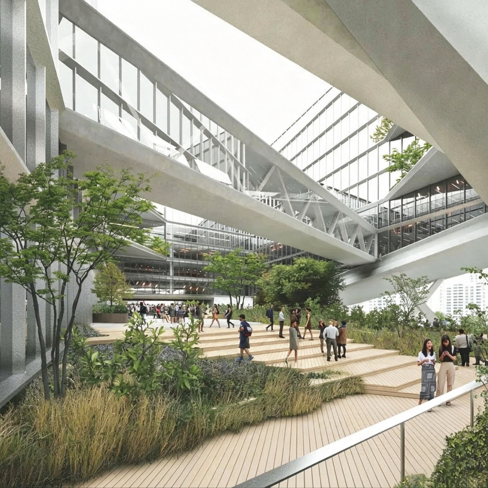
外立面兼顾遮阳、防眩光与自然通风，体量走向顺应主导风向和日照角度。
底部12组“V”形框架柱承托转换层，将大跨度研发空间与上部标准层清晰勾连。
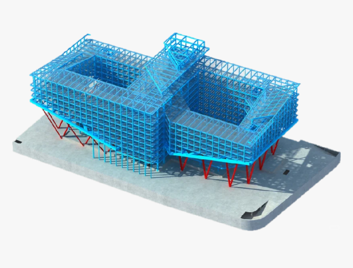
整体不追求塔楼高度，而以水平展开的板式体量回应滨江高新区研发园区肌理；双庭院错位布置，在保证各功能板块独立运作的同时，形成共享的“中间地带”。
中庭幕墙采用悬挂式缆索结构，搭配超白夹层玻璃，极致通透；南北板楼外立面则用高反射低辐射中空玻璃和垂直铝板。
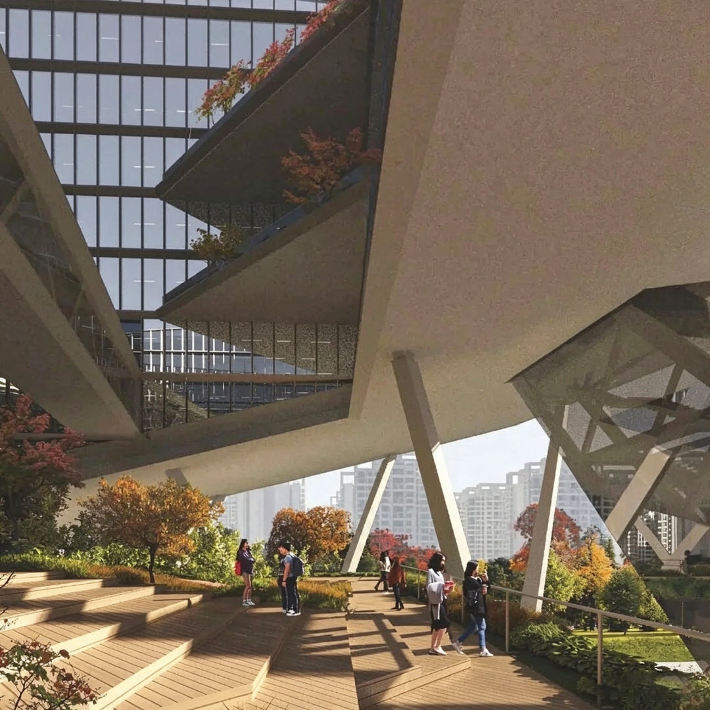
项目以LEED金级认证为目标，通过乡土植物、透水铺装和绿色屋顶管理雨洪、缓解热岛效应。
2027年，这座“织锦为园”的总部大楼将正式亮相，为滨江区添一座辨识度鲜明的城市地标，并推动智能制造和数字经济发展。
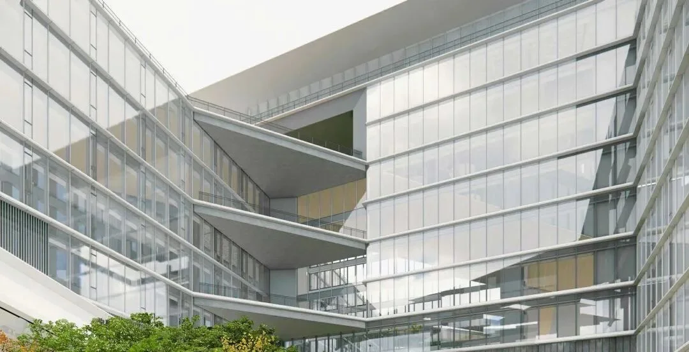

编辑：吉文 | 视觉：慕熙 胡音
联系：赵赵（id：cunquchina）
往｜期｜精｜选[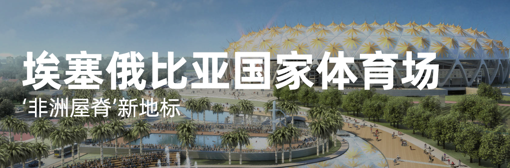](https://mp.weixin.qq.com/s?__biz=Mzg2NjA5OTE5Nw==&mid=2247681168&idx=1&sn=c4ff61997fe7cb15825477f5e339fe8f&scene=21#wechat_redirect)[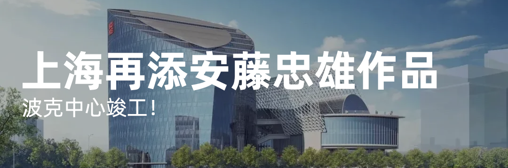](https://mp.weixin.qq.com/s?__biz=Mzg2NjA5OTE5Nw==&mid=2247680993&idx=1&sn=c3e7635900a63a7c414df45a9b0bc95e&scene=21#wechat_redirect)
GA｜能｜见｜度
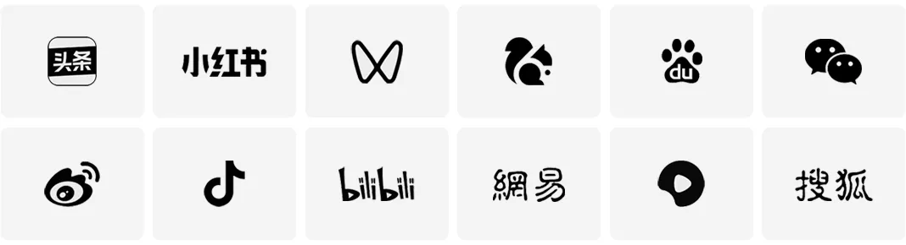
欢迎在以上12大平台  搜索、订阅“GA环球建筑”  一同见证设计的力量

