# 素朴新作｜海南临高百仞滩闸坝变身桥亭：基础设施承载公共生活

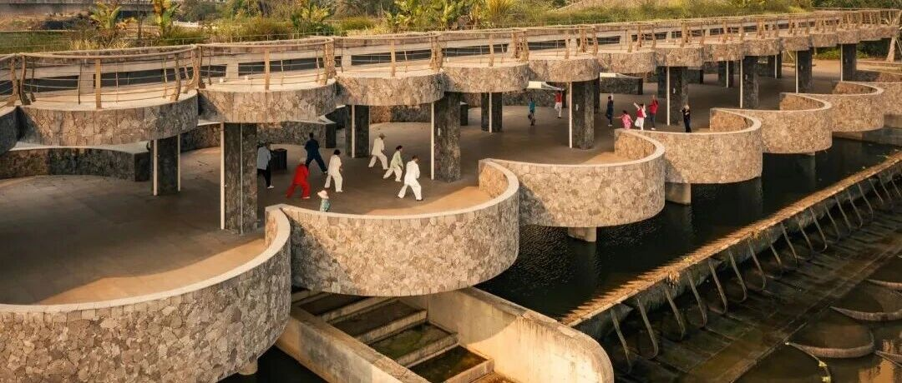

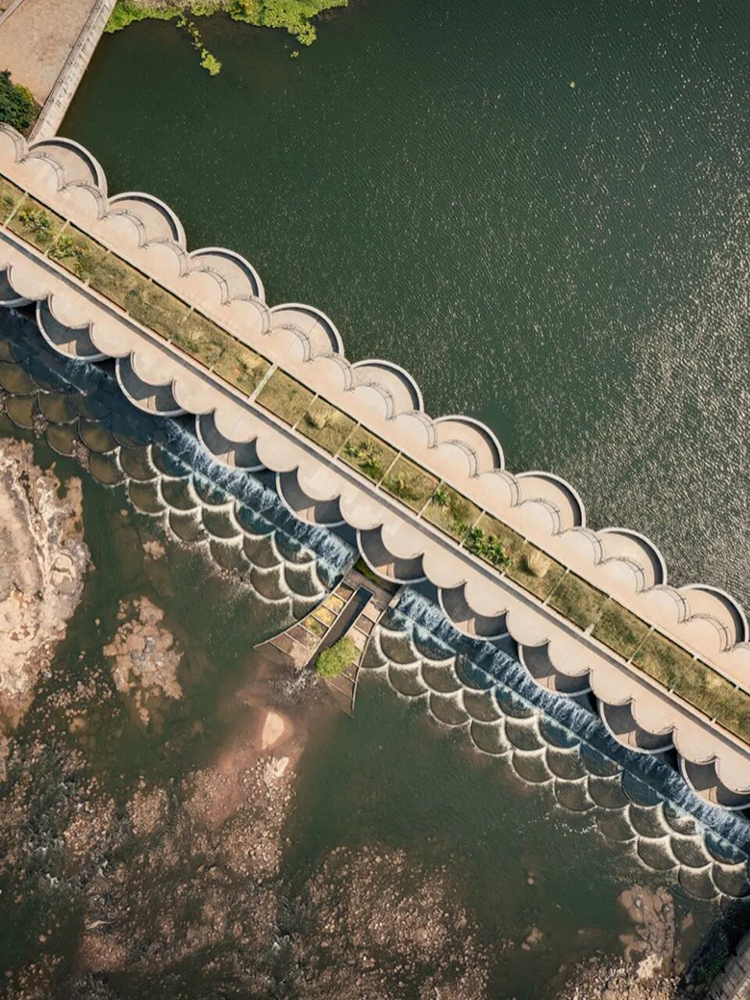

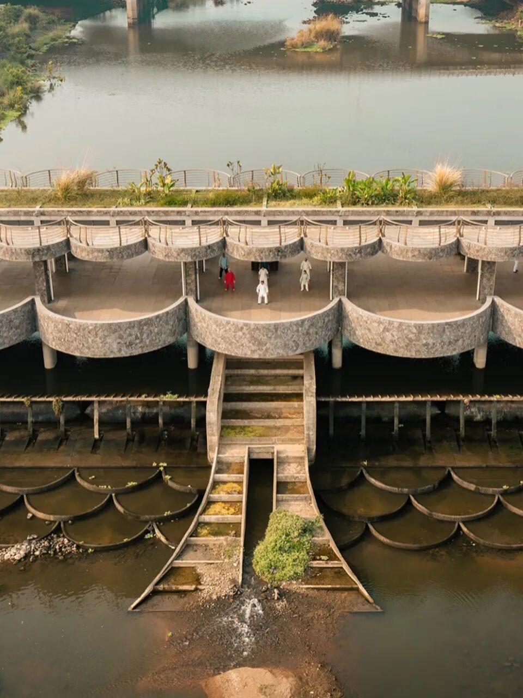

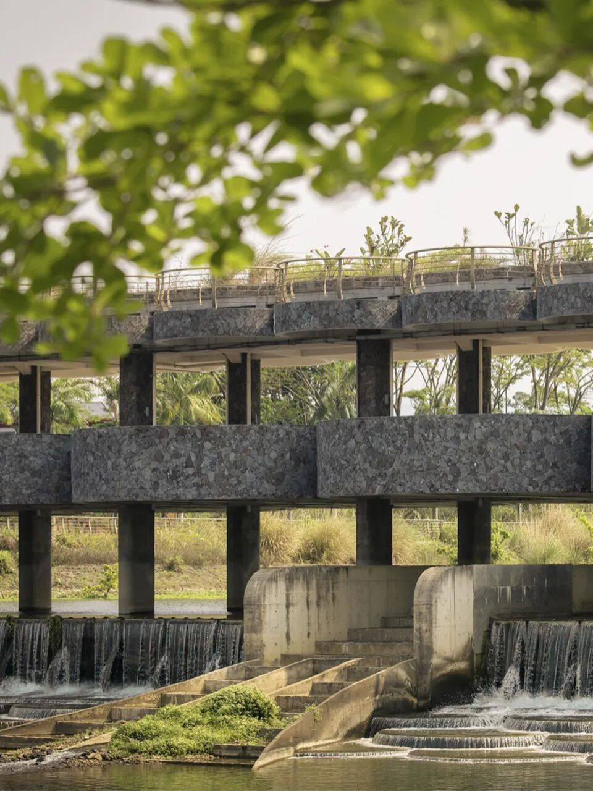

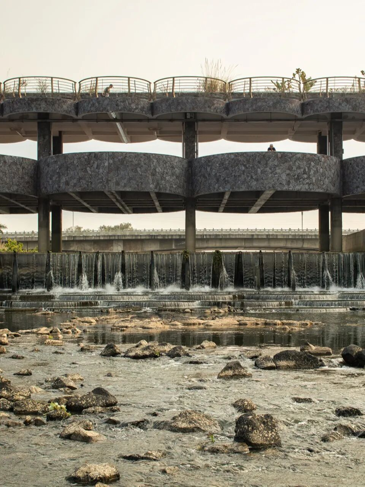

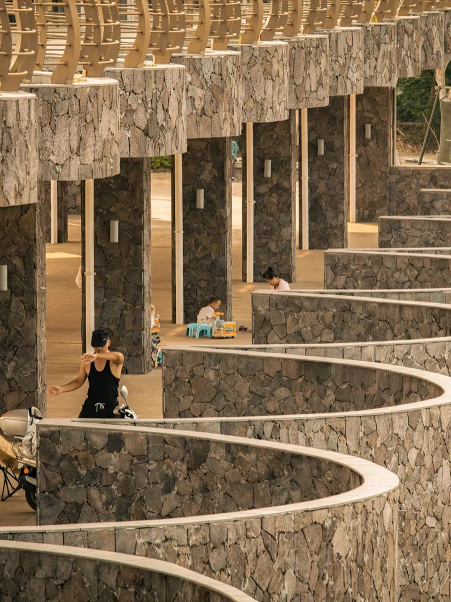
©  夏至
当一项水利工程进入已经高度城市化的环境，我们或许可以重新追问：基础设施是否能够借更新之机会成为一种公共空间、一种社会基础设施，成为河流与城市、自然与社区之间重新建立联系的媒介？
感谢  ** 素朴工作室  ** 对gooood的分享
从水坝到桥亭——基础设施承载公共生活
在存量发展阶段，城市更新不只是对老旧建筑和街区的修补，支撑城市运行的基础设施的更新，也理应成为不容忽视的重要组成部分。同时，长期以来，水利基础设施被视为人类调蓄自然的利器，以效率、安全和防洪调蓄为首要目标，因而常被隔离于城市日常生活之外，形成工程系统与公共空间彼此分离的状态。当生态修复、韧性城市与公共空间逐渐成为当代城市发展的共同议题，当一项水利工程进入已经高度城市化的环境，我们或许可以重新追问：基础设施是否能够借更新之机会成为一种公共空间、一种社会基础设施，成为河流与城市、自然与社区之间重新建立联系的媒介？临高百仞滩闸坝改造正是在这样的背景下展开。项目由清华大学素朴工作室与海南省水利院共同完成，试图将闸坝、河流、桥梁和两岸生活重新组织在一起，使水利基础设施成为城市公共空间的一部分。
▲项目视频  © 夏至 / Xia Zhi
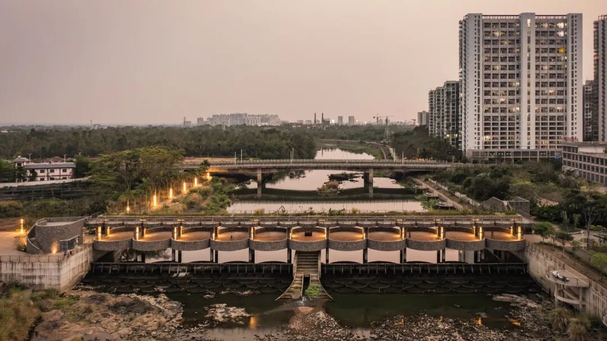
▲闸坝与城市环境全景  © 夏至 / Xia Zhi
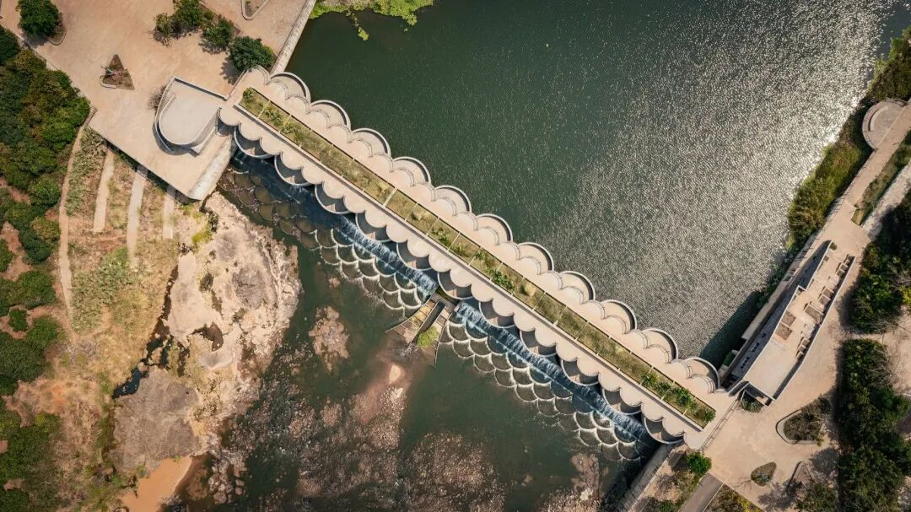
▲百仞滩闸坝全景  © 夏至 / Xia Zhi
重解水坝
文澜江穿越海南临高县，给海岛小镇带来充沛淡水，伴随而来的汛期水患影响着人们生活。位于下游的百仞滩河道蜿蜒，岩层跌宕，激流穿越层叠石滩形成连续的瀑布景观，“百仞听涛”自古便是当地著名的历史景观。随着城市逐渐向河流两岸生长，西岸形成了密集的居民社区，东岸则保留着百仞滩自然保护区。两者隔河相望，空间距离很近，却需要绕行才能抵达，日常生活与自然景观之间始终缺少真正的联系。
上世纪90年代起，这里便建有简易滚水坝以调蓄江水，解决文澜江的洪涝灾害，但因滚水坝阻水，导致防洪效果不佳。随着百仞滩周边的住区快速建设和人口增长，为保护临高县城的防洪安全，确保当地可持续的建设发展，新一轮的闸坝改造工程日益迫切，政府提出了更高的诉求，能否在治水的同时有所提升。设计团队的策划得到政府认可：打造一个能够连接两岸的公共景观空间，使百仞滩重新进入居民的日常生活。
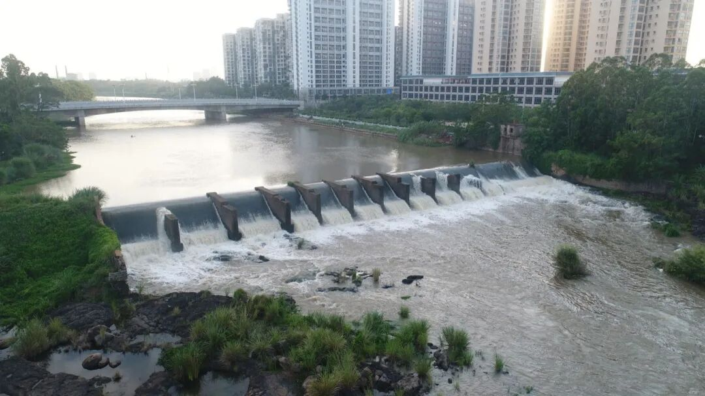
▲改造前的滚水坝  © 夏至 / Xia Zhi
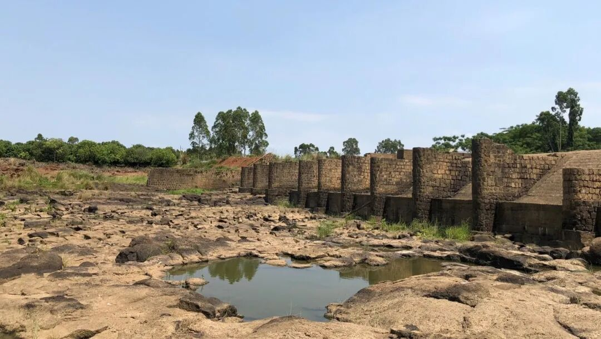
▲改造前的滚水坝  © 夏至 / Xia Zhi
桥亭空间
设计研究从这样一个朴素的问题开始：人们为何愿意在水边停留？
传统绘画中的桥、亭、水榭和廊桥，常常同时承担着跨越、停留、观景和纳凉的作用。清代金农册页中的题句“风来四面卧当中”，尤其生动地描绘了人在水上空间中四面受风、临水休憩的状态。这些图像与题句并不是现代意义上的热环境测量，却记录了长期生活经验的智慧：临水、架空、遮阴和四面通风，可以共同营造宜人的停留空间。
从这个意义上说，桥亭既是一种人文原型，也是一种环境原型。它将跨越与停留结合在一起，让看水、听水、交往和休憩自然发生；同时借助临水、遮阴与通风，为户外生活提供舒适的空间条件。百仞滩的设计延续了这种人与水相处的经验。设计关注的并非传统水榭或廊桥的具体形式，而是其中人与水相处的空间关系。
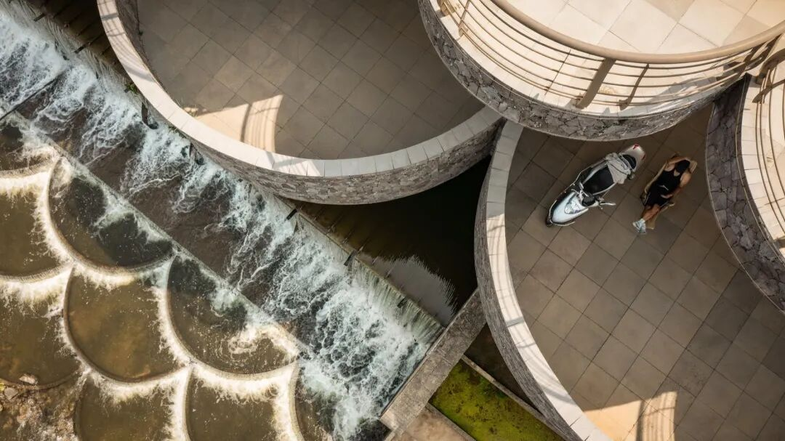
▲听涛午休  © 夏至 / Xia Zhi
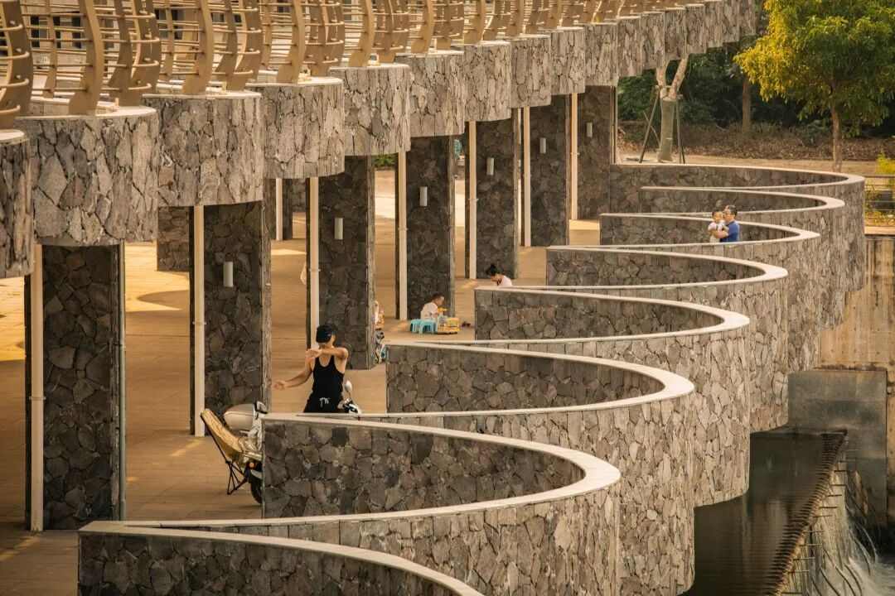
▲出挑平台上居民休闲的日常  © 夏至 / Xia Zhi
水流秩序
原有的百仞滩滚水坝自身已经显示出一种清晰的水流秩序：天然岩层沿河床垂直跌落，水流穿越不同高程的石滩，在跌落、缓流和再次汇集之间不断变化。新的闸坝同样需要面对这一河段3米多的高程落差，以及蓄水、泄洪和水位控制的工程要求。3米的高差对于一处瀑布景观并不算巨大，对于需要沿河道洄游的鱼类，却是难以跨越的阻隔。如何把一次集中的高差转化为连续而温和的水位变化，因此不仅是水利工程的问题，也关系到河流生态的连续性。
中国传统河道治理中积累了许多顺应水势的办法，其中，鱼鳞坝提供了一种十分朴素的思路，以层层错动的阶梯将高差逐级分解，水流在一系列低坝之间跌落、停蓄，再继续向下游流动，分散水流冲击力，降低洪水对下游的破坏。鱼鳞坝形成的缓流促进了水体的自净，浅水环境为水生生物提供更多栖息条件。鱼鳞台阶在旱季成为蓄水池，可用于农田灌溉、浣纱洗衣、日常汲水，泽被百姓，
因此鱼鳞坝周边有百态，有人情，烟火常聚。因此，这种传统智慧同时具有工程、生态与生活三个层面的意义。
2020年，素朴工作室在福建犀溪镇西浦村的设计中，团队已经尝试借鉴鱼鳞坝的层叠关系，处理山地地形中大高差挡墙和地表径流、蓄水和日常使用场景之间的互动。虽然虽然当年的项目设计的场景未能实施，但这种将工程问题转化为空间关系的方法被保留下来。此次面对百仞滩的坝体更新，建筑团队与海南省水利院的水利工程师不约而同地再次想到鱼鳞坝。
结合河道条件，采用鱼鳞台阶式的水流组织，并以气盾坝进行水位控制。层层展开的鱼鳞台阶使水流在高差中逐级缓降，释放势能，与原来的滚水坝相比，对生态鱼群友好，同时水流阻力也更小，防洪抗涝能力更好。气盾坝则通过充气抬闸蓄水、排气落闸放水，在不同工况下完成蓄泄调节。
新的水工体系由此形成了一套关于高程、方向和层次的几何秩序。天然石滩层层展开，传统鱼鳞坝顺应水势逐级跌落，新的水工设施又以更加精确的工程方式延续这种关系。水从上游到下游的过程，既完成了水位与高差的控制，也形成一段可以被观看和感知的连续水景。
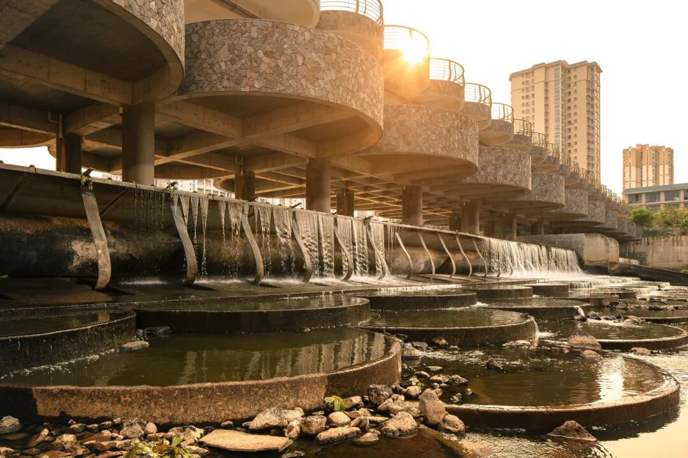
▲气盾坝开始放水  © 夏至 / Xia Zhi
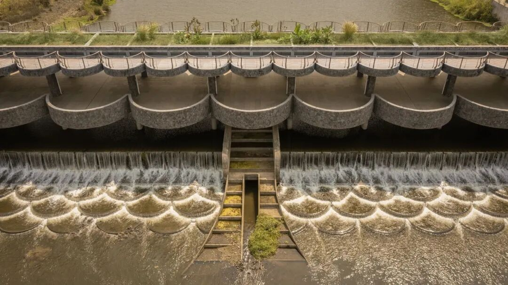
▲闸坝北侧日景  © 夏至 / Xia Zhi
现场层叠的石滩与鱼鳞坝的水工智慧，也使设计团队意识到，建筑可以沿着同一套秩序继续展开。水流在不同高程间逐级跌落，层叠消解高差；建筑空间则沿着这种层叠关系组织日常的行走、停留和观看。桥梁、平台和屋顶由此沿着层叠、错动和展开的关系向两岸延伸；鱼鳞台阶形成的节奏进入桥面的组织。跌水的层次成为人在桥上不断感知的背景，人在行进中不断接近水、观看水，并听见脚下水流的变化。源于传统水上空间中人与水的亲近关系，将水工设施中的工程尺度，转化为与人的身体相关的日常空间。
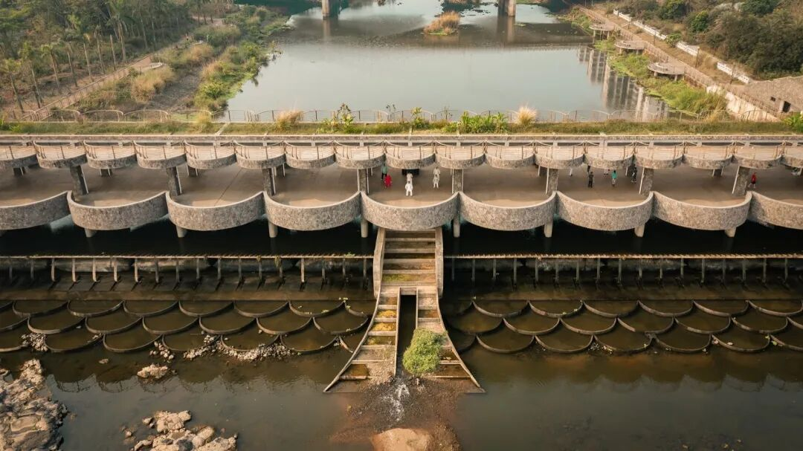
▲闸坝廊桥整体环境  © 夏至 / Xia Zhi
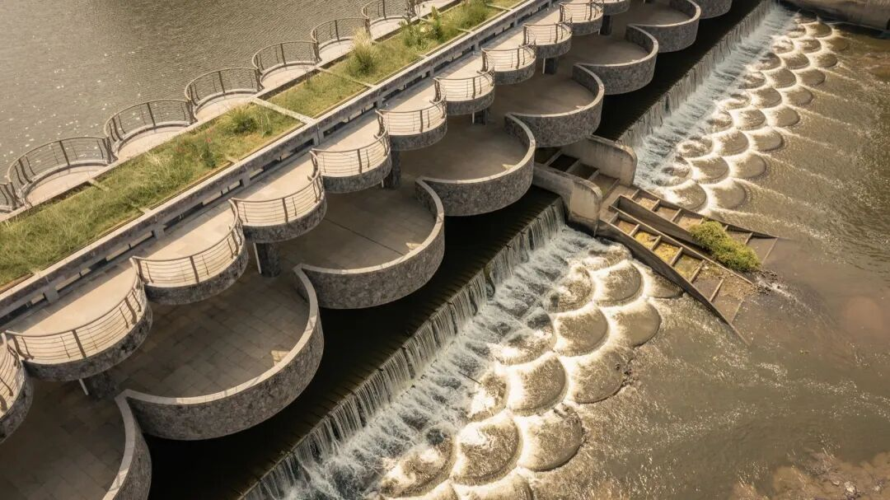
▲日景放水听涛  © 夏至 / Xia Zhi
工程与人
伴随闸坝修建的跨河连桥，将文澜江两岸重新连接起来。西岸是居民社区，东岸是百仞滩自然保护区。过去需要绕行才能抵达的自然景区，如今进入了居民日常步行的范围。从社区出发，穿过河流，便可以直接进入河滩、树林与水岸。基础设施改变了两岸的空间距离，也改变了自然进入城市生活的方式。桥面进一步将这种连接转化为可以停留的空间，沿着桥梁行走，两侧边界不断展开和收拢，形成一系列大小不同的曲边平台，延续着鱼鳞台阶层层错动的几何关系，也使一条线性的跨河路径产生了不同的宽度和节奏。
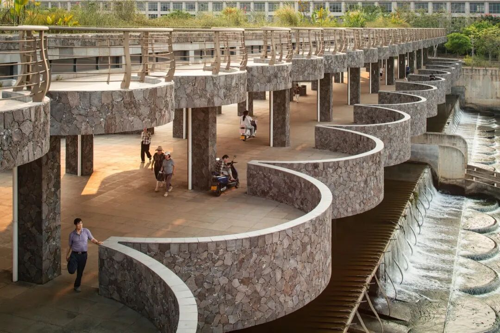
▲闸坝廊桥上居民休闲的日常  © 夏至 / Xia Zhi
这些散布在水面上的小尺度空间，可以被理解为一组当代的“桥亭”，人在其中临水而坐，既保持与主要路径的联系，又获得相对明确的停留领域，并不依赖明确的功能划分，而是给日常生活留下了足够的余地，人可以根据天气、时间和活动方式选择不同的位置。有些位置临近跌水，水声成为空间最直接的背景；有些平台面向开阔的河面，可以远眺上下游；还有一些尺度更小，与主要通行路径保持适当距离，自然形成可以坐下、倚靠和停留休憩的角落。人的行动也因此获得了不同的速度，从通过，到放慢脚步，再到停下来观看河流。水坝两端的控制机房也被纳入这一连续的空间系统。西岸结合居民社区设置滨水水吧、景观台阶和观景平台，形成社区进入河流的第一个节点；东岸则通过广场和步道继续连接百仞滩自然保护区。于是，从社区到河流、从桥梁到自然保护区，一段原本由不同工程设施组成的路径逐渐成为连续的公共空间。
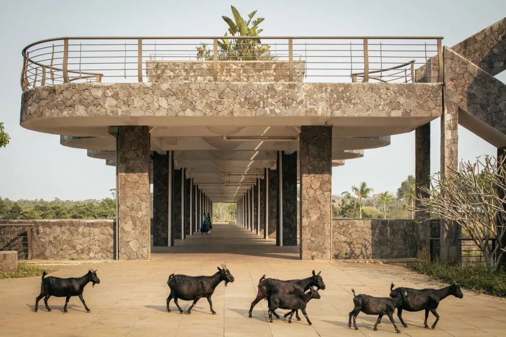
▲西岸桥头  © 夏至 / Xia Zhi
材料和细部进一步将工程尺度拉近到人的尺度。主体结构采用钢筋混凝土，以满足水工设施的耐久要求；在栏板、柱体等人与建筑近距离接触的位置，则使用当地建筑常用的火山岩石板。火山岩粗粝的质感与百仞滩层叠的自然河滩形成呼应，也使人在倚靠、触摸和停留时获得更接近身体尺度的材料感受。
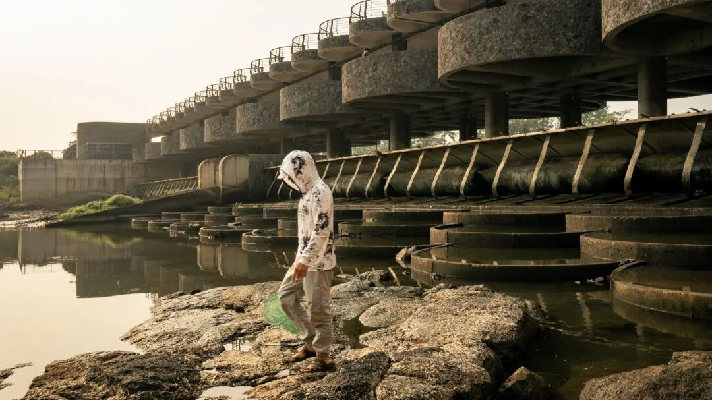
▲蓄水期间百仞石滩与钓鱼者  © 夏至 / Xia Zhi
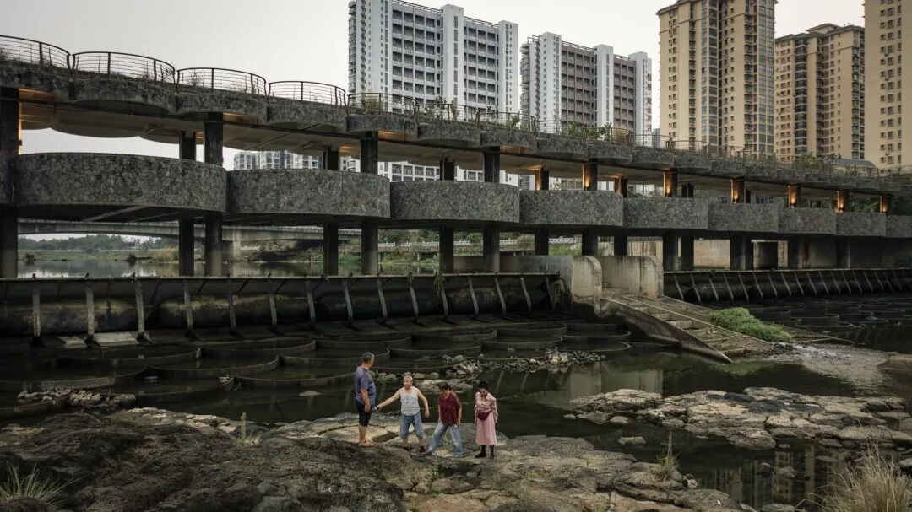
▲居民体验百仞石滩  © 夏至 / Xia Zhi
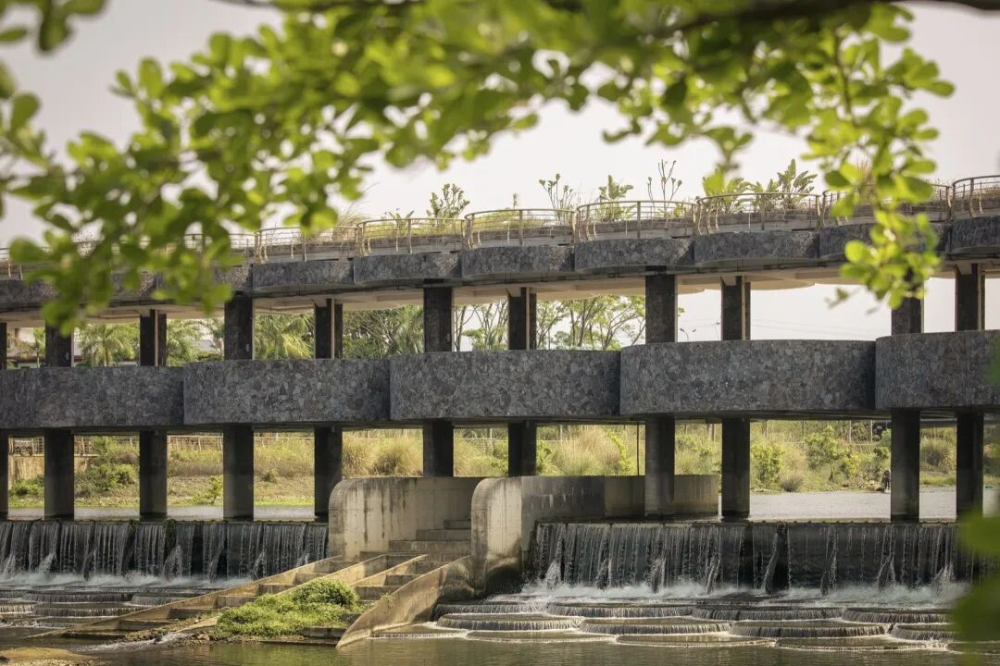
▲北岸回望闸坝放水  © 夏至 / Xia Zhi
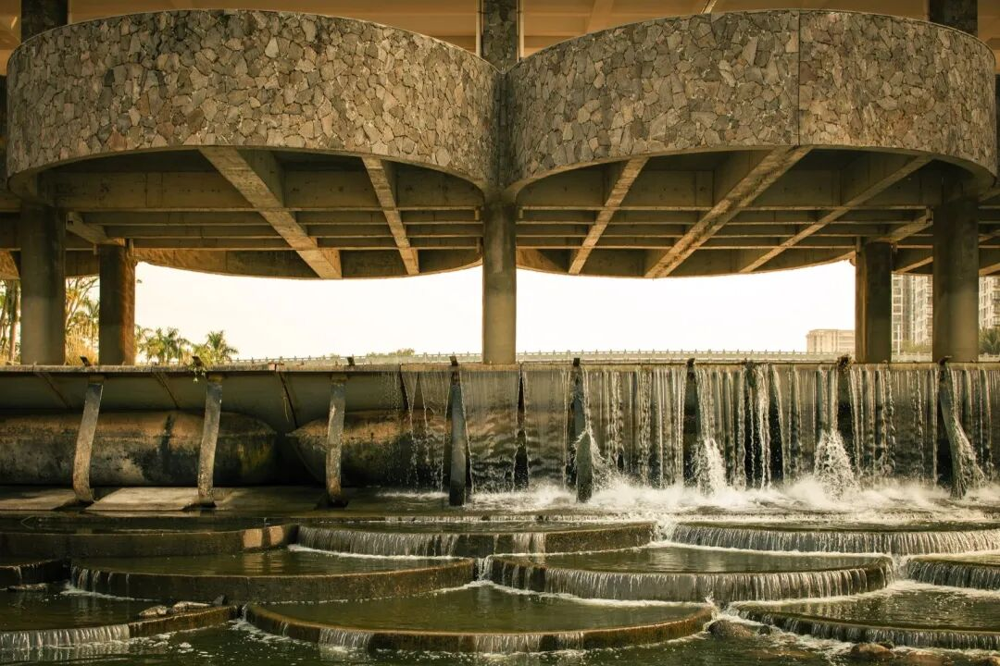
▲闸坝放水- 百仞听涛  © 夏至 / Xia Zhi
气候响应
在海南炎热、多雨的热湿气候中，真正决定一个室外空间能否被持续、自发使用的，是人在其中能否舒适地停留下来。强烈的太阳辐射、频繁的降雨和较高的空气湿度，使遮阳和避雨成为公共活动最基本的条件；与此同时，开阔的河面和持续流动的水体，也为半户外空间提供了独特的环境条件。桥上的风雨廊由此形成了一种“水上凉亭”的状态，延续传统临水空间中临水、受风、遮阴、可停留的环境经验。水流经过鱼鳞台阶层层跌落，持续流动的跌水扩大了水与空气的接触，蒸发过程带走热量；开阔的河面又形成连续的通风界面，空气沿着河道和水面流动。人在桥上感受到的，因而不仅是屋顶形成的阴影，还有流水、蒸发和风共同作用下形成的微气候。
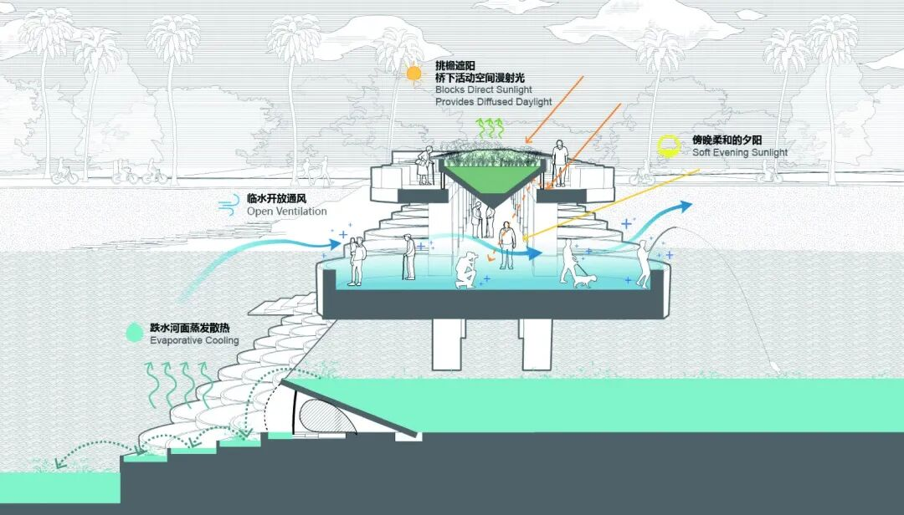
▲气候响应策略  © 素朴工作室 / SUP Atelier
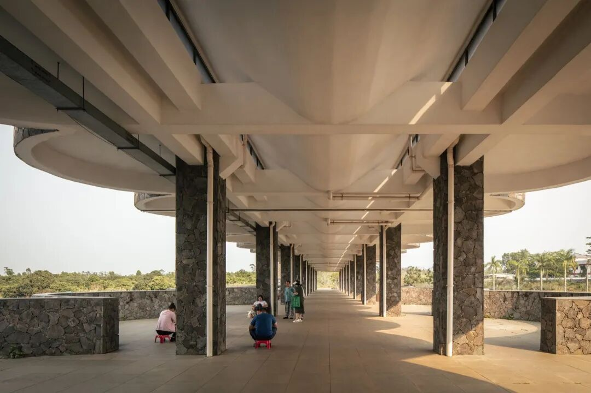
▲连桥内的日常  © 夏至 / Xia Zhi
沿桥连续展开的风雨廊，为日常通行和停留提供遮阳与避雨。较浅的屋面进深使主要活动区域获得必要的遮蔽，同时保留两侧朝向河流和天空的开放界面，让光线和空气能够持续进入。正午时，屋顶的剖面构造削弱强烈的直射光；傍晚，柔和的光线进入廊下并洒向水面，空间由遮蔽转向更加开放而轻松的状态。雨天，人们仍可以和平常一样在屋檐下散步、聊天，或者停下来观景看水。
屋顶本身也被转化为公共空间。层叠的屋面被抬升为一条可步行的观景平台，结构中形成的V形区域成为连续的种植槽。首层贴近水面，人在阴影中可以直接感受到风、水声和跌水的变化；登上屋顶，视线越过桥面，百仞滩和两岸景观随之展开。阴影、水流、风、光线和人的活动被组织在同一个空间之中，人在廊下行走和停留，脚下是不断变化的跌水，侧面是开敞的河道，环境条件本身也成为公共空间体验的一部分。
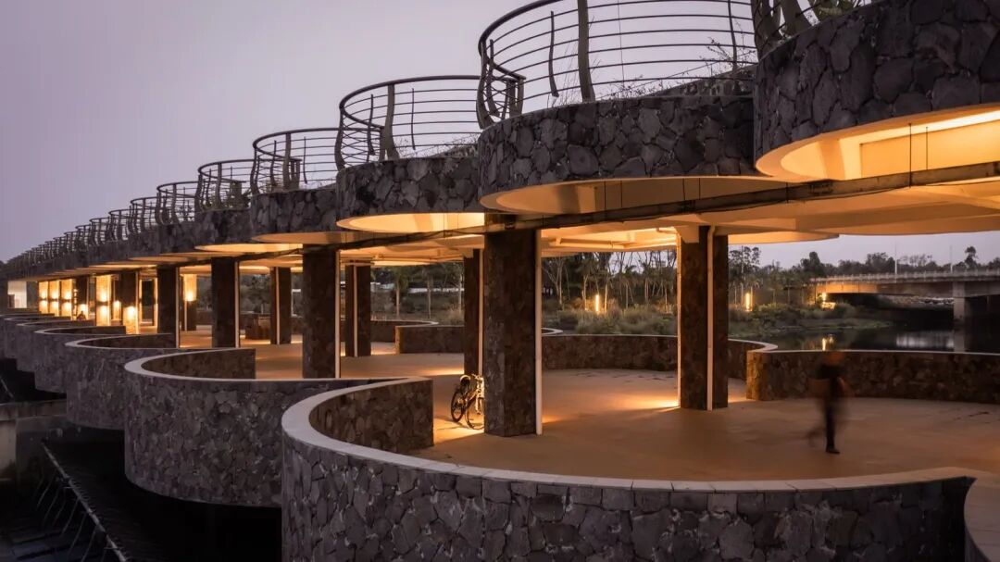
▲傍晚的廊桥  © 夏至 / Xia Zhi
回归日常
项目建成以后，许多设计之初没有被明确规定的活动开始自然出现。清晨和傍晚，人们沿着桥梁散步、锻炼；有人在平台上练太极、跳舞，有人靠着栏杆聊天、观水；钓鱼的人会长时间占据靠近水面的角落，也有人只是经过这里时停下来听一会儿水声。遮蔽下的平台在晴天提供阴凉，在雨天仍然可以使用，桥梁也因此在不同天气和一天中的不同时段保持着持续的活力。原本以通行为目的的空间，逐渐积累起具体而日常的生活。水利工程首先解决水患的问题，面向城市生活的基础设施则沿着这一秩序继续展开，将工程尺度转化为近人的空间与构造，并结合当地热湿气候，形成舒适的半户外环境。公共生活也由此自然生长。
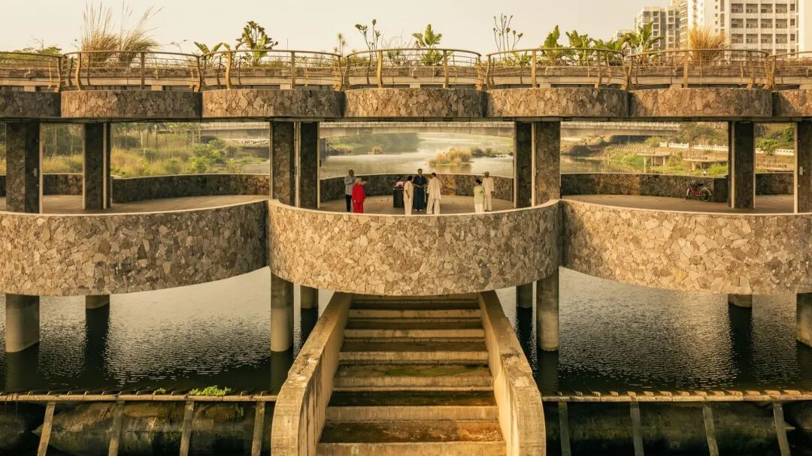
▲闸坝廊桥上居民休闲的日常  © 夏至 / Xia Zhi
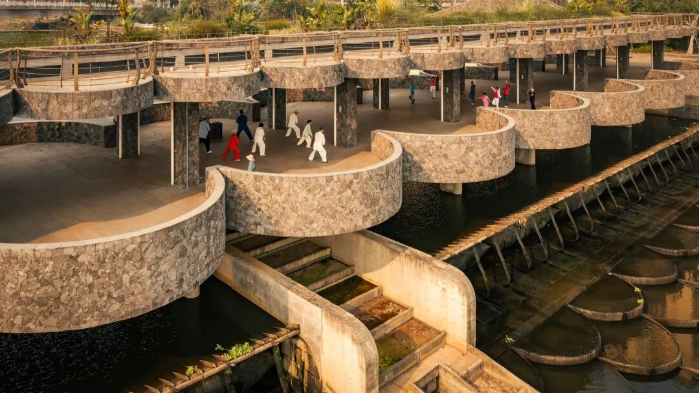
▲闸坝廊桥上居民休闲的日常  © 夏至 / Xia Zhi
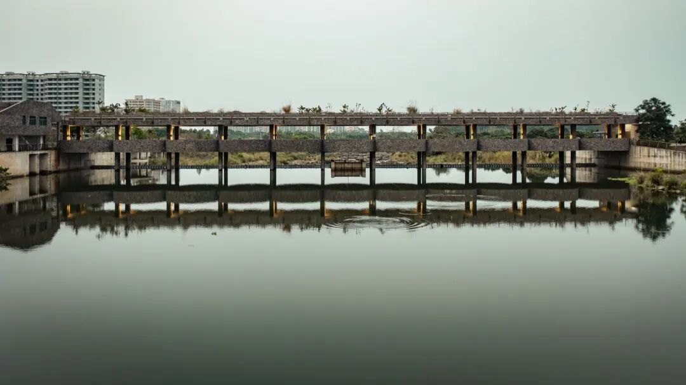
▲闸坝南侧  © 夏至 / Xia Zhi
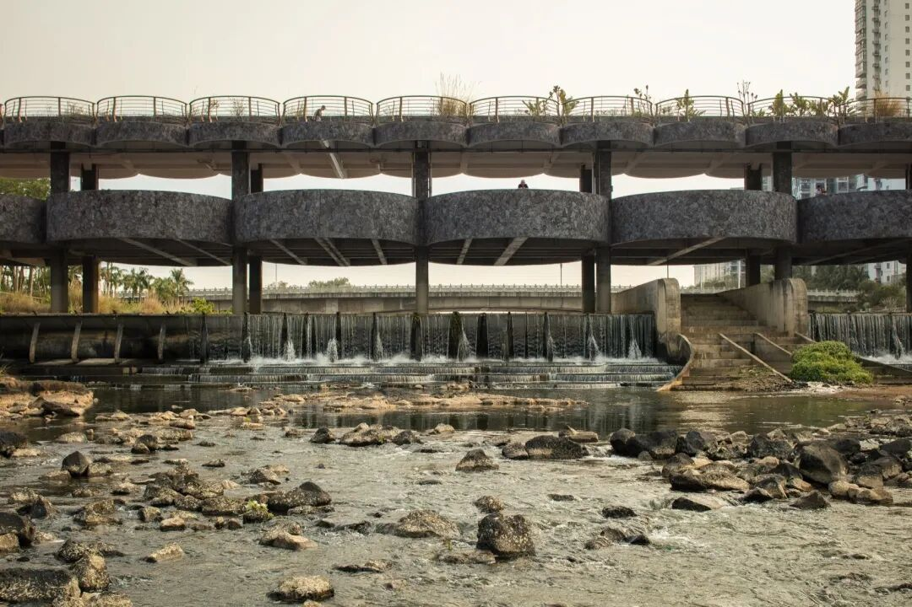
▲石滩上的闸坝  © 夏至 / Xia Zhi
对于我们而言，这项实践真正关注的，并非如何赋予础设施更多功能，而是在工程、环境与日常生活之间重新建立一种空间关系。这座闸坝依然承担着水位控制、防洪调蓄和跨河交通的职责，但当人们在桥上停留、听涛、散步、种植、观鸟，甚至只是每天经过这里时，基础设施便不再只是控制自然的装置，而成为人与自然重新相遇的场所。从天然石滩到鱼鳞跌水，从水坝到桥梁，再到散布于水面上的“桥亭”，
基础设施便不再只是控制自然的装置，而是重新成为人与自然相遇的场所，延续持续千年的人与自然的朴素情感。人重新走到水边，也重新在水上停留下来。
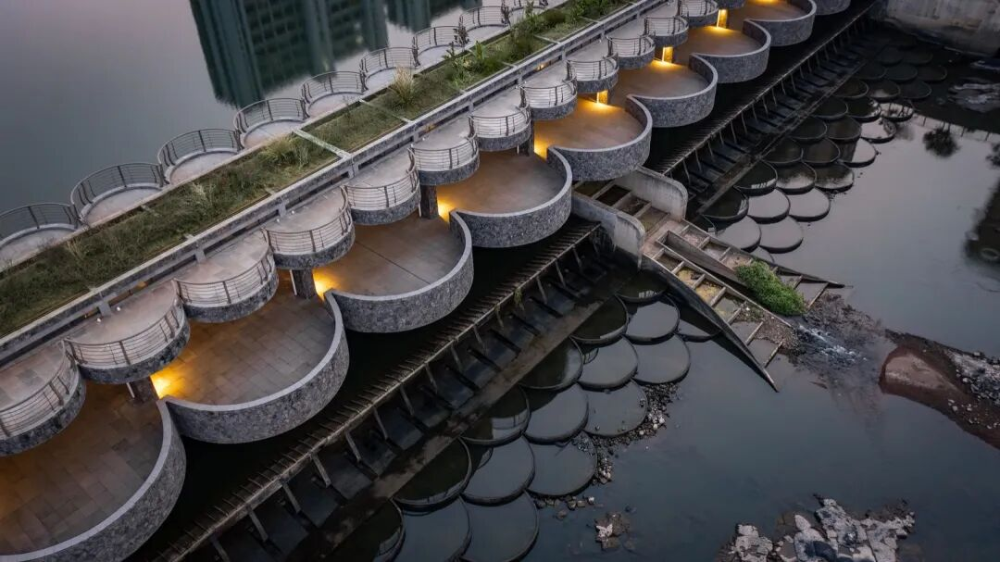
▲闸坝蓄水夜景  © 夏至 / Xia Zhi
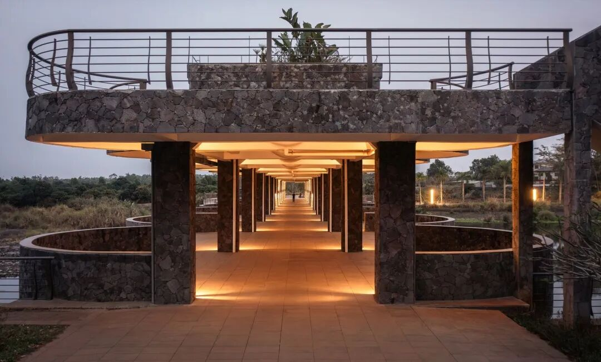
▲傍晚的闸坝桥口  © 夏至 / Xia Zhi
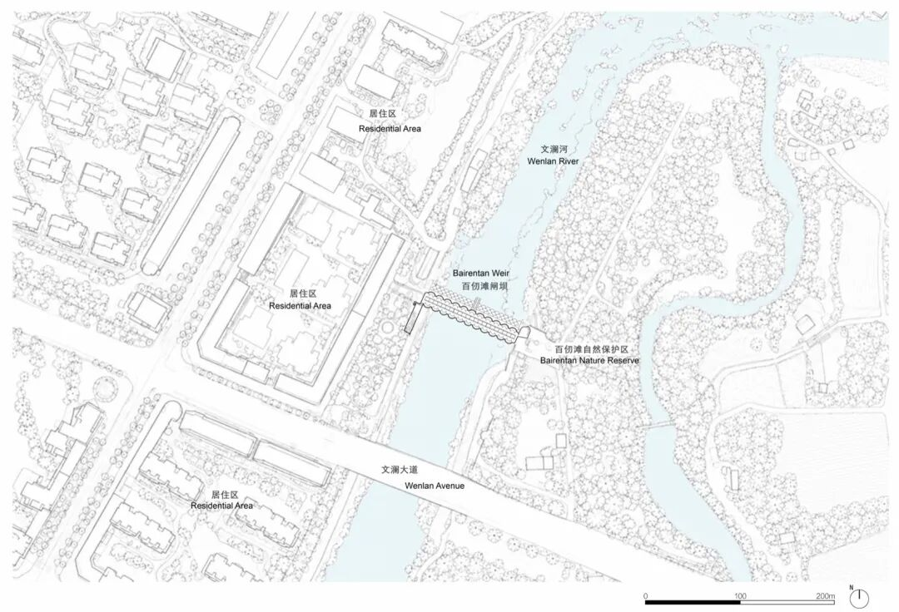
▲总平面图  © 素朴工作室 / SUP Atelier
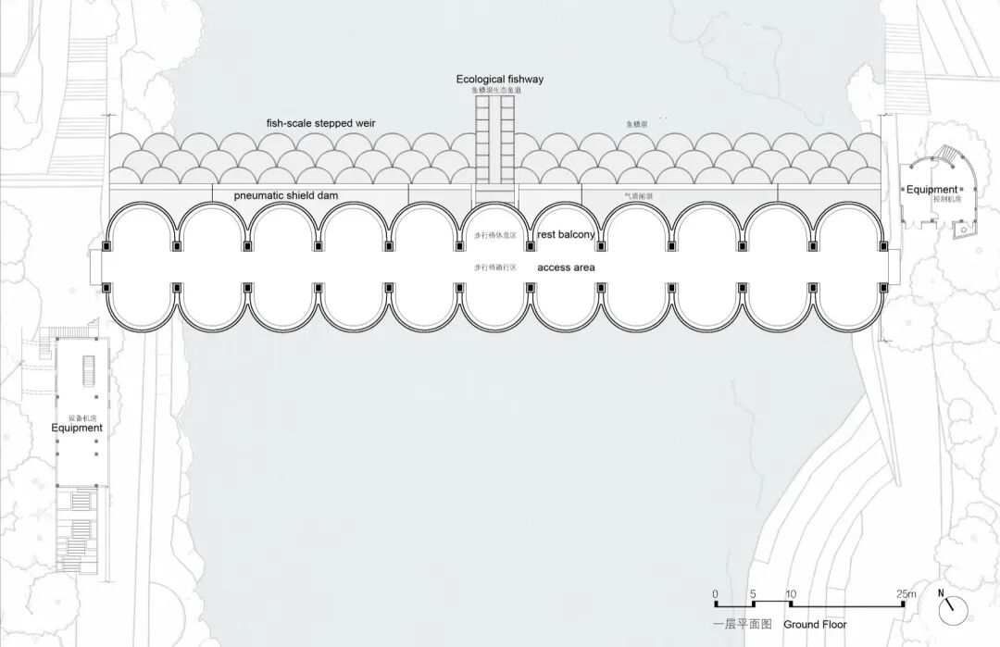
▲一层平面图  © 素朴工作室 / SUP Atelier
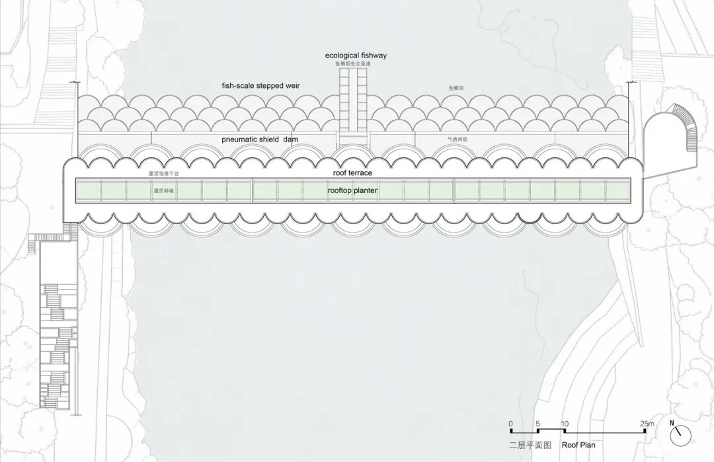
▲二层平面图  © 素朴工作室 / SUP Atelier
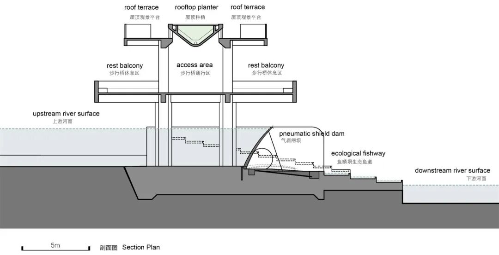
▲剖面图  © 素朴工作室 / SUP Atelier
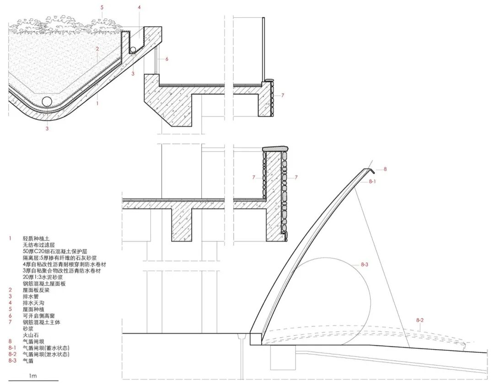
▲构造详图  © 素朴工作室 / SUP Atelier
项目名称：临高百仞滩闸坝改造项目
项目地点：海南省临高县
业主单位： 临高县水务项目建设管理中心
建筑及景观整体设计：清华大学建筑设计研究院有限公司素朴工作室
主创建筑师：宋晔皓、孙菁芬
设计团队：马诗瑜（实习），高唯芷，Veldesen Yaputra（实习）
水利工程设计：海南省水利水电勘测设计研究院（李强，郑昌业，王梦宇）
结构与机电设计：海南省水利水电勘测设计研究院（叶宏清，林梦龙，李伟）
施工单位：海南新坐标建筑工程有限公司
方案设计时间：2021.01-2021.04
工程设计时间：2021.06-2021.12
竣工时间：2024.05.31
基地面积: 10360m2
建筑面积：3500m2
结构形式：钢筋混凝土框架结构
摄影：夏至
版权©www.gooood.cn，欢迎转发，  禁止以gooood编辑版本进行任何形式转载

↓  网站最新发布项目一览
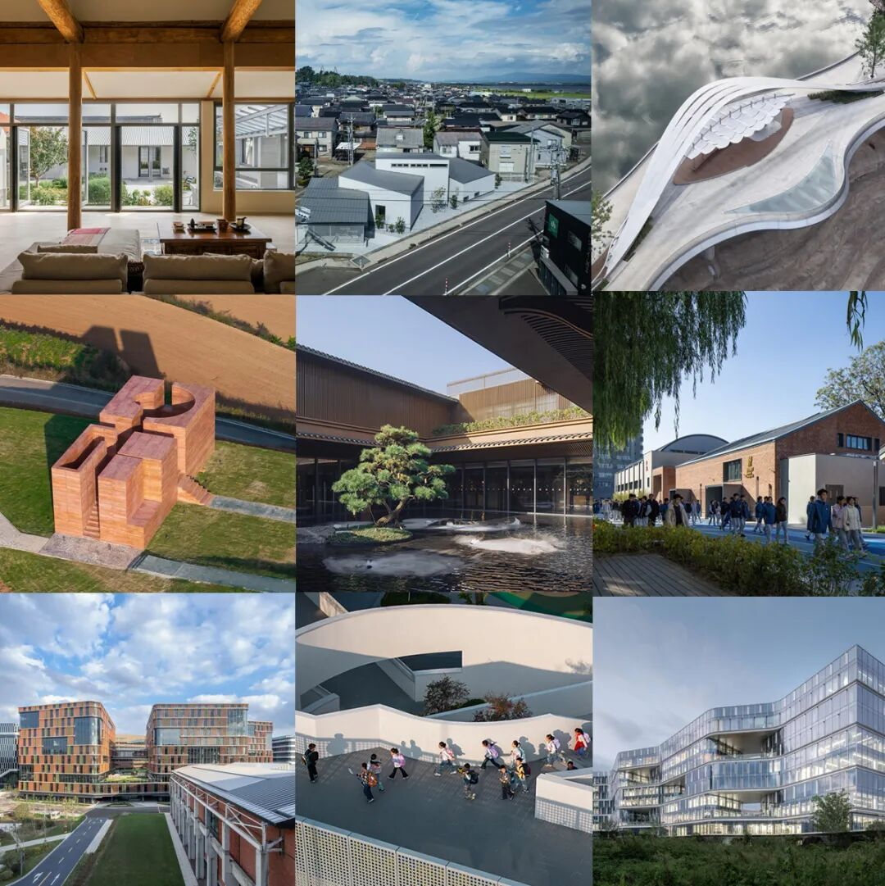
猛击“阅读原文”，进入网站畅享更多精彩

